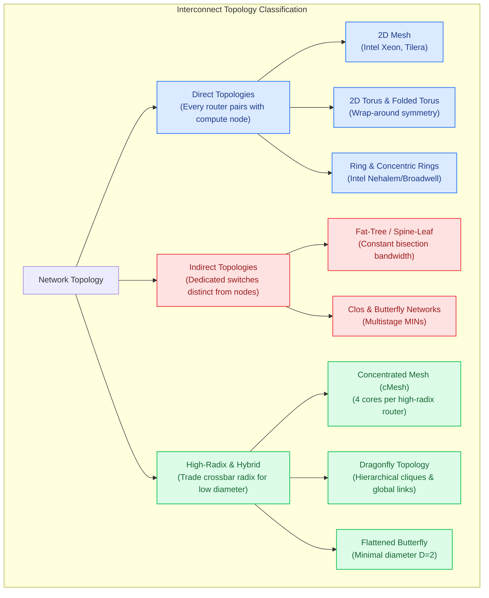

# Track 3: Topologies & Interconnect Metrics

  
Network Architecture • Module 03

  <h1>Interconnect Topologies &amp; Quantitative Performance Metrics</h1>
  

    Master the spatial roadmap of silicon chips. Explore how routers and processing elements are physically and logically wired to maximize bisection bandwidth, minimize hop diameter, and conquer the physical layout constraints of 2D and 3D silicon.
  

  

    ⏱️ 4 In-Depth Lessons
    🔬 4 Interactive Calculators &amp; Simulators
    📐 Rigorous Mathematical Derivations
    🎯 Self-Assessment Quizzes
  

---

## 🗺️ Topological Taxonomy & Learning Roadmap

The diagram below categorizes on-chip and system-level interconnect topologies by their architectural structure:

---

## 📚 Syllabus & Chapters in Track 3

  

    

      Lesson 3.1
      
Direct Topologies: Mesh, Torus &amp; Folded Torus

      

        Mathematical foundations of planar networks. Derive node degree, diameter, average hop count ($H_{avg} = \frac{2}{3}\sqrt{N}$), and bisection bandwidth ($B_b = 2\sqrt{N} \cdot w$). Solve the long wrap-around wire crisis using the Folded Torus layout.
      

      

        ⚡ <strong>Features:</strong> Interactive Mesh vs. Torus Topology Explorer &amp; Shortest-Path Visualizer, Self-Check Quiz.
      

    

    <a href="01-direct-topologies/" class="noc-track-link">Launch Lesson 3.1 →</a>
  

  

    

      Lesson 3.2
      
Indirect &amp; Concentrated Networks (Fat-Tree &amp; cMesh)

      

        Separate switching elements from compute nodes. Explore Multistage Interconnection Networks (MINs), Clos networks, and Balfour &amp; Dally's Concentrated Mesh (cMesh), reducing router count by 75% and halving network diameter.
      

      

        ⚡ <strong>Features:</strong> Interactive 64-Core Mesh vs. cMesh Area &amp; Latency Calculator, Self-Check Quiz.
      

    

    <a href="02-indirect-hierarchical/" class="noc-track-link">Launch Lesson 3.2 →</a>
  

  

    

      Lesson 3.3
      
Interconnect Metrics &amp; Benchmark Traffic Patterns

      

        Formal mathematical modeling of Zero-Load Latency ($T_0$), Saturation Throughput ($\Theta_{sat}$), and Bisection Channel Load ($\gamma_{max}$). Benchmark networks under Uniform Random, Bit-Complement, Transpose, Tornado, and Rentian traffic locality.
      

      

        ⚡ <strong>Features:</strong> Interactive Synthetic Traffic &amp; Bisection Stress Visualizer, Bit-Complement proof, Self-Check Quiz.
      

    

    <a href="03-metrics-traffic-patterns/" class="noc-track-link">Launch Lesson 3.3 →</a>
  

  

    

      Lesson 3.4
      
High-Radix Topologies: Dragonfly &amp; Flattened Butterfly

      

        The high-radix revolution (Kim, Dally et al.). Trading crossbar radix for ultra-low diameter ($D \le 3$). Explore the Flattened Butterfly, Dragonfly hierarchical groups, Cray Slingshot, and NVIDIA NVLink NVSwitch architectures.
      

      

        ⚡ <strong>Features:</strong> Interactive High-Radix vs. Low-Radix Trade-off Explorer, Slingshot case study, Self-Check Quiz.
      

    

    <a href="04-high-radix-topologies/" class="noc-track-link">Launch Lesson 3.4 →</a>
  

---

## 🎯 Track Learning Objectives

Upon completing Track 3, you will be able to:

1. **Calculate network metrics rigorously** for any $k$-ary $n$-cube topology: node degree, diameter, bisection bandwidth, and average hop distance.
2. **Apply the Folded Torus layout** to eliminate global wrap-around wires, equalizing all inter-router link lengths on a planar die.
3. **Dimension Concentrated Meshes (cMesh)** to balance router radix complexity against network hop count and wire density.
4. **Evaluate throughput limits under benchmark traffic patterns** (Uniform Random, Bit-Complement, Transpose, Tornado) and identify the bottleneck bisection channels.
5. **Architect High-Radix topologies** (Flattened Butterfly and Dragonfly) to compress network diameter down to 2–3 hops for exascale AI and server fabrics.

Ready to begin? Start with **[Lesson 3.1: Direct Topologies (Mesh & Torus)](01-direct-topologies.md)**.
