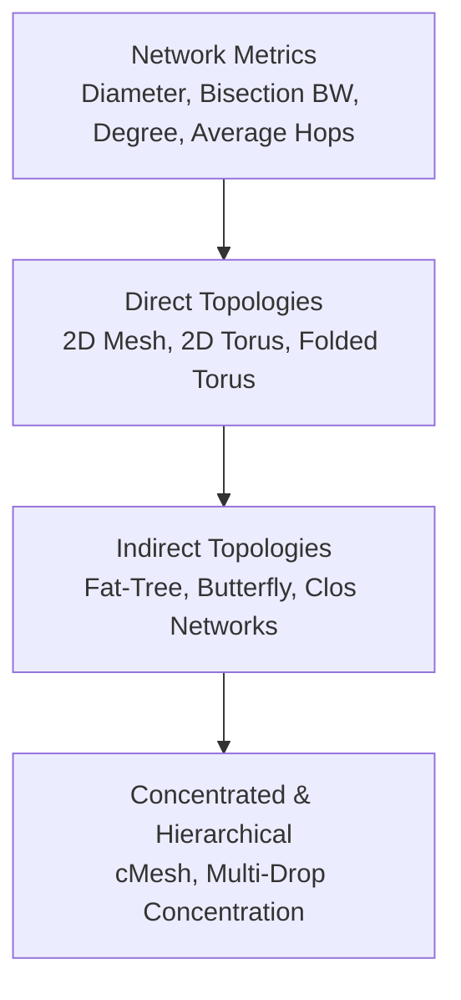

# Track 3: Topologies & Interconnect Metrics

The network topology defines the roadmap of the chip—how routers and processing tiles are physically and logically interconnected. The topology dictates the network's maximum throughput, zero-load latency, path diversity, and physical wiring complexity.

---

## 🗺️ Track Roadmap

---

## 📖 Lessons in this Track

1. **[3.1 Direct Topologies (Mesh & Torus)](01-direct-topologies.md)**  
   The mathematical foundations of 2D Mesh and 2D Torus networks. Deriving network diameter, average hop count, bisection bandwidth, and the folded torus layout to eliminate long wrap-around wires.
2. **[3.2 Indirect & Concentrated Networks](02-indirect-hierarchical.md)**  
   When to use indirect networks (switches distinct from endpoints). Multistage Interconnection Networks (MINs), Fat-Trees, and Concentrated Mesh (cMesh) architectures.
