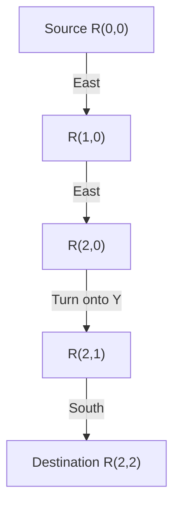
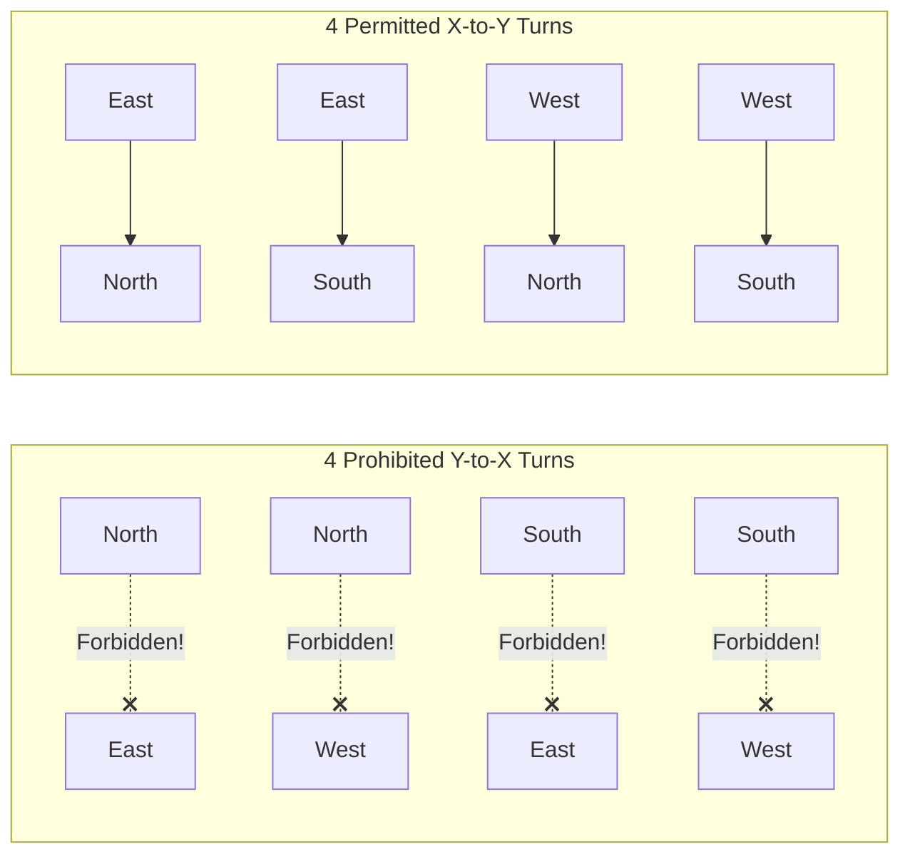

# 4.1 Deterministic Dimension-Order Routing (DOR)

Deterministic routing algorithms choose a single, fixed path for any source-destination pair, regardless of current network congestion or buffer loads.

The most famous and widely deployed deterministic algorithm in silicon NoCs is **Dimension-Order Routing (DOR)**, commonly known as **XY Routing**.

---

## 1. Algorithmic Logic of XY Routing

In a 2D mesh, every router has coordinate $(x_{curr}, y_{curr})$ and every packet contains destination coordinate $(x_{dest}, y_{dest})$.

In XY Routing, the packet strictly traverses the **horizontal dimension ($X$) first** until it reaches the destination column, and then traverses the **vertical dimension ($Y$)** to reach the target row:

```verilog
// Verilog Pseudocode: Combinational Route Computation (RC)
always_comb begin
    if (x_curr < x_dest)
        out_port = PORT_EAST;
    else if (x_curr > x_dest)
        out_port = PORT_WEST;
    else if (y_curr < y_dest)
        out_port = PORT_SOUTH;
    else if (y_curr > y_dest)
        out_port = PORT_NORTH;
    else
        out_port = PORT_LOCAL;
end
```



---

## 2. Why is XY Routing Deadlock-Free?

In a 2D mesh, a packet can potentially make **8 distinct turns** between orthogonal directions:
- **X-to-Y Turns**: $\text{East} \rightarrow \text{North}$, $\text{East} \rightarrow \text{South}$, $\text{West} \rightarrow \text{North}$, $\text{West} \rightarrow \text{South}$.
- **Y-to-X Turns**: $\text{North} \rightarrow \text{East}$, $\text{North} \rightarrow \text{West}$, $\text{South} \rightarrow \text{East}$, $\text{South} \rightarrow \text{West}$.

A routing deadlock requires a **closed cycle of buffer dependencies** (e.g., East $\rightarrow$ South $\rightarrow$ West $\rightarrow$ North $\rightarrow$ East).



By strictly requiring packets to finish all $X$ hops before beginning any $Y$ hops, **XY Routing completely forbids all four Y-to-X turns!**

Without any Y-to-X turns:
- A packet can transition from $X \rightarrow Y$.
- But once in dimension $Y$, it can **never** turn back into dimension $X$.
- Therefore, a closed dependency cycle can **never** form. Deadlock is mathematically impossible!

---

## 3. Advantages and Bottlenecks of XY Routing

### Advantages:
1. **Zero State & Tiny Area**: The router hardware needs only 4 integer comparators and a multiplexer. The logic computes in less than 50 picoseconds.
2. **In-Order Packet Delivery**: For a given source-destination flow, all packets take the identical path. Flits always arrive in order, eliminating expensive packet reordering buffers at the destination network interface.
3. **Provably Deadlock-Free**: No extra virtual channels or complex recovery logic needed.

### Bottlenecks:
1. **Zero Adaptivity to Congestion**: If an intermediate router along the XY path is under heavy congestion, incoming packets must sit and wait in line, even if an adjacent parallel path is completely empty!
2. **Zero Fault Tolerance**: If a single router or link along the XY path fails (e.g., due to electromigration or thermal breakdown), all communication across that route dies permanently.

To solve these limitations, architects developed **Adaptive Routing**, which we explore in [4.2 Adaptive Routing & The Turn Model](02-adaptive-turn-model.md).
