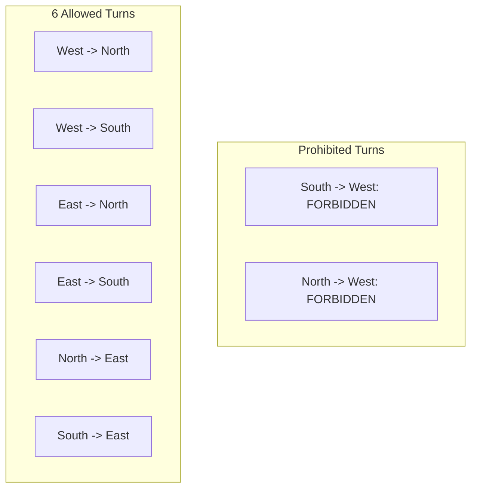

# 4.2 Adaptive Routing & The Turn Model

Deterministic XY routing prevents deadlock by strictly outlawing 4 out of the 8 possible turns. But is it necessary to eliminate so many turns?

In 1994, Christopher J. Glass and Lionel M. Ni proved that **prohibiting just TWO turns is sufficient to break all cycles**, unlocking significant path diversity without requiring virtual channels. This methodology is called **The Turn Model**.

---

## 1. The Anatomy of Cycles

In a 2D mesh, any simple closed loop contains 4 turns in a plane:
- **Clockwise (CW) Cycle**: $\text{North} \rightarrow \text{East} \rightarrow \text{South} \rightarrow \text{West} \rightarrow \text{North}$
- **Counter-Clockwise (CCW) Cycle**: $\text{North} \rightarrow \text{West} \rightarrow \text{South} \rightarrow \text{East} \rightarrow \text{North}$

```
CW Cycle Turns:                 CCW Cycle Turns:
1. North -> East                1. North -> West
2. East -> South                2. West -> South
3. South -> West                3. South -> East
4. West -> North                4. East -> North
```

To prevent deadlocks, we must break **both the clockwise and counter-clockwise cycles**.
- XY routing prohibits 4 turns (2 CW and 2 CCW), leaving only 4 turns allowed.
- The Turn Model observes: **We only need to prohibit ONE turn from the CW cycle and ONE turn from the CCW cycle!**
- This leaves **6 out of 8 turns permitted** ($75\%$ flexibility instead of $50\%$).

---

## 2. The West-First Routing Algorithm

In the **West-First** algorithm, the two prohibited turns are:
1. $\text{South} \rightarrow \text{West}$ (breaks CW cycle)
2. $\text{North} \rightarrow \text{West}$ (breaks CCW cycle)



### Routing Rule:
> **"If the packet's destination is West of the current node ($x_{dest} < x_{curr}$), it MUST route West immediately before making any other turn!"**

Once the packet turns North or South, it is strictly forbidden from ever turning West again.
- **Heading West**: Fully deterministic (must take West hops first).
- **Heading East**: **Fully adaptive!** The packet can adaptively interleave East, North, and South hops around congested routers or thermal hotspots.

---

## 3. The Odd-Even Turn Model

While West-First provides adaptivity towards the East, it provides zero adaptivity when traveling West.

In 2000, Ge-Ming Chiu proposed the **Odd-Even Turn Model**, which distributes turn restrictions across even and odd columns:
- **Even Columns ($X \pmod 2 = 0$)**: Packets are prohibited from making $\text{East} \rightarrow \text{North}$ and $\text{East} \rightarrow \text{South}$ turns.
- **Odd Columns ($X \pmod 2 = 1$)**: Packets are prohibited from making $\text{North} \rightarrow \text{West}$ and $\text{South} \rightarrow \text{West}$ turns.

By alternating turn restrictions across column parity, Odd-Even achieves **the highest degree of adaptivity among all turn models**, avoiding deadlock without virtual channels and providing path diversity in all four quadrants!

---

## Summary of Turn Models

| Algorithm | Prohibited Turns | Allowed Turns | Westbound Adaptivity | Eastbound Adaptivity |
| :--- | :--- | :--- | :--- | :--- |
| **XY Routing** | 4 turns (all Y-to-X) | 4 turns | 0% (Deterministic) | 0% (Deterministic) |
| **West-First** | South $\rightarrow$ West, North $\rightarrow$ West | 6 turns | 0% (Must go West first) | **100% Fully Adaptive** |
| **North-Last** | North $\rightarrow$ East, North $\rightarrow$ West | 6 turns | 50% | 50% |
| **Negative-First**| North $\rightarrow$ East, South $\rightarrow$ East | 6 turns | Adaptive in Negative directions | Adaptive in Positive directions |
| **Odd-Even** | Dynamic based on column parity | 6 turns / column | **Balanced Adaptive** | **Balanced Adaptive** |

> [!TIP]
> Experience the difference yourself! Head over to the [Interactive 2D Mesh Simulator](../interactive/visualizer.md) and watch packets adaptively divert under West-First and Odd-Even rules.
