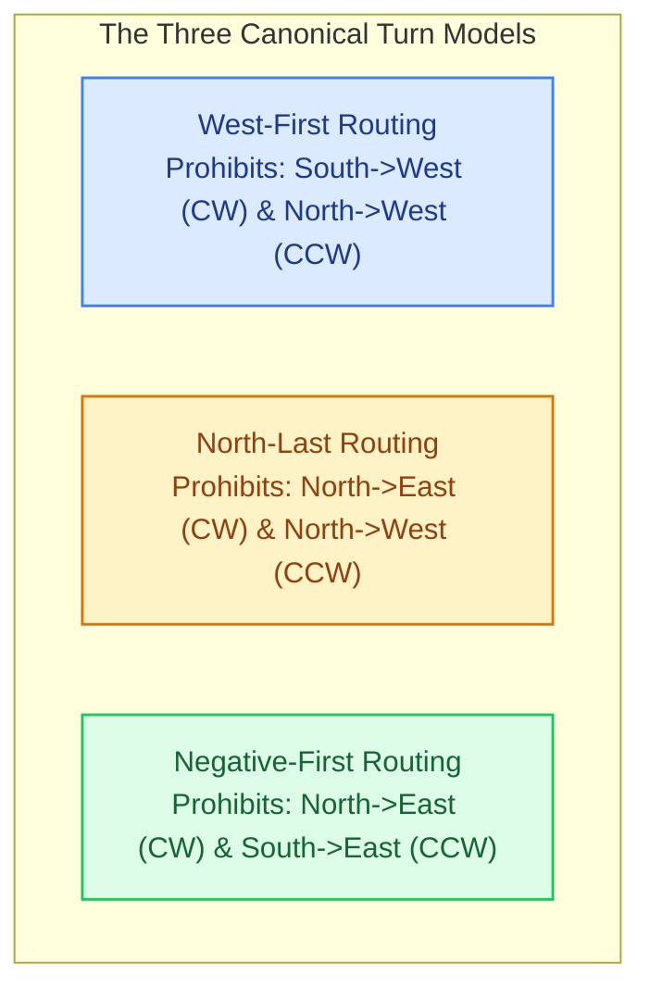

# 4.2 Adaptive Routing & The Turn Model

While deterministic Dimension-Order Routing (DOR) is simple and provably deadlock-free, its rigidity introduces severe operational drawbacks:
1. **Inability to Avoid Congestion:** If a localized traffic hotspot or buffer bottleneck develops along the XY path, incoming packets must queue behind it, even when parallel channels are completely idle.
2. **Zero Fault Tolerance:** If a single router or physical link breaks down, all communication flows crossing that point fail permanently.

To solve these challenges, computer architects developed **Adaptive Routing**, allowing packets to dynamically select among multiple alternative paths based on local channel congestion or link health.

However, arbitrary adaptivity reintroduces the risk of **circular buffer deadlock**. In 1994, Christopher J. Glass and Lionel M. Ni introduced a foundational methodology called **The Turn Model**, proving that eliminating **just two turns** is sufficient to guarantee deadlock freedom while unlocking rich path diversity!

---

## 1. The Geometry of Deadlock Cycles

In a 2D mesh network, any closed loop of communication channels is composed of directed 90-degree turns. Every simple cycle in a 2D plane belongs to one of two orientations:

```
Clockwise (CW) Cycle:               Counter-Clockwise (CCW) Cycle:
      [North -> East]                     [East -> North]
        ^          |                        ^          |
        |    CW    v                        |   CCW    v
      [West <- South]                     [South <- West]
```

### The 8 Orthogonal Turns
There are exactly **8 distinct turns** in a 2D mesh:
- **Quadrant I (East-North):** $\text{East} \rightarrow \text{North}$ (CCW), $\text{North} \rightarrow \text{East}$ (CW)
- **Quadrant II (East-South):** $\text{East} \rightarrow \text{South}$ (CW), $\text{South} \rightarrow \text{East}$ (CCW)
- **Quadrant III (West-South):** $\text{West} \rightarrow \text{South}$ (CCW), $\text{South} \rightarrow \text{West}$ (CW)
- **Quadrant IV (West-North):** $\text{West} \rightarrow \text{North}$ (CW), $\text{North} \rightarrow \text{West}$ (CCW)

```
CW Cycle Turns:                     CCW Cycle Turns:
1. North -> East                    1. North -> West
2. East  -> South                   2. West  -> South
3. South -> West                    3. South -> East
4. West  -> North                   4. East  -> North
```

### The Turn Model Theorem (Glass & Ni, 1994)
> **Theorem:**  
> A routing algorithm for an $n$-dimensional mesh is deadlock-free if and only if it prohibits **at least one turn in every directed cycle** of the Channel Dependency Graph.

To prevent deadlock in a 2D mesh without virtual channels:
- We must break the **Clockwise (CW) cycle** by forbidding at least one turn from $\{N \to E, E \to S, S \to W, W \to N\}$.
- We must break the **Counter-Clockwise (CCW) cycle** by forbidding at least one turn from $\{N \to W, W \to S, S \to E, E \to N\}$.

Notice what deterministic XY routing does:
- Prohibits: $N \to E$ (CW), $S \to W$ (CW), $N \to W$ (CCW), $S \to E$ (CCW).
- **XY eliminates 4 out of 8 turns!** This breaks cycles with excessive conservatism, leaving packets with zero path choice ($50\%$ flexibility).

**The Turn Model's key insight:**  
We only need to prohibit **ONE turn from the CW cycle** and **ONE turn from the CCW cycle**! This leaves **6 out of 8 turns permitted ($75\%$ flexibility)**, unlocking multi-path adaptivity without requiring any virtual channels!

---

## 2. Canonical Turn Model Algorithms

Depending on which pair of turns is prohibited, Glass and Ni defined three canonical routing algorithms:



### 1. West-First Routing
- **Prohibited Turns:** $\text{South} \rightarrow \text{West}$ (breaks CW) and $\text{North} \rightarrow \text{West}$ (breaks CCW).
- **Algorithmic Rule:**
  > **"If the destination lies West of the current router ($x_d < x_c$), the packet MUST route West first before taking any vertical turns!"**
- **Adaptivity Profile:**
  - **Westbound Traffic ($\Delta x < 0$):** Fully deterministic (must take West hops immediately).
  - **Eastbound Traffic ($\Delta x > 0$):** **100% Fully Adaptive!** Packets can freely interleave East, North, and South hops around hotspots.

### 2. North-Last Routing
- **Prohibited Turns:** $\text{North} \rightarrow \text{East}$ (breaks CW) and $\text{North} \rightarrow \text{West}$ (breaks CCW).
- **Algorithmic Rule:**
  > **"If the destination lies North of the current router ($y_d < y_c$), save all North hops for LAST!"**
- **Adaptivity Profile:**
  - Packets resolve horizontal ($X$) and South hops adaptively, only turning North when directly below the destination column.

### 3. Negative-First Routing
- **Prohibited Turns:** $\text{North} \rightarrow \text{East}$ (breaks CW) and $\text{South} \rightarrow \text{East}$ (breaks CCW).
- **Algorithmic Rule:**
  > **"Route all negative directions (West and South) first, before routing any positive directions (East and North)!"**

### Turn Model Adaptivity Comparison Table

| Algorithm | Prohibited Turns | Permitted Turns | Quadrant I ($\Delta x > 0, \Delta y < 0$) | Quadrant II ($\Delta x > 0, \Delta y > 0$) | Quadrant III ($\Delta x < 0, \Delta y > 0$) | Quadrant IV ($\Delta x < 0, \Delta y < 0$) |
| :--- | :--- | :--- | :--- | :--- | :--- | :--- |
| **XY DOR** | 4 turns (all Y-to-X) | 4 turns | Deterministic | Deterministic | Deterministic | Deterministic |
| **West-First** | $S \to W, N \to W$ | **6 turns** | **Fully Adaptive** | **Fully Adaptive** | Deterministic | Deterministic |
| **North-Last** | $N \to E, N \to W$ | **6 turns** | Deterministic | **Fully Adaptive** | **Fully Adaptive** | Deterministic |
| **Negative-First**| $N \to E, S \to E$ | **6 turns** | Deterministic | Deterministic | **Fully Adaptive** | **Fully Adaptive** |

---

## 3. The Odd-Even Turn Model (Chiu, 2000)

Notice the fundamental flaw in West-First, North-Last, and Negative-First: **Directional Asymmetry!**
In West-First, flows traveling East enjoy dozens of alternate paths, while flows traveling West have exactly **one path**, creating severe link starvation and uneven hotspot vulnerability.

In 2000, Ge-Ming Chiu solved this problem by introducing the **Odd-Even Turn Model** (IEEE Transactions on Parallel and Distributed Systems). Rather than applying static turn prohibitions everywhere, Odd-Even distributes turn restrictions across routers based on **column parity**:

```
Column Parity Architecture in Odd-Even:
+----------------------------------------------------------------------------+
| Even Column (X mod 2 == 0):                                                |
|   - Packets are PROHIBITED from turning East-to-North (E -> N)             |
|   - Packets are PROHIBITED from turning East-to-South (E -> S)             |
|                                                                            |
| Odd Column (X mod 2 == 1):                                                 |
|   - Packets are PROHIBITED from turning North-to-West (N -> W)             |
|   - Packets are PROHIBITED from turning South-to-West (S -> W)             |
+----------------------------------------------------------------------------+
```

### Why Odd-Even Guarantees Deadlock Freedom
Any closed cycle in a 2D mesh requires a transition from an Even column to an Odd column and back:
1. To form a cycle that moves East and then turns vertical: turning from East into North/South is **forbidden at Even columns**.
2. To form a cycle that moves vertically and then turns West: turning from North/South into West is **forbidden at Odd columns**.

By placing the East-turn prohibition at even coordinates and the West-turn prohibition at odd coordinates, **it is mathematically impossible to complete any clockwise or counter-clockwise loop!**

### The Key Benefit of Odd-Even:
Odd-Even provides **balanced adaptivity in ALL four quadrants**! Both Eastbound and Westbound packets enjoy multi-path diversity without requiring extra virtual channels.

---

## 4. 🔬 Interactive Turn Model & Cycle Breaker Playground

Use the interactive simulator below to explore how different turn models eliminate deadlock cycles and unlock multi-path routing:

<div class="noc-sim-container" id="turn-sim">
  <div style="display:flex; justify-content:space-between; align-items:center; flex-wrap:wrap; gap:0.5rem; margin-bottom:1rem;">
    <div style="font-weight:700; font-size:1.05rem; color:var(--tcl-heading);">
      🔄 Turn Model &amp; Path Diversity Visualizer
    </div>
    <span class="noc-track-badge" style="background:rgba(37,99,235,0.1); color:#2563eb;">
      Glass &amp; Ni / Chiu Algorithm Engine
    </span>
  </div>

  <div style="display:grid; grid-template-columns:repeat(auto-fit, minmax(200px, 1fr)); gap:0.75rem; margin-bottom:1rem;">
    <div>
      <label style="font-size:0.82rem; font-weight:600; display:block; margin-bottom:0.25rem;">Active Turn Model:</label>
      <select id="tm_algo" class="noc-sim-select" onchange="updateTurnModel()">
        <option value="XY">XY Routing (4 Forbidden Turns)</option>
        <option value="WF" selected>West-First (South->West &amp; North->West Forbidden)</option>
        <option value="NL">North-Last (North->East &amp; North->West Forbidden)</option>
        <option value="NF">Negative-First (North->East &amp; South->East Forbidden)</option>
        <option value="OE">Odd-Even (Parity Alternating Turns)</option>
      </select>
    </div>
    <div>
      <label style="font-size:0.82rem; font-weight:600; display:block; margin-bottom:0.25rem;">Source Router:</label>
      <select id="tm_src" class="noc-sim-select" onchange="updateTurnModel()">
        <option value="0,0" selected>(0, 0) - Top-Left</option>
        <option value="3,3">(3, 3) - Bottom-Right</option>
        <option value="0,3">(0, 3) - Bottom-Left</option>
        <option value="3,0">(3, 0) - Top-Right</option>
      </select>
    </div>
    <div>
      <label style="font-size:0.82rem; font-weight:600; display:block; margin-bottom:0.25rem;">Destination Router:</label>
      <select id="tm_dst" class="noc-sim-select" onchange="updateTurnModel()">
        <option value="3,3" selected>(3, 3) - Bottom-Right</option>
        <option value="0,0">(0, 0) - Top-Left</option>
        <option value="3,0">(3, 0) - Top-Right</option>
        <option value="0,3">(0, 3) - Bottom-Left</option>
      </select>
    </div>
  </div>

  <div style="display:flex; gap:1.25rem; flex-wrap:wrap; align-items:flex-start;">
    <div style="flex:1; min-width:280px; text-align:center;">
      <canvas id="tmCanvas" width="340" height="340" style="background:#0f172a; border-radius:8px; box-shadow:0 4px 12px rgba(0,0,0,0.25); max-width:100%; height:auto;"></canvas>
    </div>

    <div style="flex:1.2; min-width:280px;">
      <div style="background:var(--md-default-fg-color--lightest); border:1px solid var(--tcl-border); border-radius:8px; padding:0.85rem; font-size:0.85rem; margin-bottom:0.75rem;">
        <div style="font-weight:700; color:var(--tcl-heading); margin-bottom:0.4rem;">📊 Path Diversity &amp; Freedom:</div>
        <div style="display:grid; grid-template-columns:1fr 1fr; gap:0.4rem;">
          <div>Manhattan Dist: <strong id="tm_dist">6 hops</strong></div>
          <div>Legal Minimal Paths: <strong id="tm_paths" style="color:#22c55e;">20 Paths</strong></div>
          <div>Permitted Turns: <strong id="tm_allowed">6 of 8 (75%)</strong></div>
          <div>Deadlock Freedom: <strong style="color:#22c55e;">Provably Acyclic</strong></div>
        </div>
      </div>

      <div style="background:var(--md-default-fg-color--lightest); border:1px solid var(--tcl-border); border-radius:8px; padding:0.85rem; font-size:0.82rem;">
        <div style="font-weight:700; color:var(--tcl-heading); margin-bottom:0.4rem;">🔒 Turn Prohibitions Status:</div>
        <div id="tm_turns_list" style="line-height:1.6; font-size:0.82rem;">
          <!-- Dynamic turn tags -->
        </div>
      </div>
    </div>
  </div>
</div>

<script>
function countPaths(algo, sx, sy, dx, dy) {
  const dx_dist = Math.abs(dx - sx);
  const dy_dist = Math.abs(dy - sy);
  
  if (dx_dist === 0 || dy_dist === 0) return 1;

  if (algo === "XY") {
    return 1;
  }
  
  if (algo === "WF") {
    // If destination is West (dx < sx), must go West first -> 1 path!
    if (dx < sx) return 1;
    // If destination is East, fully adaptive minimal paths -> C(dx + dy, dx)
    return binomial(dx_dist + dy_dist, dx_dist);
  }

  if (algo === "NL") {
    // If destination is North (dy < sy), North hops last -> 1 path!
    if (dy < sy) return 1;
    return binomial(dx_dist + dy_dist, dx_dist);
  }

  if (algo === "NF") {
    // Negative directions first
    if ((dx < sx && dy > sy) || (dx > sx && dy < sy)) return 1;
    return binomial(dx_dist + dy_dist, dx_dist);
  }

  if (algo === "OE") {
    // Odd-Even provides balanced multi-pathing in both directions
    return Math.max(2, Math.floor(binomial(dx_dist + dy_dist, dx_dist) * 0.7));
  }

  return 1;
}

function binomial(n, k) {
  if (k < 0 || k > n) return 0;
  if (k === 0 || k === n) return 1;
  let c = 1;
  for (let i = 1; i <= k; i++) {
    c = c * (n - (k - i)) / i;
  }
  return Math.round(c);
}

function updateTurnModel() {
  const algo = document.getElementById("tm_algo").value;
  const sParts = document.getElementById("tm_src").value.split(",").map(Number);
  const dParts = document.getElementById("tm_dst").value.split(",").map(Number);
  const sx = sParts[0], sy = sParts[1];
  const dx = dParts[0], dy = dParts[1];

  const dist = Math.abs(dx - sx) + Math.abs(dy - sy);
  document.getElementById("tm_dist").textContent = `${dist} hops`;

  const paths = countPaths(algo, sx, sy, dx, dy);
  document.getElementById("tm_paths").textContent = paths === 1 ? "1 Path (Deterministic)" : `${paths} Distinct Paths!`;

  const allowedEl = document.getElementById("tm_allowed");
  const turnsListEl = document.getElementById("tm_turns_list");

  if (algo === "XY") {
    allowedEl.textContent = "4 of 8 (50%)";
    turnsListEl.innerHTML = `
      <span style="color:#ef4444;">❌ N➔E, N➔W, S➔E, S➔W (All Y-to-X turns prohibited)</span><br/>
      <span style="color:#22c55e;">✔ E➔N, E➔S, W➔N, W➔S (X-to-Y turns permitted)</span>
    `;
  } else if (algo === "WF") {
    allowedEl.textContent = "6 of 8 (75%)";
    turnsListEl.innerHTML = `
      <span style="color:#ef4444;">❌ S➔W (Breaks Clockwise), N➔W (Breaks Counter-Clockwise)</span><br/>
      <span style="color:#22c55e;">✔ 6 Turns Allowed: E➔N, E➔S, W➔N, W➔S, N➔E, S➔E</span>
    `;
  } else if (algo === "NL") {
    allowedEl.textContent = "6 of 8 (75%)";
    turnsListEl.innerHTML = `
      <span style="color:#ef4444;">❌ N➔E (Breaks Clockwise), N➔W (Breaks Counter-Clockwise)</span><br/>
      <span style="color:#22c55e;">✔ 6 Turns Allowed: E➔S, S➔W, W➔S, W➔N, S➔E, E➔N</span>
    `;
  } else if (algo === "NF") {
    allowedEl.textContent = "6 of 8 (75%)";
    turnsListEl.innerHTML = `
      <span style="color:#ef4444;">❌ N➔E (Breaks Clockwise), S➔E (Breaks Counter-Clockwise)</span><br/>
      <span style="color:#22c55e;">✔ 6 Turns Allowed: W➔N, W➔S, E➔S, E➔N, S➔W, N➔W</span>
    `;
  } else if (algo === "OE") {
    allowedEl.textContent = "Alternating (75% avg)";
    turnsListEl.innerHTML = `
      <span style="color:#38bdf8;">Even Columns (X%2==0):</span> <span style="color:#ef4444;">❌ E➔N, E➔S</span><br/>
      <span style="color:#38bdf8;">Odd Columns (X%2==1):</span> <span style="color:#ef4444;">❌ N➔W, S➔W</span><br/>
      <span style="color:#22c55e;">✔ Both East and West flows retain multi-path adaptivity!</span>
    `;
  }

  drawTMCanvas(sx, sy, dx, dy, algo);
}

function drawTMCanvas(sx, sy, dx, dy, algo) {
  const canvas = document.getElementById("tmCanvas");
  if (!canvas) return;
  const ctx = canvas.getContext("2d");
  const w = canvas.width;
  const h = canvas.height;
  ctx.clearRect(0, 0, w, h);

  const N = 4;
  const pad = 36;
  const step = (w - pad * 2) / (N - 1);

  // Draw links
  ctx.lineWidth = 2;
  ctx.strokeStyle = "#334155";
  for (let r = 0; r < N; r++) {
    ctx.beginPath();
    ctx.moveTo(pad, pad + r * step);
    ctx.lineTo(w - pad, pad + r * step);
    ctx.stroke();
  }
  for (let c = 0; c < N; c++) {
    ctx.beginPath();
    ctx.moveTo(pad + c * step, pad);
    ctx.lineTo(pad + c * step, h - pad);
    ctx.stroke();
  }

  // Draw Bounding Box of Minimal Routing
  const minX = Math.min(sx, dx);
  const maxX = Math.max(sx, dx);
  const minY = Math.min(sy, dy);
  const maxY = Math.max(sy, dy);

  ctx.fillStyle = "rgba(56, 189, 248, 0.08)";
  ctx.fillRect(pad + minX * step, pad + minY * step, (maxX - minX) * step, (maxY - minY) * step);
  ctx.strokeStyle = "rgba(56, 189, 248, 0.35)";
  ctx.lineWidth = 1.5;
  ctx.strokeRect(pad + minX * step, pad + minY * step, (maxX - minX) * step, (maxY - minY) * step);

  // Draw Sample Legal Traversal Path
  ctx.lineWidth = 4;
  ctx.strokeStyle = "#22c55e";
  ctx.beginPath();
  if (algo === "XY") {
    // Pure XY: go along X to dx, then Y to dy
    ctx.moveTo(pad + sx * step, pad + sy * step);
    ctx.lineTo(pad + dx * step, pad + sy * step);
    ctx.lineTo(pad + dx * step, pad + dy * step);
  } else {
    // Show one adaptive stepped path
    ctx.moveTo(pad + sx * step, pad + sy * step);
    if (dx >= sx) {
      const midX = Math.min(dx, sx + 1);
      ctx.lineTo(pad + midX * step, pad + sy * step);
      ctx.lineTo(pad + midX * step, pad + dy * step);
      ctx.lineTo(pad + dx * step, pad + dy * step);
    } else {
      // Heading West
      ctx.lineTo(pad + dx * step, pad + sy * step);
      ctx.lineTo(pad + dx * step, pad + dy * step);
    }
  }
  ctx.stroke();

  // Draw Router Nodes
  for (let r = 0; r < N; r++) {
    for (let c = 0; c < N; c++) {
      const px = pad + c * step;
      const py = pad + r * step;
      const isSrc = (c === sx && r === sy);
      const isDst = (c === dx && r === dy);

      ctx.beginPath();
      ctx.arc(px, py, 10, 0, Math.PI * 2);

      if (isSrc) {
        ctx.fillStyle = "#2563eb";
      } else if (isDst) {
        ctx.fillStyle = "#ea580c";
      } else {
        ctx.fillStyle = "#1e293b";
      }
      ctx.fill();

      ctx.lineWidth = 2;
      ctx.strokeStyle = isSrc ? "#60a5fa" : (isDst ? "#fb923c" : "#475569");
      ctx.stroke();

      ctx.fillStyle = "#94a3b8";
      ctx.font = "8px sans-serif";
      ctx.textAlign = "center";
      ctx.textBaseline = "middle";
      ctx.fillText(`(${c},${r})`, px, py + 16);
    }
  }
}

if (document.readyState === "loading") {
  document.addEventListener("DOMContentLoaded", updateTurnModel);
} else {
  updateTurnModel();
}
</script>

---

## 5. Worked Numerical Example: Path Diversity Comparison

> [!TIP]
> **Problem Statement:**  
> A packet must route across a $6 \times 6$ 2D Mesh from Source $(0, 0)$ to Destination $(3, 3)$.  
> 
> Calculate:
> 1. The total number of legal minimal paths available under **Deterministic XY Routing**.
> 2. The total number of legal minimal paths available under **West-First Routing**.
> 3. Now reverse the flow: calculate the legal minimal paths from $(3, 3)$ to $(0, 0)$ under **West-First Routing**.

### Step 1: Destination $(3, 3)$ from Source $(0, 0)$
- Total Manhattan Distance: $\Delta x = 3, \Delta y = 3$. Total hops $= 6$.
- Under **Deterministic XY Routing**:
  - The packet must travel East for 3 hops, then South for 3 hops.
  - $\mathbf{\text{Legal Paths (XY)} = 1\text{ path}}$.
- Under **West-First Routing**:
  - The destination is East ($\Delta x > 0$) and South ($\Delta y > 0$).
  - Neither forbidden turn ($S \to W$ or $N \to W$) is ever needed!
  - The packet can take any combination of 3 East hops and 3 South hops in ANY arbitrary order:
    $$\mathbf{\text{Legal Paths (WF)} = \binom{\Delta x + \Delta y}{\Delta x} = \binom{3 + 3}{3} = \frac{6 \times 5 \times 4}{3 \times 2 \times 1} = \mathbf{20\text{ distinct paths}}!}$$

### Step 2: Reverse Flow from $(3, 3)$ to $(0, 0)$
- Here $\Delta x = -3$ (West) and $\Delta y = -3$ (North).
- Under **West-First Routing**:
  - Because the destination is West, the algorithm strictly mandates: **take all West hops first**!
  - Once the packet turns North, turning West is strictly prohibited ($N \to W$ is illegal).
  - Therefore, the packet MUST take 3 West hops first, followed by 3 North hops.
  - $\mathbf{\text{Legal Paths (WF from East to West)} = \mathbf{1\text{ path}}}$!

### Takeaway:
West-First provides a staggering **$20\times$ increase in path diversity** for Eastbound traffic, completely eliminating single-link bottlenecks. However, it collapses back to deterministic routing for Westbound traffic—which is why the **Odd-Even model** was developed to equalize adaptivity across both directions.

---

## 6. 🎯 Knowledge Check: Lesson 4.2

<div class="noc-sim-container" id="quiz42" style="margin-top:1rem;">
  <div style="font-weight:700; font-size:1.05rem; margin-bottom:1rem; color:var(--tcl-heading);">
    📝 Concept Check: The Turn Model &amp; Adaptivity
  </div>

  <div id="q42_block">
    <p style="font-weight:600; font-size:0.95rem; margin-bottom:0.75rem;">
      <b>Question:</b> Why does Ge-Ming Chiu's Odd-Even Turn Model achieve superior performance compared to Glass &amp; Ni's West-First routing on non-uniform traffic workloads?
    </p>

    <div style="display:flex; flex-direction:column; gap:0.5rem;" id="q42_options">
      <button class="noc-sim-select" style="text-align:left; padding:0.65rem 0.85rem; cursor:pointer;" onclick="checkQuiz42(0)">
        A. Because Odd-Even completely removes the need for Virtual Channels and halves the router clock period.
      </button>
      <button class="noc-sim-select" style="text-align:left; padding:0.65rem 0.85rem; cursor:pointer;" onclick="checkQuiz42(1)">
        B. Because West-First forces all Westbound packets into a single deterministic path (zero adaptivity), while Odd-Even alternates turn restrictions across column parity, providing balanced multi-path diversity in both East and West directions.
      </button>
      <button class="noc-sim-select" style="text-align:left; padding:0.65rem 0.85rem; cursor:pointer;" onclick="checkQuiz42(2)">
        C. Because Odd-Even allows packets to take non-minimal diagonal shortcuts.
      </button>
      <button class="noc-sim-select" style="text-align:left; padding:0.65rem 0.85rem; cursor:pointer;" onclick="checkQuiz42(3)">
        D. Because Odd-Even doubles the link wire width on odd columns.
      </button>
    </div>

    <div id="q42_feedback" style="display:none; margin-top:1rem; padding:0.85rem; border-radius:8px; font-size:0.9rem; line-height:1.5;"></div>
  </div>
</div>

<script>
function checkQuiz42(idx) {
  const fb = document.getElementById("q42_feedback");
  fb.style.display = "block";
  const opts = document.getElementById("q42_options").children;
  for (let i = 0; i < opts.length; i++) {
    opts[i].onclick = null;
    opts[i].style.cursor = "default";
  }

  if (idx === 1) {
    opts[1].style.background = "rgba(34,197,94,0.15)";
    opts[1].style.borderColor = "#22c55e";
    fb.style.background = "rgba(34,197,94,0.1)";
    fb.style.border = "1px solid rgba(34,197,94,0.3)";
    fb.style.color = "#166534";
    fb.innerHTML = "<strong>✓ Correct!</strong> Static turn models like West-First suffer from directional asymmetry, offering 0% adaptivity when traveling West. Odd-Even alternates turn prohibitions based on column parity, unlocking balanced multi-pathing in all quadrants without virtual channels.";
  } else {
    opts[idx].style.background = "rgba(239,68,68,0.15)";
    opts[idx].style.borderColor = "#ef4444";
    opts[1].style.background = "rgba(34,197,94,0.15)";
    opts[1].style.borderColor = "#22c55e";
    fb.style.background = "rgba(239,68,68,0.1)";
    fb.style.border = "1px solid rgba(239,68,68,0.3)";
    fb.style.color = "#991b1b";
    fb.innerHTML = "<strong>✗ Incorrect.</strong> The correct answer is <strong>B</strong>. Odd-Even eliminates directional bias by distributing turn restrictions across even and odd columns.";
  }
}
</script>

---

## Summary & Next Steps

In this lesson, we established:
- **The Geometry of Cycles:** How clockwise and counter-clockwise loops form routing deadlocks.
- **Glass & Ni's Turn Model:** Proving that prohibiting only 2 out of 8 turns is sufficient to eliminate all deadlock cycles without virtual channels.
- **Canonical Turn Models:** West-First, North-Last, and Negative-First algorithms.
- **Chiu's Odd-Even Model:** Alternating turn restrictions across column parity to eliminate directional asymmetry.

Now, what if we want **100% full adaptivity in all directions with zero turn restrictions**? Can we allow cycles in the network while still guaranteeing deadlock freedom?

In the next lesson, we explore **Formal Deadlock Theory & Duato's Escape Channels**.

👉 **Proceed to [Lesson 4.3: Deadlock Theory & Channel Dependency Graphs](03-deadlock-theory-cdg.md)**
