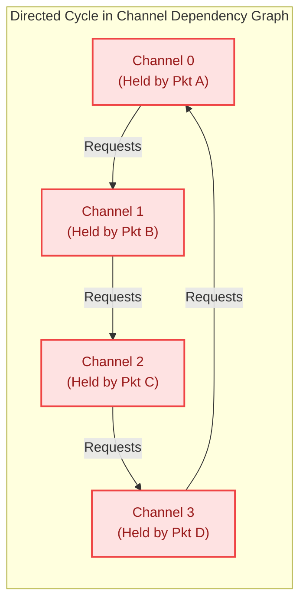

# 4.3 Formal Deadlock Theory & Duato's Escape Channels

In packet-switched and wormhole-switched interconnects, an unverified routing algorithm can lead to catastrophic failure: **Routing Deadlock**. 

Deadlock occurs when a set of packets hold network buffer resources while indefinitely waiting for other buffers held by each other in a closed dependency cycle. Once deadlock occurs, no packet in the cycle can ever advance. Buffer queues back up across the chip, freezing the entire processor and requiring a hard system reset.

To mathematically prove that an interconnect will never lock up under any conceivable traffic workload, computer architects rely on **Channel Dependency Graphs (CDGs)** and formal theorems developed by **William Dally, Charles Seitz, and José Duato**.

In this lesson, we examine the mathematical foundations of network deadlock, contrast the **Dally-Seitz Theorem** against **Duato's Escape Channel Theorem**, explore real-world silicon implementations, and simulate deadlock formation and escape in real time.

<div class="noc-callout" style="background: rgba(15, 118, 110, 0.08); border-left: 4px solid #0f766e; padding: 1rem 1.25rem; margin: 1.5rem 0; border-radius: 0 8px 8px 0;">
  <div style="font-weight: 700; color: #0f766e; margin-bottom: 0.25rem;">📖 Textbook Reference</div>
  <div style="color: #334155; font-size: 0.95rem;">
    Access the formal mathematical proofs for the Dally-Seitz and Duato theorems along with the open-source CDG cycle detector in <strong><a href="https://github.com/network-on-chip/book/blob/main/chapters/ch05-routing-deadlock-theory/index.md#52-the-dally-seitz-channel-dependency-graph-theorem-1987" target="_blank" rel="noopener">Chapter 5.2: The Dally-Seitz CDG Theorem</a></strong> and <strong><a href="https://github.com/network-on-chip/book/blob/main/chapters/ch05-routing-deadlock-theory/index.md#55-duatos-theorem-for-fully-adaptive-routing-1993" target="_blank" rel="noopener">Chapter 5.5: Duato's Theorem</a></strong>.
  </div>
</div>

---

## 1. Formal Graph-Theoretic Foundations

Let an interconnection network be represented as a directed graph $I = G(N, C)$, where:
- $N$ is the set of router nodes (processing elements and switches).
- $C$ is the set of unidirectional communication channels (physical links or virtual channels).

A **Routing Function** $R: C \times N \rightarrow \mathcal{P}(C)$ maps the currently held channel $c_{curr}$ and destination node $d$ to a set of candidate next channels:
$$\{c_{next}\} = R(c_{curr}, d)$$

### The Waiting State and Deadlock Configuration
In a wormhole-routed network, a packet can span multiple routers simultaneously, holding buffer space in channel $c_i$ while its header flit requests channel $c_j$.

```
Deadlock Definition:
A non-empty set of packets P_deadlock = {p_1, p_2, ..., p_k} is deadlocked if and only if:
  - Packet p_1 holds Channel c_1 and waits for Channel c_2 (held by p_2)
  - Packet p_2 holds Channel c_2 and waits for Channel c_3 (held by p_3)
  ...
  - Packet p_k holds Channel c_k and waits for Channel c_1 (held by p_1)
```

Because every packet in $P_{deadlock}$ is waiting for a buffer that cannot be freed until another packet advances, **all $k$ packets are permanently frozen!**

---

## 2. The Channel Dependency Graph (CDG)

To analyze buffer dependencies independently of traffic, we construct the **Channel Dependency Graph (CDG)**, denoted $D = (C, E)$:
- **Vertices ($V = C$):** Every communication channel $c_i \in C$ in the network is a vertex in $D$.
- **Directed Edges ($(c_i, c_j) \in E$):** A directed edge from vertex $c_i$ to vertex $c_j$ exists if and only if a packet can transition directly from channel $c_i$ to channel $c_j$ under routing function $R$:
  $$(c_i, c_j) \in E \iff \exists d \in N \text{ such that } c_j \in R(c_i, d)$$



---

## 3. The Dally-Seitz Theorem (1987)

In their seminal 1987 paper, William J. Dally and Charles L. Seitz formulated the foundational theorem for deterministic routing:

> **Theorem (Dally & Seitz, 1987):**  
> A deterministic routing algorithm $R$ for an interconnection network is **deadlock-free if and only if** its Channel Dependency Graph $D$ contains **no directed cycles**.

### Mathematical Proof via Topological Ordering:
1. **Sufficiency ($\Leftarrow$):**  
   Suppose the CDG $D$ contains no directed cycles (it is a Directed Acyclic Graph, or DAG).  
   Every finite DAG possesses a **topological ordering**. We can assign a strictly increasing integer rank to each channel:
   $$\text{rank}: C \rightarrow \mathbb{N} \quad \text{such that } (c_i, c_j) \in E \implies \text{rank}(c_i) < \text{rank}(c_j)$$
   Suppose a circular deadlock exists among channels $c_1 \rightarrow c_2 \dots \rightarrow c_k \rightarrow c_1$.  
   Then by definition:
   $$\text{rank}(c_1) < \text{rank}(c_2) < \dots < \text{rank}(c_k) < \text{rank}(c_1) \implies \text{rank}(c_1) < \text{rank}(c_1)$$
   This is a mathematical contradiction! Therefore, no circular waiting chain can form.
2. **Necessity ($\Rightarrow$):**  
   If $D$ contains a directed cycle, one can construct a valid traffic sequence where $k$ packets simultaneously occupy the channels in the cycle, producing an active deadlock.

### Limitations of Dally-Seitz for Adaptive Routing:
The Dally-Seitz theorem is **necessary and sufficient ONLY for deterministic routing**.

For **adaptive routing**, the condition is overly conservative! An adaptive packet can wait for channel $c_1$, but if an alternative channel $c_2$ becomes available, it can take $c_2$. Therefore, **a cycle in the CDG does NOT necessarily cause deadlock in an adaptive network!**

Applying Dally-Seitz to adaptive networks creates "false negatives"—forbidding highly efficient, deadlock-free adaptive routes.

---

## 4. Duato's Theorem: Escape Channels (1993, 1997)

In 1993, Spanish computer scientist **José Duato** published a breakthrough theorem that revolutionized high-performance network design by introducing **Escape Virtual Channels**:

> **Duato's Theorem (1993, 1997):**  
> An adaptive routing function $R$ is **deadlock-free** if the set of virtual channels $C$ can be partitioned into two subsets:
> $$C = C_1 \cup C_0$$
> 1. An **Adaptive Channel Subnetwork ($C_1$):** Packets in $C_1$ can route fully adaptively across any legal path. Directed cycles **ARE PERMITTED** in $C_1$'s dependency graph!
> 2. An **Escape Channel Subnetwork ($C_0$):** Guaranteed to have an **acyclic** Channel Dependency Graph (e.g., using deterministic XY DOR).
> 
> Provided that:
> - $C_0$ provides a connected path between every source and destination.
> - Any packet traveling in $C_1$ can **always transition into $C_0$** whenever it encounters blocked buffers.
> - Once a packet enters $C_0$, it must strictly obey $C_0$'s acyclic routing function.

```mermaid
graph TD
  subgraph Duato_Architecture ["Duato's Escape Virtual Channel Architecture"]
    Flit["Arriving Packet Flit"] --> Arbiter{"Adaptive VC Available?"}
    
    subgraph Adaptive_Plane ["Adaptive Subnetwork (C1: VC 1, VC 2)"]
      Arbiter -->|Yes (Normal Path)| C1_Route["Fully Adaptive Routing<br/>(Allows Cycles & Congestion Bypass)"]
    end

    subgraph Escape_Plane ["Escape Subnetwork (C0: VC 0)"]
      Arbiter -->|Blocked / Congested| C0_Route["Deterministic XY Routing<br/>(Strictly Acyclic CDG)"]
      C1_Route -. Hotspot Stalls .-> C0_Route
    end
  end

  classDef adaptStyle fill:#dcfce7,stroke:#22c55e,stroke-width:1.5px,color:#166534;
  classDef escapeStyle fill:#dbeafe,stroke:#3b82f6,stroke-width:1.5px,color:#1e3a8a;

  class C1_Route adaptStyle;
  class C0_Route escapeStyle;
```

### Why Duato's Architecture is Impervious to Deadlock:
1. **Under Normal Load:** Over $95\%$ of packets traverse the high-speed adaptive channels in $C_1$, dynamically weaving around memory hotspots and heavy cache lines.
2. **When Deadlock Threatens in $C_1$:** If packets in $C_1$ ever form a circular waiting cycle, they do not freeze! As their buffer queues fill up, the blocked packets simply request the **Escape Virtual Channel ($C_0$)**.
3. **Guaranteed Drain:** Because $C_0$'s Channel Dependency Graph is strictly acyclic, the packet with the highest topological rank in $C_0$ is **guaranteed to reach its destination and exit the network**. Once it leaves, the next packet advances. By induction, **$C_0$ continuously drains flits out of the network**, breaking any potential deadlock!

---

## 5. Silicon Case Studies: Escape Channels in Commercial Routers

Where is Duato's escape channel architecture implemented in real hardware?

### 1. Cray T3E & Alpha 21364 (EV7)
The iconic DEC Alpha 21364 processor integrated an on-chip network router connecting 128 Alpha CPUs into a 2D Torus:
- **Virtual Channels:** 3 VCs per physical link.
- **Allocation:** $VC_1$ and $VC_2$ were configured as adaptive channels (allowing arbitrary non-minimal turns to evade failed chips).
- **Escape Channel:** $VC_0$ enforced strict dimension-order routing (DOR) with dateline virtual channel switching, serving as the Duato escape path.

### 2. Modern Server & AI Fabrics (Cray Slingshot / Intel Xeon)
In modern exascale clusters, switches like HPE/Cray Slingshot and Intel Ultra Path Interconnect (UPI) utilize dedicated escape virtual lanes ($VL_0$) to guarantee forward progress during heavy all-to-all collective communications.

---

## 6. 🔬 Interactive CDG Deadlock Simulator & Escape Channel Flusher

Experience how circular dependencies form and how Duato's escape virtual channels instantly drain deadlocked packets:

<div class="noc-sim-container" id="cdg-sim">
  <div style="display:flex; justify-content:space-between; align-items:center; flex-wrap:wrap; gap:0.5rem; margin-bottom:1rem;">
    <div style="font-weight:700; font-size:1.05rem; color:var(--tcl-heading);">
      ⚡ CDG Cycle Simulator &amp; Duato Escape Channel Flusher
    </div>
    <span class="noc-track-badge" style="background:rgba(239,68,68,0.1); color:#ef4444;" id="cdg_status_badge">
      Normal Operation
    </span>
  </div>

  <div style="display:flex; gap:0.5rem; flex-wrap:wrap; margin-bottom:1rem;">
    <button class="noc-sim-btn" style="background:#ef4444;" onclick="triggerDeadlock()">
      ⚠️ Inject Circular Contention (Cause Deadlock)
    </button>
    <button class="noc-sim-btn" style="background:#22c55e;" onclick="activateEscapeChannel()">
      🛡️ Activate Duato Escape Channel (C0)
    </button>
    <button class="noc-sim-btn" style="background:var(--md-default-fg-color--lightest); color:var(--md-default-fg-color); border:1px solid var(--tcl-border);" onclick="resetCDGSim()">
      🔄 Reset
    </button>
  </div>

  <div style="display:flex; gap:1.25rem; flex-wrap:wrap; align-items:flex-start;">
    <div style="flex:1; min-width:280px; text-align:center;">
      <canvas id="cdgCanvas" width="340" height="340" style="background:#0f172a; border-radius:8px; box-shadow:0 4px 12px rgba(0,0,0,0.25); max-width:100%; height:auto;"></canvas>
    </div>

    <div style="flex:1.2; min-width:280px;">
      <div style="background:var(--md-default-fg-color--lightest); border:1px solid var(--tcl-border); border-radius:8px; padding:0.85rem; font-size:0.85rem; margin-bottom:0.75rem;">
        <div style="font-weight:700; color:var(--tcl-heading); margin-bottom:0.4rem;">📊 Channel Dependency State:</div>
        <div style="display:grid; grid-template-columns:1fr 1fr; gap:0.4rem;">
          <div>Active Channels: <strong id="cdg_chans">4 Channels</strong></div>
          <div>Cycle Status: <strong id="cdg_cycle" style="color:#22c55e;">Acyclic (Free)</strong></div>
          <div>Adaptive VCs (C1): <strong id="cdg_c1_state">Idle</strong></div>
          <div>Escape VC (C0): <strong id="cdg_c0_state" style="color:#38bdf8;">Standby</strong></div>
        </div>
      </div>

      <div style="background:var(--md-default-fg-color--lightest); border:1px solid var(--tcl-border); border-radius:8px; padding:0.85rem; font-size:0.82rem;">
        <div style="font-weight:700; color:var(--tcl-heading); margin-bottom:0.4rem;">🔍 Dependency Monitor:</div>
        <div id="cdg_log" style="font-family:monospace; height:130px; overflow-y:auto; line-height:1.5; color:var(--md-default-fg-color--lighter);">
          <span style="color:#22c55e;">[READY] Interconnect operating normally. Buffers have capacity.</span>
        </div>
      </div>
    </div>
  </div>
</div>

<script>
const cdgState = {
  isDeadlocked: false,
  isEscaping: false,
  stepCount: 0,
  flits: [
    { id: "A", curr: 0, next: 1, color: "#ef4444", state: "normal" },
    { id: "B", curr: 1, next: 2, color: "#f97316", state: "normal" },
    { id: "C", curr: 2, next: 3, color: "#eab308", state: "normal" },
    { id: "D", curr: 3, next: 0, color: "#a855f7", state: "normal" }
  ]
};

function triggerDeadlock() {
  cdgState.isDeadlocked = true;
  cdgState.isEscaping = false;

  const badge = document.getElementById("cdg_status_badge");
  badge.textContent = "CRITICAL: DEADLOCK DETECTED";
  badge.style.background = "rgba(239,68,68,0.2)";
  badge.style.color = "#ef4444";

  document.getElementById("cdg_cycle").innerHTML = "<span style='color:#ef4444;'>CLOSED DIRECTED CYCLE!</span>";
  document.getElementById("cdg_c1_state").innerHTML = "<span style='color:#ef4444;'>100% Full (Blocked)</span>";

  const log = document.getElementById("cdg_log");
  log.innerHTML = `
    <span style="color:#ef4444; font-weight:bold;">[DEADLOCK DETECTED]</span><br/>
    - Pkt A holds Chan 0 ➔ waiting for Chan 1 (held by Pkt B)<br/>
    - Pkt B holds Chan 1 ➔ waiting for Chan 2 (held by Pkt C)<br/>
    - Pkt C holds Chan 2 ➔ waiting for Chan 3 (held by Pkt D)<br/>
    - Pkt D holds Chan 3 ➔ waiting for Chan 0 (held by Pkt A)<br/>
    <span style="color:#ef4444;">All 4 packets are frozen indefinitely!</span>
  `;

  drawCDGCanvas();
}

function activateEscapeChannel() {
  if (!cdgState.isDeadlocked) return;
  cdgState.isEscaping = true;

  const badge = document.getElementById("cdg_status_badge");
  badge.textContent = "DRAINING VIA DUATO ESCAPE CHANNEL (C0)";
  badge.style.background = "rgba(34,197,94,0.2)";
  badge.style.color = "#22c55e";

  document.getElementById("cdg_cycle").innerHTML = "<span style='color:#22c55e;'>Cycle Broken via C0</span>";
  document.getElementById("cdg_c0_state").innerHTML = "<span style='color:#22c55e; font-weight:bold;'>Active Draining</span>";

  const log = document.getElementById("cdg_log");
  log.innerHTML += `
    <br/><span style="color:#22c55e; font-weight:bold;">[DUATO RECOVERY ACTIVE]</span><br/>
    - Packet D falls back into acyclic Escape Virtual Channel (C0).<br/>
    - C0 has no cycles: Packet D drains into local memory core!<br/>
    - Channel 3 buffer is freed ➔ Packet C advances!<br/>
    - Channel 2 buffer is freed ➔ Packet B advances!<br/>
    - Channel 1 buffer is freed ➔ Packet A advances!<br/>
    <span style="color:#22c55e;">Interconnect completely recovered. Forward progress restored!</span>
  `;
  log.scrollTop = log.scrollHeight;

  drawCDGCanvas();
}

function resetCDGSim() {
  cdgState.isDeadlocked = false;
  cdgState.isEscaping = false;

  const badge = document.getElementById("cdg_status_badge");
  badge.textContent = "Normal Operation";
  badge.style.background = "rgba(34,197,94,0.1)";
  badge.style.color = "#22c55e";

  document.getElementById("cdg_cycle").innerHTML = "<span style='color:#22c55e;'>Acyclic (Free)</span>";
  document.getElementById("cdg_c1_state").textContent = "Idle";
  document.getElementById("cdg_c0_state").textContent = "Standby";

  document.getElementById("cdg_log").innerHTML = `<span style="color:#22c55e;">[READY] Interconnect operating normally. Buffers have capacity.</span>`;

  drawCDGCanvas();
}

function drawCDGCanvas() {
  const canvas = document.getElementById("cdgCanvas");
  if (!canvas) return;
  const ctx = canvas.getContext("2d");
  const w = canvas.width;
  const h = canvas.height;
  ctx.clearRect(0, 0, w, h);

  const cx = w / 2;
  const cy = h / 2;
  const r = 100;

  const nodes = [
    { x: cx, y: cy - r, label: "R0 (Chan 0)" },
    { x: cx + r, y: cy, label: "R1 (Chan 1)" },
    { x: cx, y: cy + r, label: "R2 (Chan 2)" },
    { x: cx - r, y: cy, label: "R3 (Chan 3)" }
  ];

  // Draw Channels
  for (let i = 0; i < 4; i++) {
    const nextIdx = (i + 1) % 4;
    const n1 = nodes[i];
    const n2 = nodes[nextIdx];

    ctx.beginPath();
    ctx.moveTo(n1.x, n1.y);
    ctx.lineTo(n2.x, n2.y);

    if (cdgState.isDeadlocked && !cdgState.isEscaping) {
      ctx.strokeStyle = "#ef4444";
      ctx.lineWidth = 4;
    } else if (cdgState.isEscaping) {
      ctx.strokeStyle = (i === 3) ? "#22c55e" : "#38bdf8";
      ctx.lineWidth = (i === 3) ? 5 : 3;
    } else {
      ctx.strokeStyle = "#334155";
      ctx.lineWidth = 2;
    }
    ctx.stroke();
  }

  // Draw Nodes
  for (let i = 0; i < 4; i++) {
    const n = nodes[i];

    ctx.beginPath();
    ctx.arc(n.x, n.y, 22, 0, Math.PI * 2);

    if (cdgState.isDeadlocked && !cdgState.isEscaping) {
      ctx.fillStyle = "#7f1d1d";
      ctx.strokeStyle = "#ef4444";
    } else if (cdgState.isEscaping && i === 3) {
      ctx.fillStyle = "#14532d";
      ctx.strokeStyle = "#22c55e";
    } else {
      ctx.fillStyle = "#1e293b";
      ctx.strokeStyle = "#38bdf8";
    }
    ctx.lineWidth = 2.5;
    ctx.fill();
    ctx.stroke();

    ctx.fillStyle = "#ffffff";
    ctx.font = "bold 9px sans-serif";
    ctx.textAlign = "center";
    ctx.textBaseline = "middle";
    ctx.fillText(`R${i}`, n.x, n.y - 4);

    ctx.fillStyle = "#94a3b8";
    ctx.font = "7.5px monospace";
    ctx.fillText(`C${i}`, n.x, n.y + 7);
  }

  // Draw Center Deadlock / Escape Badge
  ctx.beginPath();
  ctx.arc(cx, cy, 32, 0, Math.PI * 2);
  if (cdgState.isDeadlocked && !cdgState.isEscaping) {
    ctx.fillStyle = "rgba(239, 68, 68, 0.2)";
    ctx.strokeStyle = "#ef4444";
    ctx.lineWidth = 2;
    ctx.fill();
    ctx.stroke();

    ctx.fillStyle = "#ef4444";
    ctx.font = "bold 10px sans-serif";
    ctx.textAlign = "center";
    ctx.textBaseline = "middle";
    ctx.fillText("CYCLE!", cx, cy);
  } else if (cdgState.isEscaping) {
    ctx.fillStyle = "rgba(34, 197, 94, 0.2)";
    ctx.strokeStyle = "#22c55e";
    ctx.lineWidth = 2;
    ctx.fill();
    ctx.stroke();

    ctx.fillStyle = "#22c55e";
    ctx.font = "bold 9px sans-serif";
    ctx.textAlign = "center";
    ctx.textBaseline = "middle";
    ctx.fillText("C0 DRAIN", cx, cy);
  } else {
    ctx.fillStyle = "rgba(56, 189, 248, 0.1)";
    ctx.strokeStyle = "#38bdf8";
    ctx.lineWidth = 1.5;
    ctx.fill();
    ctx.stroke();

    ctx.fillStyle = "#38bdf8";
    ctx.font = "bold 9px sans-serif";
    ctx.textAlign = "center";
    ctx.textBaseline = "middle";
    ctx.fillText("FREE", cx, cy);
  }
}

if (document.readyState === "loading") {
  document.addEventListener("DOMContentLoaded", drawCDGCanvas);
} else {
  drawCDGCanvas();
}
</script>

---

## 7. Worked Numerical Example: Verifying Duato's Theorem

> [!TIP]
> **Problem Statement:**  
> A system architect is designing a 2D Torus interconnect ($4 \times 4$).  
> Because a Torus has physical wrap-around channels, even deterministic XY routing contains cycles in each ring dimension (e.g. $0 \rightarrow 1 \rightarrow 2 \rightarrow 3 \rightarrow 0$).  
> 
> The architect equips each physical link with **3 Virtual Channels**: $VC_0, VC_1, VC_2$.  
> - Packets can use $VC_1$ and $VC_2$ with fully adaptive, non-minimal routing.
> - $VC_0$ is restricted to deterministic dimension-order routing using **Dateline Virtual Channel Switching** (packets switch from $VC_0A$ to $VC_0B$ when crossing the wrap-around link).
> 
> Verify whether this interconnect satisfies Duato's Conditions for deadlock freedom.

### Verification of Duato's 3 Conditions:

1. **Subnetwork Partitioning:**
   $$C = C_1 \cup C_0, \quad \text{where } C_1 = \{VC_1, VC_2\} \text{ and } C_0 = \{VC_0\}$$
   - $C_1$ allows cycles (adaptive plane).
   - $C_0$ uses dateline splitting, which splits the circular ring into a monotonically ranked linear chain ($VC_0A < VC_0B$).
   - Therefore, the Channel Dependency Graph of $C_0$ is **strictly acyclic**! (Condition 1 Satisfied ✔)

2. **Full Connectivity of Escape Subnetwork ($C_0$):**
   - Does $C_0$ provide a legal path between every node pair $(s, d)$?
   - Yes: Dimension-Order Routing with dateline splitting connects every source to every destination in the $4 \times 4$ Torus. (Condition 2 Satisfied ✔)

3. **Guaranteed Transition to Escape Path:**
   - A packet in $C_1$ that finds all adaptive buffers blocked can always request $VC_0$.
   - Once a packet enters $VC_0$, it is forbidden from ever jumping back into $C_1$.
   - Because $C_0$ is acyclic, it continuously drains flits out of the network, preventing any permanent starvation. (Condition 3 Satisfied ✔)

### Conclusion:
The architecture strictly satisfies Duato's Theorem and is **provably deadlock-free**, despite allowing arbitrary non-minimal adaptive routing in $VC_1$ and $VC_2$!

---

## 8. 💻 Synthesizable Hardware: Duato Escape Virtual Channel Allocator

José Duato's theorem enables fully adaptive routing on an adaptive channel pool ($C_1$) by reserving an acyclic escape channel pool ($C_0$). In silicon, this is implemented as an adaptive Virtual Channel allocator:
1. **Adaptive VCs ($C_1$):** Packets can turn in any minimal direction based on available credits, maximizing bandwidth and spreading out traffic.
2. **Escape VC ($C_0$):** Dedicated strictly to deterministic Dimension-Order Routing (XY), forming an acyclic dependency graph.
3. **Fallback Arbitration:** Whenever adaptive VCs face congestion ($credits \le threshold$), packets fall back to the escape channel, guaranteeing starvation-free drain and provable deadlock freedom!

The synthesizable Verilog module below, `duato_escape_vc_allocator.v`, implements this architecture:

```verilog
//=============================================================================
// Module: duato_escape_vc_allocator
// Description: Synthesizable Duato Escape Channel Virtual Channel Allocator
//              for fully adaptive, deadlock-free NoC routing.
//              - C1 Plane (VCs 1..NUM_ADAPTIVE): Adaptive routing based on
//                downstream queue congestion.
//              - C0 Plane (VC 0): Escape channel strictly reserved for
//                deterministic Dimension-Order Routing (XY), forming an
//                acyclic channel dependency subgraph.
//              - Fallback Mechanism: If C1 VCs are congested or exhausted,
//                flits safely escape via C0 to guarantee forward progress!
//=============================================================================

module duato_escape_vc_allocator #(
    parameter integer COORD_W       = 3, // 8x8 mesh coordinates (3 bits)
    parameter integer CREDIT_W      = 4, // Up to 15 credits per VC buffer
    parameter integer NUM_ADAPT_VC  = 2  // Number of adaptive VCs (total VCs = 1 + NUM_ADAPT_VC)
)(
    input  wire                     clk,
    input  wire                     rst_n,

    // Routing Request & Node Coordinates
    input  wire                     req_valid,
    input  wire [COORD_W-1:0]       curr_x,
    input  wire [COORD_W-1:0]       curr_y,
    input  wire [COORD_W-1:0]       dest_x,
    input  wire [COORD_W-1:0]       dest_y,

    // Congestion / Credit Feedback
    input  wire [CREDIT_W-1:0]      c0_escape_credits,   // VC 0 (XY Escape)
    input  wire [CREDIT_W-1:0]      c1_adapt_credits_x,  // Adaptive VC credits along X
    input  wire [CREDIT_W-1:0]      c1_adapt_credits_y,  // Adaptive VC credits along Y
    input  wire [CREDIT_W-1:0]      threshold_low,       // Low-credit escape threshold

    // Allocation Outputs
    output reg                      grant_valid,
    output reg                      grant_is_escape,     // 1 = routed on C0 escape, 0 = C1 adaptive
    output reg  [1:0]               grant_vc_id,         // 0 = VC0 (Escape), 1..2 = Adaptive VCs
    output reg  [4:0]               out_port_1hot        // [4]=LOCAL, [3]=NORTH, [2]=SOUTH, [1]=EAST, [0]=WEST
);

    // Direction Offsets
    wire need_west  = (dest_x < curr_x);
    wire need_east  = (dest_x > curr_x);
    wire need_north = (dest_y < curr_y);
    wire need_south = (dest_y > curr_y);

    // Deterministic XY Route (Escape Channel Sub-function)
    reg [4:0] dor_xy_port;
    always @(*) begin
        if (dest_x == curr_x && dest_y == curr_y) begin
            dor_xy_port = 5'b10000; // Local Core Ejection
        end else if (need_east) begin
            dor_xy_port = 5'b00010; // East
        end else if (need_west) begin
            dor_xy_port = 5'b00001; // West
        end else if (need_south) begin
            dor_xy_port = 5'b00100; // South
        end else begin
            dor_xy_port = 5'b01000; // North
        end
    end

    // Adaptive Routing Decision: Prefer dimension with higher available credits
    wire x_has_credits = (c1_adapt_credits_x > threshold_low);
    wire y_has_credits = (c1_adapt_credits_y > threshold_low);
    wire prefer_y      = (c1_adapt_credits_y > c1_adapt_credits_x);

    always @(posedge clk or negedge rst_n) begin
        if (!rst_n) begin
            grant_valid     <= 1'b0;
            grant_is_escape <= 1'b0;
            grant_vc_id     <= 2'd0;
            out_port_1hot   <= 5'b00000;
        end else begin
            grant_valid <= req_valid;
            if (req_valid) begin
                if (dest_x == curr_x && dest_y == curr_y) begin
                    // Local core ejection
                    grant_is_escape <= 1'b1;
                    grant_vc_id     <= 2'd0;
                    out_port_1hot   <= 5'b10000;
                end else if ((need_north || need_south) && prefer_y && y_has_credits) begin
                    // Adaptive Y traversal on C1
                    grant_is_escape <= 1'b0;
                    grant_vc_id     <= 2'd1;
                    out_port_1hot   <= need_south ? 5'b00100 : 5'b01000;
                end else if ((need_east || need_west) && x_has_credits) begin
                    // Adaptive X traversal on C1
                    grant_is_escape <= 1'b0;
                    grant_vc_id     <= 2'd2;
                    out_port_1hot   <= need_east ? 5'b00010 : 5'b00001;
                end else if ((need_north || need_south) && y_has_credits) begin
                    // Secondary adaptive Y traversal on C1
                    grant_is_escape <= 1'b0;
                    grant_vc_id     <= 2'd1;
                    out_port_1hot   <= need_south ? 5'b00100 : 5'b01000;
                end else if (c0_escape_credits > 0) begin
                    // Adaptive channels blocked: Safe escape via C0 (Strict XY)
                    grant_is_escape <= 1'b1;
                    grant_vc_id     <= 2'd0;
                    out_port_1hot   <= dor_xy_port;
                end else begin
                    // All buffers full: Stall grant
                    grant_valid     <= 1'b0;
                    out_port_1hot   <= 5'b00000;
                end
            end else begin
                out_port_1hot <= 5'b00000;
            end
        end
    end

endmodule
```

---

## 9. 🕹️ Interactive Lab & Arcade Arena

Experience deadlock formation and escape channel flushing in interactive simulations:

<div class="noc-tracks-grid" style="margin-top:1rem;">
  <div class="noc-track-card">
    <div>
      <span class="noc-track-badge" style="background:rgba(239,68,68,0.15); color:#ef4444;">Arcade Defense</span>
      <div class="noc-track-title">🕹️ Deadlock Buster Arcade</div>
      <div class="noc-track-desc">
        Watch circular wait dependencies freeze multi-tile buffers in real time. Deploy Duato escape channels to break cyclic queues and restore maximum line-rate throughput!
      </div>
    </div>
    <a href="../interactive/game/" class="noc-track-link">Play Deadlock Buster →</a>
  </div>

  <div class="noc-track-card">
    <div>
      <span class="noc-track-badge" style="background:rgba(147,51,234,0.15); color:#9333ea;">Silicon Arena</span>
      <div class="noc-track-title">⚔️ Arbiter Arena: VC Clash</div>
      <div class="noc-track-desc">
        Experience Virtual Channel allocation under heavy adaptive traffic, arbitrating between escape channels and high-throughput speculative crossbar paths.
      </div>
    </div>
    <a href="../interactive/arbiter/" class="noc-track-link">Launch Arbiter Arena →</a>
  </div>
</div>

---

## 10. 🎯 Comprehensive Self-Assessment Quiz

Test your understanding of Channel Dependency Graphs, Dally-Seitz conditions, and Duato's Theorem:

<div class="noc-sim-container" id="quiz43_container" style="margin-top:1rem;">
  <div style="display:flex; justify-content:space-between; align-items:center; margin-bottom:1rem; border-bottom:1px solid var(--tcl-border); padding-bottom:0.5rem;">
    <span style="font-weight:700; font-size:1.05rem; color:var(--tcl-heading);">📝 Lesson 4.3 Self-Check</span>
    <span id="quiz43_score" style="font-weight:700; font-size:0.9rem; color:#2563eb;">Score: 0 / 3</span>
  </div>

  <!-- Question 1 -->
  <div class="quiz-item" style="margin-bottom:1.5rem;">
    <p style="font-weight:600; font-size:0.95rem; margin-bottom:0.6rem;">
      <b>Q1:</b> Why does the <strong>Dally-Seitz theorem</strong> fail to accurately evaluate deadlock freedom in <em>adaptive</em> routing algorithms?
    </p>
    <div style="display:flex; flex-direction:column; gap:0.45rem;" id="q43_1_options">
      <button class="noc-sim-select" style="text-align:left; padding:0.6rem 0.85rem; cursor:pointer;" onclick="answerQ43(1, 0)">A. Because Dally-Seitz only applies to circuit-switched optical networks.</button>
      <button class="noc-sim-select" style="text-align:left; padding:0.6rem 0.85rem; cursor:pointer;" onclick="answerQ43(1, 1)">B. Because Dally-Seitz requires an acyclic Channel Dependency Graph (CDG). In adaptive networks, a CDG may contain cycles, but packets can dynamically select alternative non-blocked channels, so cycles do not necessarily cause deadlock.</button>
      <button class="noc-sim-select" style="text-align:left; padding:0.6rem 0.85rem; cursor:pointer;" onclick="answerQ43(1, 2)">C. Because Dally-Seitz does not account for serialization delay.</button>
      <button class="noc-sim-select" style="text-align:left; padding:0.6rem 0.85rem; cursor:pointer;" onclick="answerQ43(1, 3)">D. Because adaptive routers cannot implement Virtual Channels.</button>
    </div>
    <div id="q43_1_feedback" style="display:none; margin-top:0.6rem; padding:0.75rem; border-radius:6px; font-size:0.88rem; line-height:1.5;"></div>
  </div>

  <!-- Question 2 -->
  <div class="quiz-item" style="margin-bottom:1.5rem;">
    <p style="font-weight:600; font-size:0.95rem; margin-bottom:0.6rem;">
      <b>Q2:</b> Under José Duato's Escape Channel Theorem ($C = C_1 \cup C_0$), what fundamental condition MUST the escape channel subset $C_0$ satisfy?
    </p>
    <div style="display:flex; flex-direction:column; gap:0.45rem;" id="q43_2_options">
      <button class="noc-sim-select" style="text-align:left; padding:0.6rem 0.85rem; cursor:pointer;" onclick="answerQ43(2, 0)">A. $C_0$ must operate at double the clock frequency of $C_1$.</button>
      <button class="noc-sim-select" style="text-align:left; padding:0.6rem 0.85rem; cursor:pointer;" onclick="answerQ43(2, 1)">B. $C_0$ must have an acyclic Channel Dependency Graph on its own (such as being dedicated to deterministic XY routing) and must be accessible from any channel in $C_1$.</button>
      <button class="noc-sim-select" style="text-align:left; padding:0.6rem 0.85rem; cursor:pointer;" onclick="answerQ43(2, 2)">C. $C_0$ must contain at least 75% of total router buffer storage.</button>
      <button class="noc-sim-select" style="text-align:left; padding:0.6rem 0.85rem; cursor:pointer;" onclick="answerQ43(2, 3)">D. $C_0$ must only carry broadcast cache invalidation messages.</button>
    </div>
    <div id="q43_2_feedback" style="display:none; margin-top:0.6rem; padding:0.75rem; border-radius:6px; font-size:0.88rem; line-height:1.5;"></div>
  </div>

  <!-- Question 3 -->
  <div class="quiz-item" style="margin-bottom:1rem;">
    <p style="font-weight:600; font-size:0.95rem; margin-bottom:0.6rem;">
      <b>Q3:</b> In modern multi-core router microarchitectures, why is dedicating just 1 out of 4 Virtual Channels to the escape plane ($C_0$) sufficient to sustain peak throughput?
    </p>
    <div style="display:flex; flex-direction:column; gap:0.45rem;" id="q43_3_options">
      <button class="noc-sim-select" style="text-align:left; padding:0.6rem 0.85rem; cursor:pointer;" onclick="answerQ43(3, 0)">A. Because under normal load, over 95% of traffic flows through the adaptive VCs ($C_1$), and the escape channel $C_0$ only engages during transient congestion spikes to drain potential deadlocks.</button>
      <button class="noc-sim-select" style="text-align:left; padding:0.6rem 0.85rem; cursor:pointer;" onclick="answerQ43(3, 1)">B. Because the escape VC bypasses the router crossbar switch.</button>
      <button class="noc-sim-select" style="text-align:left; padding:0.6rem 0.85rem; cursor:pointer;" onclick="answerQ43(3, 2)">C. Because escape packets have zero flit serialization overhead.</button>
      <button class="noc-sim-select" style="text-align:left; padding:0.6rem 0.85rem; cursor:pointer;" onclick="answerQ43(3, 3)">D. Because deterministic XY routing achieves higher throughput than adaptive routing.</button>
    </div>
    <div id="q43_3_feedback" style="display:none; margin-top:0.6rem; padding:0.75rem; border-radius:6px; font-size:0.88rem; line-height:1.5;"></div>
  </div>
</div>

<script>
let q43Score = 0;
const answeredQ43 = {1: false, 2: false, 3: false};

function answerQ43(qNum, selected) {
  if (answeredQ43[qNum]) return;
  answeredQ43[qNum] = true;

  const correctAnswers = {1: 1, 2: 1, 3: 0};
  const isCorrect = (selected === correctAnswers[qNum]);
  const fb = document.getElementById("q43_" + qNum + "_feedback");
  const opts = document.getElementById("q43_" + qNum + "_options").children;

  for (let i = 0; i < opts.length; i++) {
    opts[i].style.cursor = "default";
    opts[i].onclick = null;
  }

  if (isCorrect) {
    q43Score++;
    opts[selected].style.background = "rgba(34, 197, 94, 0.15)";
    opts[selected].style.borderColor = "#22c55e";
    fb.style.display = "block";
    fb.style.background = "rgba(34, 197, 94, 0.1)";
    fb.style.border = "1px solid rgba(34, 197, 94, 0.3)";
    fb.style.color = "#166534";
    fb.innerHTML = "<strong>✓ Correct!</strong> " + getQ43Explanation(qNum, true);
  } else {
    opts[selected].style.background = "rgba(239, 68, 68, 0.15)";
    opts[selected].style.borderColor = "#ef4444";
    opts[correctAnswers[qNum]].style.background = "rgba(34, 197, 94, 0.15)";
    opts[correctAnswers[qNum]].style.borderColor = "#22c55e";
    fb.style.display = "block";
    fb.style.background = "rgba(239, 68, 68, 0.1)";
    fb.style.border = "1px solid rgba(239, 68, 68, 0.3)";
    fb.style.color = "#991b1b";
    fb.innerHTML = "<strong>✗ Incorrect.</strong> " + getQ43Explanation(qNum, false);
  }

  document.getElementById("quiz43_score").textContent = "Score: " + q43Score + " / 3";
}

function getQ43Explanation(qNum, wasCorrect) {
  if (qNum === 1) {
    return "Dally-Seitz provides a necessary and sufficient condition only for deterministic routing. In adaptive networks, packets have alternative routing paths; thus, cyclic dependencies do not automatically imply that packets are permanently stuck.";
  } else if (qNum === 2) {
    return "Duato's theorem decouples adaptivity from deadlock freedom by guaranteeing that an acyclic escape sub-network (C0) always exists to drain packets if the fully adaptive channels (C1) encounter cyclic stalls.";
  } else {
    return "In practice, adaptive channels (C1) absorb the vast majority of traffic. The escape channel (C0) serves primarily as a safety release valve, preserving 100% adaptive throughput while mathematically preventing deadlock.";
  }
}
</script>

---

## Summary & Next Steps

In this lesson, we established:
- **Channel Dependency Graphs (CDGs):** Modeling routing functions as directed graphs of channel resources.
- **The Dally-Seitz Theorem:** Necessary and sufficient proof of deadlock freedom for deterministic routing via topological ordering.
- **Duato's Theorem:** Decoupling adaptivity from deadlock freedom by partitioning channels into an adaptive plane ($C_1$) and an acyclic escape plane ($C_0$).
- **Synthesizable Verilog RTL:** Implemented `duato_escape_vc_allocator.v`, arbitrating between adaptive VCs and XY escape channels.
- **Silicon Microarchitecture:** How Alpha EV7, Cray T3E, and modern server fabrics implement escape virtual channels.

However, even if our physical routing algorithm is provably deadlock-free, a chip can STILL freeze due to **Cache Coherence Protocol Deadlock** or physical link failures! 

In our final lesson of Track 4, we explore **Fault-Tolerant Routing & Protocol Deadlock Avoidance**.

👉 **Proceed to [Lesson 4.4: Fault-Tolerant Routing & Protocol Deadlock](04-fault-tolerant-protocol-deadlock.md)**

