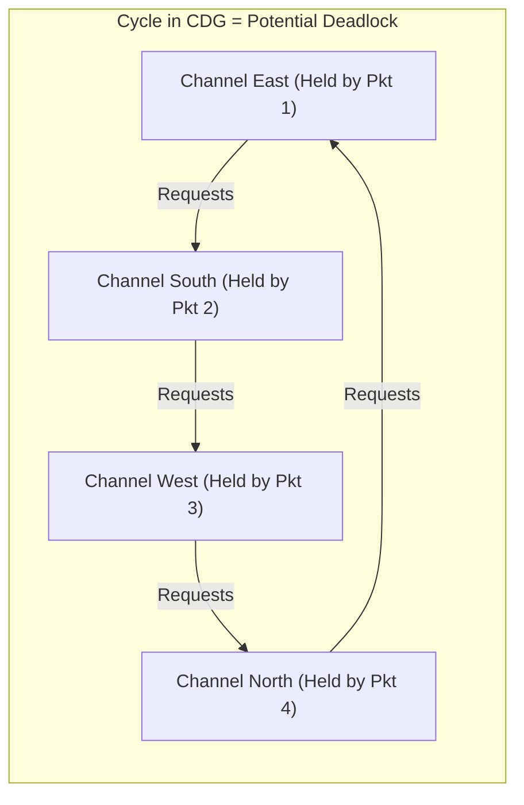

# 4.3 Deadlock Theory & Channel Dependency Graphs

To formally verify that an interconnection network will never lock up under any traffic pattern, computer architects rely on **Channel Dependency Graphs (CDGs)** and formal mathematical theorems.

---

## 1. The Channel Dependency Graph (CDG)

Let the physical network be represented as an interconnection graph $G = (N, C)$, where $N$ is the set of router nodes and $C$ is the set of unidirectional communication channels.

A routing algorithm is a function $R: C \times N \rightarrow \mathcal{P}(C)$ that maps the current channel $c_i$ and destination node $d$ to a set of candidate next channels $\{c_j\}$.

We construct the **Channel Dependency Graph (CDG)**, denoted $D = (C, E)$:
- **Vertices**: Each communication channel $c_i \in C$ is a vertex in $D$.
- **Edges**: A directed edge $(c_i, c_j) \in E$ exists if and only if a packet can transition directly from channel $c_i$ to channel $c_j$ under routing function $R$.



If four packets each hold one channel and request the next channel in a circular dependency, none can advance. The network deadlocks indefinitely!

---

## 2. The Dally-Seitz Theorem (1987)

William J. Dally and Charles L. Seitz formulated the foundational theorem for deterministic routing:

> **Theorem (Dally & Seitz, 1987):**  
> A deterministic routing algorithm $R$ for an interconnection network is **deadlock-free if and only if** its Channel Dependency Graph $D$ contains **no directed cycles**.

### Proof Sketch for XY Routing:
Assign a strictly increasing index to every channel:
- All horizontal channels $c \in C_X$ are assigned numbers in range $[1, K]$.
- All vertical channels $c \in C_Y$ are assigned numbers in range $[K+1, 2K]$.

Because packets only move from $X \rightarrow X$ (within dimension), $X \rightarrow Y$ (increasing index), or $Y \rightarrow Y$ (within dimension), and never from $Y \rightarrow X$, every channel transition satisfies:

$$\text{Index}(c_{next}) > \text{Index}(c_{curr})$$

Since the channel indices are strictly monotonically increasing, **no directed cycle can exist**. By the Dally-Seitz theorem, XY routing is guaranteed deadlock-free.

---

## 3. Duato's Theorem: Escape Channels (1993)

The Dally-Seitz theorem is too strict for adaptive routing: requiring the *entire* CDG to be acyclic forbids many profitable adaptive paths.

In 1993, José Duato published a breakthrough theorem that decoupled adaptivity from deadlock freedom by introducing **Escape Virtual Channels**:

> **Duato's Theorem (1993):**  
> A connected routing function $R$ is **deadlock-free** if the set of virtual channels can be partitioned into two classes:
> 1. An **Adaptive Channel Subnetwork ($C_1$)**: Can have cycles and allow fully adaptive, out-of-order routing.
> 2. An **Escape Channel Subnetwork ($C_0$)**: Guaranteed to be strictly **acyclic** (e.g., using XY routing).
> 
> Provided that any packet traversing $C_1$ can always fall back into $C_0$ whenever it encounters congestion!

```mermaid
graph TD
  subgraph Duato_Architecture [Duato Escape Channel Architecture]
    subgraph Adaptive_VCs [Adaptive VCs (VC 1, VC 2)]
      Pkt["Packet Flits"] --> Route_Adapt["Fully Adaptive Routing<br/>(Diverts around congestion & faults)"]
    end
    
    subgraph Escape_VC [Escape VC (VC 0)]
      Route_Escape["Deterministic XY Routing<br/>(Strictly Acyclic CDG)"]
    end

    Route_Adapt -. Congestion Encountered .-> Route_Escape
  end
```

### Why Duato's Theorem is Revolutionary:
- **Maximum Adaptivity**: Over $90\%$ of packets route through the adaptive VCs ($VC_1, VC_2$), freely navigating around hotspots, thermal spikes, and traffic bursts.
- **Guaranteed Drain**: If an adaptive packet is ever blocked in a potential deadlock cycle, it simply requests the escape virtual channel ($VC_0$). Because $VC_0$ follows XY routing and has an acyclic CDG, it is guaranteed to drain and make forward progress!

This escape channel paradigm forms the backbone of commercial adaptive routers in modern supercomputing and server SoCs.
