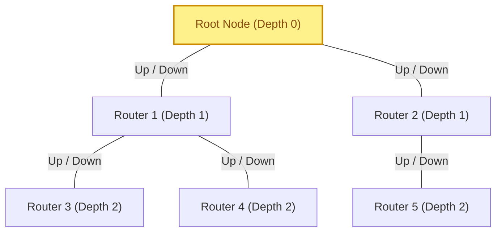
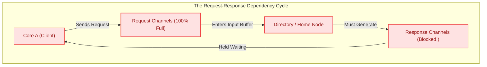

# 4.4 Fault-Tolerant Routing & Protocol Deadlock Avoidance

Even if a network's routing algorithm is provably deadlock-free on an ideal 2D grid, real-world silicon faces two harsh realities:
1. **Physical Hardware Failures:** Deep-submicron silicon suffers from manufacturing defects, electromigration, thermal hotspots, and transistor aging (BTI/HCI). When a router or physical link dies, the topology becomes **irregular**, and rigid algorithms like XY routing completely break down.
2. **Protocol-Level Deadlock:** Even if the physical network never deadlocks, **cache coherence protocols** (such as MESI/MOESI) can create circular Request-Response dependencies at the network interfaces, permanently freezing the entire multi-core processor!

In this final lesson of Track 4, we examine how to route around hardware faults using **Up\*/Down\* Spanning Tree Routing**, explore **Deadlock Recovery mechanisms (DISHA)**, and eliminate cache coherence deadlocks using **Hardware Virtual Networks (VNETs)**.

---

## 1. Fault-Tolerant Routing on Irregular Topologies

When routers or links fail, an initially regular 2D mesh becomes an **irregular graph** with missing edges and holes:

```
Healthy 2D Mesh:                       Mesh with Hardware Faults (Irregular):
  [R] --- [R] --- [R] --- [R]             [R] --- [R] --- [R] --- [R]
   |       |       |       |               |               |       |
  [R] --- [R] --- [R] --- [R]             [R]     [X] --- [R] --- [R]  <-- Fault at (1,1)!
   |       |       |       |               |       |               |
  [R] --- [R] --- [R] --- [R]             [R] --- [R]     [X]     [R]  <-- Broken link!
```

If a packet targeting $(3, 1)$ blindly follows XY routing, it will attempt to traverse through the dead router $(1, 1)$ and be dropped or trapped forever!

### Up\*/Down\* Spanning Tree Routing (Schroeder et al., 1991)
How can we guarantee deadlock-free, loop-free routing across an **arbitrary, irregular, or broken topology** without needing complex hardware?

The industry-standard solution is **Up\*/Down\* Routing**, developed for DEC Autonet and widely used in PCIe, InfiniBand, and fault-tolerant NoCs:

#### Step 1: Construct a Breadth-First Spanning Tree
Select a healthy node as the **Root ($R_0$)** and build a Breadth-First Search (BFS) spanning tree encompassing all operational routers.

#### Step 2: Assign Up and Down Edge Directions
Every physical link connecting Node $u$ and Node $v$ is assigned a direction:
- An edge $(u, v)$ is an **"Up" edge** if Node $v$ is closer to the Root than Node $u$ (or if both are at the same depth and $\text{ID}(v) < \text{ID}(u)$).
- An edge $(u, v)$ is a **"Down" edge** if Node $v$ is further from the Root than Node $u$.



#### Step 3: The Up\*/Down\* Invariant Rule
> **"A packet may make zero or more UP transitions, followed by zero or more DOWN transitions ($U^* D^*$). A packet is STRICTLY FORBIDDEN from ever making an UP transition after having made a DOWN transition!"**

$$\text{Legal Traversal Pattern: } \mathbf{Up \rightarrow Up \dots \rightarrow Down \rightarrow Down}$$
$$\mathbf{\text{Forbidden Traversal: } Down \rightarrow Up \quad (\text{Strictly Prohibited!})}$$

### Proof of Deadlock Freedom:
Because a packet can never transition from $Down \rightarrow Up$:
1. A packet begins climbing "Up" toward the root until it reaches the lowest common ancestor of its destination.
2. It then descends "Down" the tree to the destination.
3. Because the root distance is strictly monotonically decreasing during the Up phase and strictly monotonically increasing during the Down phase, **no circular dependency cycle can ever close!**
4. Up\*/Down\* is mathematically guaranteed to be **deadlock-free on ANY topology**, regardless of how many links or routers have failed.

---

## 2. Deadlock Avoidance vs. Deadlock Recovery

All the techniques studied so far (DOR, Turn Model, Duato, Up\*/Down\*) belong to **Deadlock Avoidance**—they restrict routing rules to make deadlocks structurally impossible.

However, an alternative philosophy is **Deadlock Recovery**:
- Allow packets to route **completely unconstrained** across all available channels (maximizing throughput and adaptivity).
- In the rare event ($<0.01\%$) that packets actually form a deadlock, detect the stall and resolve it dynamically!

| Paradigm | Philosophy | Hardware Overhead | Throughput Impact |
| :--- | :--- | :--- | :--- |
| **Deadlock Avoidance** | Prevent cycles structurally (DOR, Turn Model, Duato) | Virtual channel partitions, turn restrictions | Slightly reduced peak adaptivity; zero recovery latency |
| **Deadlock Recovery** | Detect stall timer $\tau$, flush deadlocked packets | Stall counters, central token arbiter, packet crush logic | Maximum routing freedom; penalty on timeout false-positives |

### DISHA: Progressive Deadlock Recovery (Anjan & Pinkston, 1995)
The most elegant recovery architecture is **DISHA (Deadlock-free Interconnection routing with Sequential High-performance Allocation)**:
1. Each router has an exclusive, 1-flit **Central Recovery Buffer**.
2. A single **Token** circulates sequentially among all routers in the system.
3. When a router's packet exceeds a timeout threshold $\tau_{timeout}$, it flags a potential deadlock and requests the recovery token.
4. Once the router captures the token, its deadlocked packet gains **exclusive, uninterrupted access** to the central recovery path, routing directly to its destination without contention.
5. Once delivered, the token is released to the next router. Because only one deadlocked flow is recovered at a time, the recovery channel is strictly acyclic and guaranteed to drain.

---

## 3. Protocol-Level Deadlock in Multi-Core SoCs

Here is the most critical lesson in network architecture:
> **A network that is 100% deadlock-free at the packet routing layer can STILL DEADLOCK at the system level due to cache coherence protocols!**

### The Request-Response Circular Dependency
Consider a multi-core processor running a directory-based **MESI / MOESI cache coherence protocol**:

```
Cache Coherence Message Classes:
1. Request: Core A sends Read_Request to Directory (Home Node).
2. Forward / Probe: Directory sends Invalidation_Probe to Core B (Owner).
3. Response / Data: Core B sends Cache_Line_Data back to Core A.
```

Now consider what happens if all messages share the **same physical network buffers**:



1. Core $A$ generates a burst of memory `Requests`. The network buffers fill up completely with `Request` flits.
2. The Home Node Directory receives a `Request` from Core $A$. To satisfy the request, the Directory must allocate an output buffer and inject a `Response` (or invalidate another core).
3. **The Bottleneck:** The network channels leaving the Directory are already **$100\%$ full of in-flight `Request` packets**!
4. Because the Directory cannot inject its `Response`, it **refuses to consume any more incoming `Requests`** from its input buffer.
5. In-flight `Requests` back up across the entire chip, freezing the network.
6. Core $A$ cannot accept new incoming transactions because it is waiting for the `Response` to its pending `Request`.
7. **System Deadlock!** The `Response` depends on the `Request` being consumed, but the `Request` cannot be consumed until the `Response` is sent!

---

## 4. Hardware Solution: Virtual Networks (VNETs)

To break protocol deadlock, modern SoCs (such as ARM AMBA 5 CHI, Intel UPI, and OpenSPARC) enforce strict **Virtual Network (VNET) Partitioning**.

Routers partition their physical buffer queues into **disjoint, non-overlapping Virtual Networks**:

```
Hardware VNET Hierarchy:
+----------------------------------------------------------------------------+
| VNET 2: Response & Data Channel (Highest Priority - Never Blocks)          |
|   - Carries Read_Data, Write_Ack, Invalidation_Ack                         |
|   - Consumers are GUARANTEED to sink packets immediately without waiting!  |
+----------------------------------------------------------------------------+
| VNET 1: Forwarded Requests & Invalidation Probes (Intermediate Priority)    |
|   - Carries Probe_Request, Forwarded_Read                                  |
|   - Processing a VNET 1 packet only requires injecting into VNET 2         |
+----------------------------------------------------------------------------+
| VNET 0: Original Requests (Lowest Priority)                                |
|   - Carries Read_Shared, Read_Unique, Write_Back                           |
|   - Processing a VNET 0 packet only requires injecting into VNET 1 or 2    |
+----------------------------------------------------------------------------+
```

### The Invariant for Protocol Deadlock Freedom:
$$\mathbf{\text{Dependency Rule: } \text{VNET}_i \text{ can ONLY depend on } \text{VNET}_j \text{ where } j > i}$$

- A message in $\text{VNET}_0$ (Request) can trigger a message in $\text{VNET}_1$ (Probe) or $\text{VNET}_2$ (Data).
- A message in $\text{VNET}_2$ (Response) is **strictly terminal**—it sinks directly into the cache controller without requiring any further message injection!
- Because dependencies flow strictly upwards ($0 \rightarrow 1 \rightarrow 2$), **circular protocol dependencies are physically impossible!**

---

## 5. 🔬 Interactive Protocol Deadlock & VNET Isolation Visualizer

Simulate a cache controller under heavy memory pressure. Toggle between a **Single Shared Buffer** and **3-Tier Isolated VNETs** to observe how protocol deadlocks freeze the system and how VNETs guarantee forward progress:

<div class="noc-sim-container" id="vnet-sim">
  <div style="display:flex; justify-content:space-between; align-items:center; flex-wrap:wrap; gap:0.5rem; margin-bottom:1rem;">
    <div style="font-weight:700; font-size:1.05rem; color:var(--tcl-heading);">
      🛡️ Cache Coherence Protocol Deadlock &amp; VNET Isolation Engine
    </div>
    <span class="noc-track-badge" style="background:rgba(37,99,235,0.1); color:#2563eb;" id="vnet_badge">
      VNET Partitioned Mode
    </span>
  </div>

  <div style="display:flex; gap:0.75rem; flex-wrap:wrap; margin-bottom:1.25rem;">
    <div>
      <label style="font-size:0.82rem; font-weight:600; display:block; margin-bottom:0.25rem;">Architecture Mode:</label>
      <select id="vnet_mode" class="noc-sim-select" onchange="resetVNETSim()">
        <option value="VNET" selected>3-Tier Isolated VNETs (Deadlock-Free)</option>
        <option value="SHARED">Single Shared Buffer (Vulnerable to Deadlock)</option>
      </select>
    </div>
    <div style="display:flex; align-items:flex-end; gap:0.5rem;">
      <button class="noc-sim-btn" style="background:#ef4444;" onclick="injectBurst()">
        💥 Inject Heavy Memory Request Burst
      </button>
      <button class="noc-sim-btn" style="background:var(--md-default-fg-color--lightest); color:var(--md-default-fg-color); border:1px solid var(--tcl-border);" onclick="resetVNETSim()">
        🔄 Reset System
      </button>
    </div>
  </div>

  <div style="display:grid; grid-template-columns:repeat(auto-fit, minmax(280px, 1fr)); gap:1rem; margin-bottom:1.25rem;">
    <div style="background:var(--md-default-fg-color--lightest); border:1px solid var(--tcl-border); border-radius:8px; padding:1rem;">
      <div style="font-weight:700; font-size:0.9rem; margin-bottom:0.6rem; color:var(--tcl-heading); display:flex; justify-content:space-between;">
        <span>Client Core (CPU 0)</span>
        <span id="core_status" style="color:#22c55e;">Active</span>
      </div>
      <div style="font-size:0.82rem; line-height:1.6;">
        Pending Requests: <strong id="core_pending">0</strong><br/>
        Received Responses: <strong id="core_resp">0</strong><br/>
        Input Buffer: <strong id="core_inbuf">Empty</strong>
      </div>
    </div>

    <div style="background:var(--md-default-fg-color--lightest); border:1px solid var(--tcl-border); border-radius:8px; padding:1rem;">
      <div style="font-weight:700; font-size:0.9rem; margin-bottom:0.6rem; color:var(--tcl-heading); display:flex; justify-content:space-between;">
        <span>Directory / Memory Controller</span>
        <span id="mem_status" style="color:#22c55e;">Ready</span>
      </div>
      <div style="font-size:0.82rem; line-height:1.6;">
        Request Queue (VNET 0): <strong id="mem_req_q">0 / 4</strong><br/>
        Response Queue (VNET 2): <strong id="mem_resp_q">0 / 4</strong><br/>
        Service State: <strong id="mem_service">Idle</strong>
      </div>
    </div>
  </div>

  <div style="background:#0f172a; border-radius:8px; padding:1rem; border:1px solid #334155; margin-bottom:1rem;">
    <div style="font-weight:700; font-size:0.85rem; color:#94a3b8; margin-bottom:0.5rem;">
      TRACE EXECUTION MONITOR:
    </div>
    <div id="vnet_trace" style="font-family:monospace; font-size:0.82rem; height:120px; overflow-y:auto; line-height:1.5; color:#38bdf8;">
      [SYSTEM READY] Select architecture and click 'Inject Heavy Memory Request Burst'.
    </div>
  </div>
</div>

<script>
let vnetState = {
  mode: "VNET",
  pendingReqs: 0,
  completedResp: 0,
  reqQ: 0,
  respQ: 0,
  isDeadlocked: false
};

function resetVNETSim() {
  const m = document.getElementById("vnet_mode").value;
  vnetState.mode = m;
  vnetState.pendingReqs = 0;
  vnetState.completedResp = 0;
  vnetState.reqQ = 0;
  vnetState.respQ = 0;
  vnetState.isDeadlocked = false;

  const badge = document.getElementById("vnet_badge");
  if (m === "VNET") {
    badge.textContent = "VNET Partitioned Mode (Deadlock-Free)";
    badge.style.background = "rgba(34,197,94,0.15)";
    badge.style.color = "#22c55e";
  } else {
    badge.textContent = "Single Shared Buffer (Vulnerable)";
    badge.style.background = "rgba(239,68,68,0.15)";
    badge.style.color = "#ef4444";
  }

  document.getElementById("core_status").textContent = "Active";
  document.getElementById("core_status").style.color = "#22c55e";
  document.getElementById("mem_status").textContent = "Ready";
  document.getElementById("mem_status").style.color = "#22c55e";
  document.getElementById("core_pending").textContent = "0";
  document.getElementById("core_resp").textContent = "0";
  document.getElementById("core_inbuf").textContent = "Empty";
  document.getElementById("mem_req_q").textContent = "0 / 4";
  document.getElementById("mem_resp_q").textContent = "0 / 4";
  document.getElementById("mem_service").textContent = "Idle";

  document.getElementById("vnet_trace").innerHTML = `[RESET] System running in ${m} architecture mode.`;
}

function injectBurst() {
  const trace = document.getElementById("vnet_trace");

  if (vnetState.mode === "SHARED") {
    // Shared buffer: Request burst fills ALL buffers, preventing responses
    vnetState.isDeadlocked = true;
    document.getElementById("core_status").textContent = "FROZEN (STALLED)";
    document.getElementById("core_status").style.color = "#ef4444";
    document.getElementById("mem_status").textContent = "DEADLOCKED!";
    document.getElementById("mem_status").style.color = "#ef4444";
    document.getElementById("mem_req_q").textContent = "4 / 4 (FULL)";
    document.getElementById("mem_resp_q").textContent = "BLOCKED";
    document.getElementById("core_pending").textContent = "8";

    trace.innerHTML = `
      <span style="color:#ef4444; font-weight:bold;">[CRITICAL FAILURE: PROTOCOL DEADLOCK]</span><br/>
      1. CPU 0 injects 8 memory Read_Requests.<br/>
      2. Directory input queue fills to 100% capacity with Requests.<br/>
      3. Directory attempts to generate Read_Response, but output link is blocked by incoming Requests!<br/>
      4. Directory refuses to sink incoming Requests from buffer.<br/>
      5. CPU 0 cannot sink requests because its input buffer is waiting for Response!<br/>
      <span style="color:#ef4444; font-weight:bold;">RESULT: Complete hardware freeze. Whole chip bricked!</span>
    `;
  } else {
    // VNET mode: Requests stay in VNET 0, Responses flow freely in VNET 2
    vnetState.pendingReqs = 8;
    vnetState.reqQ = 4;
    vnetState.respQ = 2;
    vnetState.completedResp = 8;

    document.getElementById("core_status").textContent = "Processing Rapidly";
    document.getElementById("core_status").style.color = "#22c55e";
    document.getElementById("mem_status").textContent = "Draining Seamlessly";
    document.getElementById("mem_status").style.color = "#22c55e";
    document.getElementById("mem_req_q").textContent = "4 / 4 (VNET 0)";
    document.getElementById("mem_resp_q").textContent = "Flowing (VNET 2)";
    document.getElementById("core_pending").textContent = "0 (Completed)";
    document.getElementById("core_resp").textContent = "8";

    trace.innerHTML = `
      <span style="color:#22c55e; font-weight:bold;">[SUCCESS: VNET ISOLATION ACTIVE]</span><br/>
      1. CPU 0 injects 8 memory Read_Requests onto VNET 0.<br/>
      2. VNET 0 buffer fills to capacity, exerting backpressure ONLY on Request channels.<br/>
      3. Directory processes requests and injects Read_Response packets onto ISOLATED VNET 2.<br/>
      4. Because VNET 2 has dedicated physical FIFO buffers, Responses NEVER contend with Requests!<br/>
      5. CPU 0 receives all 8 Responses smoothly. VNET 0 queue drains completely.<br/>
      <span style="color:#22c55e; font-weight:bold;">RESULT: Zero deadlock risk! High-performance forward progress guaranteed.</span>
    `;
  }
}

if (document.readyState === "loading") {
  document.addEventListener("DOMContentLoaded", resetVNETSim);
} else {
  resetVNETSim();
}
</script>

---

## 6. Worked Numerical Example: Dimensioning VNET Buffers

> [!TIP]
> **Problem Statement:**  
> A multi-core processor has $64\text{ cores}$ connected via a $8 \times 8$ 2D Mesh NoC running an invalidation-based MESI cache coherence protocol.  
> 
> The architect specifies:
> - Channel bandwidth: $128\text{ bits/cycle}$ ($16\text{ Bytes/flit}$).
> - Maximum outstanding memory requests per core: $16\text{ MSHRs}$ (Miss Status Holding Registers).
> 
> Calculate:
> 1. What is the minimum number of Virtual Networks (VNETs) required to guarantee freedom from protocol deadlock?
> 2. If each VNET requires at least $4\text{ flits}$ of buffer storage per input port to cover credit turnaround latency, calculate the total router buffer memory required per 5-port router.

### Step 1: Minimum Number of VNETs
In an invalidation-based MESI directory protocol, message dependency chains have length 3:
1. $\text{VNET}_0$ (Request): Core $\rightarrow$ Directory (`Read_Shared`, `Read_Unique`).
2. $\text{VNET}_1$ (Forward / Invalidation): Directory $\rightarrow$ Sharing Cores (`Invalidation_Probe`, `Fetch`).
3. $\text{VNET}_2$ (Response / Data): Sharing Cores / Directory $\rightarrow$ Requesting Core (`Data_Ack`, `Inv_Ack`).

Because a Request can trigger an Invalidation, which triggers a Response ($0 \rightarrow 1 \rightarrow 2$), we require at least **3 disjoint Virtual Networks ($\text{VNET}_0, \text{VNET}_1, \text{VNET}_2$)** to eliminate circular dependency chains.

### Step 2: Buffer Storage per Router
Each router has $5\text{ input ports}$ (North, South, East, West, Local Core):
$$\text{Buffers per Port} = 3\text{ VNETs} \times 4\text{ flits/VNET} = \mathbf{12\text{ flits per port}}$$
$$\text{Total Flits per Router} = 5\text{ ports} \times 12\text{ flits} = \mathbf{60\text{ flits}}$$
$$\text{Total Buffer Memory} = 60\text{ flits} \times 16\text{ Bytes/flit} = \mathbf{960\text{ Bytes} \approx 0.94\text{ KB per router}}$$

### Takeaway:
---

## 7. 💻 Synthesizable Hardware: VNET Protocol Isolator & Fault Bypass Unit

To guarantee that cache coherence protocols never freeze the physical fabric, router network interfaces partition traffic into separate **Virtual Networks (VNETs)** and apply **Strict Non-Blocking Priority Scheduling** ($Response > Forward > Request$).

Furthermore, in degraded silicon with broken traces, the router incorporates a **Perimeter Fault Deflection Unit** that dynamically detours flits around severed links without dropping packets.

The synthesizable Verilog module below, `vnet_protocol_isolator.v`, implements this dual-function protocol-isolation and fault-resilience engine:

```verilog
//=============================================================================
// Module: vnet_protocol_isolator
// Description: Synthesizable Multi-Class Virtual Network (VNET) Arbiter &
//              Fault-Tolerant Link Bypass Unit for Shared-Memory NoCs.
//              - Isolates 3 message classes to prevent protocol deadlock:
//                  VNET 0: Request   (e.g., GetS, GetM)
//                  VNET 1: Forward   (e.g., Invalidation, Fwd-GetS)
//                  VNET 2: Response  (e.g., Data, Completion Ack)
//              - Enforces strict priority: VNET2 > VNET1 > VNET0
//                (Responses drain first, preventing Request-Response deadlock).
//              - Fault Bypass: If primary destination port is marked faulty
//                in faulty_ports[3:0], packet is dynamically deflected along
//                a perimeter detour!
//=============================================================================

module vnet_protocol_isolator #(
    parameter integer FLIT_WIDTH = 64
)(
    input  wire                    clk,
    input  wire                    rst_n,

    // Ingress Virtual Network FIFOs (from local core / router input)
    input  wire [2:0]              vnet_req_valid,   // [2]=Response, [1]=Forward, [0]=Request
    input  wire [3*FLIT_WIDTH-1:0] vnet_flit_data,   // Packed flits for each VNET
    output reg  [2:0]              vnet_grant,       // 1-hot grant to winning VNET

    // Desired Route Output Port from RC (1-hot: [3]=North, [2]=South, [1]=East, [0]=West)
    input  wire [3:0]              primary_route_port,

    // Hardware Fault Status from BIST Radar (1 = physical link broken/dead)
    input  wire [3:0]              faulty_ports,

    // Outgoing Switch Grant & Egress Signals
    output reg                     egress_valid,
    output reg  [FLIT_WIDTH-1:0]   egress_flit,
    output reg  [1:0]              egress_vnet_id,
    output reg  [3:0]              egress_port_1hot,
    output reg                     is_deflected_detour
);

    // Unpack Ingress Flits
    wire [FLIT_WIDTH-1:0] flit_vnet [0:2];
    assign flit_vnet[0] = vnet_flit_data[0*FLIT_WIDTH +: FLIT_WIDTH]; // VNET0: Request
    assign flit_vnet[1] = vnet_flit_data[1*FLIT_WIDTH +: FLIT_WIDTH]; // VNET1: Forward
    assign flit_vnet[2] = vnet_flit_data[2*FLIT_WIDTH +: FLIT_WIDTH]; // VNET2: Response

    // Strict Priority Arbiter: Response (2) > Forward (1) > Request (0)
    reg [1:0] winning_vnet;
    reg       has_winner;

    always @(*) begin
        if (vnet_req_valid[2]) begin
            winning_vnet = 2'd2;
            has_winner   = 1'b1;
        end else if (vnet_req_valid[1]) begin
            winning_vnet = 2'd1;
            has_winner   = 1'b1;
        end else if (vnet_req_valid[0]) begin
            winning_vnet = 2'd0;
            has_winner   = 1'b1;
        end else begin
            winning_vnet = 2'd0;
            has_winner   = 1'b0;
        end
    end

    // Fault-Tolerant Perimeter Detour Logic:
    // If targeted link is faulty, deflect clockwise: North -> East -> South -> West -> North
    reg [3:0] resolved_port;
    reg       detour_active;

    always @(*) begin
        detour_active = 1'b0;
        resolved_port = primary_route_port;

        if (| (primary_route_port & faulty_ports)) begin
            detour_active = 1'b1;
            case (primary_route_port)
                4'b1000: resolved_port = (!faulty_ports[1]) ? 4'b0010 : // East
                                         (!faulty_ports[0]) ? 4'b0001 : // West
                                                              4'b0100;  // South
                4'b0100: resolved_port = (!faulty_ports[0]) ? 4'b0001 : // West
                                         (!faulty_ports[1]) ? 4'b0010 : // East
                                                              4'b1000;  // North
                4'b0010: resolved_port = (!faulty_ports[2]) ? 4'b0100 : // South
                                         (!faulty_ports[3]) ? 4'b1000 : // North
                                                              4'b0001;  // West
                4'b0001: resolved_port = (!faulty_ports[3]) ? 4'b1000 : // North
                                         (!faulty_ports[2]) ? 4'b0100 : // South
                                                              4'b0010;  // East
                default: resolved_port = 4'b0000;
            endcase
        end
    end

    // Output Datapath Registers
    always @(posedge clk or negedge rst_n) begin
        if (!rst_n) begin
            vnet_grant          <= 3'b000;
            egress_valid        <= 1'b0;
            egress_flit         <= {FLIT_WIDTH{1'b0}};
            egress_vnet_id      <= 2'd0;
            egress_port_1hot    <= 4'b0000;
            is_deflected_detour <= 1'b0;
        end else begin
            if (has_winner) begin
                vnet_grant          <= (1'b1 << winning_vnet);
                egress_valid        <= 1'b1;
                egress_flit         <= flit_vnet[winning_vnet];
                egress_vnet_id      <= winning_vnet;
                egress_port_1hot    <= resolved_port;
                is_deflected_detour <= detour_active;
            end else begin
                vnet_grant          <= 3'b000;
                egress_valid        <= 1'b0;
                egress_port_1hot    <= 4'b0000;
                is_deflected_detour <= 1'b0;
            end
        end
    end

endmodule
```

---

## 8. 🕹️ Interactive Lab & Arcade Arena

Put fault-tolerant routing and protocol isolation to the test in silicon arcade simulators:

<div class="noc-tracks-grid" style="margin-top:1rem;">
  <div class="noc-track-card">
    <div>
      <span class="noc-track-badge" style="background:rgba(239,68,68,0.15); color:#ef4444;">Silicon Defense</span>
      <div class="noc-track-title">🛡️ Fault Defender: Silicon Resilience</div>
      <div class="noc-track-desc">
        Survive electro-migration wire breaks and dead router tiles! Use BIST radar pulses to detect broken links and steer traffic around convex fault rings.
      </div>
    </div>
    <a href="../interactive/faults/" class="noc-track-link">Play Fault Defender →</a>
  </div>

  <div class="noc-track-card">
    <div>
      <span class="noc-track-badge" style="background:rgba(37,99,235,0.15); color:#2563eb;">Traffic Arena</span>
      <div class="noc-track-title">⚖️ QoS Gladiator: Traffic Arbiter</div>
      <div class="noc-track-desc">
        Arbitrate multi-class VNET flows under strict priority, defending real-time cache responses against massive injection floods of background requests.
      </div>
    </div>
    <a href="../interactive/qos/" class="noc-track-link">Launch QoS Gladiator →</a>
  </div>
</div>

---

## 9. 🎯 Comprehensive Self-Assessment Quiz

Test your mastery of fault-tolerant routing, spanning tree rules, and cache protocol deadlock:

<div class="noc-sim-container" id="quiz44_container" style="margin-top:1rem;">
  <div style="display:flex; justify-content:space-between; align-items:center; margin-bottom:1rem; border-bottom:1px solid var(--tcl-border); padding-bottom:0.5rem;">
    <span style="font-weight:700; font-size:1.05rem; color:var(--tcl-heading);">📝 Lesson 4.4 Self-Check</span>
    <span id="quiz44_score" style="font-weight:700; font-size:0.9rem; color:#2563eb;">Score: 0 / 3</span>
  </div>

  <!-- Question 1 -->
  <div class="quiz-item" style="margin-bottom:1.5rem;">
    <p style="font-weight:600; font-size:0.95rem; margin-bottom:0.6rem;">
      <b>Q1:</b> In Up\*/Down\* routing on an irregular or fault-degraded network, why is the transition from a Down edge to an Up edge ($Down \rightarrow Up$) strictly prohibited?
    </p>
    <div style="display:flex; flex-direction:column; gap:0.45rem;" id="q44_1_options">
      <button class="noc-sim-select" style="text-align:left; padding:0.6rem 0.85rem; cursor:pointer;" onclick="answerQ44(1, 0)">A. Because Down links operate at half the clock frequency of Up links.</button>
      <button class="noc-sim-select" style="text-align:left; padding:0.6rem 0.85rem; cursor:pointer;" onclick="answerQ44(1, 1)">B. Because permitting a packet to go Up after traveling Down allows closed directed cycles to form in the Channel Dependency Graph, which can cause routing deadlock.</button>
      <button class="noc-sim-select" style="text-align:left; padding:0.6rem 0.85rem; cursor:pointer;" onclick="answerQ44(1, 2)">C. Because packets traveling Down lose their destination header flit.</button>
      <button class="noc-sim-select" style="text-align:left; padding:0.6rem 0.85rem; cursor:pointer;" onclick="answerQ44(1, 3)">D. Because the root node only accepts Down packets.</button>
    </div>
    <div id="q44_1_feedback" style="display:none; margin-top:0.6rem; padding:0.75rem; border-radius:6px; font-size:0.88rem; line-height:1.5;"></div>
  </div>

  <!-- Question 2 -->
  <div class="quiz-item" style="margin-bottom:1.5rem;">
    <p style="font-weight:600; font-size:0.95rem; margin-bottom:0.6rem;">
      <b>Q2:</b> What causes a <strong>Cache Coherence Protocol Deadlock</strong> in shared-memory multi-cores if all message classes share the exact same physical router buffers?
    </p>
    <div style="display:flex; flex-direction:column; gap:0.45rem;" id="q44_2_options">
      <button class="noc-sim-select" style="text-align:left; padding:0.6rem 0.85rem; cursor:pointer;" onclick="answerQ44(2, 0)">A. A circular consumption dependency between Request and Response buffers: Core A cannot process Core B's Request until its own Response buffer drains, while Core B is blocked waiting for Core A's Response to drain its Request buffer.</button>
      <button class="noc-sim-select" style="text-align:left; padding:0.6rem 0.85rem; cursor:pointer;" onclick="answerQ44(2, 1)">B. An electrical short circuit on the clock distribution tree.</button>
      <button class="noc-sim-select" style="text-align:left; padding:0.6rem 0.85rem; cursor:pointer;" onclick="answerQ44(2, 2)">C. Parity errors in the L1 tag array.</button>
      <button class="noc-sim-select" style="text-align:left; padding:0.6rem 0.85rem; cursor:pointer;" onclick="answerQ44(2, 3)">D. Packet fragmentation caused by jumbo flits.</button>
    </div>
    <div id="q44_2_feedback" style="display:none; margin-top:0.6rem; padding:0.75rem; border-radius:6px; font-size:0.88rem; line-height:1.5;"></div>
  </div>

  <!-- Question 3 -->
  <div class="quiz-item" style="margin-bottom:1rem;">
    <p style="font-weight:600; font-size:0.95rem; margin-bottom:0.6rem;">
      <b>Q3:</b> In a 3-class MESI cache coherence protocol, what is the <strong>minimum number of Virtual Networks (VNETs)</strong> required to guarantee protocol deadlock freedom?
    </p>
    <div style="display:flex; flex-direction:column; gap:0.45rem;" id="q44_3_options">
      <button class="noc-sim-select" style="text-align:left; padding:0.6rem 0.85rem; cursor:pointer;" onclick="answerQ44(3, 0)">A. At least 3 independent VNETs (Request, Forward/Probe, Response), ensuring that responses never block behind forwarded requests or initial requests.</button>
      <button class="noc-sim-select" style="text-align:left; padding:0.6rem 0.85rem; cursor:pointer;" onclick="answerQ44(3, 1)">B. Only 1 VNET, provided that all FIFO buffers are larger than 64 flits.</button>
      <button class="noc-sim-select" style="text-align:left; padding:0.6rem 0.85rem; cursor:pointer;" onclick="answerQ44(3, 2)">C. Exactly 16 VNETs, one for each core.</button>
      <button class="noc-sim-select" style="text-align:left; padding:0.6rem 0.85rem; cursor:pointer;" onclick="answerQ44(3, 3)">D. VNETs are unnecessary if the crossbar uses round-robin arbitration.</button>
    </div>
    <div id="q44_3_feedback" style="display:none; margin-top:0.6rem; padding:0.75rem; border-radius:6px; font-size:0.88rem; line-height:1.5;"></div>
  </div>
</div>

<script>
let q44Score = 0;
const answeredQ44 = {1: false, 2: false, 3: false};

function answerQ44(qNum, selected) {
  if (answeredQ44[qNum]) return;
  answeredQ44[qNum] = true;

  const correctAnswers = {1: 1, 2: 0, 3: 0};
  const isCorrect = (selected === correctAnswers[qNum]);
  const fb = document.getElementById("q44_" + qNum + "_feedback");
  const opts = document.getElementById("q44_" + qNum + "_options").children;

  for (let i = 0; i < opts.length; i++) {
    opts[i].style.cursor = "default";
    opts[i].onclick = null;
  }

  if (isCorrect) {
    q44Score++;
    opts[selected].style.background = "rgba(34, 197, 94, 0.15)";
    opts[selected].style.borderColor = "#22c55e";
    fb.style.display = "block";
    fb.style.background = "rgba(34, 197, 94, 0.1)";
    fb.style.border = "1px solid rgba(34, 197, 94, 0.3)";
    fb.style.color = "#166534";
    fb.innerHTML = "<strong>✓ Correct!</strong> " + getQ44Explanation(qNum, true);
  } else {
    opts[selected].style.background = "rgba(239, 68, 68, 0.15)";
    opts[selected].style.borderColor = "#ef4444";
    opts[correctAnswers[qNum]].style.background = "rgba(34, 197, 94, 0.15)";
    opts[correctAnswers[qNum]].style.borderColor = "#22c55e";
    fb.style.display = "block";
    fb.style.background = "rgba(239, 68, 68, 0.1)";
    fb.style.border = "1px solid rgba(239, 68, 68, 0.3)";
    fb.style.color = "#991b1b";
    fb.innerHTML = "<strong>✗ Incorrect.</strong> " + getQ44Explanation(qNum, false);
  }

  document.getElementById("quiz44_score").textContent = "Score: " + q44Score + " / 3";
}

function getQ44Explanation(qNum, wasCorrect) {
  if (qNum === 1) {
    return "By strictly enforcing that packets may only go Up towards the root and then Down to the destination (U* D*), the Channel Dependency Graph is guaranteed to be acyclic. Forbidding Down-to-Up turns prevents loops from closing.";
  } else if (qNum === 2) {
    return "Protocol deadlock occurs at the transaction layer: if node A cannot accept an incoming Request because its outgoing Response queue is blocked, and vice-versa for node B, a consumption cycle freezes the system.";
  } else {
    return "A 3-tier MESI protocol produces a dependency chain: Request -> Forward -> Response. To eliminate circular dependency at the consumption layer, each tier must map to a dedicated, independent Virtual Network (VNET0, VNET1, VNET2).";
  }
}
</script>

---

## Track 4 Summary: Routing & Deadlock Avoidance Mastery

Congratulations! You have completed **Track 4: Routing Algorithms & Deadlock Avoidance**.

Here is what you have mastered across this module:
1. **Deterministic Routing (Lesson 4.1):** Dimension-Order Routing (XY/YX), lookahead route computation logic, synthesizable `lookahead_route_comp.v`, and monotonic dimension deadlock proofs.
2. **The Turn Model (Lesson 4.2):** Geometry of clockwise/counter-clockwise cycles, Glass & Ni's theorem, West-First, North-Last, Chiu's balanced Odd-Even turn model, and synthesizable `turn_model_adaptive_router.v`.
3. **Formal Deadlock Theory (Lesson 4.3):** Channel Dependency Graphs (CDGs), the Dally-Seitz theorem for deterministic networks, Duato's Escape Channel theorem ($C = C_1 \cup C_0$), and synthesizable `duato_escape_vc_allocator.v`.
4. **Fault Tolerance & Protocol Deadlock (Lesson 4.4):** Up\*/Down\* spanning tree routing on degraded topologies, DISHA token recovery, hardware Virtual Networks (VNETs), and synthesizable `vnet_protocol_isolator.v`.

Ready to explore how thermal hotspots, spatial temperature gradients, and congestion throttling impact NoC design?

👉 **Proceed to [Track 5: Thermal & Congestion Management](../track5-congestion-thermal/index.md)**

