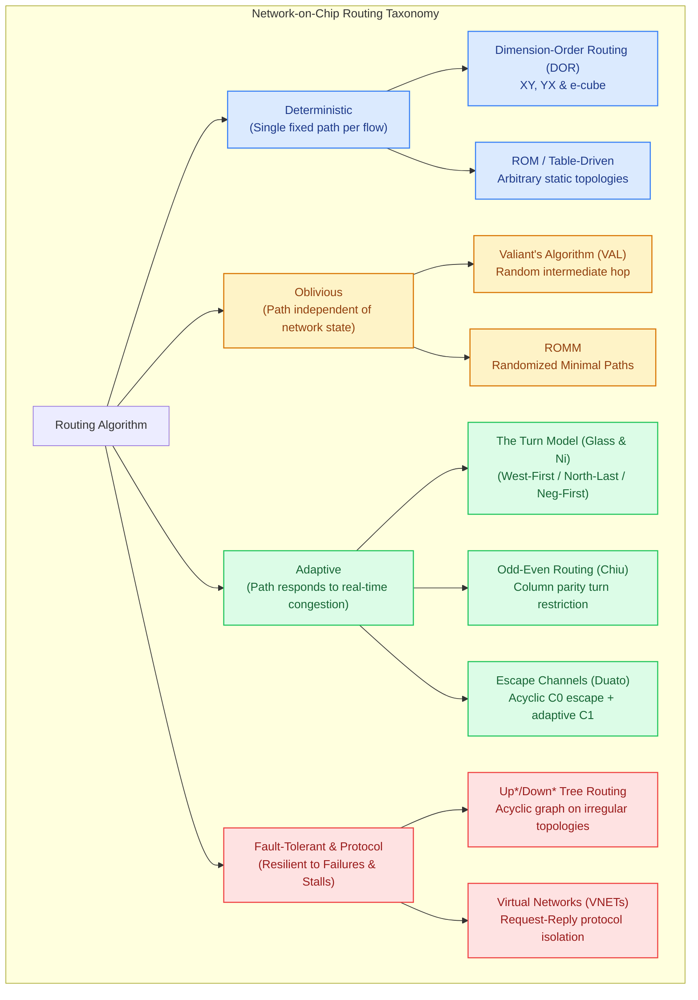

# Track 4: Routing Algorithms & Deadlock Avoidance

  
Network Architecture • Module 04

  <h1>Routing Algorithms &amp; Formal Deadlock Avoidance</h1>
  

    Master how packets navigate complex network topologies. From deterministic Dimension-Order Routing (DOR) to Glass &amp; Ni's Turn Model, Chiu's Odd-Even algorithm, and Duato's Escape Channels—learn to design high-throughput, adaptive, and provably deadlock-free routing engines.
  

  

    ⏱️ 4 In-Depth Lessons
    🔬 4 Interactive Simulators &amp; Visualizers
    💻 4 Synthesizable Verilog RTL Modules
    📐 Dally-Seitz &amp; Duato Formal Theorems
  

  

    

      📚 Aligned with Official Textbook Chapter 5
    

    

      For rigorous mathematical proofs of the Dally-Seitz theorem, Channel Dependency Graphs (CDG), Glass-Ni turn models, Duato's escape channels, and cache coherence VNET isolation, read <strong>Chapter 5: Deadlock Theory, Turn Models &amp; Adaptive Routing</strong>.
    

  

  <a href="../textbook/ch05-routing-deadlock-theory/" style="display: inline-flex; align-items: center; gap: 6px; background: #2563eb; color: #ffffff; padding: 8px 16px; border-radius: 6px; font-weight: 600; font-size: 0.85rem; text-decoration: none; transition: background 0.2s;">
    Read Chapter 5 Online →
  </a>

---

## 🗺️ Routing Algorithms Taxonomy & Roadmap

The diagram below maps the algorithmic landscape of network routing, from simple hardware state machines to formally verified adaptive and fault-tolerant architectures:

---

## 📚 Syllabus & Chapters in Track 4

  

    

      Lesson 4.1
      
Deterministic Dimension-Order Routing (DOR)

      

        Algorithmic foundations of XY and YX routing. Single-cycle combinational Route Computation (RC), lookahead routing optimization, synthesizable Verilog RTL (`lookahead_route_comp.v`), and mathematical proof of deadlock-freedom via monotonic dimension traversal.
      

      

        ⚡ <strong>Features:</strong> Interactive XY / YX Path Stepper, Synthesizable Verilog RTL (`lookahead_route_comp.v`), 3-Question Self-Check Quiz, Arcade Linkages (Packet Master &amp; Deadlock Buster).
      

    

    <a href="01-deterministic-dor/" class="noc-track-link">Launch Lesson 4.1 →</a>
  

  

    

      Lesson 4.2
      
Adaptive Routing &amp; The Turn Model

      

        Overcoming deterministic congestion bottlenecks. Christopher Glass and Lionel Ni's Turn Model: breaking all directed cycles by prohibiting only 2 out of 8 turns. West-First, North-Last, Ge-Ming Chiu's balanced Odd-Even turn model, and synthesizable dual-mode RTL (`turn_model_adaptive_router.v`).
      

      

        ⚡ <strong>Features:</strong> Interactive Turn Model Playground, Synthesizable Verilog RTL (`turn_model_adaptive_router.v`), 3-Question Self-Check Quiz, Arcade Linkages (Packet Master &amp; Deadlock Buster).
      

    

    <a href="02-adaptive-turn-model/" class="noc-track-link">Launch Lesson 4.2 →</a>
  

  

    

      Lesson 4.3
      
Formal Deadlock Theory &amp; Duato's Escape Channels

      

        Rigorous graph-theoretic foundations: Channel Dependency Graphs (CDGs). Dally &amp; Seitz's necessary and sufficient condition for deterministic routing. José Duato's breakthrough Escape Channel Theorem ($C = C_1 \cup C_0$), and synthesizable escape-channel VC allocator RTL (`duato_escape_vc_allocator.v`).
      

      

        ⚡ <strong>Features:</strong> Interactive CDG Deadlock Simulator &amp; Escape Channel Flusher, Synthesizable Verilog RTL (`duato_escape_vc_allocator.v`), 3-Question Self-Check Quiz, Arcade Linkages (Deadlock Buster &amp; Arbiter Arena).
      

    

    <a href="03-deadlock-theory-cdg/" class="noc-track-link">Launch Lesson 4.3 →</a>
  

  

    

      Lesson 4.4
      
Fault-Tolerant Routing &amp; Protocol Deadlock Avoidance

      

        Surviving hardware degradation and cache protocol stalls. Convex fault rings, Up*/Down* spanning tree routing for irregular and damaged topologies, deadlock recovery (DISHA token), hardware Virtual Networks (VNETs) to avoid MESI Request-Response deadlocks, and synthesizable VNET priority scheduler RTL (`vnet_protocol_isolator.v`).
      

      

        ⚡ <strong>Features:</strong> Interactive VNET Isolation Visualizer, Synthesizable Verilog RTL (`vnet_protocol_isolator.v`), 3-Question Self-Check Quiz, Arcade Linkages (Fault Defender &amp; QoS Gladiator).
      

    

    <a href="04-fault-tolerant-protocol-deadlock/" class="noc-track-link">Launch Lesson 4.4 →</a>
  

---

## 🎯 Track Learning Objectives

Upon completing Track 4, you will be able to:

1. **Implement single-cycle lookahead route computation** in synthesizable Verilog for Dimension-Order Routing (DOR).
2. **Apply Glass &amp; Ni's Turn Model** to eliminate clockwise and counter-clockwise cycles with minimal turn restrictions.
3. **Analyze Chiu's Odd-Even routing algorithm** to provide direction-balanced adaptivity without requiring dedicated virtual channels.
4. **Construct Channel Dependency Graphs (CDGs)** and apply the **Dally-Seitz** and **Duato Theorems** to mathematically prove deadlock-freedom.
5. **Architect Escape Virtual Channels** ($C = C_1 \cup C_0$) in router crossbars to enable aggressive adaptive routing without deadlock risk.
6. **Differentiate routing-level deadlock from cache coherence protocol-level deadlock**, and design multi-tier Virtual Networks (VNETs) to eliminate Request-Response dependency cycles.

Ready to begin? Start with **[Lesson 4.1: Deterministic Dimension-Order Routing (DOR)](01-deterministic-dor.md)**.
