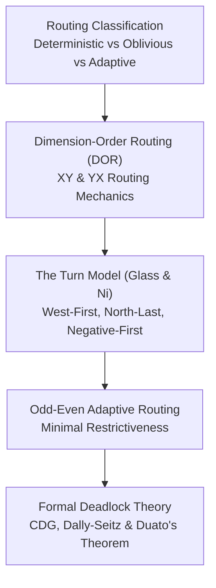

# Track 4: Routing Algorithms & Deadlock Avoidance

The routing algorithm determines the exact path a packet traverses from source to destination. In a wormhole-switched on-chip network, an incorrect routing policy can lead to **Routing Deadlock**—a circular chain of buffer dependencies where packets freeze forever, bricking the entire processor.

---

## 🗺️ Track Roadmap

---

## 📖 Lessons in this Track

1. **[4.1 Deterministic Dimension-Order Routing (DOR)](01-deterministic-dor.md)**  
   Understanding XY routing. Algorithmic implementation, hardware cost, and why strictly prohibiting turns from Y to X prevents deadlock.
2. **[4.2 Adaptive Routing & The Turn Model](02-adaptive-turn-model.md)**  
   Breaking the rigidity of deterministic routing. Glass and Ni's Turn Model: eliminating cycles by removing the minimum number of turns. West-First and Odd-Even algorithms.
3. **[4.3 Deadlock Theory & Channel Dependency Graphs](03-deadlock-theory-cdg.md)**  
   Formal mathematical foundations: Channel Dependency Graphs (CDG), Dally-Seitz theorem, Duato's theorem, and escape virtual channels.
