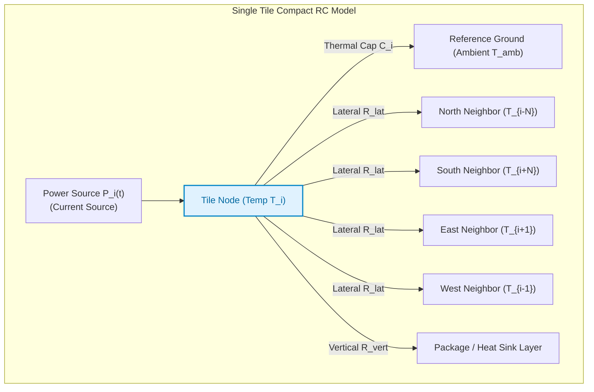

# 5.1 Thermal Physics & Compact RC Modeling

In modern nanometer many-core processors, transistor scaling has entered the era of **Dark Silicon** [[Esmaeilzadeh2011]](#ref-esmaeilzadeh2011), [[Taylor2012]](#ref-taylor2012). While Moore's Law continues to increase transistor density [[Moore1965]](#ref-moore1965), **Dennard scaling has ended** [[Dennard1974]](#ref-dennard1974): operating voltage ($V_{DD}$) cannot scale below $\sim 0.7\text{ V}$ without triggering catastrophic subthreshold leakage.

As a result, power density in high-performance SoCs routinely exceeds **$100\text{–}300\text{ W/cm}^2$**—a heat flux higher than the heating element of an electric stove, packed into a piece of silicon thinner than a human hair!

When intensive workloads (e.g., matrix multiplications in AI or heavy cache snooping) execute on a subset of cores, the localized heat cannot escape quickly enough, creating severe **Thermal Hotspots**.

In this lesson, we establish the physical equations of silicon heat conduction, derive the **Thermal-Electrical Duality**, analyze compact **RC ladder networks (HotSpot)**, and examine the profound timescale mismatch that challenges chip designers.

---

## 1. The Physics of Silicon Heat Conduction

Heat flow in a semiconductor substrate is governed by **Fourier's Law of Thermal Conduction**:

$$\mathbf{q = -k \nabla T}$$

Where:
- $\mathbf{q}$ is the local heat flux density ($\text{W/m}^2$).
- $k$ is the thermal conductivity of the material ($k_{Si} \approx 148\text{ W/(m}\cdot\text{K)}$ at $300\text{ K}$, but drops to $\approx 100\text{ W/(m}\cdot\text{K)}$ at operating temperatures).
- $\nabla T$ is the spatial temperature gradient ($\text{K/m}$).

Applying conservation of energy over an infinitesimal volume element yields the **3D Heat Diffusion Partial Differential Equation (PDE)**:

$$\rho c_p \frac{\partial T(\mathbf{x}, t)}{\partial t} = \nabla \cdot \big( k \nabla T(\mathbf{x}, t) \big) + P_{gen}(\mathbf{x}, t)$$

Where:
- $\rho$ is the mass density of silicon ($2,330\text{ kg/m}^3$).
- $c_p$ is the specific heat capacity of silicon ($712\text{ J/(kg}\cdot\text{K)}$).
- $P_{gen}(\mathbf{x}, t)$ is the volumetric heat generation rate from transistor switching and leakage power ($\text{W/m}^3$).

```
Physical Package Stack (Heat Flowing Vertically from Junction to Ambient):
=============================================================================
[ Silicon Active Layer (Heat Generating Transistors: 10–50 µm) ]
      |
      v  Conduction
[ Bulk Silicon Substrate (300–700 µm) ]
      |
      v  Conduction
[ Thermal Interface Material / TIM (Grease / Solder: 20–50 µm) ]
      |
      v  Conduction
[ Copper Heat Spreader (1–2 mm) ]
      |
      v  Conduction
[ Aluminum Heat Sink with Cooling Fins (30–60 mm) ]
      |
      v  Convection
[ Ambient Air (T_amb = 25°C – 45°C) ]
=============================================================================
```

---

## 2. The Thermal-Electrical Duality

Solving the continuous 3D heat diffusion PDE at every clock cycle is computationally intractable for runtime chip controllers.

To make thermal analysis fast and tractable, computer architects exploit the mathematical equivalence between **heat flow** and **electrical charge flow**. This isomorphism is called the **Thermal-Electrical Analogy**:

| Physical Phenomenon | Thermal Domain | Electrical Domain | Governing Equation |
| :--- | :--- | :--- | :--- |
| **Effort Variable** | Temperature Difference ($\Delta T$, $\text{K}$) | Voltage Potential ($\Delta V$, $\text{V}$) | — |
| **Flow Variable** | Heat Flow / Power Dissipation ($P$, $\text{W}$) | Electric Current ($I$, $\text{A}$) | — |
| **Conduction Loss** | Thermal Resistance ($R_{th}$, $\text{K/W}$) | Electrical Resistance ($R$, $\Omega$) | $R_{th} = \frac{L}{k \cdot A}$ |
| **Energy Storage** | Thermal Capacitance ($C_{th}$, $\text{J/K}$) | Electrical Capacitance ($C$, $\text{F}$) | $C_{th} = \rho \cdot c_p \cdot V$ |
| **Constitutive Law** | $\Delta T = P \cdot R_{th}$ | $\Delta V = I \cdot R$ | Ohm's Law Analogy |
| **Transient Storage** | $P_{stored} = C_{th} \frac{dT}{dt}$ | $I_{stored} = C \frac{dV}{dt}$ | Capacitor Charging |

---

## 3. Compact RC Modeling: The HotSpot Grid Model

Pioneered by Wei Huang, Mircea Stan, and Kevin Skadron (University of Virginia [[Skadron2003]](#ref-skadron2003), [[Huang2006]](#ref-huang2006)), the **HotSpot Compact Thermal Model** discretizes a multi-core die into an interconnected grid of $N \times N$ thermal cells:



### State-Space Matrix Formulation
Applying Kirchhoff’s Current Law to all $N$ thermal nodes produces the canonical first-order linear differential state-space model:

$$\mathbf{C_{th} \frac{d\mathbf{T}(t)}{dt} + \mathbf{G_{th}} \mathbf{T}(t) = \mathbf{P}(t) + \mathbf{G_{amb}} T_{amb}}$$

Where:
- $\mathbf{T}(t) \in \mathbb{R}^N$ is the vector of temperatures across all tiles.
- $\mathbf{P}(t) \in \mathbb{R}^N$ is the vector of instantaneous tile power dissipation.
- $\mathbf{C_{th}} = \text{diag}(C_1, C_2, \dots, C_N)$ is the diagonal thermal capacitance matrix.
- $\mathbf{G_{th}} = \mathbf{R_{th}}^{-1}$ is the symmetric thermal conductance matrix capturing both lateral heat spreading to neighboring tiles and vertical dissipation to the heat sink.

In discrete time with sampling interval $\Delta t$:

$$\mathbf{T}[k+1] = \mathbf{A} \mathbf{T}[k] + \mathbf{B} \mathbf{P}[k]$$

Where $\mathbf{A} = \exp(-\mathbf{C_{th}}^{-1} \mathbf{G_{th}} \Delta t)$ and $\mathbf{B} = (\mathbf{I} - \mathbf{A}) \mathbf{G_{th}}^{-1}$.

---

## 4. The $10^7\times$ Timescale Disparity: Why Reactive Throttling Fails

Why is thermal management so challenging in high-frequency multi-core chips? 

The fundamental problem is the **astronomical mismatch between electrical and thermal time constants**:

### 1. The Electrical Clock Cycle ($\tau_{clk}$)
A modern on-chip processor running at $2.0\text{–}3.0\text{ GHz}$ completes instructions and transfers flits every **sub-nanosecond**:

$$\tau_{clk} = \frac{1}{2.0\text{ GHz}} = \mathbf{0.5 \times 10^{-9}\text{ seconds (0.5 ns)}}$$

### 2. The Thermal Time Constant ($\tau_{th}$)
Silicon and copper have large physical masses and heat capacities. The thermal time constant of a silicon die is given by:

$$\tau_{th} = R_{th} \cdot C_{th} \approx \mathbf{5\text{ to } 15\text{ milliseconds (ms)}}$$

$$\text{Timescale Ratio} = \frac{\tau_{th}}{\tau_{clk}} = \frac{10 \times 10^{-3}\text{ s}}{0.5 \times 10^{-9}\text{ s}} = \mathbf{2 \times 10^7\text{ clock cycles}}!$$

```
Timescale Disparity Hazard:
-----------------------------------------------------------------------------
Cycle 0:          Sudden heavy burst starts (100% core activity).
Cycle 100:        Local power density spikes instantly. Heat begins accumulating.
Cycle 1,000,000:  Physical temperature is still rising; on-chip sensor has not tripped.
Cycle 15,000,000: Thermal diode finally hits 85°C trip threshold.
Cycle 15,000,001: Reactive throttling activates (DVFS kicks in).
                  TOO LATE! Thermal overshoot has already reached 98°C,
                  causing irreversible transistor aging!
-----------------------------------------------------------------------------
```

---

## 5. Consequences of Thermal Hotspots on Silicon

When localized power density creates a hotspot ($T > 90^\circ\text{C}$), the chip suffers three catastrophic effects:

### 1. Subthreshold Leakage Power Explosion
Subthreshold leakage current ($I_{leak}$) increases **exponentially** with temperature:

$$I_{leak} \propto T^2 \exp\left( \frac{V_{GS} - V_{th}}{m \, k_B T / q} \right)$$

At $85^\circ\text{C}$, leakage power accounts for over **$40\%$ of total chip power**! If heat is not removed, higher temperature causes higher leakage, which causes even higher heat—leading to **thermal runaway**!

### 2. Accelerated Silicon Failure (Black's Equation)
Electromigration—the physical transport of metal atoms in interconnect wires due to momentum transfer from electrons—accelerates exponentially with temperature according to **Black's Law**:

$$\text{MTTF} = \frac{A}{J^2} \exp\left( \frac{E_a}{k_B T} \right)$$

Where:
- $\text{MTTF}$ is Mean Time to Failure.
- $J$ is current density ($\text{A/cm}^2$).
- $E_a$ is activation energy ($\approx 0.7\text{–}0.9\text{ eV}$ for copper interconnects).
- $k_B$ is Boltzmann's constant ($8.617 \times 10^{-5}\text{ eV/K}$).

> **Rule of Thumb:** A sustained **$10^\circ\text{C}$ rise** in junction temperature cuts chip lifetime in **half ($50\%$ drop in MTTF)**!

### 3. Clock Skew & Timing Jitter
Carrier mobility in silicon degrades with temperature ($\mu \propto T^{-1.5}$). Transistors in a $95^\circ\text{C}$ core switch noticeably slower than transistors in an adjacent $45^\circ\text{C}$ core, creating dangerous **spatial clock skew** across synchronous NoC routers.

---

## 6. 🔬 Interactive 2D Silicon Die Thermal RC Ladder Simulator

Use this interactive finite-difference thermal simulator to inject power bursts into individual tiles of a $4 \times 4$ multi-core SoC, observe lateral heat diffusion to neighboring tiles, and watch thermal gradients develop in real time:

<div class="noc-sim-container" id="thermal-sim">
  <div style="display:flex; justify-content:space-between; align-items:center; flex-wrap:wrap; gap:0.5rem; margin-bottom:1rem;">
    <div style="font-weight:700; font-size:1.05rem; color:var(--tcl-heading);">
      🌡️ 2D Die Thermal RC Grid &amp; Heat Diffusion Simulator
    </div>
    <span class="noc-track-badge" style="background:rgba(239,68,68,0.1); color:#ef4444;" id="th_badge">
      Peak Temp: 45.0°C
    </span>
  </div>

  <div style="display:grid; grid-template-columns:repeat(auto-fit, minmax(200px, 1fr)); gap:0.75rem; margin-bottom:1rem;">
    <div>
      <label style="font-size:0.82rem; font-weight:600; display:block; margin-bottom:0.25rem;">Workload Profile:</label>
      <select id="th_profile" class="noc-sim-select" onchange="applyThermalProfile()">
        <option value="IDLE">Idle Workload (5W Base per Tile)</option>
        <option value="HOTSPOT" selected>Single Hotspot (Core 5 @ 35W)</option>
        <option value="DUAL">Dual Diagonal Hotspots (Core 5 &amp; 10 @ 30W)</option>
        <option value="CORNER">Corner Stress (Core 0 @ 40W)</option>
      </select>
    </div>
    <div>
      <label style="font-size:0.82rem; font-weight:600; display:block; margin-bottom:0.25rem;">Heat Sink Efficiency (R_vert):</label>
      <select id="th_rvert" class="noc-sim-select" onchange="stepThermalDiffusion()">
        <option value="0.8">Premium Copper Vapor Chamber (0.8 K/W)</option>
        <option value="1.5" selected>Standard Aluminum Fin Heat Sink (1.5 K/W)</option>
        <option value="2.8">Passive Tablet Cooling (2.8 K/W)</option>
      </select>
    </div>
    <div style="display:flex; align-items:flex-end; gap:0.5rem;">
      <button class="noc-sim-btn" onclick="stepThermalDiffusion()">⏱ Step Time (+2 ms)</button>
      <button class="noc-sim-btn" style="background:#22c55e;" onclick="runToEquilibrium()">⚡ Steady State</button>
      <button class="noc-sim-btn" style="background:var(--md-default-fg-color--lightest); color:var(--md-default-fg-color); border:1px solid var(--tcl-border);" onclick="resetThermalSim()">🔄 Reset</button>
    </div>
  </div>

  <div style="display:flex; gap:1.25rem; flex-wrap:wrap; align-items:flex-start;">
    <div style="flex:1; min-width:280px; text-align:center;">
      <canvas id="thCanvas" width="340" height="340" style="background:#0f172a; border-radius:8px; box-shadow:0 4px 12px rgba(0,0,0,0.25); max-width:100%; height:auto;"></canvas>
      <div style="font-size:0.75rem; color:#94a3b8; margin-top:0.35rem;">
        Legend: <span style="color:#38bdf8;">■ 45°C</span> ➔ <span style="color:#22c55e;">■ 65°C</span> ➔ <span style="color:#eab308;">■ 80°C</span> ➔ <span style="color:#ef4444;">■ 95°C+</span>
      </div>
    </div>

    <div style="flex:1.2; min-width:280px;">
      <div style="background:var(--md-default-fg-color--lightest); border:1px solid var(--tcl-border); border-radius:8px; padding:0.85rem; font-size:0.85rem; margin-bottom:0.75rem;">
        <div style="font-weight:700; color:var(--tcl-heading); margin-bottom:0.4rem;">📊 Real-Time Thermal Metrics:</div>
        <div style="display:grid; grid-template-columns:1fr 1fr; gap:0.4rem;">
          <div>Peak Temp ($T_{max}$): <strong id="th_tmax" style="color:#ef4444;">45.0°C</strong></div>
          <div>Min Temp ($T_{min}$): <strong id="th_tmin" style="color:#38bdf8;">45.0°C</strong></div>
          <div>Spatial Gradient ($\Delta T$): <strong id="th_grad">0.0°C</strong></div>
          <div>Total Die Power: <strong id="th_power">80.0 W</strong></div>
          <div>Elapsed Time: <strong id="th_time">0.0 ms</strong></div>
          <div>Reliability Multiplier: <strong id="th_mttf" style="color:#22c55e;">1.00× (Nominal)</strong></div>
        </div>
      </div>

      <div style="background:var(--md-default-fg-color--lightest); border:1px solid var(--tcl-border); border-radius:8px; padding:0.85rem; font-size:0.82rem;">
        <div style="font-weight:700; color:var(--tcl-heading); margin-bottom:0.4rem;">💡 Physical Thermal Insight:</div>
        <div id="th_insight" style="line-height:1.6; font-size:0.82rem; color:var(--md-default-fg-color);">
          Die is at thermal equilibrium with ambient heat sink ($T_{amb} = 45.0^\circ\text{C}$).
        </div>
      </div>
    </div>
  </div>
</div>

<script>
const thState = {
  N: 4,
  Tamb: 45.0,
  time_ms: 0.0,
  power: new Array(16).fill(5.0),
  temp: new Array(16).fill(45.0)
};

function applyThermalProfile() {
  const prof = document.getElementById("th_profile").value;
  thState.power = new Array(16).fill(5.0); // Baseline idle 5W

  if (prof === "HOTSPOT") {
    thState.power[5] = 35.0; // Tile (1,1) is hotspot
  } else if (prof === "DUAL") {
    thState.power[5] = 30.0;
    thState.power[10] = 30.0;
  } else if (prof === "CORNER") {
    thState.power[0] = 40.0;
  }

  stepThermalDiffusion();
}

function stepThermalDiffusion() {
  const dt = 2.0; // 2 ms step
  const R_vert = parseFloat(document.getElementById("th_rvert").value);
  const R_lat = 4.0; // Lateral thermal resistance between adjacent tiles
  const C_tile = 0.008; // Thermal capacitance in J/K (tau = R*C ~ 12 ms)

  thState.time_ms += dt;
  const newTemp = [...thState.temp];

  for (let r = 0; r < 4; r++) {
    for (let c = 0; c < 4; c++) {
      const idx = r * 4 + c;
      const T_curr = thState.temp[idx];

      // Heat flow from neighbors (lateral conduction)
      let Q_lateral = 0;
      if (r > 0) Q_lateral += (thState.temp[(r - 1) * 4 + c] - T_curr) / R_lat;
      if (r < 3) Q_lateral += (thState.temp[(r + 1) * 4 + c] - T_curr) / R_lat;
      if (c > 0) Q_lateral += (thState.temp[r * 4 + (c - 1)] - T_curr) / R_lat;
      if (c < 3) Q_lateral += (thState.temp[r * 4 + (c + 1)] - T_curr) / R_lat;

      // Vertical heat flow to ambient
      const Q_vertical = (T_curr - thState.Tamb) / R_vert;

      // Net energy change: dT/dt = (P_gen + Q_lateral - Q_vertical) / C_tile
      const netPower = thState.power[idx] + Q_lateral - Q_vertical;
      const dT = (netPower / C_tile) * (dt / 1000.0);

      newTemp[idx] = Math.max(thState.Tamb, T_curr + dT);
    }
  }

  thState.temp = newTemp;
  updateThermalUI();
  drawThermalCanvas();
}

function runToEquilibrium() {
  for (let i = 0; i < 40; i++) {
    stepThermalDiffusion();
  }
}

function resetThermalSim() {
  thState.time_ms = 0.0;
  thState.temp = new Array(16).fill(thState.Tamb);
  applyThermalProfile();
}

function tempToColor(t) {
  // 45C (blue) -> 65C (green) -> 80C (yellow) -> 95C+ (red)
  const norm = Math.min(1.0, Math.max(0.0, (t - 45.0) / 50.0));
  if (norm < 0.33) {
    // Blue to Green
    const f = norm / 0.33;
    const r = Math.round(56 * (1 - f) + 34 * f);
    const g = Math.round(189 * (1 - f) + 197 * f);
    const b = Math.round(248 * (1 - f) + 94 * f);
    return `rgb(${r}, ${g}, ${b})`;
  } else if (norm < 0.66) {
    // Green to Yellow
    const f = (norm - 0.33) / 0.33;
    const r = Math.round(34 * (1 - f) + 234 * f);
    const g = Math.round(197 * (1 - f) + 179 * f);
    const b = Math.round(94 * (1 - f) + 8 * f);
    return `rgb(${r}, ${g}, ${b})`;
  } else {
    // Yellow to Red
    const f = (norm - 0.66) / 0.34;
    const r = Math.round(234 * (1 - f) + 239 * f);
    const g = Math.round(179 * (1 - f) + 68 * f);
    const b = Math.round(8 * (1 - f) + 68 * f);
    return `rgb(${r}, ${g}, ${b})`;
  }
}

function updateThermalUI() {
  const maxT = Math.max(...thState.temp);
  const minT = Math.min(...thState.temp);
  const grad = maxT - minT;
  const totPower = thState.power.reduce((a, b) => a + b, 0);

  document.getElementById("th_tmax").textContent = `${maxT.toFixed(1)}°C`;
  document.getElementById("th_tmin").textContent = `${minT.toFixed(1)}°C`;
  document.getElementById("th_grad").textContent = `${grad.toFixed(1)}°C`;
  document.getElementById("th_power").textContent = `${totPower.toFixed(1)} W`;
  document.getElementById("th_time").textContent = `${thState.time_ms.toFixed(1)} ms`;

  const badge = document.getElementById("th_badge");
  badge.textContent = `Peak Temp: ${maxT.toFixed(1)}°C`;
  if (maxT > 85.0) {
    badge.style.background = "rgba(239,68,68,0.2)";
    badge.style.color = "#ef4444";
  } else if (maxT > 65.0) {
    badge.style.background = "rgba(234,179,8,0.2)";
    badge.style.color = "#ca8a04";
  } else {
    badge.style.background = "rgba(34,197,94,0.2)";
    badge.style.color = "#22c55e";
  }

  // Black's Law MTTF estimate: exp(Ea/k (1/T_nom - 1/T_peak))
  // T in Kelvin: 45C = 318.15K
  const Ea_k = 0.8 / (8.617e-5); // ~ 9284 K
  const T_nom = 45.0 + 273.15;
  const T_act = maxT + 273.15;
  const mttf = Math.exp(Ea_k * (1.0 / T_nom - 1.0 / T_act));
  const mttfEl = document.getElementById("th_mttf");
  mttfEl.textContent = `${mttf.toFixed(2)}×`;
  if (mttf < 0.5) {
    mttfEl.style.color = "#ef4444";
  } else if (mttf < 0.8) {
    mttfEl.style.color = "#ca8a04";
  } else {
    mttfEl.style.color = "#22c55e";
  }

  const insightEl = document.getElementById("th_insight");
  if (maxT > 90.0) {
    insightEl.innerHTML = `<span style="color:#ef4444; font-weight:bold;">CRITICAL OVERHEAT:</span> Peak temperature reached <strong>${maxT.toFixed(1)}°C</strong> with a <strong>${grad.toFixed(1)}°C spatial gradient</strong>! Electromigration lifetime dropped by <strong>${((1 - mttf) * 100).toFixed(0)}%</strong>. High risk of localized timing failure!`;
  } else if (maxT > 70.0) {
    insightEl.innerHTML = `<span style="color:#ca8a04; font-weight:bold;">MODERATE HOTSPOT:</span> Peak temperature is <strong>${maxT.toFixed(1)}°C</strong>. Lateral thermal diffusion is spreading heat to adjacent tiles.`;
  } else {
    insightEl.innerHTML = `Operating safely within nominal thermal envelope. Temperature distribution is relatively uniform across all tiles.`;
  }
}

function drawThermalCanvas() {
  const canvas = document.getElementById("thCanvas");
  if (!canvas) return;
  const ctx = canvas.getContext("2d");
  const w = canvas.width;
  const h = canvas.height;
  ctx.clearRect(0, 0, w, h);

  const pad = 24;
  const tileSize = (w - pad * 2) / 4;

  for (let r = 0; r < 4; r++) {
    for (let c = 0; c < 4; c++) {
      const idx = r * 4 + c;
      const x = pad + c * tileSize;
      const y = pad + r * tileSize;
      const t = thState.temp[idx];
      const p = thState.power[idx];

      // Draw Tile Box
      ctx.fillStyle = tempToColor(t);
      ctx.fillRect(x + 2, y + 2, tileSize - 4, tileSize - 4);

      ctx.lineWidth = 1.5;
      ctx.strokeStyle = "#1e293b";
      ctx.strokeRect(x + 2, y + 2, tileSize - 4, tileSize - 4);

      // Label: Tile index
      ctx.fillStyle = "#ffffff";
      ctx.font = "bold 10px sans-serif";
      ctx.textAlign = "center";
      ctx.textBaseline = "middle";
      ctx.fillText(`Core ${idx}`, x + tileSize / 2, y + tileSize / 2 - 10);

      // Label: Temperature
      ctx.font = "bold 11px sans-serif";
      ctx.fillText(`${t.toFixed(1)}°C`, x + tileSize / 2, y + tileSize / 2 + 4);

      // Label: Power
      ctx.font = "8.5px sans-serif";
      ctx.fillStyle = "rgba(255,255,255,0.85)";
      ctx.fillText(`${p.toFixed(0)}W`, x + tileSize / 2, y + tileSize / 2 + 16);
    }
  }
}

if (document.readyState === "loading") {
  document.addEventListener("DOMContentLoaded", applyThermalProfile);
} else {
  applyThermalProfile();
}
</script>

---

## 7. Worked Numerical Example: Thermal Resistance & Black's Law

> [!TIP]
> **Problem Statement:**  
> A $16$-core SoC has die area $A = 1.0\text{ cm}^2$ ($100\text{ mm}^2$).  
> - Ambient temperature inside server chassis is $T_{amb} = 45^\circ\text{C}$ ($318.15\text{ K}$).
> - Effective package thermal resistance (substrate + TIM + heat sink) is $R_{th} = 0.80\text{ K/W}$.
> - Nominal total die power dissipation is $P_{nom} = 40\text{ W}$.
> - During an intense AI matrix multiplication phase, dynamic power surges to $P_{burst} = 75\text{ W}$.
> 
> Calculate:
> 1. The steady-state average junction temperature ($T_{j, nom}$) under nominal load.
> 2. The steady-state average junction temperature ($T_{j, burst}$) during the burst phase.
> 3. The relative reduction in electromigration Mean Time to Failure ($\text{MTTF}$) during the burst phase, assuming activation energy $E_a = 0.80\text{ eV}$.

### Step 1: Compute Nominal Junction Temperature
Using the thermal Ohm's law:

$$\Delta T = P \cdot R_{th}$$

$$T_{j, nom} = T_{amb} + P_{nom} \cdot R_{th} = 45^\circ\text{C} + (40\text{ W} \times 0.80\text{ K/W}) = 45^\circ\text{C} + 32^\circ\text{C} = \mathbf{77.0^\circ\text{C} \quad (350.15\text{ K})}$$

### Step 2: Compute Burst Junction Temperature

$$T_{j, burst} = T_{amb} + P_{burst} \cdot R_{th} = 45^\circ\text{C} + (75\text{ W} \times 0.80\text{ K/W}) = 45^\circ\text{C} + 60^\circ\text{C} = \mathbf{105.0^\circ\text{C} \quad (378.15\text{ K})}$$

### Step 3: Compute MTTF Reduction via Black's Law

$$\frac{\text{MTTF}_{burst}}{\text{MTTF}_{nom}} = \exp\left( \frac{E_a}{k_B} \left( \frac{1}{T_{burst}} - \frac{1}{T_{nom}} \right) \right)$$

Where $k_B = 8.617 \times 10^{-5}\text{ eV/K}$:

$$\frac{E_a}{k_B} = \frac{0.80}{8.617 \times 10^{-5}} \approx 9,284\text{ K}$$

$$\Delta(1/T) = \frac{1}{378.15} - \frac{1}{350.15} = 0.002644 - 0.002856 = -0.000212\text{ K}^{-1}$$

$$\text{Exponent} = 9,284 \times (-0.000212) = -1.968$$

$$\mathbf{\frac{\text{MTTF}_{burst}}{\text{MTTF}_{nom}} = \exp(-1.968) \approx \mathbf{0.1397 \approx 14\%}}$$

### Takeaway:
Operating the chip at $105^\circ\text{C}$ instead of $77^\circ\text{C}$ slashes expected silicon lifetime by **$86\%$**! Controlling thermal peaks is not merely an energy concern—it is a matter of silicon survival.

---

## 8. Synthesizable Verilog Module: `thermal_sensor_digital_interface.v`

In modern silicon, on-chip thermal monitoring relies on **Ring Oscillator (RO)** thermal sensors or thermal diode delta-$V_{BE}$ ADCs. The module below provides a fully synthesizable digital interface that counts ring oscillator pulses over a calibrated timebase window, applies factory zero-offset and gain calibration, filters high-frequency noise through moving average smoothing, and generates dual-threshold warning interrupts and critical thermal trip signals with programmable hysteresis to prevent oscillation chatter.

```verilog
//=============================================================================
// File: thermal_sensor_digital_interface.v
// Module: thermal_sensor_digital_interface
// Description: Synthesizable On-Chip Thermal Sensor Digital Controller.
//              Features:
//              - Asynchronous RO pulse synchronizer & edge detector (CDC safe).
//              - Calibrated timebase sampling window generator.
//              - Linear gain/offset calibration: Temp = (raw * gain >> 8) + offset.
//              - 4-sample moving average digital low-pass noise filter.
//              - Dual-threshold comparison (Warning & Emergency Trip) with
//                hysteresis band to eliminate thermal trip chatter.
//=============================================================================

`timescale 1ns / 1ps

module thermal_sensor_digital_interface #(
    parameter integer REF_CLK_FREQ_HZ      = 100_000_000, // 100 MHz reference clock
    parameter integer SAMPLE_WINDOW_CYCLES = 100_000,     // 1 ms measurement window
    parameter [7:0]   DEFAULT_TH_WARN      = 8'd85,       // 85 deg C early warning
    parameter [7:0]   DEFAULT_TH_CRIT      = 8'd105,      // 105 deg C emergency trip
    parameter [7:0]   HYSTERESIS_DELTA     = 8'd4         // 4 deg C hysteresis band
)(
    input  wire        clk,               // Synchronous system clock
    input  wire        rst_n,             // Active-low synchronous reset
    input  wire        sensor_ro_pulse,   // Asynchronous ring-oscillator pulse input
    
    // Factory Calibration & Threshold Config
    input  wire [7:0]  cfg_cal_offset,    // Zero-point offset correction
    input  wire [7:0]  cfg_cal_gain,      // Scale factor (8-bit fixed point: 1.0 = 8'h80)
    input  wire [7:0]  cfg_th_warn,       // Programmable warning threshold
    input  wire [7:0]  cfg_th_crit,       // Programmable critical trip threshold
    
    // Status & Interrupt Outputs
    output reg  [7:0]  current_temp_c,    // Current filtered temperature in deg C
    output reg  [15:0] raw_pulse_count,   // Raw pulse count in last sampling window
    output reg         irq_temp_warn,     // Warning interrupt for proactive DVFS
    output reg         trip_temp_crit,    // Emergency hardware clock-gating / shutoff
    output reg         sample_valid       // High for 1 cycle when new temp is ready
);

    //-------------------------------------------------------------------------
    // 1. Two-Stage Synchronizer & Edge Detector for Asynchronous RO Pulse
    //-------------------------------------------------------------------------
    reg ro_sync_0, ro_sync_1, ro_sync_2;
    wire ro_pulse_edge;

    always @(posedge clk or negedge rst_n) begin
        if (!rst_n) begin
            ro_sync_0 <= 1'b0;
            ro_sync_1 <= 1'b0;
            ro_sync_2 <= 1'b0;
        end else begin
            ro_sync_0 <= sensor_ro_pulse;
            ro_sync_1 <= ro_sync_0;
            ro_sync_2 <= ro_sync_1;
        end
    end

    assign ro_pulse_edge = ro_sync_1 & ~ro_sync_2;

    //-------------------------------------------------------------------------
    // 2. Sampling Window Timebase & Pulse Accumulator
    //-------------------------------------------------------------------------
    reg [31:0] window_counter;
    reg [15:0] pulse_accumulator;
    reg        window_done;

    always @(posedge clk or negedge rst_n) begin
        if (!rst_n) begin
            window_counter    <= 32'd0;
            pulse_accumulator <= 16'd0;
            window_done       <= 1'b0;
            raw_pulse_count   <= 16'd0;
        end else begin
            if (ro_pulse_edge) begin
                pulse_accumulator <= pulse_accumulator + 16'd1;
            end

            if (window_counter >= SAMPLE_WINDOW_CYCLES - 1) begin
                window_counter    <= 32'd0;
                raw_pulse_count   <= pulse_accumulator;
                pulse_accumulator <= 16'd0;
                window_done       <= 1'b1;
            end else begin
                window_counter    <= window_counter + 32'd1;
                window_done       <= 1'b0;
            end
        end
    end

    //-------------------------------------------------------------------------
    // 3. Calibration & Moving Average Low-Pass Filter
    //-------------------------------------------------------------------------
    reg [15:0] scaled_temp;
    reg [7:0]  inst_temp_c;
    reg [7:0]  temp_history [0:3];
    reg [9:0]  filter_sum;
    integer    i;

    always @(posedge clk or negedge rst_n) begin
        if (!rst_n) begin
            scaled_temp    <= 16'd0;
            inst_temp_c    <= 8'd0;
            current_temp_c <= 8'd25; // Default ambient 25 deg C
            sample_valid   <= 1'b0;
            filter_sum     <= 10'd100;
            for (i = 0; i < 4; i = i + 1) begin
                temp_history[i] <= 8'd25;
            end
        end else begin
            sample_valid <= 1'b0;

            if (window_done) begin
                // Compute calibrated instant temperature:
                // Raw pulse count is converted via fixed-point gain (scaled by 256) + offset
                scaled_temp = (raw_pulse_count[7:0] * cfg_cal_gain) >> 7;
                inst_temp_c = scaled_temp[7:0] + cfg_cal_offset;

                // Shift 4-tap history window
                temp_history[3] <= temp_history[2];
                temp_history[2] <= temp_history[1];
                temp_history[1] <= temp_history[0];
                temp_history[0] <= inst_temp_c;

                // 4-tap average: (h0 + h1 + h2 + h3) >> 2
                filter_sum = temp_history[0] + temp_history[1] + temp_history[2] + temp_history[3];
                current_temp_c <= filter_sum[9:2];
                sample_valid   <= 1'b1;
            end
        end
    end

    //-------------------------------------------------------------------------
    // 4. Threshold Comparison with Hysteresis Band
    //-------------------------------------------------------------------------
    wire [7:0] active_th_warn = (cfg_th_warn != 8'd0) ? cfg_th_warn : DEFAULT_TH_WARN;
    wire [7:0] active_th_crit = (cfg_th_crit != 8'd0) ? cfg_th_crit : DEFAULT_TH_CRIT;

    always @(posedge clk or negedge rst_n) begin
        if (!rst_n) begin
            irq_temp_warn  <= 1'b0;
            trip_temp_crit <= 1'b0;
        end else if (sample_valid) begin
            // Warning interrupt with hysteresis
            if (!irq_temp_warn && (current_temp_c >= active_th_warn)) begin
                irq_temp_warn <= 1'b1;
            end else if (irq_temp_warn && (current_temp_c < (active_th_warn - HYSTERESIS_DELTA))) begin
                irq_temp_warn <= 1'b0;
            end

            // Critical thermal trip with hysteresis
            if (!trip_temp_crit && (current_temp_c >= active_th_crit)) begin
                trip_temp_crit <= 1'b1;
            end else if (trip_temp_crit && (current_temp_c < (active_th_crit - HYSTERESIS_DELTA))) begin
                trip_temp_crit <= 1'b0;
            end
        end
    end

endmodule
```

---

## 9. 🕹️ Interactive Simulation & Arcade Linkages

Deepen your practical understanding of silicon thermal dynamics by exploring our interactive arcade games:

- 🎮 **[Hotspot Hero: Silicon Thermal Defender](../interactive/hotspot.md):** Battle 2D RC thermal conduction hotspots and balance cooling budgets under intense multi-core computational loads.
- 🎮 **[Volt Vortex: Dark Silicon Power](../interactive/power.md):** Master TDP budgets, rail surges, and dynamic sleep gating to keep silicon junction temperatures below critical thermal limits.

---

## 10. 🎯 Concept Check: Lesson 5.1

Test your mastery of thermal physics, RC modeling, and silicon lifetime degradation with this 3-question self-assessment.

<div class="noc-sim-container" id="quiz51" style="margin-top:1rem;">
  <div style="display:flex; justify-content:space-between; align-items:center; margin-bottom:1rem; flex-wrap:wrap; gap:0.5rem;">
    <div style="font-weight:700; font-size:1.05rem; color:var(--tcl-heading);">
      📝 Concept Check: Thermal Physics &amp; RC Modeling
    </div>
    <div id="q51_score_badge" style="font-size:0.85rem; font-weight:600; padding:4px 10px; border-radius:12px; background:rgba(37,99,235,0.1); color:#2563eb;">
      Score: 0 / 3
    </div>
  </div>

  <!-- Question 1 -->
  <div id="q51_1_block" style="margin-bottom:1.5rem; padding-bottom:1rem; border-bottom:1px solid var(--noc-border);">
    <p style="font-weight:600; font-size:0.95rem; margin-bottom:0.75rem;">
      <b>1. Timescale Mismatch:</b> Why does reactive Dynamic Thermal Management (DTM)—which throttles clock frequency only after a physical on-chip diode exceeds a threshold—fail to prevent thermal damage during sudden compute bursts?
    </p>
    <div style="display:flex; flex-direction:column; gap:0.5rem;" id="q51_1_opts">
      <button class="noc-sim-select" style="text-align:left; padding:0.65rem 0.85rem; cursor:pointer;" onclick="checkQ51(1, 0)">
        A. Because thermal diodes cannot measure temperatures above 50°C.
      </button>
      <button class="noc-sim-select" style="text-align:left; padding:0.65rem 0.85rem; cursor:pointer;" onclick="checkQ51(1, 1)">
        B. Because silicon has a thermal capacitance time constant of 5–15 milliseconds, which is over 10^7 clock cycles slower than electrical power spikes, causing temperature to severely overshoot before the sensor can react.
      </button>
      <button class="noc-sim-select" style="text-align:left; padding:0.65rem 0.85rem; cursor:pointer;" onclick="checkQ51(1, 2)">
        C. Because reactive DTM disables the router virtual channels.
      </button>
      <button class="noc-sim-select" style="text-align:left; padding:0.65rem 0.85rem; cursor:pointer;" onclick="checkQ51(1, 3)">
        D. Because heat in silicon only conducts horizontally, never vertically.
      </button>
    </div>
    <div id="q51_1_fb" style="display:none; margin-top:0.75rem; padding:0.75rem; border-radius:8px; font-size:0.9rem; line-height:1.5;"></div>
  </div>

  <!-- Question 2 -->
  <div id="q51_2_block" style="margin-bottom:1.5rem; padding-bottom:1rem; border-bottom:1px solid var(--noc-border);">
    <p style="font-weight:600; font-size:0.95rem; margin-bottom:0.75rem;">
      <b>2. Silicon Reliability Physics:</b> According to Black's Electromigration Equation ($\text{MTTF} \propto \exp(E_a / k_B T)$), how does a temperature surge from $77^\circ\text{C}$ to $105^\circ\text{C}$ affect the expected operating lifetime of on-chip interconnects?
    </p>
    <div style="display:flex; flex-direction:column; gap:0.5rem;" id="q51_2_opts">
      <button class="noc-sim-select" style="text-align:left; padding:0.65rem 0.85rem; cursor:pointer;" onclick="checkQ51(2, 0)">
        A. Lifetime decreases by approximately 10% linearly with temperature.
      </button>
      <button class="noc-sim-select" style="text-align:left; padding:0.65rem 0.85rem; cursor:pointer;" onclick="checkQ51(2, 1)">
        B. Lifetime increases due to annealing of metal grain boundaries.
      </button>
      <button class="noc-sim-select" style="text-align:left; padding:0.65rem 0.85rem; cursor:pointer;" onclick="checkQ51(2, 2)">
        C. Expected lifetime collapses exponentially by approximately 86% ($\text{MTTF}_{burst} \approx 0.14 \times \text{MTTF}_{nom}$).
      </button>
      <button class="noc-sim-select" style="text-align:left; padding:0.65rem 0.85rem; cursor:pointer;" onclick="checkQ51(2, 3)">
        D. Interconnect MTTF is completely independent of silicon temperature.
      </button>
    </div>
    <div id="q51_2_fb" style="display:none; margin-top:0.75rem; padding:0.75rem; border-radius:8px; font-size:0.9rem; line-height:1.5;"></div>
  </div>

  <!-- Question 3 -->
  <div id="q51_3_block" style="margin-bottom:1rem;">
    <p style="font-weight:600; font-size:0.95rem; margin-bottom:0.75rem;">
      <b>3. Thermal-Electrical Analogy:</b> In the HotSpot compact RC thermal modeling framework, which thermal property corresponds to electrical capacitance ($C = Q/V$)?
    </p>
    <div style="display:flex; flex-direction:column; gap:0.5rem;" id="q51_3_opts">
      <button class="noc-sim-select" style="text-align:left; padding:0.65rem 0.85rem; cursor:pointer;" onclick="checkQ51(3, 0)">
        A. Thermal capacitance $C_{th} = \rho \cdot c_p \cdot V$ ($\text{J/K}$), representing the volumetric heat energy stored per degree of temperature elevation.
      </button>
      <button class="noc-sim-select" style="text-align:left; padding:0.65rem 0.85rem; cursor:pointer;" onclick="checkQ51(3, 1)">
        B. Thermal conductivity $k_{Si}$ ($\text{W/(m}\cdot\text{K)}$).
      </button>
      <button class="noc-sim-select" style="text-align:left; padding:0.65rem 0.85rem; cursor:pointer;" onclick="checkQ51(3, 2)">
        C. Heat sink convective coefficient $h_{conv}$.
      </button>
      <button class="noc-sim-select" style="text-align:left; padding:0.65rem 0.85rem; cursor:pointer;" onclick="checkQ51(3, 3)">
        D. Total tile power dissipation $P_{gen}$ ($\text{W}$).
      </button>
    </div>
    <div id="q51_3_fb" style="display:none; margin-top:0.75rem; padding:0.75rem; border-radius:8px; font-size:0.9rem; line-height:1.5;"></div>
  </div>

  <div style="margin-top:1rem; text-align:right;">
    <button class="noc-sim-btn" onclick="resetQuiz51()" style="padding:4px 12px; font-size:0.85rem;">🔄 Reset Quiz</button>
  </div>
</div>

<script>
const q51Answers = { 1: 1, 2: 2, 3: 0 };
let q51UserScore = { 1: false, 2: false, 3: false };

function checkQ51(qNum, optIdx) {
  const fb = document.getElementById(`q51_${qNum}_fb`);
  const opts = document.getElementById(`q51_${qNum}_opts`).children;
  fb.style.display = "block";

  for (let i = 0; i < opts.length; i++) {
    opts[i].onclick = null;
    opts[i].style.cursor = "default";
  }

  const isCorrect = (optIdx === q51Answers[qNum]);
  q51UserScore[qNum] = isCorrect;

  const q51Explanations = {
    1: "Due to the large thermal capacitance of the silicon substrate and packaging (tau ~ 5–15 ms), heat accumulates over millions of clock cycles before physical sensor readings rise. By the time reactive DTM trips, severe thermal overshoot has already occurred.",
    2: "Black's law reveals the exponential penalty of thermal surges: a 28°C rise slashes MTTF to ~14% of nominal lifetime, accelerating failure by over 7x.",
    3: "Thermal capacitance C_th = rho * c_p * V quantifies how much thermal energy (in Joules) is required to raise the node temperature by 1 Kelvin, perfectly analogous to electrical charge storage in a capacitor."
  };

  if (isCorrect) {
    opts[optIdx].style.background = "rgba(34,197,94,0.15)";
    opts[optIdx].style.borderColor = "#22c55e";
    fb.style.background = "rgba(34,197,94,0.1)";
    fb.style.border = "1px solid rgba(34,197,94,0.3)";
    fb.style.color = "#166534";
    fb.innerHTML = `<strong>✓ Correct!</strong><br><div style="margin-top:0.4rem; line-height:1.5;"><strong>Detailed Solution:</strong> ${q51Explanations[qNum]}</div>`;
  } else {
    opts[optIdx].style.background = "rgba(239,68,68,0.15)";
    opts[optIdx].style.borderColor = "#ef4444";
    opts[q51Answers[qNum]].style.background = "rgba(34,197,94,0.15)";
    opts[q51Answers[qNum]].style.borderColor = "#22c55e";
    fb.style.background = "rgba(239,68,68,0.1)";
    fb.style.border = "1px solid rgba(239,68,68,0.3)";
    fb.style.color = "#991b1b";
    fb.innerHTML = `<strong>✗ Incorrect.</strong> The correct answer is <strong>${String.fromCharCode(65 + q51Answers[qNum])}</strong>.<br><div style="margin-top:0.4rem; line-height:1.5;"><strong>Detailed Solution:</strong> ${q51Explanations[qNum]}</div>`;
  }

  updateQ51Score();
}

function updateQ51Score() {
  const score = Object.values(q51UserScore).filter(Boolean).length;
  const badge = document.getElementById("q51_score_badge");
  badge.textContent = `Score: ${score} / 3`;
  if (score === 3) {
    badge.style.background = "rgba(34,197,94,0.2)";
    badge.style.color = "#166534";
  }
}

function resetQuiz51() {
  q51UserScore = { 1: false, 2: false, 3: false };
  for (let q = 1; q <= 3; q++) {
    const fb = document.getElementById(`q51_${q}_fb`);
    fb.style.display = "none";
    fb.innerHTML = "";
    const opts = document.getElementById(`q51_${q}_opts`).children;
    for (let i = 0; i < opts.length; i++) {
      opts[i].style.background = "";
      opts[i].style.borderColor = "";
      opts[i].style.cursor = "pointer";
      opts[i].onclick = (function(qNum, optIdx) {
        return function() { checkQ51(qNum, optIdx); };
      })(q, i);
    }
  }
  const badge = document.getElementById("q51_score_badge");
  badge.textContent = "Score: 0 / 3";
  badge.style.background = "rgba(37,99,235,0.1)";
  badge.style.color = "#2563eb";
}
</script>

---

## References & Further Reading

1. <a id="ref-skadron2003"></a>**[Skadron2003]** K. Skadron, M. R. Stan, W. Huang, S. Velusamy, K. Sankaranarayanan, and D. Tarjan, "Temperature-Aware Microarchitecture," in *Proceedings of the 30th Annual International Symposium on Computer Architecture (ISCA)*, 2003, pp. 2–13. [DOI: 10.1145/859618.859620](https://doi.org/10.1145/859618.859620).
2. <a id="ref-huang2006"></a>**[Huang2006]** W. Huang et al., "HotSpot: A Compact Multiprocessor Thermal Model for Runtime Temperature Tracking," *IEEE Transactions on Very Large Scale Integration (VLSI) Systems*, vol. 14, no. 5, pp. 501–513, May 2006. [DOI: 10.1109/TVLSI.2006.876103](https://doi.org/10.1109/TVLSI.2006.876103).
3. <a id="ref-esmaeilzadeh2011"></a>**[Esmaeilzadeh2011]** H. Esmaeilzadeh, E. Blem, R. St. Amant, K. Sankaralingam, and D. Burger, "Dark Silicon and the End of Multicore Scaling," in *Proceedings of the 38th Annual International Symposium on Computer Architecture (ISCA)*, 2011, pp. 365–376. [DOI: 10.1145/2000064.2000108](https://doi.org/10.1145/2000064.2000108).
4. <a id="ref-taylor2012"></a>**[Taylor2012]** M. B. Taylor, "Is Dark Silicon Useful? Harnessing the Four Horsemen of the Apocalypse," in *Proceedings of the 49th Annual Design Automation Conference (DAC)*, 2012, pp. 1131–1136. [DOI: 10.1145/2228360.2228567](https://doi.org/10.1145/2228360.2228567).
5. <a id="ref-moore1965"></a>**[Moore1965]** G. E. Moore, "Cramming More Components onto Integrated Circuits," *Electronics*, vol. 38, no. 8, pp. 114–117, Apr. 1965. [DOI: 10.1109/JPROC.1998.658762](https://doi.org/10.1109/JPROC.1998.658762).
6. <a id="ref-dennard1974"></a>**[Dennard1974]** R. H. Dennard et al., "Design of Ion-Implanted MOSFET's with Very Small Physical Dimensions for Digital Integrated Circuits," *IEEE Journal of Solid-State Circuits*, vol. 9, no. 5, pp. 256–268, Oct. 1974. [DOI: 10.1109/JSSC.1974.1050511](https://doi.org/10.1109/JSSC.1974.1050511).

---

## Summary & Next Steps

In this lesson, we established:
- **Fourier's Law & Heat Conduction**: The physical equations governing 3D heat spreading in silicon.
- **Thermal-Electrical Duality**: Mapping thermal properties directly to equivalent $R_{th}$ and $C_{th}$ electrical ladder circuits.
- **The HotSpot Grid Model**: Formulating state-space differential equations for fast runtime thermal estimation.
- **Timescale Disparity**: Proving why thermal capacitance lag makes purely reactive throttling susceptible to dangerous thermal overshoots.
- **Synthesizable On-Chip Thermal Sensor Controller (`thermal_sensor_digital_interface.v`)**: Pulse counting, moving-average smoothing, and dual-threshold trip logic with hysteresis.

Now, heat generation is directly coupled to **network traffic congestion**. When packets back up in router buffers, dynamic switching power spikes. In the next lesson, we examine **Congestion Detection & Source Quenching**.

👉 **Proceed to [Lesson 5.2: Congestion Detection & Source Quenching](02-congestion-detection-throttling.md)**
