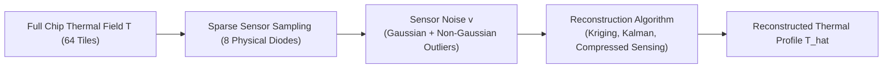

# 5.2 Optimal Thermal Sensor Placement

To manage chip temperature effectively, the system controller must know the temperature across the entire die. However, placing a physical thermal sensor at every single tile is impossible due to silicon area, routing congestion, and calibration overhead.

Instead, architects place a small budget of $K$ physical sensors (e.g., $K = 8$ sensors on an 8x8 mesh with 64 tiles) and mathematically **reconstruct** the remaining temperatures.

---

## 1. The Sensor Placement Problem

Given an $N$-tile NoC system and a budget of $K \ll N$ physical sensors:
- Where on the die should we locate the $K$ sensors?
- How do we reconstruct the full continuous thermal field $\hat{\mathbf{T}} \in \mathbb{R}^N$ from noisy sensor readings $\mathbf{y} \in \mathbb{R}^K$?

$$\mathbf{y} = \mathbf{H} \mathbf{T} + \mathbf{v}$$

Where:
- $\mathbf{H} \in \{0, 1\}^{K \times N}$ is the sensor selection measurement matrix.
- $\mathbf{v}$ is the sensor measurement noise vector.

---

## 2. Gaussian vs. Non-Gaussian Sensor Noise

Traditional sensor placement algorithms assume ideal, zero-mean **Gaussian noise** $\mathbf{v} \sim \mathcal{N}(0, \sigma^2 \mathbf{I})$.

However, real on-chip physical thermal diodes (BJT-based, ring-oscillator-based, or resistance-temperature detectors) suffer from **non-Gaussian disturbances**:
- **Electromagnetic Interference (EMI)**: High-speed dI/dt inductive switching noise from adjacent clock trees and power grids.
- **Process Variations**: Systematic threshold voltage shifts across the die.
- **Heavy-Tailed Outliers & Drift**: Sudden impulsive voltage fluctuations that cause non-Gaussian sensor glitches.

Under non-Gaussian noise, standard Least Squares reconstruction fails catastrophically, yielding massive temperature errors that can mask dangerous hotspots!

---

## 3. Verified In-Lab Implementation

In our lab repository [`projects/thermal-sensor-placement-and-thermal-reconstruction-under-gaussian-and-non-gaussian-sensor`](https://github.com/network-on-chip/thermal-sensor-placement-and-thermal-reconstruction-under-gaussian-and-non-gaussian-sensor), we validated robust sensor placement and reconstruction schemes:

- **Optimal Placement Criterion**: Maximizes information entropy and minimizes the trace of the error covariance matrix under constrained sensor count.
- **Robust M-Estimation & Kalman Filtering**: Downweights impulsive non-Gaussian sensor anomalies, recovering accurate thermal maps even when individual sensors report corrupted readings.
- **Full Verification Report**: See the detailed experimental results and validation metrics in our project [REPORT.md](file:///home/yongfu/proj/noc-lab/projects/thermal-sensor-placement-and-thermal-reconstruction-under-gaussian-and-non-gaussian-sensor/REPORT.md).

---

In the next track, we look beyond the single planar die at [Track 6: Chiplets & 3D NoC](../track6-chiplets-and-3d/index.md).
