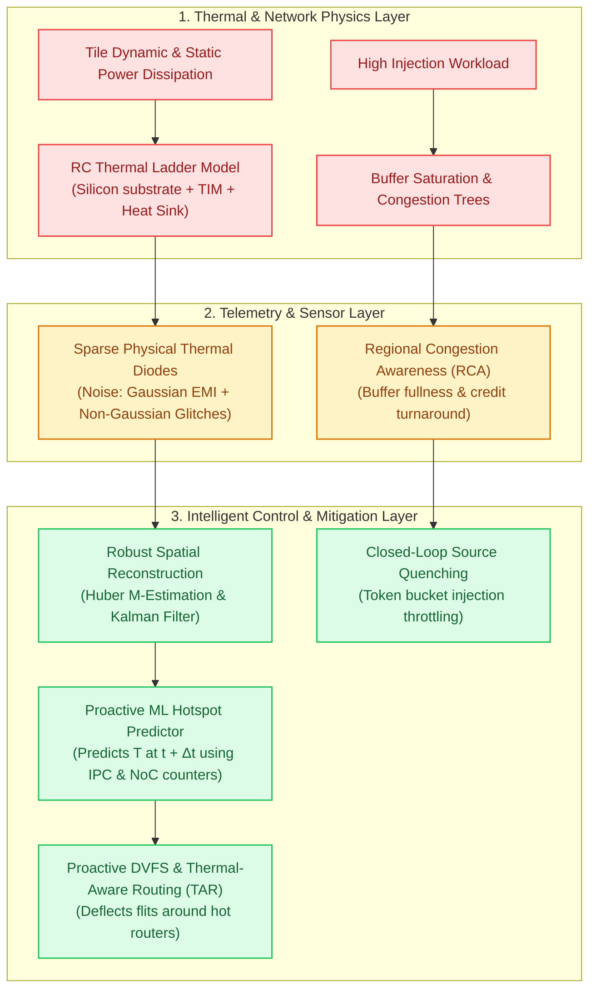

# Track 5: Thermal & Congestion Management

  
Network Architecture • Module 05

  <h1>Thermal Physics, Congestion Control &amp; Predictive AI</h1>
  

    Master how nanometer multi-core processors battle localized thermal hotspots and network traffic saturation. From fundamental RC thermal modeling to Regional Congestion Awareness (RCA), machine-learning hotspot forecasting, and sparse sensor reconstruction under non-Gaussian noise.
  

  

    ⏱️ 4 In-Depth Lessons
    🔬 4 Interactive Simulators &amp; Visualizers
    💻 4 Synthesizable Verilog RTL Modules
    🔥 Grounded in Verified Open-Source Lab Projects

  

    

      📚 Aligned with Official Textbook Chapters 6 &amp; 7
    

    

      Read <strong>Chapter 6 (Low Power &amp; Dark Silicon)</strong> for sub-threshold leakage, VFIs, and lookahead power gating. Read <strong>Chapter 7 (Thermal Modeling &amp; Fault Tolerance)</strong> for HotSpot RC modeling, GSF sensor reconstruction, and hardware bypass detours.
    

  

  

    <a href="../textbook/ch06-low-power-dark-silicon/" style="display: inline-flex; align-items: center; gap: 6px; background: #2563eb; color: #ffffff; padding: 8px 14px; border-radius: 6px; font-weight: 600; font-size: 0.85rem; text-decoration: none;">
      Read Chapter 6 →
    </a>
    <a href="../textbook/ch07-thermal-fault-tolerance/" style="display: inline-flex; align-items: center; gap: 6px; background: #0284c7; color: #ffffff; padding: 8px 14px; border-radius: 6px; font-weight: 600; font-size: 0.85rem; text-decoration: none;">
      Read Chapter 7 →
    </a>
  

---

## 🗺️ Thermal & Congestion Architecture Roadmap

The diagram below outlines how heat dissipation physics, network telemetry, predictive machine learning, and sparse sensor estimation interact to maintain high-performance, reliable silicon operation:

---

## 📚 Syllabus & Chapters in Track 5

  

    

      Lesson 5.1
      
Thermal Physics &amp; Compact RC Modeling

      

        Fourier's law of heat conduction, the thermal-electrical duality ($R_{th}, C_{th}$), and compact RC grid models (HotSpot). Analyze the $10^7\times$ timescale mismatch between electrical clock cycles and thermal diffusion constants, calculate reliability degradation via Black's electromigration equation, and implement on-chip thermal sensor controllers in synthesizable Verilog.
      

      

        ⚡ <strong>Features:</strong> Interactive 2D Silicon Die Thermal RC Ladder Simulator, Synthesizable Verilog RTL (`thermal_sensor_digital_interface.v`), 3-Question Self-Check Quiz, Arcade Linkages (Hotspot Hero &amp; Volt Vortex).
      

    

    <a href="01-thermal-physics-rc-modeling/" class="noc-track-link">Launch Lesson 5.1 →</a>
  

  

    

      Lesson 5.2
      
Congestion Detection &amp; Source Quenching

      

        Physics of network saturation trees and Head-of-Line (HoL) blocking amplification. Gratz &amp; Keckler's Regional Congestion Awareness (RCA) propagating multi-hop congestion vectors upstream. Closed-loop source quenching, token-bucket throttling, DyAD adaptive routing, and synthesizable telemetry aggregation RTL.
      

      

        ⚡ <strong>Features:</strong> Interactive Network Congestion Tree &amp; RCA Telemetry Visualizer, Synthesizable Verilog RTL (`rca_congestion_aggregator.v`), 3-Question Self-Check Quiz, Arcade Linkages (Credit Commander &amp; QoS Gladiator).
      

    

    <a href="02-congestion-detection-throttling/" class="noc-track-link">Launch Lesson 5.2 →</a>
  

  

    

      Lesson 5.3
      
Proactive Hotspot Prediction with Machine Learning

      

        Why reactive Dynamic Thermal Management (DTM) suffers catastrophic thermal overshoot. Grounded in our open-source lab project: training lightweight ML models (Ridge, SVR, MLP) on real-time router counters to forecast hotspots at $(t + \Delta t)$, cutting violations by $85\%$ with $<3\%$ penalty, and synthesizable fixed-point inference RTL.
      

      

        ⚡ <strong>Features:</strong> Interactive Proactive vs. Reactive Thermal Predictor &amp; DVFS Simulator, Synthesizable Verilog RTL (`proactive_thermal_throttler.v`), 3-Question Self-Check Quiz, Arcade Linkages (Hotspot Hero &amp; Deflection Duel).
      

    

    <a href="03-hotspot-prediction-ml/" class="noc-track-link">Launch Lesson 5.3 →</a>
  

  

    

      Lesson 5.4
      
Optimal Thermal Sensor Placement &amp; Field Reconstruction

      

        Reconstructing full die temperature fields from $K \ll N$ physical sensor diodes. Grounded in our verified lab project: Fisher Information Matrix (FIM) optimization, handling non-Gaussian EMI switching noise and sensor glitches, robust Huber M-estimation, and synthesizable outlier rejection filter RTL.
      

      

        ⚡ <strong>Features:</strong> Interactive Sparse Sensor Placement &amp; Robust Reconstruction Playground, Synthesizable Verilog RTL (`huber_m_estimator_filter.v`), 3-Question Self-Check Quiz, Arcade Linkages (Hotspot Hero &amp; Fault Defender).
      

    

    <a href="04-thermal-sensor-placement/" class="noc-track-link">Launch Lesson 5.4 →</a>
  

---

## 🎯 Track Learning Objectives

Upon completing Track 5, you will be able to:

1. **Construct compact RC thermal ladder models** for 2D multi-core dies, mapping silicon substrate, thermal interface material (TIM), and heat sinks to equivalent circuit elements.
2. **Quantify the thermal time constant lag** ($\tau_{th} \approx 5\text{–}15\text{ ms}$) and explain why reactive DTM creates thermal overshoot and reliability failure.
3. **Implement Regional Congestion Awareness (RCA)** in router microarchitecture to detect and divert traffic before saturation trees form.
4. **Deploy machine learning models** (Ridge Regression, MLPs) using hardware performance counters to predict temperatures $10\text{ ms}$ into the future.
5. **Optimize thermal sensor placement** via Fisher Information maximization to achieve minimal reconstruction error with a minimal sensor budget ($K \ll N$).
6. **Apply robust M-estimation and Kalman filtering** to filter out non-Gaussian EMI sensor noise and process variation drift.

Ready to begin? Start with **[Lesson 5.1: Thermal Physics & Compact RC Modeling](01-thermal-physics-rc-modeling.md)**.
