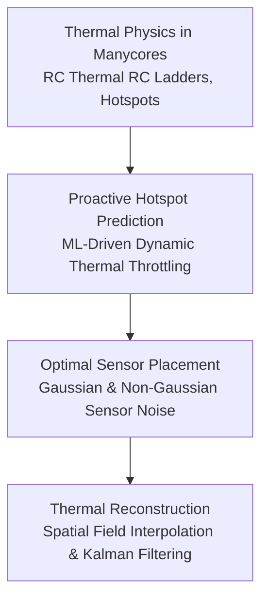

# Track 5: Thermal & Congestion Management

In modern nanometer manycore chips, power density routinely exceeds hundreds of watts per square centimeter, creating localized **thermal hotspots**. Excessive heat degrades transistor reliability (electromigration, dielectric breakdown), accelerates timing jitter, and can cause catastrophic thermal runaway.

In this track, we study how Network-on-Chip routers and intelligent management policies monitor, predict, and mitigate thermal emergencies, grounded directly in our lab's verified open-source simulation projects.

---

## 🗺️ Track Roadmap

---

## 📖 Lessons in this Track

1. **[5.1 Hotspot Prediction & Throttling](01-hotspot-prediction.md)**  
   Understanding thermal transients in manycore NoCs. Reactive vs proactive thermal management. Machine-learning-based hotspot prediction models (grounded in [`projects/intelligent-hotspot-prediction-for-network-on-chip-based-multicore-systems`](https://github.com/network-on-chip/intelligent-hotspot-prediction-for-network-on-chip-based-multicore-systems)).
2. **[5.2 Optimal Thermal Sensor Placement](02-thermal-sensor-placement.md)**  
   How to place a limited number of on-chip thermal sensors to accurately reconstruct the continuous temperature profile of the die under Gaussian and non-Gaussian noise (grounded in [`projects/thermal-sensor-placement-and-thermal-reconstruction...`](https://github.com/network-on-chip/thermal-sensor-placement-and-thermal-reconstruction-under-gaussian-and-non-gaussian-sensor)).
