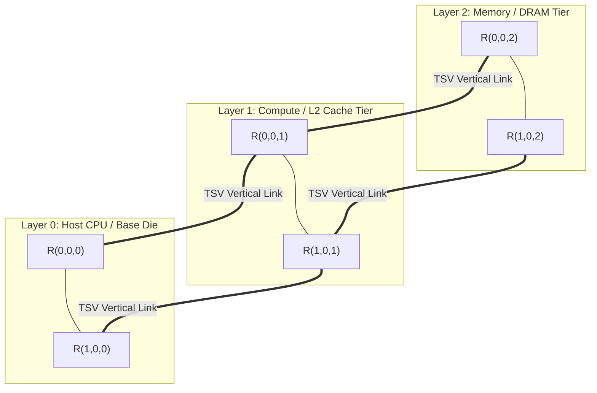
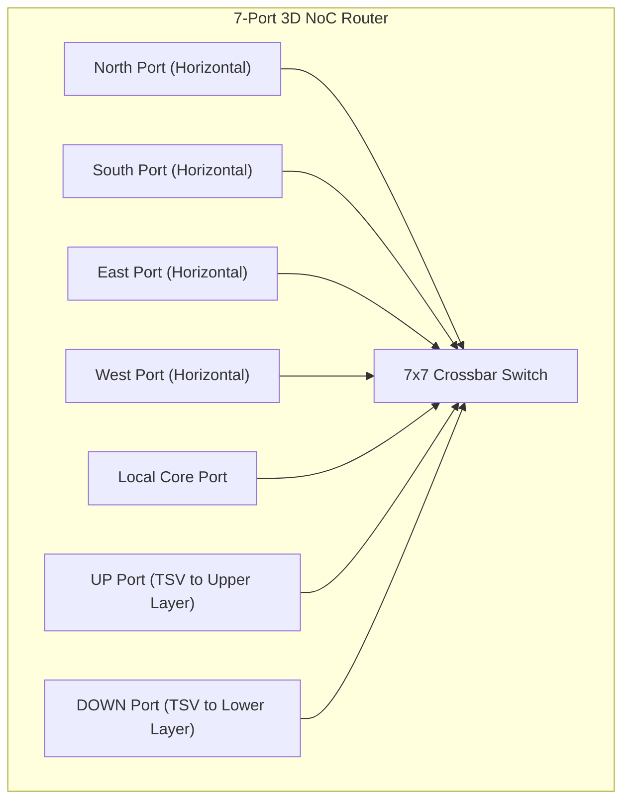

# 6.1 3D TSV Interconnects

In monolithic 2D chips, expanding network size from $N$ to $2N$ nodes increases the horizontal wire distance and hop count. 

By stacking multiple silicon dies vertically and connecting them with microscopic vertical copper pillars called **Through-Silicon Vias (TSVs)**, we unlock **3D Network-on-Chip (3D NoC)**.

---

## 1. Physical Anatomy of 3D Integration

In a 3D IC, multiple wafer-thinned active silicon layers (e.g., Layer 0 for Logic, Layer 1 for SRAM Cache, Layer 2 for DRAM) are bonded face-to-back or face-to-face:

### The Magic of TSVs:
- **Vertical Distance**: A typical thinned silicon die is only $20 \text{ to } 50 \ \mu\text{m}$ thick.
- **Microscopic Delay**: While a horizontal inter-router link might span $1000 \ \mu\text{m}$ ($1 \text{ mm}$), the vertical TSV link is $20\times \text{ shorter}$! Vertical latency is negligible (often sub-cycle).

---

## 2. 7-Port 3D Router Microarchitecture

To support vertical communication, the canonical 5-port 2D router is expanded into a **7-port 3D router**:

### Architectural Implications:
- **Crossbar Size**: Increases from $5 \times 5$ to $7 \times 7$ crosspoints ($49$ vs $25$ crosspoints, nearly double the crossbar area).
- **Dimension-Order Routing in 3D (XYZ Routing)**:
  1. Route along $X$ dimension.
  2. Route along $Y$ dimension.
  3. Route along $Z$ dimension (via TSVs).
  4. Delivers deterministic, deadlock-free communication across 3D meshes!

---

## 3. The 3D Thermal Challenge

While 3D NoCs dramatically reduce wire length and hop count, they present a major physical obstacle: **Severe Thermal Trapping**.

In a 2D chip, heat escapes directly out through the silicon substrate into the heat spreader and heatsink. In a 3-layer 3D stack:
- Active tiers in the middle layer are insulated by low-thermal-conductivity dielectric bonding layers ($\text{SiO}_2$ or polymer adhesives).
- Power density multiplies ($3\times$ higher power per unit footprint).
- Temperatures can easily spike over $110^\circ\text{C}$ unless dynamic thermal-aware routing policies steer packets away from vertical hotspot columns!

In the next lesson, we will see how the industry solves these manufacturing and thermal yield challenges using **2.5D Multi-Chiplet Interconnects**.
