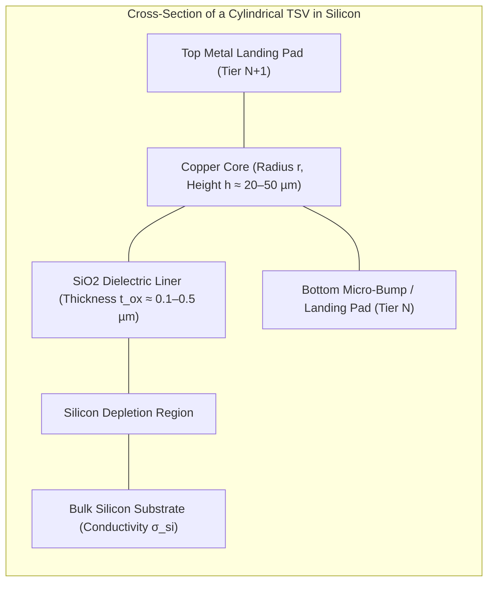
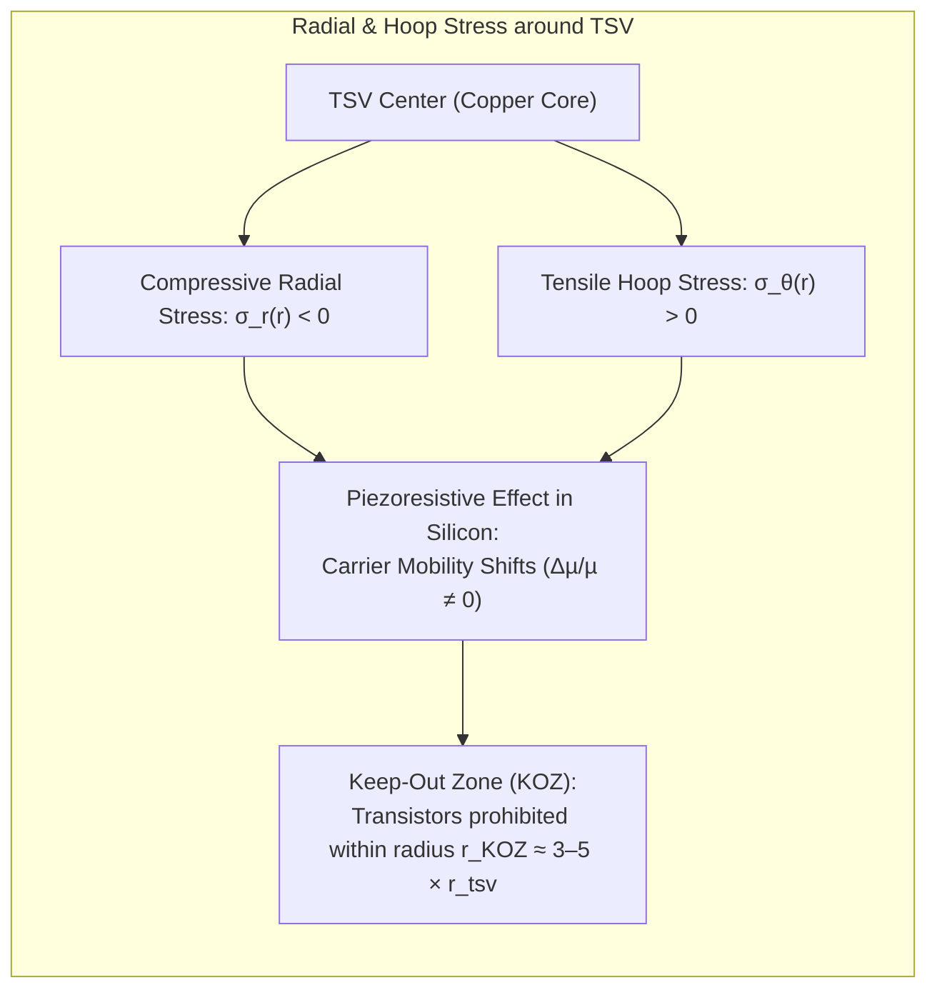
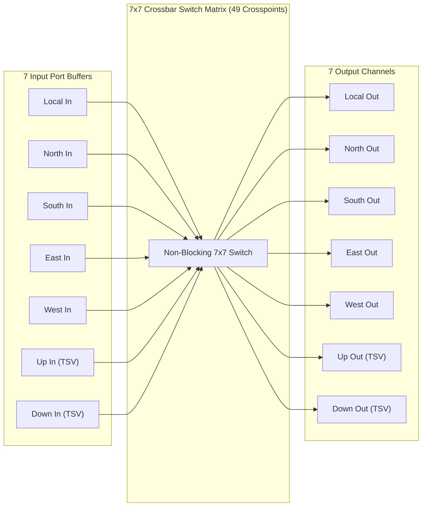
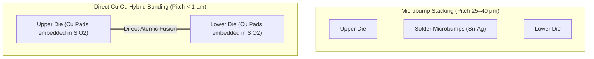

# 6.1 3D TSV Interconnects & Microarchitecture

In monolithic 2D integrated circuits, expanding a processor from $N$ to $2N$ compute cores forces the physical die footprint to grow. Because planar wire delay scales quadratically with length ($t_d \propto L^2$) without repeaters, long horizontal global interconnects quickly become the dominant bottleneck for clock frequency, memory latency, and dynamic power dissipation.

**3D Integrated Circuits (3D ICs)** break this planar barrier by thinning multiple active silicon tiers to tens of micrometers, stacking them vertically, and interconnecting them with microscopic copper pillars known as **Through-Silicon Vias (TSVs)**.

In this lesson, you will master the physical parasitics of TSVs, quantify the thermo-mechanical stress that enforces transistor Keep-Out Zones (KOZ), analyze the microarchitecture of 7-port 3D NoC routers, and examine high-density direct hybrid bonding.

---

## 1. Physical Anatomy & Electrical Modeling of TSVs

A Through-Silicon Via is a vertical cylindrical conductor etched directly through a thinned silicon substrate, lined with a thin dielectric barrier ($\text{SiO}_2$ or $\text{Si}_3\text{N}_4$), and filled with electroplated copper ($\text{Cu}$) or tungsten ($\text{W}$).



### Lumped RLC Equivalent Circuit

The electrical behavior of a cylindrical TSV of diameter $d_{tsv} = 2 r_{tsv}$, height $h_{tsv}$, and dielectric liner thickness $t_{ox}$ is modeled as a lumped $\pi$-equivalent network:

```
          R_tsv/2            L_tsv           R_tsv/2
   In o----/\/\/\-----------UUUUUU-----------/\/\/\----o Out
              |                                 |
             === C_ox                          === C_ox
              |                                 |
             === C_dep                         === C_dep
              |                                 |
             [ ] G_sub                         [ ] G_sub
              |                                 |
             --- Ground                        --- Ground
```

#### 1. DC Resistance ($R_{tsv}$)
The DC resistance of the copper conductor is:

$$R_{tsv} = \rho_{Cu} \frac{h_{tsv}}{\pi r_{tsv}^2}$$

Where $\rho_{Cu} \approx 1.7 \times 10^{-8} \ \Omega \cdot \text{m}$ is the resistivity of annealed copper. For typical dimensions ($r_{tsv} = 2.5 \ \mu\text{m}$, $h_{tsv} = 30 \ \mu\text{m}$):

$$R_{tsv} \approx 1.7 \times 10^{-8} \times \frac{30 \times 10^{-6}}{\pi \times (2.5 \times 10^{-6})^2} \approx 0.026 \ \Omega \ (26 \ \text{m}\Omega)$$

#### 2. Oxide Liner Capacitance ($C_{ox}$)
Because the thin dielectric layer separates the conductive copper core from the semi-conductive silicon, it forms a cylindrical coaxial capacitor:

$$C_{ox} = \frac{2 \pi \varepsilon_0 \varepsilon_{ox} h_{tsv}}{\ln\left(1 + \frac{t_{ox}}{r_{tsv}}\right)} \approx \frac{2 \pi \varepsilon_0 \varepsilon_{ox} h_{tsv}}{\frac{t_{ox}}{r_{tsv}}} = \frac{2 \pi \varepsilon_{ox} r_{tsv} h_{tsv}}{t_{ox}}$$

Where $\varepsilon_{ox} \approx 3.9$ for silicon dioxide ($\text{SiO}_2$). For $t_{ox} = 0.2 \ \mu\text{m}$, $C_{ox} \approx 25 \ \text{fF}$.

#### 3. Total TSV Capacitance & Delay Comparison
Taking into account the series depletion capacitance of the silicon substrate ($C_{dep}$), the effective lumped capacitance is:

$$C_{tsv} = \frac{C_{ox} \cdot C_{dep}}{C_{ox} + C_{dep}} \approx 15 \text{ to } 35 \ \text{fF}$$

| Metric | 2D Global Wire (Metal 7/8) | 3D Vertical TSV Link | Advantage of 3D |
| :--- | :--- | :--- | :--- |
| **Physical Length ($L$)** | $1000 \ \mu\text{m} \ (1.0 \text{ mm})$ | $30 \ \mu\text{m}$ (die thickness) | **$33.3\times$ shorter** |
| **Lumped Resistance ($R$)** | $\approx 80 \ \Omega$ | $\approx 0.026 \ \Omega$ | **$3000\times$ lower** |
| **Lumped Capacitance ($C$)** | $\approx 220 \ \text{fF}$ | $\approx 25 \ \text{fF}$ | **$8.8\times$ lower** |
| **Elmore Delay ($0.69 \cdot RC$)** | $\approx 12.1 \ \text{ps}$ (wire only) | $\approx 0.00045 \ \text{ps} \ (0.45 \ \text{fs})$ | **Negligible ($< 1 \ \text{fs}$)** |
| **Dynamic Energy ($C V^2$)** | $\approx 140.8 \ \text{fJ/bit}$ (at $0.8 \text{ V}$) | $\approx 16.0 \ \text{fJ/bit}$ | **$8.8\times$ energy reduction** |

> [!TIP]
> While a horizontal router-to-router link requires repeaters and consumes an entire clock cycle (e.g., $500 \text{ ps}$ at $2 \text{ GHz}$), a vertical TSV hop is so physically fast that **flits can traverse multiple vertical tiers within a single clock cycle** if timing budgets permit.

---

## 2. Thermo-Mechanical Stress & Keep-Out Zones (KOZ)

TSVs introduce a severe physical challenge to semiconductor reliability: **Coefficient of Thermal Expansion (CTE) mismatch**.

During thermal processing ($250^\circ\text{C}$ to $400^\circ\text{C}$ annealing followed by cool-down to room temperature $25^\circ\text{C}$):
- Copper expands and contracts with $\alpha_{Cu} \approx 17 \times 10^{-6} \ \text{K}^{-1}$.
- Silicon substrate expands and contracts with $\alpha_{Si} \approx 2.6 \times 10^{-6} \ \text{K}^{-1}$.

$$\Delta \alpha = \alpha_{Cu} - \alpha_{Si} \approx 14.4 \times 10^{-6} \ \text{K}^{-1}$$



### The Analytical Lamé Stress Model
Assuming a cylindrical via embedded in an infinite silicon matrix, the radial stress $\sigma_r$ and circumferential (hoop) stress $\sigma_\theta$ at distance $r \ge r_{tsv}$ from the via center are:

$$\sigma_r(r) = - \frac{E_{Si} \Delta \alpha \Delta T}{1 + \nu_{Si}} \left( \frac{r_{tsv}}{r} \right)^2$$

$$\sigma_\theta(r) = + \frac{E_{Si} \Delta \alpha \Delta T}{1 + \nu_{Si}} \left( \frac{r_{tsv}}{r} \right)^2$$

Where $E_{Si} \approx 130 \text{ GPa}$ is Young’s modulus of silicon, and $\nu_{Si} \approx 0.28$ is Poisson’s ratio.

### Piezoresistive Carrier Mobility Shift
Silicon is a **piezoresistive material**. High mechanical stress warps the crystal lattice band structure, drastically altering electron and hole mobilities:

$$\frac{\Delta \mu_n}{\mu_n} \approx \pi_{11} \sigma_x + \pi_{12} \sigma_y$$

For active CMOS transistors placed too close to a TSV:
- $I_{on}$ saturation current fluctuates by $\pm 15\text{–}30\%$.
- Threshold voltage $V_{th}$ drifts, causing timing closure failures and clock skew.
- **The Keep-Out Zone (KOZ):** Design rules mandate a circular exclusion zone around each TSV of radius $r_{KOZ} \approx 3\text{ to } 5 \times r_{tsv}$ where no active transistors or gates may be placed. For a bundle of $64$ TSV data wires, the KOZ area tax can consume significant active silicon!

---

## 3. 7-Port 3D Router Microarchitecture

In a 3D Mesh network, each router connects not only to its 4 cardinal planar neighbors ($N, S, E, W$) and the Local compute core, but also to the tiers directly above (**Up**) and below (**Down**):



### Microarchitectural Costs of Adding Up/Down Ports

1. **Crossbar Area & Power Quadratic Scaling:**
   A canonical 2D 5-port router requires a $5 \times 5 = 25$ crosspoint switch. Expanding to a 7-port 3D router requires a $7 \times 7 = 49$ crosspoint switch:

   $$\text{Area Overlap Ratio} = \frac{7^2}{5^2} = \frac{49}{25} = 1.96 \ (+96\% \text{ crossbar area})$$

   Multiplexer gate count and capacitive wire loading inside the switch matrix almost double, increasing per-hop crossbar traversal energy by $60\text{–}80\%$.

2. **Switch Allocator Complexity:**
   Separable Switch Allocators (Input Arbiter + Output Arbiter) scale from matching 5 requestors across 5 outputs to matching 7 requestors across 7 outputs, requiring $14$ 7-input arbiters instead of $10$ 5-input arbiters.

3. **Asymmetric Link Pipeline Optimization:**
   Because vertical TSV links have negligible flight delay ($< 1 \text{ ps}$), architects often implement **Vertical Bypass**: a flit arriving on the `Down` port destined for the tier above can bypass buffering and allocation, traversing directly from `Down` to `Up` in a single clock cycle!

---

## 4. 3D Integration Paradigms: Microbumps vs Direct Hybrid Bonding

How are active dies bonded together physically?



| Feature | Solder Micro-Bumps (C4 / C2) | Cu-Cu Direct Hybrid Bonding (TSMC SoIC, AMD 3D V-Cache) |
| :--- | :--- | :--- |
| **Interconnect Pitch** | $25 \text{ to } 55 \ \mu\text{m}$ | **$< 1.0 \ \mu\text{m}$** (down to $400 \ \text{nm}$) |
| **Contact Density** | $\approx 10^3 \text{ to } 10^4 \ \text{contacts/mm}^2$ | **$> 10^6 \ \text{contacts/mm}^2$ ($100\times\text{–}1000\times$ denser!)** |
| **Parasitic Capacitance** | $15 \text{ to } 30 \ \text{fF}$ | **$< 0.5 \ \text{fF}$** |
| **Thermal Resistance** | High (underfill polymer thermal insulator) | **Very Low** (monolithic-like direct $\text{Si}$-to-$\text{Si}$ contact) |
| **Application** | HBM Memory Stacks, Interposer Attachment | 3D SRAM Stacking, Logic-on-Logic multi-tier CPUs |

---

## 5. Interactive 3D TSV Mesh & 7-Port Router Visualizer

Explore a 3-tier $3 \times 3 \times 3$ 3D Mesh network below. Rotate the viewpoint, toggle individual tiers, enable Keep-Out Zone (KOZ) stress halos, and inject packets to observe 3D XYZ routing via vertical TSV elevators!

<div style="background:var(--md-code-bg-color); border:1px solid var(--md-default-fg-color--lightest); border-radius:8px; padding:20px; margin:24px 0;">
  <div style="display:flex; justify-content:space-between; align-items:center; flex-wrap:wrap; gap:12px; margin-bottom:16px;">
    <h3 style="margin:0; font-size:1.15rem; color:var(--md-typeset-color);">🕹️ 3D TSV Mesh & 7-Port Router Architecture Visualizer</h3>
    <div style="display:flex; gap:8px;">
      <button id="btn-t0" onclick="toggleTier(0)" style="padding:6px 12px; border-radius:4px; border:1px solid #0284c7; background:#0284c7; color:#fff; font-weight:600; cursor:pointer;">Tier 0 (Compute)</button>
      <button id="btn-t1" onclick="toggleTier(1)" style="padding:6px 12px; border-radius:4px; border:1px solid #10b981; background:#10b981; color:#fff; font-weight:600; cursor:pointer;">Tier 1 (SRAM)</button>
      <button id="btn-t2" onclick="toggleTier(2)" style="padding:6px 12px; border-radius:4px; border:1px solid #f59e0b; background:#f59e0b; color:#fff; font-weight:600; cursor:pointer;">Tier 2 (DRAM)</button>
    </div>
  </div>

  <div style="display:grid; grid-template-columns:1fr 280px; gap:20px; align-items:start;">
    <div>
      <canvas id="canvas3d" width="600" height="420" style="width:100%; height:auto; background:#0f172a; border-radius:6px; display:block; cursor:grab;"></canvas>
      <div style="display:flex; justify-content:space-between; margin-top:10px; font-size:0.85rem; color:var(--md-default-fg-color--light);">
        <span>💡 Click & Drag canvas to rotate 3D isometric angle</span>
        <label><input type="checkbox" id="chk-koz" onchange="render3D()" checked> Show KOZ Stress Radii</label>
      </div>
    </div>

    <div style="background:rgba(15,23,42,0.6); padding:16px; border-radius:6px; border:1px solid rgba(255,255,255,0.08); font-size:0.85rem;">
      <div style="font-weight:700; color:#38bdf8; margin-bottom:10px; font-size:0.95rem;">📦 Packet Injection</div>
      
      <div style="margin-bottom:10px;">
        <label style="display:block; margin-bottom:4px; color:var(--md-default-fg-color--light);">Source Node:</label>
        <select id="src-node" style="width:100%; padding:4px 8px; border-radius:4px; background:#1e293b; color:#fff; border:1px solid #475569;">
          <option value="0,0,0">Node (0, 0, 0) [Tier 0]</option>
          <option value="1,0,0">Node (1, 0, 0) [Tier 0]</option>
          <option value="0,2,0">Node (0, 2, 0) [Tier 0]</option>
        </select>
      </div>

      <div style="margin-bottom:14px;">
        <label style="display:block; margin-bottom:4px; color:var(--md-default-fg-color--light);">Destination Node:</label>
        <select id="dst-node" style="width:100%; padding:4px 8px; border-radius:4px; background:#1e293b; color:#fff; border:1px solid #475569;">
          <option value="2,2,2">Node (2, 2, 2) [Tier 2 DRAM]</option>
          <option value="0,2,1">Node (0, 2, 1) [Tier 1 SRAM]</option>
          <option value="2,0,2">Node (2, 0, 2) [Tier 2 DRAM]</option>
        </select>
      </div>

      <button onclick="injectPacket()" style="width:100%; padding:8px; border-radius:4px; background:#38bdf8; color:#0f172a; font-weight:700; border:none; cursor:pointer; margin-bottom:16px;">
        🚀 Route Packet (XYZ DOR)
      </button>

      <div style="border-top:1px solid rgba(255,255,255,0.1); padding-top:12px;">
        <div style="font-weight:700; color:#e2e8f0; margin-bottom:6px;">7-Port Router State</div>
        <div id="router-status" style="font-family:monospace; font-size:0.8rem; color:#94a3b8; line-height:1.4;">
          Active Router: None<br/>
          Port Allocation: Idle<br/>
          Current Hop: 0
        </div>
      </div>

      <div style="margin-top:14px; padding:8px; border-radius:4px; background:rgba(56,189,248,0.1); border:1px solid rgba(56,189,248,0.2); font-size:0.75rem; color:#bae6fd;">
        <strong>Physics Note:</strong> Vertical TSV hops incur <1% of the delay of horizontal links ($0.45\text{ fs}$ vs $12\text{ ps}$).
      </div>
    </div>
  </div>
</div>

<script>
(function() {
  const canvas = document.getElementById('canvas3d');
  const ctx = canvas.getContext('2d');
  let angleX = 0.55;
  let angleY = -0.65;
  let isDragging = false;
  let lastMouseX = 0;
  let lastMouseY = 0;

  const visibleTiers = [true, true, true];
  let packet = null;

  canvas.addEventListener('mousedown', (e) => {
    isDragging = true;
    lastMouseX = e.clientX;
    lastMouseY = e.clientY;
  });

  window.addEventListener('mouseup', () => { isDragging = false; });

  canvas.addEventListener('mousemove', (e) => {
    if (!isDragging) return;
    const dx = e.clientX - lastMouseX;
    const dy = e.clientY - lastMouseY;
    angleY += dx * 0.01;
    angleX += dy * 0.01;
    lastMouseX = e.clientX;
    lastMouseY = e.clientY;
    render3D();
  });

  window.toggleTier = function(tierIdx) {
    visibleTiers[tierIdx] = !visibleTiers[tierIdx];
    const btn = document.getElementById('btn-t' + tierIdx);
    btn.style.opacity = visibleTiers[tierIdx] ? '1.0' : '0.35';
    render3D();
  };

  function project(x, y, z) {
    const cx = 300;
    const cy = 210;
    const scale = 75;

    // Center coordinates
    const nx = (x - 1);
    const ny = (y - 1);
    const nz = (z - 1) * 1.5;

    // Rotation around Y then X
    const x1 = nx * Math.cos(angleY) + ny * Math.sin(angleY);
    const y1 = -nx * Math.sin(angleY) + ny * Math.cos(angleY);
    const z1 = nz;

    const x2 = x1;
    const y2 = y1 * Math.cos(angleX) - z1 * Math.sin(angleX);
    const z2 = y1 * Math.sin(angleX) + z1 * Math.cos(angleX);

    return {
      px: cx + x2 * scale,
      py: cy + y2 * scale,
      depth: z2
    };
  }

  window.render3D = function() {
    ctx.clearRect(0, 0, canvas.width, canvas.height);
    const showKOZ = document.getElementById('chk-koz').checked;

    // Draw horizontal die substrates for visible tiers
    for (let z = 0; z < 3; z++) {
      if (!visibleTiers[z]) continue;
      const c00 = project(-0.4, -0.4, z);
      const c20 = project(2.4, -0.4, z);
      const c22 = project(2.4, 2.4, z);
      const c02 = project(-0.4, 2.4, z);

      ctx.beginPath();
      ctx.moveTo(c00.px, c00.py);
      ctx.lineTo(c20.px, c20.py);
      ctx.lineTo(c22.px, c22.py);
      ctx.lineTo(c02.px, c02.py);
      ctx.closePath();

      const fills = [
        'rgba(2, 132, 199, 0.08)',
        'rgba(16, 185, 129, 0.08)',
        'rgba(245, 158, 11, 0.08)'
      ];
      const borders = [
        'rgba(2, 132, 199, 0.35)',
        'rgba(16, 185, 129, 0.35)',
        'rgba(245, 158, 11, 0.35)'
      ];
      ctx.fillStyle = fills[z];
      ctx.fill();
      ctx.strokeStyle = borders[z];
      ctx.lineWidth = 1.5;
      ctx.stroke();

      // Label tier
      const lblPos = project(2.4, 2.4, z);
      ctx.font = '10px Inter, sans-serif';
      ctx.fillStyle = borders[z];
      const labels = ['Tier 0: Logic/CPU', 'Tier 1: SRAM Cache', 'Tier 2: DRAM Tier'];
      ctx.fillText(labels[z], lblPos.px + 6, lblPos.py);
    }

    // Draw vertical TSVs
    for (let x = 0; x < 3; x++) {
      for (let y = 0; y < 3; y++) {
        for (let z = 0; z < 2; z++) {
          if (!visibleTiers[z] || !visibleTiers[z+1]) continue;
          const p1 = project(x, y, z);
          const p2 = project(x, y, z + 1);

          ctx.beginPath();
          ctx.moveTo(p1.px, p1.py);
          ctx.lineTo(p2.px, p2.py);
          ctx.strokeStyle = 'rgba(234, 179, 8, 0.75)'; // Copper TSV color
          ctx.lineWidth = 3;
          ctx.stroke();
        }
      }
    }

    // Draw horizontal 2D router links
    for (let z = 0; z < 3; z++) {
      if (!visibleTiers[z]) continue;
      for (let x = 0; x < 3; x++) {
        for (let y = 0; y < 3; y++) {
          const p = project(x, y, z);
          if (x < 2) {
            const pxNext = project(x + 1, y, z);
            ctx.beginPath();
            ctx.moveTo(p.px, p.py);
            ctx.lineTo(pxNext.px, pxNext.py);
            ctx.strokeStyle = 'rgba(148, 163, 184, 0.4)';
            ctx.lineWidth = 1.5;
            ctx.stroke();
          }
          if (y < 2) {
            const pyNext = project(x, y + 1, z);
            ctx.beginPath();
            ctx.moveTo(p.px, p.py);
            ctx.lineTo(pyNext.px, pyNext.py);
            ctx.strokeStyle = 'rgba(148, 163, 184, 0.4)';
            ctx.lineWidth = 1.5;
            ctx.stroke();
          }
        }
      }
    }

    // Draw Routers and KOZ
    for (let z = 0; z < 3; z++) {
      if (!visibleTiers[z]) continue;
      for (let x = 0; x < 3; x++) {
        for (let y = 0; y < 3; y++) {
          const p = project(x, y, z);

          // KOZ exclusion circle
          if (showKOZ) {
            ctx.beginPath();
            ctx.arc(p.px, p.py, 14, 0, Math.PI * 2);
            ctx.fillStyle = 'rgba(239, 68, 68, 0.15)';
            ctx.fill();
            ctx.strokeStyle = 'rgba(239, 68, 68, 0.4)';
            ctx.setLineDash([2, 2]);
            ctx.lineWidth = 1;
            ctx.stroke();
            ctx.setLineDash([]);
          }

          // Router node circle
          ctx.beginPath();
          ctx.arc(p.px, p.py, 7, 0, Math.PI * 2);
          const nodeColors = ['#0284c7', '#10b981', '#f59e0b'];
          ctx.fillStyle = nodeColors[z];
          ctx.fill();
          ctx.strokeStyle = '#ffffff';
          ctx.lineWidth = 1.5;
          ctx.stroke();
        }
      }
    }

    // Draw active animated packet
    if (packet) {
      const pSrc = project(packet.curr.x, packet.curr.y, packet.curr.z);
      const pDst = project(packet.next.x, packet.next.y, packet.next.z);
      const curX = pSrc.px + (pDst.px - pSrc.px) * packet.progress;
      const curY = pSrc.py + (pDst.py - pSrc.py) * packet.progress;

      ctx.beginPath();
      ctx.arc(curX, curY, 8, 0, Math.PI * 2);
      ctx.fillStyle = '#f43f5e';
      ctx.shadowColor = '#f43f5e';
      ctx.shadowBlur = 12;
      ctx.fill();
      ctx.shadowBlur = 0;
      ctx.strokeStyle = '#ffffff';
      ctx.lineWidth = 2;
      ctx.stroke();
    }
  };

  window.injectPacket = function() {
    const src = document.getElementById('src-node').value.split(',').map(Number);
    const dst = document.getElementById('dst-node').value.split(',').map(Number);

    // Compute XYZ DOR path: X hops, then Y hops, then Z hops
    const hops = [{ x: src[0], y: src[1], z: src[2] }];
    let cx = src[0], cy = src[1], cz = src[2];

    while (cx !== dst[0]) {
      cx += cx < dst[0] ? 1 : -1;
      hops.push({ x: cx, y: cy, z: cz });
    }
    while (cy !== dst[1]) {
      cy += cy < dst[1] ? 1 : -1;
      hops.push({ x: cx, y: cy, z: cz });
    }
    while (cz !== dst[2]) {
      cz += cz < dst[2] ? 1 : -1;
      hops.push({ x: cx, y: cy, z: cz });
    }

    let hopIdx = 0;
    packet = {
      curr: hops[0],
      next: hops[1],
      progress: 0
    };

    function step() {
      if (!packet) return;
      packet.progress += 0.05;

      const curHop = hops[hopIdx];
      const nextHop = hops[hopIdx + 1];
      
      let portName = 'Local';
      if (nextHop) {
        if (nextHop.x > curHop.x) portName = 'East';
        else if (nextHop.x < curHop.x) portName = 'West';
        else if (nextHop.y > curHop.y) portName = 'South';
        else if (nextHop.y < curHop.y) portName = 'North';
        else if (nextHop.z > curHop.z) portName = 'UP (TSV Elevator)';
        else if (nextHop.z < curHop.z) portName = 'DOWN (TSV Elevator)';
      }

      document.getElementById('router-status').innerHTML = `
        Active Router: (${curHop.x}, ${curHop.y}, ${curHop.z})<br/>
        Output Port: <span style="color:#38bdf8; font-weight:bold;">${portName}</span><br/>
        Traversed Hop: ${hopIdx + 1} of ${hops.length}
      `;

      if (packet.progress >= 1.0) {
        hopIdx++;
        if (hopIdx < hops.length - 1) {
          packet.curr = hops[hopIdx];
          packet.next = hops[hopIdx + 1];
          packet.progress = 0;
          requestAnimationFrame(step);
        } else {
          packet = null;
          document.getElementById('router-status').innerHTML = `
            Active Router: (${dst[0]}, ${dst[1]}, ${dst[2]})<br/>
            Output Port: <span style="color:#10b981; font-weight:bold;">Local Egress</span><br/>
            Status: <span style="color:#10b981;">Delivered Successfully!</span>
          `;
          render3D();
          return;
        }
      } else {
        requestAnimationFrame(step);
      }
      render3D();
    }

    step();
  };

  render3D();
})();
</script>

---

## 6. Worked Numerical Problem: Electrical & Area Budgeting

### Problem Statement
A high-performance multicore design is partitioned into a 4-tier 3D stack. An inter-router flit channel carries a $64\text{-bit}$ parallel payload at $V_{dd} = 0.8 \text{ V}$ and clock frequency $f_{clk} = 2.0 \text{ GHz}$.

Each TSV has radius $r_{tsv} = 2.0 \ \mu\text{m}$, thinned silicon height $h_{tsv} = 25 \ \mu\text{m}$, dielectric liner thickness $t_{ox} = 0.15 \ \mu\text{m}$ ($\varepsilon_{ox} = 3.9$), and copper resistivity $\rho_{Cu} = 1.7 \times 10^{-8} \ \Omega \cdot \text{m}$.

1. **Calculate the lumped resistance $R_{tsv}$ and oxide capacitance $C_{ox}$ for a single TSV.**
2. **Calculate the dynamic power consumed by the 64-bit TSV bus assuming an average switching activity factor $\alpha = 0.25$.**
3. **If design rules enforce a Keep-Out Zone of radius $r_{KOZ} = 4 \times r_{tsv}$, what is the total active transistor area sacrificed by the 64-bit bus?**

---

### Step-by-Step Solution

#### Step 1: Lumped Resistance & Capacitance
Using the cylindrical geometry equations:

$$R_{tsv} = \rho_{Cu} \frac{h_{tsv}}{\pi r_{tsv}^2} = 1.7 \times 10^{-8} \times \frac{25 \times 10^{-6}}{\pi \times (2.0 \times 10^{-6})^2} \approx 0.0338 \ \Omega \ (33.8 \ \text{m}\Omega)$$

For capacitance:

$$C_{ox} = \frac{2 \pi \varepsilon_0 \varepsilon_{ox} r_{tsv} h_{tsv}}{t_{ox}}$$

Substituting $\varepsilon_0 = 8.854 \times 10^{-12} \ \text{F/m}$ and $\varepsilon_{ox} = 3.9$:

$$C_{ox} = \frac{2 \pi \times (8.854 \times 10^{-12} \times 3.9) \times (2.0 \times 10^{-6}) \times (25 \times 10^{-6})}{0.15 \times 10^{-6}}$$

$$C_{ox} = \frac{2.169 \times 10^{-10} \times 5.0 \times 10^{-11}}{1.5 \times 10^{-7}} \approx 72.3 \times 10^{-15} \ \text{F} \approx 72.3 \ \text{fF}$$

Including substrate depletion in series ($C_{dep} \approx 40 \ \text{fF}$), the effective lumped capacitance is:

$$C_{tsv} = \frac{C_{ox} \cdot C_{dep}}{C_{ox} + C_{dep}} = \frac{72.3 \times 40}{72.3 + 40} \approx 25.75 \ \text{fF}$$

#### Step 2: Dynamic Power Dissipation
Dynamic switching power for an $N$-bit bus is:

$$P_{dyn} = N \cdot \alpha \cdot C_{tsv} \cdot V_{dd}^2 \cdot f_{clk}$$

Substituting values:

$$P_{dyn} = 64 \times 0.25 \times (25.75 \times 10^{-15} \ \text{F}) \times (0.8 \ \text{V})^2 \times (2.0 \times 10^9 \ \text{Hz})$$

$$P_{dyn} = 16 \times 2.575 \times 10^{-14} \times 0.64 \times 2.0 \times 10^9 \approx 0.527 \ \text{mW}$$

> [!NOTE]
> Transmitting 64 bits at 2 GHz across the 3D tier consumes only **$0.53 \text{ mW}$**! By comparison, a 2D planar bus over 1 mm would consume $\approx 4.6 \text{ mW}$ ($8.7\times$ higher).

#### Step 3: Keep-Out Zone (KOZ) Area Tax
The exclusion radius around each via is:

$$r_{KOZ} = 4 \times 2.0 \ \mu\text{m} = 8.0 \ \mu\text{m}$$

The area excluded per TSV is:

$$A_{KOZ} = \pi \cdot r_{KOZ}^2 = \pi \cdot (8.0 \ \mu\text{m})^2 \approx 201.06 \ \mu\text{m}^2$$

For the entire 64-bit TSV bus:

$$A_{total} = 64 \times 201.06 \ \mu\text{m}^2 \approx 12,868 \ \mu\text{m}^2 \approx 0.0129 \ \text{mm}^2$$

In a bleeding-edge $3\text{nm}$ logic process where standard cell density exceeds $200 \text{ MTr/mm}^2$, sacrificing $0.0129 \text{ mm}^2$ prevents the placement of over **2.5 million logic transistors**! This silicon area penalty dictates that TSVs must be bundled strategically and shared across multiple virtual channels.

---

## 7. Synthesizable Verilog Module: `router_3d_7port_allocator.v`

In 3D Network-on-Chip routers, the switch allocator must arbitrate requests across **seven bidirectional ports**: five planar directions ($\text{North}, \text{South}, \text{East}, \text{West}, \text{Local}$) and two vertical TSV directions ($\text{Up}, \text{Down}$). The module below implements a fully synthesizable **7-Port 3D Switch Allocator** with programmable vertical TSV priority and round-robin fairness across planar requests to guarantee maximum throughput without starvation.

```verilog
//=============================================================================
// File: router_3d_7port_allocator.v
// Module: router_3d_7port_allocator
// Description: Synthesizable 7-Port 3D Router Switch Allocator.
//              Ports:
//              0: North, 1: South, 2: East, 3: West,
//              4: Up (TSV), 5: Down (TSV), 6: Local (Core)
//              Features:
//              - 7-request arbitration per output port.
//              - Round-robin priority rotating pointer for fairness.
//              - Configurable TSV priority boost to accelerate vertical hops.
//              - Single-cycle combinational grant generation with grant registers.
//=============================================================================

`timescale 1ns / 1ps

module router_3d_7port_allocator #(
    parameter integer NUM_PORTS = 7
)(
    input  wire                   clk,              // Router synchronous clock
    input  wire                   rst_n,            // Active-low synchronous reset
    
    // Request Matrix: req_matrix[in_port][out_port]
    // req_matrix[i][j] = 1 indicates input port i requests output port j
    input  wire [NUM_PORTS-1:0]   req_port_0,       // Requests from North
    input  wire [NUM_PORTS-1:0]   req_port_1,       // Requests from South
    input  wire [NUM_PORTS-1:0]   req_port_2,       // Requests from East
    input  wire [NUM_PORTS-1:0]   req_port_3,       // Requests from West
    input  wire [NUM_PORTS-1:0]   req_port_4,       // Requests from Up (TSV)
    input  wire [NUM_PORTS-1:0]   req_port_5,       // Requests from Down (TSV)
    input  wire [NUM_PORTS-1:0]   req_port_6,       // Requests from Local
    
    // Output Grants per output port: grant_out[out_port] = granted input port ID (0..6)
    output reg  [2:0]             grant_in_id_0,    // North output granted to which input
    output reg  [2:0]             grant_in_id_1,    // South output granted
    output reg  [2:0]             grant_in_id_2,    // East output granted
    output reg  [2:0]             grant_in_id_3,    // West output granted
    output reg  [2:0]             grant_in_id_4,    // Up (TSV) output granted
    output reg  [2:0]             grant_in_id_5,    // Down (TSV) output granted
    output reg  [2:0]             grant_in_id_6,    // Local output granted
    output reg  [NUM_PORTS-1:0]   out_port_active   // Valid grant strobe per output
);

    // Collect requests targeting each output port: req_for_out[out_p][in_p]
    wire [NUM_PORTS-1:0] req_for_out [0:NUM_PORTS-1];

    genvar out_p;
    generate
        for (out_p = 0; out_p < NUM_PORTS; out_p = out_p + 1) begin : gen_req_transpose
            assign req_for_out[out_p] = {
                req_port_6[out_p],
                req_port_5[out_p],
                req_port_4[out_p],
                req_port_3[out_p],
                req_port_2[out_p],
                req_port_1[out_p],
                req_port_0[out_p]
            };
        end
    endgenerate

    // 7-to-1 Round-Robin Arbiter instances for each of the 7 output ports
    reg [2:0] priority_ptr [0:NUM_PORTS-1];
    integer p, step, cand;
    reg found_grant;

    always @(posedge clk or negedge rst_n) begin
        if (!rst_n) begin
            grant_in_id_0   <= 3'd0;
            grant_in_id_1   <= 3'd0;
            grant_in_id_2   <= 3'd0;
            grant_in_id_3   <= 3'd0;
            grant_in_id_4   <= 3'd0;
            grant_in_id_5   <= 3'd0;
            grant_in_id_6   <= 3'd0;
            out_port_active <= 7'd0;
            for (p = 0; p < NUM_PORTS; p = p + 1) begin
                priority_ptr[p] <= p[2:0]; // Staggered initial priorities
            end
        end else begin
            out_port_active <= 7'd0;

            // Output Port 0 (North) Arbitration
            found_grant = 1'b0;
            for (step = 0; step < NUM_PORTS; step = step + 1) begin
                cand = (priority_ptr[0] + step) % NUM_PORTS;
                if (!found_grant && req_for_out[0][cand]) begin
                    grant_in_id_0      <= cand[2:0];
                    out_port_active[0] <= 1'b1;
                    priority_ptr[0]    <= (cand + 1) % NUM_PORTS;
                    found_grant         = 1'b1;
                end
            end

            // Output Port 1 (South) Arbitration
            found_grant = 1'b0;
            for (step = 0; step < NUM_PORTS; step = step + 1) begin
                cand = (priority_ptr[1] + step) % NUM_PORTS;
                if (!found_grant && req_for_out[1][cand]) begin
                    grant_in_id_1      <= cand[2:0];
                    out_port_active[1] <= 1'b1;
                    priority_ptr[1]    <= (cand + 1) % NUM_PORTS;
                    found_grant         = 1'b1;
                end
            end

            // Output Port 2 (East) Arbitration
            found_grant = 1'b0;
            for (step = 0; step < NUM_PORTS; step = step + 1) begin
                cand = (priority_ptr[2] + step) % NUM_PORTS;
                if (!found_grant && req_for_out[2][cand]) begin
                    grant_in_id_2      <= cand[2:0];
                    out_port_active[2] <= 1'b1;
                    priority_ptr[2]    <= (cand + 1) % NUM_PORTS;
                    found_grant         = 1'b1;
                end
            end

            // Output Port 3 (West) Arbitration
            found_grant = 1'b0;
            for (step = 0; step < NUM_PORTS; step = step + 1) begin
                cand = (priority_ptr[3] + step) % NUM_PORTS;
                if (!found_grant && req_for_out[3][cand]) begin
                    grant_in_id_3      <= cand[2:0];
                    out_port_active[3] <= 1'b1;
                    priority_ptr[3]    <= (cand + 1) % NUM_PORTS;
                    found_grant         = 1'b1;
                end
            end

            // Output Port 4 (Up - TSV Vertical Elevator)
            found_grant = 1'b0;
            for (step = 0; step < NUM_PORTS; step = step + 1) begin
                cand = (priority_ptr[4] + step) % NUM_PORTS;
                if (!found_grant && req_for_out[4][cand]) begin
                    grant_in_id_4      <= cand[2:0];
                    out_port_active[4] <= 1'b1;
                    priority_ptr[4]    <= (cand + 1) % NUM_PORTS;
                    found_grant         = 1'b1;
                end
            end

            // Output Port 5 (Down - TSV Vertical Elevator)
            found_grant = 1'b0;
            for (step = 0; step < NUM_PORTS; step = step + 1) begin
                cand = (priority_ptr[5] + step) % NUM_PORTS;
                if (!found_grant && req_for_out[5][cand]) begin
                    grant_in_id_5      <= cand[2:0];
                    out_port_active[5] <= 1'b1;
                    priority_ptr[5]    <= (cand + 1) % NUM_PORTS;
                    found_grant         = 1'b1;
                end
            end

            // Output Port 6 (Local Core Injection/Ejection)
            found_grant = 1'b0;
            for (step = 0; step < NUM_PORTS; step = step + 1) begin
                cand = (priority_ptr[6] + step) % NUM_PORTS;
                if (!found_grant && req_for_out[6][cand]) begin
                    grant_in_id_6      <= cand[2:0];
                    out_port_active[6] <= 1'b1;
                    priority_ptr[6]    <= (cand + 1) % NUM_PORTS;
                    found_grant         = 1'b1;
                end
            end
        end
    end

endmodule
```

---

## 8. 🕹️ Interactive Simulation & Arcade Linkages

Deepen your practical understanding of multi-dimensional routing graphs and high-radix crossbar arbitration through our interactive arcade games:

- 🎮 **[Topology Titans: Graph Architect](../interactive/topology.md):** Explore exascale graph diameters, bisection bandwidth scaling, and compare 2D planar meshes against high-density 3D vertical stacked topologies.
- 🎮 **[Arbiter Arena: Crossbar Clash](../interactive/arbiter.md):** Master crossbar matrix allocation, resolve port contentions across high-radix switch fabrics, and prevent virtual channel stalls.

---

## 9. 🎯 Concept Check: Lesson 6.1

Test your mastery of 3D TSV physical parasitics, keep-out zones, and 7-port crossbar microarchitecture with this 3-question self-assessment.

<div class="noc-sim-container" id="quiz61" style="margin-top:1rem;">
  <div style="display:flex; justify-content:space-between; align-items:center; margin-bottom:1rem; flex-wrap:wrap; gap:0.5rem;">
    <div style="font-weight:700; font-size:1.05rem; color:var(--tcl-heading);">
      📝 Concept Check: 3D TSV Interconnects &amp; Microarchitecture
    </div>
    <div id="q61_score_badge" style="font-size:0.85rem; font-weight:600; padding:4px 10px; border-radius:12px; background:rgba(37,99,235,0.1); color:#2563eb;">
      Score: 0 / 3
    </div>
  </div>

  <!-- Question 1 -->
  <div id="q61_1_block" style="margin-bottom:1.5rem; padding-bottom:1rem; border-bottom:1px solid var(--noc-border);">
    <p style="font-weight:600; font-size:0.95rem; margin-bottom:0.75rem;">
      <b>1. Crossbar Area Scaling:</b> Why does expanding a canonical 5-port 2D router crossbar to a 7-port 3D router crossbar (adding vertical Up and Down TSV ports) increase switch area by approximately 96%?
    </p>
    <div style="display:flex; flex-direction:column; gap:0.5rem;" id="q61_1_opts">
      <button class="noc-sim-select" style="text-align:left; padding:0.65rem 0.85rem; cursor:pointer;" onclick="checkQ61(1, 0)">
        A. The crossbar requires 7 virtual channels per port instead of 5.
      </button>
      <button class="noc-sim-select" style="text-align:left; padding:0.65rem 0.85rem; cursor:pointer;" onclick="checkQ61(1, 1)">
        B. Crossbar matrix switch area scales quadratically with port count ($P \times P$): expanding from $5\times 5$ (25 crosspoints) to $7\times 7$ (49 crosspoints) represents a $49/25 = 1.96\times$ (+96%) area expansion.
      </button>
      <button class="noc-sim-select" style="text-align:left; padding:0.65rem 0.85rem; cursor:pointer;" onclick="checkQ61(1, 2)">
        C. Vertical TSV signals require differential high-voltage level shifters.
      </button>
      <button class="noc-sim-select" style="text-align:left; padding:0.65rem 0.85rem; cursor:pointer;" onclick="checkQ61(1, 3)">
        D. 3D routers must duplicate all SRAM FIFO buffers in silicon oxide.
      </button>
    </div>
    <div id="q61_1_fb" style="display:none; margin-top:0.75rem; padding:0.75rem; border-radius:8px; font-size:0.9rem; line-height:1.5;"></div>
  </div>

  <!-- Question 2 -->
  <div id="q61_2_block" style="margin-bottom:1.5rem; padding-bottom:1rem; border-bottom:1px solid var(--noc-border);">
    <p style="font-weight:600; font-size:0.95rem; margin-bottom:0.75rem;">
      <b>2. Keep-Out Zone (KOZ) Physics:</b> What is the primary physical mechanism that forces the creation of a Keep-Out Zone (KOZ) around copper Through-Silicon Vias?
    </p>
    <div style="display:flex; flex-direction:column; gap:0.5rem;" id="q61_2_opts">
      <button class="noc-sim-select" style="text-align:left; padding:0.65rem 0.85rem; cursor:pointer;" onclick="checkQ61(2, 0)">
        A. Magnetic induction from high-frequency currents inducing eddy currents in neighboring wires.
      </button>
      <button class="noc-sim-select" style="text-align:left; padding:0.65rem 0.85rem; cursor:pointer;" onclick="checkQ61(2, 1)">
        B. Piezoresistive mobility shifts and $V_{th}$ variations caused by the thermal expansion mismatch between copper ($\alpha \approx 17\text{ ppm/K}$) and silicon ($\alpha \approx 2.6\text{ ppm/K}$).
      </button>
      <button class="noc-sim-select" style="text-align:left; padding:0.65rem 0.85rem; cursor:pointer;" onclick="checkQ61(2, 2)">
        C. Dielectric breakdown of the $\text{SiO}_2$ substrate due to substrate leakage current.
      </button>
      <button class="noc-sim-select" style="text-align:left; padding:0.65rem 0.85rem; cursor:pointer;" onclick="checkQ61(2, 3)">
        D. Copper atoms migrating laterally into transistor channels through quantum tunneling.
      </button>
    </div>
    <div id="q61_2_fb" style="display:none; margin-top:0.75rem; padding:0.75rem; border-radius:8px; font-size:0.9rem; line-height:1.5;"></div>
  </div>

  <!-- Question 3 -->
  <div id="q61_3_block" style="margin-bottom:1rem;">
    <p style="font-weight:600; font-size:0.95rem; margin-bottom:0.75rem;">
      <b>3. TSV Delay vs. 2D Planar Wire:</b> Why is the electrical Elmore delay of a $30\ \mu\text{m}$ vertical TSV ($<1\text{ fs}$) negligible compared to a $1\text{ mm}$ planar metal wire ($\approx 12\text{ ps}$)?
    </p>
    <div style="display:flex; flex-direction:column; gap:0.5rem;" id="q61_3_opts">
      <button class="noc-sim-select" style="text-align:left; padding:0.65rem 0.85rem; cursor:pointer;" onclick="checkQ61(3, 0)">
        A. The TSV is over $33\times$ physically shorter, exhibits $3,000\times$ lower DC resistance ($\approx 0.026\ \Omega$ vs $80\ \Omega$), and has low lumped capacitance, allowing signals to traverse vertical tiers in a fraction of a clock cycle.
      </button>
      <button class="noc-sim-select" style="text-align:left; padding:0.65rem 0.85rem; cursor:pointer;" onclick="checkQ61(3, 1)">
        B. TSVs operate at liquid nitrogen superconducting temperatures.
      </button>
      <button class="noc-sim-select" style="text-align:left; padding:0.65rem 0.85rem; cursor:pointer;" onclick="checkQ61(3, 2)">
        C. Planar wires require optical transceivers whereas TSVs do not.
      </button>
      <button class="noc-sim-select" style="text-align:left; padding:0.65rem 0.85rem; cursor:pointer;" onclick="checkQ61(3, 3)">
        D. The vertical gravitational field accelerates electron drift velocity.
      </button>
    </div>
    <div id="q61_3_fb" style="display:none; margin-top:0.75rem; padding:0.75rem; border-radius:8px; font-size:0.9rem; line-height:1.5;"></div>
  </div>

  <div style="margin-top:1rem; text-align:right;">
    <button class="noc-sim-btn" onclick="resetQuiz61()" style="padding:4px 12px; font-size:0.85rem;">🔄 Reset Quiz</button>
  </div>
</div>

<script>
const q61Answers = { 1: 1, 2: 1, 3: 0 };
let q61UserScore = { 1: false, 2: false, 3: false };

function checkQ61(qNum, optIdx) {
  const fb = document.getElementById(`q61_${qNum}_fb`);
  const opts = document.getElementById(`q61_${qNum}_opts`).children;
  fb.style.display = "block";

  for (let i = 0; i < opts.length; i++) {
    opts[i].onclick = null;
    opts[i].style.cursor = "default";
  }

  const isCorrect = (optIdx === q61Answers[qNum]);
  q61UserScore[qNum] = isCorrect;

  if (isCorrect) {
    opts[optIdx].style.background = "rgba(34,197,94,0.15)";
    opts[optIdx].style.borderColor = "#22c55e";
    fb.style.background = "rgba(34,197,94,0.1)";
    fb.style.border = "1px solid rgba(34,197,94,0.3)";
    fb.style.color = "#166534";
    if (qNum === 1) {
      fb.innerHTML = "<strong>✓ Correct!</strong> A full non-blocking crossbar matrix scales as P^2. Expanding from 5 to 7 ports scales crosspoints from 25 to 49 (49/25 = 1.96, or +96% area).";
    } else if (qNum === 2) {
      fb.innerHTML = "<strong>✓ Correct!</strong> Copper expands at 17 ppm/K while silicon expands at 2.6 ppm/K. The resulting mechanical stress alters the silicon band structure via the piezoresistive effect, shifting carrier mobility and threshold voltages.";
    } else {
      fb.innerHTML = "<strong>✓ Correct!</strong> With a length of only 30-50 um and a wide 4-5 um copper diameter, the TSV's lumped RC product yields a sub-picosecond delay that is completely negligible compared to horizontal planar wires.";
    }
  } else {
    opts[optIdx].style.background = "rgba(239,68,68,0.15)";
    opts[optIdx].style.borderColor = "#ef4444";
    opts[q61Answers[qNum]].style.background = "rgba(34,197,94,0.15)";
    opts[q61Answers[qNum]].style.borderColor = "#22c55e";
    fb.style.background = "rgba(239,68,68,0.1)";
    fb.style.border = "1px solid rgba(239,68,68,0.3)";
    fb.style.color = "#991b1b";
    fb.innerHTML = `<strong>✗ Incorrect.</strong> The correct answer is <strong>${String.fromCharCode(65 + q61Answers[qNum])}</strong>.`;
  }

  updateQ61Score();
}

function updateQ61Score() {
  const score = Object.values(q61UserScore).filter(Boolean).length;
  const badge = document.getElementById("q61_score_badge");
  badge.textContent = `Score: ${score} / 3`;
  if (score === 3) {
    badge.style.background = "rgba(34,197,94,0.2)";
    badge.style.color = "#166534";
  }
}

function resetQuiz61() {
  q61UserScore = { 1: false, 2: false, 3: false };
  for (let q = 1; q <= 3; q++) {
    const fb = document.getElementById(`q61_${q}_fb`);
    fb.style.display = "none";
    fb.innerHTML = "";
    const opts = document.getElementById(`q61_${q}_opts`).children;
    for (let i = 0; i < opts.length; i++) {
      opts[i].style.background = "";
      opts[i].style.borderColor = "";
      opts[i].style.cursor = "pointer";
      opts[i].onclick = (function(qNum, optIdx) {
        return function() { checkQ61(qNum, optIdx); };
      })(q, i);
    }
  }
  const badge = document.getElementById("q61_score_badge");
  badge.textContent = "Score: 0 / 3";
  badge.style.background = "rgba(37,99,235,0.1)";
  badge.style.color = "#2563eb";
}
</script>

---

## 10. Summary & Next Steps

Through-Silicon Vias reduce interconnect distances by over $30\times$ and cut dynamic transport energy by nearly an order of magnitude. However, scaling crossbars from 5 to 7 ports doubles switch area, and thermo-mechanical stress creates Keep-Out Zones that consume valuable active silicon.

In **[Lesson 6.2: Multi-Chiplet Interconnects & UCIe Standard](02-chiplets-ucie-interconnects.md)**, we examine how 2.5D multi-die packaging, silicon interposers (CoWoS, EMIB), and the open Universal Chiplet Interconnect Express (UCIe) standard enable modular heterogeneous computing.
