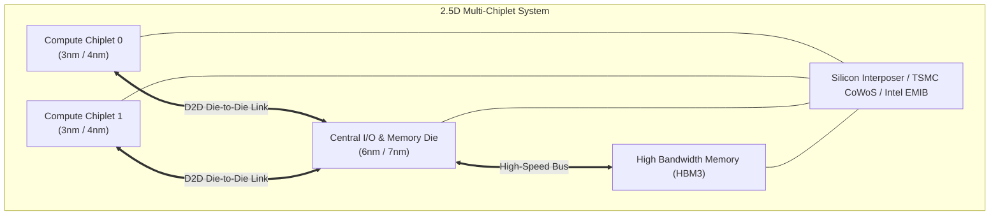
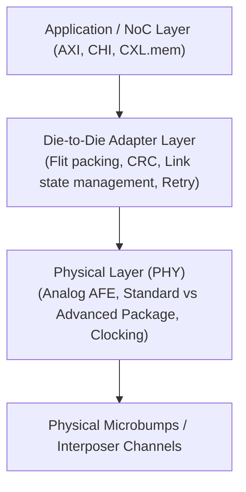

# 6.2 Multi-Chiplet & UCIe Interconnects

As monolithic dies exceed the physical lithography reticle limit ($\approx 858 \text{ mm}^2$), building a single giant chip becomes economically unviable due to defect density:

$$\text{Yield} \approx \left( 1 + \frac{D_0 \cdot A}{\alpha} \right)^{-\alpha}$$

A monolithic $800 \text{ mm}^2$ die might yield only $15\%$ functional chips, while splitting that same system into four $200 \text{ mm}^2$ chiplets boosts yield above $75\%$.

---

## 1. 2.5D Packaging: Silicon Interposers & Bridges

In a 2.5D architecture, multiple independent chiplets are placed side-by-side and interconnected via a high-density substrate:

### Packaging Technologies:
1. **Passive Silicon Interposer (TSMC CoWoS)**: A full silicon wafer layer with sub-micron metal routing wires connecting micro-bumps on adjacent dies.
2. **Silicon Bridges (Intel EMIB)**: Small localized silicon bridges embedded within the organic package substrate only where high-density chiplet-to-chiplet wires are needed, lowering cost.

---

## 2. Universal Chiplet Interconnect Express (UCIe)

To eliminate proprietary, vendor-locked interfaces, the semiconductor consortium (Intel, AMD, Arm, TSMC, Samsung, Google, Meta, Qualcomm) established the **UCIe** open industry standard in 2022.

UCIe defines a layered protocol stack for die-to-die (D2D) communication:

### Key UCIe Performance Metrics:
- **Bandwidth Density**: Up to $1300 \text{ Gbps/mm}$ of shoreline (over $28\times$ higher density than standard PCIe Gen 5!).
- **Energy Efficiency**: Less than $0.5 \text{ pJ/bit}$ (enabling high-throughput inter-chiplet traffic without burning significant thermal margin).
- **Ultra-Low Latency**: Less than $2 \text{ ns}$ physical layer transit.

---

## 3. Extending the NoC Across Chiplets

How does a Network-on-Chip span across multiple chiplets seamlessly?

1. **Unified Global Addressing**: Each chiplet is allocated a coordinate sub-grid. For example:
   - Chiplet 0 hosts routers $R(0..3, 0..3)$
   - Chiplet 1 hosts routers $R(4..7, 0..3)$
2. **Border Routers with D2D Transceivers**:
   - Routers at the boundary of Chiplet 0 have their East port connected to a UCIe PHY instead of an on-die link.
   - The flits are packetized, serialized, transmitted across microbumps, and reconstituted at Chiplet 1's West port.
3. **Transparent to Software**: The operating system and coherence protocols see a unified $8 \times 8$ mesh, completely oblivious to the fact that physical boundaries were crossed!

---

Congratulations! You have completed the foundational tracks. In [Track 7: Landmark Papers](../track7-paper-walkthroughs/index.md), we explore in-depth walkthroughs of seminal IEEE NoC literature.
