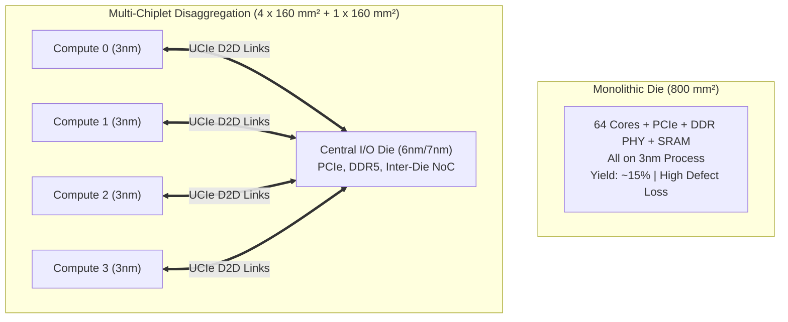
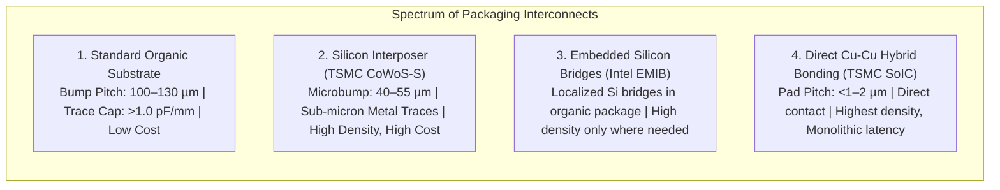
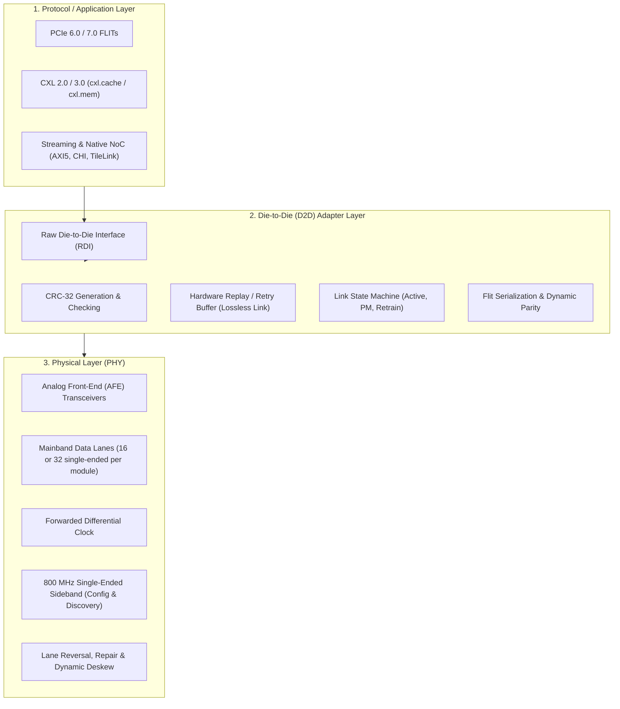
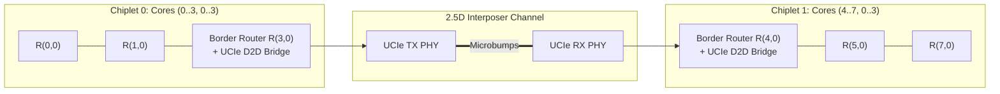

# 6.2 Multi-Chiplet Interconnects, 2.5D Packaging & UCIe

> **Companion Reading:** Monograph Chapter 9 — *3D NoCs, Chiplet Architectures, and Multi-Die Interconnects*, Section 9.3 (2.5D Multi-Die Interconnects and UCIe). [Read in Companion Textbook →](/learning/textbook/ch09-chiplets-3d/)

For over four decades, silicon scaling followed Moore’s Law [[Moore1965](#ref-moore1965)] and Dennard scaling [[Dennard1974](#ref-dennard1974)]: every two years, transistors shrank by $30\%$, enabling monolithic System-on-Chips (SoCs) to integrate more compute cores onto a single silicon die.

Today, monolithic scaling has struck two unyielding physical walls:
1. **The Lithographic Reticle Limit ($\approx 858 \text{ mm}^2$):** Standard deep-ultraviolet (DUV) and extreme-ultraviolet (EUV) photolithography exposure fields are bounded by $26 \text{ mm} \times 33 \text{ mm}$ [[Mack2007](#ref-mack2007)]. Fabricating a monolithic die larger than $858 \text{ mm}^2$ requires complex multi-mask reticle stitching.
2. **Defect Density & Yield Collapse:** Semiconductor defect density causes wafer yield to collapse exponentially as die area expands [[Murphy1964](#ref-murphy1964)]. A monolithic $800 \text{ mm}^2$ die can yield below $15\%$, making it economically prohibitive.

The semiconductor industry’s answer is the **Multi-Die Chiplet Architecture** [[Vivet2021](#ref-vivet2021)], [[Zimmer2020](#ref-zimmer2020)]: disaggregating massive monolithic SoCs into smaller, specialized functional dies (compute, I/O, memory) bonded together on an advanced substrate and unified by high-bandwidth die-to-die (D2D) interconnects.

---

## 1. The Economics of Chiplet Disaggregation



### The Negative Binomial Yield Model

Wafer yield is governed by the **Negative Binomial (Murphy/Seeds) model** [[Murphy1964](#ref-murphy1964)], [[Seeds1967](#ref-seeds1967)]:

$$\text{Yield} = \left( 1 + \frac{D_0 \cdot A}{\alpha} \right)^{-\alpha}$$

Where:
- $A$ is the individual die area in $\text{cm}^2$.
- $D_0$ is the defect density (typically $0.08\text{ to } 0.15 \text{ defects/cm}^2$ for mature nodes, $>0.3$ on early-risk nodes).
- $\alpha$ is the defect clustering parameter (typically $\alpha \approx 1.5\text{ to } 2.0$).

### Monolithic vs Chiplet Cost Scaling

Consider building an $800 \text{ mm}^2$ compute system on a $3\text{nm}$ wafer ($C_{wafer} = \$20,000$, $D_0 = 0.10 \ \text{def/cm}^2$, $\alpha = 1.5$):

| Architecture | Die Area ($A$) | Dies / Wafer ($N_w$) | Die Yield ($\%$) | Known Good Dies ($KGD$) | Wafer Cost / Good Die |
| :--- | :--- | :--- | :--- | :--- | :--- |
| **Monolithic** | $800 \ \text{mm}^2$ ($8.0 \ \text{cm}^2$) | $\approx 68$ | **$16.2\%$** | $\approx 11$ dies | **$\$1,818$ per die** |
| **4x Compute Chiplets** | $160 \ \text{mm}^2$ ($1.6 \ \text{cm}^2$) | $\approx 372$ | **$66.4\%$** | $\approx 247$ dies | **$\$81$ per chiplet** |
| **1x I/O Die (7nm node)** | $160 \ \text{mm}^2$ ($1.6 \ \text{cm}^2$) | $\approx 372$ | **$88.5\%$** (on mature 7nm) | $\approx 329$ dies | **$\$28$ per I/O die** |

Even after factoring in an advanced substrate packaging overhead ($\approx \$150\text{ to } \$200$), the 4-chiplet system costs **under $\$600$ total**—a massive **$>65\%$ cost reduction** compared to the $\$1,818$ monolithic die!

Furthermore, chiplets enable **heterogeneous process optimization**: high-performance compute cores reside on expensive $3\text{nm}$ silicon, while analog PHYs and memory controllers (which scale poorly with gate pitch) remain on cost-effective $7\text{nm}$ or $12\text{nm}$ silicon.

---

## 2. Advanced Packaging Landscape: 2.5D Interposers & Bridges

To connect chiplets with high bandwidth and low latency, packaging technology has evolved beyond traditional printed circuit boards (PCBs) [[Mahajan2016](#ref-mahajan2016)], [[Vivet2021](#ref-vivet2021)]:



| Technology | Example Platform | Interconnect Pitch | Wire Density (lines/mm/layer) | Energy / bit |
| :--- | :--- | :--- | :--- | :--- |
| **Standard Organic Substrate** | AMD EPYC (Zen 2/3) | $110\text{–}130 \ \mu\text{m}$ | $15\text{–}25$ | $\approx 1.5\text{–}2.5 \ \text{pJ/bit}$ |
| **Silicon Interposer (2.5D)** | TSMC CoWoS (NVIDIA H100) | $40\text{–}55 \ \mu\text{m}$ | $200\text{–}400$ | $\approx 0.3\text{–}0.6 \ \text{pJ/bit}$ |
| **Silicon Bridge (Embedded)** | Intel EMIB (Ponte Vecchio) | $45\text{–}55 \ \mu\text{m}$ | $200\text{–}350$ | $\approx 0.4\text{–}0.7 \ \text{pJ/bit}$ |
| **Direct Hybrid Bonding** | AMD 3D V-Cache (TSMC SoIC) | $< 1.0 \ \mu\text{m}$ | $> 1000$ | $\approx 0.05\text{–}0.1 \ \text{pJ/bit}$ |

---

## 3. Universal Chiplet Interconnect Express (UCIe)

Prior to 2022, chiplet interfaces were proprietary (Intel AIB/MDIO, AMD Infinity Fabric, TSMC LIPINCON). To enable a competitive open-chiplet ecosystem, the **UCIe Consortium** (founded by Intel, AMD, Arm, TSMC, Samsung, ASE, Google, Meta, Microsoft, and Qualcomm) ratified the **UCIe 1.0 and 2.0 specifications** [[UCIe2023](#ref-ucie2023)], [[Sharma2022](#ref-sharma2022)].

### The 3-Layer UCIe Protocol Stack

UCIe defines a layered architecture that cleanly decouples application transaction protocols from physical analog signaling:



### Key Technical Specifications of UCIe

1. **Physical Lane Architecture:**
   A standard UCIe Module consists of **16 or 32 data lanes** plus forwarded differential clocks and a dedicated $800 \text{ MHz}$ sideband. Data rates scale from $4 \text{ Gbps}$ up to **$32 \text{ Gbps}$ per lane**.

2. **Shoreline Bandwidth Density:**
   Because chiplet signals exit the die along its perimeter (shoreline), shoreline density is measured in $\text{Gbps per mm}$ of die edge:

    $$\text{Bandwidth Density} = \frac{N_{lanes} \times \text{Data Rate}}{\text{Module Width}} \ge 1300 \ \text{Gbps/mm} \ (1.3 \ \text{Tbps/mm})$$

   This is over **$25\times$ denser** than standard off-package PCIe Gen 5 signaling!

3. **Ultra-Low Energy per Bit ($< 0.5 \text{ pJ/bit}$):**
   Short interposer traces ($< 3\text{ mm}$) eliminate the need for power-hungry continuous-time linear equalizers (CTLE) or multi-tap decision feedback equalizers (DFE). Simple inverter-based drivers sustain full signal integrity at sub-picojoule efficiencies.

4. **Lossless Reliability via Hardware Retry:**
   While the raw bit error rate (BER) of microbumps is low ($\text{BER} < 10^{-15}$), UCIe’s D2D Adapter encapsulates all packets in 68-byte or 256-byte FLITs backed by CRC-32 and an automated replay buffer, achieving an effective **packet loss rate $< 10^{-27}$** (less than 1 failure per galaxy lifetime).

---

## 4. Extending the Network-on-Chip Across Chiplet Boundaries

How do packets flow seamlessly across multiple chiplets without requiring software intervention?



### 1. Global Hierarchical Coordinate Addressing
The system assigns a contiguous global coordinate space across the multi-chiplet complex.
- Chiplet 0 hosts $X \in [0, 3]$, $Y \in [0, 3]$.
- Chiplet 1 hosts $X \in [4, 7]$, $Y \in [0, 3]$.
When a core at $(1, 1)$ sends a cache-coherence request to a memory controller at $(6, 1)$, deterministic XY routing directs the packet East until it reaches Border Router $(3, 1)$.

### 2. The D2D Credit Round-Trip Dilemma ($RTT_{D2D}$)
On a single die, a router-to-router link delay is typically **1 clock cycle** ($0.5 \text{ ns}$). Across a chiplet boundary, the packet must traverse:
1. Egress protocol packetization and CDC (Clock Domain Crossing): $\approx 2 \text{ cycles}$.
2. UCIe D2D Adapter CRC framing: $\approx 2 \text{ cycles}$.
3. Analog PHY and microbump flight: $\approx 2 \text{ cycles}$.
4. Ingress PHY deskew, CRC check, and CDC: $\approx 4 \text{ cycles}$.

$$\text{Total D2D Latency} \approx 10\text{–}16 \ \text{cycles} \ (5\text{–}8 \ \text{ns})$$

Recall from [Lesson 1.3](../track1-fundamentals/03-flow-control-credit.md) that lossless credit flow control requires minimum buffer depth:

$$B_{min} \ge RTT_{round\_trip} \times \text{Bandwidth}$$

Because $RTT_{D2D}$ is $10\times\text{–}15\times$ larger than an on-die hop, **border routers must allocate deep elasticity credit buffers** ($32\text{ to } 64$ flits per VC) to prevent upstream pipeline stalls and maintain wire-speed saturation throughput!

---

## 5. Interactive Multi-Chiplet D2D Packaging & UCIe Explorer

Use this interactive engineering tool to explore the trade-offs between monolithic silicon and multi-chiplet disaggregation. Adjust die size, defect density, package technology, and UCIe lane speeds to inspect manufacturing yields, cost savings, and shoreline bandwidth in real time!

<div style="background:var(--md-code-bg-color); border:1px solid var(--md-default-fg-color--lightest); border-radius:8px; padding:20px; margin:24px 0;">
  <div style="display:flex; justify-content:space-between; align-items:center; flex-wrap:wrap; gap:12px; margin-bottom:16px;">
    <h3 style="margin:0; font-size:1.15rem; color:var(--md-typeset-color);">🎛️ Multi-Chiplet Packaging & UCIe Trade-Off Calculator</h3>
    <span style="font-size:0.85rem; color:#38bdf8; font-weight:600;">Negative Binomial Yield Engine</span>
  </div>

  <div style="display:grid; grid-template-columns:1fr 1fr; gap:24px;">
    <!-- Controls Column -->
    <div>
      <div style="margin-bottom:14px;">
        <div style="display:flex; justify-content:space-between; font-size:0.85rem; margin-bottom:4px;">
          <span>Monolithic Silicon Area ($A_{mono}$):</span>
          <strong id="val-area" style="color:#38bdf8;">800 mm²</strong>
        </div>
        <input type="range" id="rng-area" min="300" max="1000" step="50" value="800" oninput="updateChipletCalc()" style="width:100%;">
      </div>

      <div style="margin-bottom:14px;">
        <div style="display:flex; justify-content:space-between; font-size:0.85rem; margin-bottom:4px;">
          <span>Chiplet Partitioning:</span>
          <strong id="val-parts" style="color:#10b981;">4 Compute Chiplets</strong>
        </div>
        <input type="range" id="rng-parts" min="1" max="8" step="1" value="4" oninput="updateChipletCalc()" style="width:100%;">
      </div>

      <div style="margin-bottom:14px;">
        <div style="display:flex; justify-content:space-between; font-size:0.85rem; margin-bottom:4px;">
          <span>Defect Density ($D_0$):</span>
          <strong id="val-d0" style="color:#f59e0b;">0.10 def/cm²</strong>
        </div>
        <input type="range" id="rng-d0" min="0.04" max="0.30" step="0.02" value="0.10" oninput="updateChipletCalc()" style="width:100%;">
      </div>

      <div style="margin-bottom:14px;">
        <label style="display:block; font-size:0.85rem; margin-bottom:4px;">Packaging Substrate Technology:</label>
        <select id="sel-pkg" onchange="updateChipletCalc()" style="width:100%; padding:6px 8px; border-radius:4px; background:#1e293b; color:#fff; border:1px solid #475569;">
          <option value="organic">Standard Organic Substrate ($110 µm pitch, 1.8 pJ/bit)</option>
          <option value="cowos" selected>TSMC CoWoS Silicon Interposer ($45 µm pitch, 0.45 pJ/bit)</option>
          <option value="emib">Intel EMIB Embedded Bridge ($55 µm pitch, 0.55 pJ/bit)</option>
          <option value="hybrid">Direct Cu-Cu Hybrid Bonding ($1 µm pitch, 0.08 pJ/bit)</option>
        </select>
      </div>

      <div style="margin-bottom:14px;">
        <label style="display:block; font-size:0.85rem; margin-bottom:4px;">UCIe D2D Data Rate per Lane:</label>
        <select id="sel-rate" onchange="updateChipletCalc()" style="width:100%; padding:6px 8px; border-radius:4px; background:#1e293b; color:#fff; border:1px solid #475569;">
          <option value="8">8 Gbps / lane</option>
          <option value="16">16 Gbps / lane</option>
          <option value="24">24 Gbps / lane</option>
          <option value="32" selected>32 Gbps / lane (UCIe 2.0 Max)</option>
        </select>
      </div>
    </div>

    <!-- Results Column -->
    <div style="background:rgba(15,23,42,0.7); padding:16px; border-radius:6px; border:1px solid rgba(255,255,255,0.08);">
      <div style="font-weight:700; color:#38bdf8; margin-bottom:12px; font-size:0.95rem;">📊 Economic & Performance Comparison</div>

      <div style="display:grid; grid-template-columns:1fr 1fr; gap:12px; margin-bottom:16px;">
        <div style="background:rgba(255,255,255,0.03); padding:10px; border-radius:4px; border-left:3px solid #ef4444;">
          <div style="font-size:0.75rem; color:#94a3b8;">Monolithic Yield:</div>
          <div id="res-mono-yield" style="font-size:1.15rem; font-weight:700; color:#ef4444;">16.2%</div>
          <div id="res-mono-cost" style="font-size:0.75rem; color:#cbd5e1; margin-top:2px;">$1,818 / good die</div>
        </div>

        <div style="background:rgba(255,255,255,0.03); padding:10px; border-radius:4px; border-left:3px solid #10b981;">
          <div style="font-size:0.75rem; color:#94a3b8;">Chiplet Die Yield:</div>
          <div id="res-chip-yield" style="font-size:1.15rem; font-weight:700; color:#10b981;">66.4%</div>
          <div id="res-chip-cost" style="font-size:0.75rem; color:#cbd5e1; margin-top:2px;">$540 / system</div>
        </div>
      </div>

      <div style="padding:10px; border-radius:4px; background:rgba(16,185,129,0.1); border:1px solid rgba(16,185,129,0.25); margin-bottom:14px;">
        <div style="font-size:0.8rem; color:#a7f3d0; font-weight:600;">Net Manufacturing Cost Savings:</div>
        <div id="res-savings" style="font-size:1.25rem; font-weight:800; color:#34d399;">$1,278 per package (70.3%)</div>
      </div>

      <div style="border-top:1px solid rgba(255,255,255,0.1); padding-top:10px;">
        <div style="font-size:0.8rem; color:#94a3b8; margin-bottom:4px;">Shoreline Bandwidth Density:</div>
        <div id="res-density" style="font-size:1.05rem; font-weight:700; color:#38bdf8;">1,333 Gbps / mm</div>
        
        <div style="font-size:0.8rem; color:#94a3b8; margin-top:8px; margin-bottom:4px;">D2D Link Energy Efficiency:</div>
        <div id="res-energy" style="font-size:1.05rem; font-weight:700; color:#f59e0b;">0.45 pJ / bit</div>
      </div>
    </div>
  </div>
</div>

<script>
function updateChipletCalc() {
  const area = parseFloat(document.getElementById('rng-area').value);
  const parts = parseInt(document.getElementById('rng-parts').value);
  const d0 = parseFloat(document.getElementById('rng-d0').value);
  const pkg = document.getElementById('sel-pkg').value;
  const rate = parseFloat(document.getElementById('sel-rate').value);

  document.getElementById('val-area').textContent = area + ' mm²';
  document.getElementById('val-parts').textContent = parts === 1 ? '1 (Monolithic)' : parts + ' Chiplets';
  document.getElementById('val-d0').textContent = d0.toFixed(2) + ' def/cm²';

  // Negative binomial yield: Y = (1 + D0 * A / alpha)^(-alpha) with alpha = 1.5
  const alpha = 1.5;
  const areaCm2 = area / 100.0;
  const monoYield = Math.pow(1.0 + (d0 * areaCm2) / alpha, -alpha);

  // Wafer details: 300mm wafer area = pi * 150^2 ≈ 70,685 mm2
  const waferCost = 20000; // $20,000 for 3nm wafer
  const waferArea = 70685;
  const diesMono = Math.floor(waferArea / area * 0.77); // Die-to-wafer edge loss
  const kgdMono = Math.max(1, diesMono * monoYield);
  const costMono = waferCost / kgdMono;

  // Chiplet calculation
  const chipArea = area / parts;
  const chipAreaCm2 = chipArea / 100.0;
  const chipYield = Math.pow(1.0 + (d0 * chipAreaCm2) / alpha, -alpha);
  const diesChip = Math.floor(waferArea / chipArea * 0.85);
  const kgdChip = Math.max(1, diesChip * chipYield);
  const costPerChip = waferCost / kgdChip;

  // Package overhead cost
  let pkgCost = 0;
  let energyPerBit = 0.45;
  let pitch = 45;

  if (pkg === 'organic') {
    pkgCost = 30;
    energyPerBit = 1.8;
    pitch = 110;
  } else if (pkg === 'cowos') {
    pkgCost = 180;
    energyPerBit = 0.45;
    pitch = 45;
  } else if (pkg === 'emib') {
    pkgCost = 110;
    energyPerBit = 0.55;
    pitch = 55;
  } else if (pkg === 'hybrid') {
    pkgCost = 250;
    energyPerBit = 0.08;
    pitch = 1.0;
  }

  const costChipletSystem = (parts === 1) ? costMono : (costPerChip * parts + pkgCost);
  const savings = costMono - costChipletSystem;
  const savingsPct = (savings / costMono) * 100.0;

  // Shoreline density: wires per mm * rate
  // wires per mm ≈ 1000 um / pitch * layers
  const layers = (pkg === 'hybrid') ? 1 : 2;
  const wiresPerMm = Math.floor((1000.0 / pitch) * layers);
  const density = wiresPerMm * rate;

  document.getElementById('res-mono-yield').textContent = (monoYield * 100).toFixed(1) + '%';
  document.getElementById('res-mono-cost').textContent = '$' + Math.round(costMono).toLocaleString() + ' / good die';

  document.getElementById('res-chip-yield').textContent = (chipYield * 100).toFixed(1) + '%';
  document.getElementById('res-chip-cost').textContent = '$' + Math.round(costChipletSystem).toLocaleString() + ' / system';

  if (parts === 1) {
    document.getElementById('res-savings').textContent = '$0 (Baseline Monolithic)';
    document.getElementById('res-savings').style.color = '#94a3b8';
  } else {
    document.getElementById('res-savings').textContent = '$' + Math.round(savings).toLocaleString() + ' (' + savingsPct.toFixed(1) + '%)';
    document.getElementById('res-savings').style.color = savings > 0 ? '#34d399' : '#ef4444';
  }

  document.getElementById('res-density').textContent = density.toLocaleString() + ' Gbps / mm';
  document.getElementById('res-energy').textContent = energyPerBit.toFixed(2) + ' pJ / bit';
}

updateChipletCalc();
</script>

---

## 6. Worked Numerical Problem: Shoreline Bandwidth Budgeting

### Problem Statement
An AI training accelerator integrates 4 compute chiplets around a central I/O die using a silicon interposer with **UCIe 2.0**.
Each compute chiplet must sustain **$1.0 \text{ Terabyte/sec}$ ($8.0 \text{ Tbps}$)** of bidirectional bisection bandwidth into the I/O die.

The system uses standard 32-lane UCIe modules running at $24 \text{ Gbps}$ per data lane. The effective physical shoreline width of each UCIe 32-lane module is $0.6 \text{ mm}$.

1. **How many UCIe modules must be placed along each chiplet's boundary to meet the 8.0 Tbps requirement?**
2. **What total shoreline length is consumed on each chiplet?**
3. **If the D2D link operates at $0.45 \text{ pJ/bit}$, what is the power consumed by this chiplet boundary at full line rate?**

---

### Step-by-Step Solution

#### Step 1: Bandwidth per UCIe Module
Each UCIe module contains 32 data lanes. At $24 \text{ Gbps}$ per lane:

$$BW_{module} = 32 \times 24 \ \text{Gbps} = 768 \ \text{Gbps} \ (96 \ \text{GB/s})$$

#### Step 2: Module Count Required
To satisfy the target bandwidth of $8,000 \text{ Gbps}$ ($8.0 \text{ Tbps}$):

$$N_{modules} = \left\lceil \frac{8000 \ \text{Gbps}}{768 \ \text{Gbps/module}} \right\rceil = \lceil 10.41 \rceil = 11 \ \text{modules}$$

Using 11 modules provides:

$$BW_{delivered} = 11 \times 768 \ \text{Gbps} = 8,448 \ \text{Gbps} \ (1.056 \ \text{TB/s})$$

#### Step 3: Shoreline Length Consumed
With a module width of $0.6 \text{ mm}$:

$$L_{shoreline} = 11 \times 0.6 \ \text{mm} = 6.6 \ \text{mm}$$

If each chiplet has physical dimensions $14 \text{ mm} \times 14 \text{ mm}$ ($196 \text{ mm}^2$), the $6.6 \text{ mm}$ interface occupies less than **$48\%$ of a single $14 \text{ mm}$ edge**, leaving plenty of boundary perimeter for power ground bumps and test pads!

#### Step 4: Interconnect Power Dissipation
The total dynamic power to sustain $8.448 \text{ Tbps}$ at $0.45 \text{ pJ/bit}$ is:

$$P_{D2D} = \text{Data Rate} \times \text{Energy per bit}$$

$$P_{D2D} = (8.448 \times 10^{12} \ \text{bits/sec}) \times (0.45 \times 10^{-12} \ \text{J/bit}) = 3.80 \ \text{Watts}$$

> [!TIP]
> Transporting over **$1.0 \text{ TB/s}$ of data across the chiplet boundary consumes only $3.8 \text{ W}$**! By comparison, driving that same data off-package over standard PCIe Gen 5 traces would consume over **$40 \text{ W}$** ($10\times$ higher power).

---

## 7. Synthesizable Verilog Module: `ucie_d2d_link_adapter.v`

At the boundary between chiplets, the Die-to-Die (D2D) Adapter layer is responsible for converting internal NoC flits into standard UCIe physical frames, generating CRC error detection checksums, and buffering unacknowledged packets in a circular replay buffer for Link-Level Retry. The module below implements a synthesizable **UCIe D2D Link Adapter** with 16-bit CRC generation and an 8-entry sliding window replay buffer.

```verilog
//=============================================================================
// File: ucie_d2d_link_adapter.v
// Module: ucie_d2d_link_adapter
// Description: Synthesizable UCIe Die-to-Die (D2D) Link Adapter.
//              Features:
//              - Ingests 64-bit NoC flits with 8-bit routing header.
//              - Computes 16-bit CRC (polynomial: x^16 + x^12 + x^5 + 1).
//              - Packages data into 92-bit UCIe physical frames:
//                {Header[7:0], SeqNum[3:0], Payload[63:0], CRC[15:0]}.
//              - 8-entry sliding window replay buffer for Link-Level Retry.
//              - Ingests ACK/NACK responses to retire or retransmit frames.
//=============================================================================

`timescale 1ns / 1ps

module ucie_d2d_link_adapter #(
    parameter integer REPLAY_BUF_DEPTH = 8
)(
    input  wire        clk,                  // D2D Adapter core clock
    input  wire        rst_n,                // Active-low synchronous reset
    
    // Inbound Flit from Local Router Crossbar
    input  wire        flit_valid_in,        // Flit push request
    input  wire [7:0]  flit_header_in,       // Destination & VC header
    input  wire [63:0] flit_payload_in,      // 64-bit flit data
    output reg         flit_ready_out,       // Ready to accept new flit
    
    // Outbound UCIe Physical Interface (to PHY RDI)
    output reg         frame_valid_out,      // Valid frame transmitted to PHY
    output reg  [91:0] frame_data_out,       // Formatted 92-bit UCIe frame
    input  wire        phy_tx_ready,         // PHY ready for transmission
    
    // Inbound Feedback from Remote Die
    input  wire        remote_ack_valid,     // Remote die sent ACK
    input  wire [3:0]  remote_ack_seq,       // Sequence number acknowledged
    input  wire        remote_nack_valid,    // Remote die detected CRC error (NACK)
    input  wire [3:0]  remote_nack_seq       // Sequence number to replay
);

    // Sequence Number Generator (4-bit, 0..15)
    reg [3:0] tx_seq_num;
    reg [3:0] ack_ptr;

    // 16-bit CRC Generator: polynomial 16'h1021
    function [15:0] calc_crc16;
        input [71:0] data; // 8-bit header + 64-bit payload
        integer b;
        reg [15:0] crc;
        begin
            crc = 16'hFFFF;
            for (b = 71; b >= 0; b = b - 1) begin
                if ((crc[15] ^ data[b]) == 1'b1) begin
                    crc = (crc << 1) ^ 16'h1021;
                end else begin
                    crc = (crc << 1);
                end
            end
            calc_crc16 = crc;
        end
    endfunction

    wire [15:0] computed_crc = calc_crc16({flit_header_in, flit_payload_in});

    // 8-entry Replay Buffer
    reg [91:0] replay_buffer [0:REPLAY_BUF_DEPTH-1];
    reg [2:0]  replay_head;
    reg [2:0]  replay_tail;
    reg [3:0]  replay_count;
    reg        replaying_mode;

    wire replay_buf_full = (replay_count >= REPLAY_BUF_DEPTH[3:0]);

    always @(*) begin
        flit_ready_out = !replay_buf_full && !replaying_mode;
    end

    // Frame Packaging & Transmission Logic
    always @(posedge clk or negedge rst_n) begin
        if (!rst_n) begin
            tx_seq_num       <= 4'd0;
            ack_ptr          <= 4'd0;
            frame_valid_out  <= 1'b0;
            frame_data_out   <= 92'd0;
            replay_head      <= 3'd0;
            replay_tail      <= 3'd0;
            replay_count     <= 4'd0;
            replaying_mode   <= 1'b0;
        end else begin
            frame_valid_out <= 1'b0;

            // Handle Inbound Remote ACKs
            if (remote_ack_valid) begin
                if (replay_count > 4'd0) begin
                    replay_tail  <= (replay_tail + 3'd1) % REPLAY_BUF_DEPTH[2:0];
                    replay_count <= replay_count - 4'd1;
                    ack_ptr      <= remote_ack_seq;
                end
            end

            // Handle Inbound Remote NACK (Enter Replay Mode)
            if (remote_nack_valid) begin
                replaying_mode <= 1'b1;
            end

            // Normal Transmit Path
            if (!replaying_mode) begin
                if (flit_valid_in && flit_ready_out && phy_tx_ready) begin
                    // Assemble 92-bit UCIe frame:
                    // [91:84] Header, [83:80] Seq, [79:16] Payload, [15:0] CRC
                    frame_data_out   <= {flit_header_in, tx_seq_num, flit_payload_in, computed_crc};
                    frame_valid_out  <= 1'b1;

                    // Push to Replay Buffer
                    replay_buffer[replay_head] <= {flit_header_in, tx_seq_num, flit_payload_in, computed_crc};
                    replay_head                <= (replay_head + 3'd1) % REPLAY_BUF_DEPTH[2:0];
                    replay_count               <= replay_count + 4'd1;
                    tx_seq_num                 <= tx_seq_num + 4'd1;
                end
            end else begin
                // Replay Path: Retransmit from tail
                if (phy_tx_ready && (replay_count > 4'd0)) begin
                    frame_data_out  <= replay_buffer[replay_tail];
                    frame_valid_out <= 1'b1;
                    replaying_mode  <= 1'b0; // Retransmit completed
                end
            end
        end
    end

endmodule
```

---

## 8. 🕹️ Interactive Simulation & Arcade Linkages

Deepen your practical understanding of multi-die packaging, interposer microbumps, and credit buffer turnaround through our interactive arcade games:

- 🎮 **[Chiplet Tycoon: Multi-Die Architect](../interactive/chiplet.md):** Balance microbump pitches, packaging substrate costs (CoWoS vs EMIB vs Organic), and Murphy yield curves to optimize cost-per-good-die.
- 🎮 **[Credit Commander: Flow Control](../interactive/credits.md):** Manage multi-cycle D2D round-trip latency, deep credit buffer sizing, and prevent shoreline throughput collapse.

---

## 9. 🎯 Concept Check: Lesson 6.2

Test your mastery of multi-chiplet yield economics, packaging technologies, and UCIe standard protocols with this 3-question self-assessment.

<div class="noc-sim-container" id="quiz62" style="margin-top:1rem;">
  <div style="display:flex; justify-content:space-between; align-items:center; margin-bottom:1rem; flex-wrap:wrap; gap:0.5rem;">
    <div style="font-weight:700; font-size:1.05rem; color:var(--tcl-heading);">
      📝 Concept Check: Multi-Chiplet Interconnects &amp; UCIe
    </div>
    <div id="q62_score_badge" style="font-size:0.85rem; font-weight:600; padding:4px 10px; border-radius:12px; background:rgba(37,99,235,0.1); color:#2563eb;">
      Score: 0 / 3
    </div>
  </div>

  <!-- Question 1 -->
  <div id="q62_1_block" style="margin-bottom:1.5rem; padding-bottom:1rem; border-bottom:1px solid var(--noc-border);">
    <p style="font-weight:600; font-size:0.95rem; margin-bottom:0.75rem;">
      <b>1. Negative Binomial Yield Economics:</b> Why does a multi-chiplet partition achieve dramatically higher wafer yield and lower manufacturing cost than a monolithic die of equal total silicon area?
    </p>
    <div style="display:flex; flex-direction:column; gap:0.5rem;" id="q62_1_opts">
      <button class="noc-sim-select" style="text-align:left; padding:0.65rem 0.85rem; cursor:pointer;" onclick="checkQ62(1, 0)">
        A. Smaller chiplets operate at lower clock frequencies, preventing gate oxide breakdown.
      </button>
      <button class="noc-sim-select" style="text-align:left; padding:0.65rem 0.85rem; cursor:pointer;" onclick="checkQ62(1, 1)">
        B. Wafer yield drops exponentially with die area in the negative binomial model ($Y \propto (1 + D_0 A / \alpha)^{-\alpha}$); a random silicon defect ruins only one small modular chiplet ($160\text{ mm}^2$) rather than discarding an entire $800\text{ mm}^2$ monolithic die.
      </button>
      <button class="noc-sim-select" style="text-align:left; padding:0.65rem 0.85rem; cursor:pointer;" onclick="checkQ62(1, 2)">
        C. Multi-chiplet systems eliminate all silicon substrate testing requirements.
      </button>
      <button class="noc-sim-select" style="text-align:left; padding:0.65rem 0.85rem; cursor:pointer;" onclick="checkQ62(1, 3)">
        D. Chiplets allow using copper wires with zero electrical resistance.
      </button>
    </div>
    <div id="q62_1_fb" style="display:none; margin-top:0.75rem; padding:0.75rem; border-radius:8px; font-size:0.9rem; line-height:1.5;"></div>
  </div>

  <!-- Question 2 -->
  <div id="q62_2_block" style="margin-bottom:1.5rem; padding-bottom:1rem; border-bottom:1px solid var(--noc-border);">
    <p style="font-weight:600; font-size:0.95rem; margin-bottom:0.75rem;">
      <b>2. Advanced Packaging Shoreline Density:</b> How does advanced silicon interposer packaging (TSMC CoWoS / Intel EMIB with $45\text{–}55\ \mu\text{m}$ pitch) achieve shoreline bandwidth exceeding $1,300\text{ Gbps/mm}$ compared to standard organic substrates ($110\text{–}130\ \mu\text{m}$ pitch)?
    </p>
    <div style="display:flex; flex-direction:column; gap:0.5rem;" id="q62_2_opts">
      <button class="noc-sim-select" style="text-align:left; padding:0.65rem 0.85rem; cursor:pointer;" onclick="checkQ62(2, 0)">
        A. By increasing the operating voltage to 12 Volts.
      </button>
      <button class="noc-sim-select" style="text-align:left; padding:0.65rem 0.85rem; cursor:pointer;" onclick="checkQ62(2, 1)">
        B. Sub-micron lithographic metal traces on silicon interposers provide over $10\times$ higher wire routing density ($>200\text{ lines/mm/layer}$) and short trace lengths with low capacitance ($<0.3\text{ pF/mm}$), enabling dense multi-lane parallel buses.
      </button>
      <button class="noc-sim-select" style="text-align:left; padding:0.65rem 0.85rem; cursor:pointer;" onclick="checkQ62(2, 2)">
        C. Organic substrates can only route signals in the vertical Z dimension.
      </button>
      <button class="noc-sim-select" style="text-align:left; padding:0.65rem 0.85rem; cursor:pointer;" onclick="checkQ62(2, 3)">
        D. Interposers eliminate the need for analog PHY receivers.
      </button>
    </div>
    <div id="q62_2_fb" style="display:none; margin-top:0.75rem; padding:0.75rem; border-radius:8px; font-size:0.9rem; line-height:1.5;"></div>
  </div>

  <!-- Question 3 -->
  <div id="q62_3_block" style="margin-bottom:1rem;">
    <p style="font-weight:600; font-size:0.95rem; margin-bottom:0.75rem;">
      <b>3. D2D Flow Control &amp; Buffer Depth:</b> In a distributed NoC crossing a multi-chiplet boundary via UCIe, why must border routers allocate significantly larger credit buffer queues ($B_{min} \ge \text{RTT} \times \text{BW}$) than internal on-die routers?
    </p>
    <div style="display:flex; flex-direction:column; gap:0.5rem;" id="q62_3_opts">
      <button class="noc-sim-select" style="text-align:left; padding:0.65rem 0.85rem; cursor:pointer;" onclick="checkQ62(3, 0)">
        A. Because the D2D round-trip time (RTT) spans 10–16 clock cycles due to CRC generation, sliding-window retry buffers, and PHY clock-domain crossings, requiring deeper queues to prevent throughput collapse.
      </button>
      <button class="noc-sim-select" style="text-align:left; padding:0.65rem 0.85rem; cursor:pointer;" onclick="checkQ62(3, 1)">
        B. Interposer copper wires suffer from skin effect losses that invert the credit signal polarity.
      </button>
      <button class="noc-sim-select" style="text-align:left; padding:0.65rem 0.85rem; cursor:pointer;" onclick="checkQ62(3, 2)">
        C. UCIe mandates that all flits must be held for 100 clock cycles before transmission.
      </button>
      <button class="noc-sim-select" style="text-align:left; padding:0.65rem 0.85rem; cursor:pointer;" onclick="checkQ62(3, 3)">
        D. Border routers convert all packets into optical pulses.
      </button>
    </div>
    <div id="q62_3_fb" style="display:none; margin-top:0.75rem; padding:0.75rem; border-radius:8px; font-size:0.9rem; line-height:1.5;"></div>
  </div>

  <div style="margin-top:1rem; text-align:right;">
    <button class="noc-sim-btn" onclick="resetQuiz62()" style="padding:4px 12px; font-size:0.85rem;">🔄 Reset Quiz</button>
  </div>
</div>

<script>
const q62Answers = { 1: 1, 2: 1, 3: 0 };
let q62UserScore = { 1: false, 2: false, 3: false };

function checkQ62(qNum, optIdx) {
  const fb = document.getElementById(`q62_${qNum}_fb`);
  const opts = document.getElementById(`q62_${qNum}_opts`).children;
  fb.style.display = "block";

  for (let i = 0; i < opts.length; i++) {
    opts[i].onclick = null;
    opts[i].style.cursor = "default";
  }

  const isCorrect = (optIdx === q62Answers[qNum]);
  q62UserScore[qNum] = isCorrect;

  const q62Explanations = {
    1: "In the negative binomial model, yield decreases exponentially with area. When a defect strikes an 800 mm² monolithic die, the entire $1,800 die is scrapped. With smaller chiplets, only the single struck $80 chiplet is discarded!",
    2: "Advanced packaging leverages fine-pitch microbumps and sub-micron lithography on silicon substrates to achieve unprecedented wire routing density with sub-picojoule energy efficiency.",
    3: "Because D2D round-trip latency spans multiple protocol, CDC, and analog PHY pipeline stages (RTT ≈ 10–16 cycles), credit replenishment takes longer. By Little's Law, buffer depth must satisfy B_min >= RTT * BW to prevent link starvation."
  };

  if (isCorrect) {
    opts[optIdx].style.background = "rgba(34,197,94,0.15)";
    opts[optIdx].style.borderColor = "#22c55e";
    fb.style.background = "rgba(34,197,94,0.1)";
    fb.style.border = "1px solid rgba(34,197,94,0.3)";
    fb.style.color = "#166534";
    fb.innerHTML = `<strong>✓ Correct!</strong><br><div style="margin-top:0.4rem; line-height:1.5;"><strong>Detailed Solution:</strong> ${q62Explanations[qNum]}</div>`;
  } else {
    opts[optIdx].style.background = "rgba(239,68,68,0.15)";
    opts[optIdx].style.borderColor = "#ef4444";
    opts[q62Answers[qNum]].style.background = "rgba(34,197,94,0.15)";
    opts[q62Answers[qNum]].style.borderColor = "#22c55e";
    fb.style.background = "rgba(239,68,68,0.1)";
    fb.style.border = "1px solid rgba(239,68,68,0.3)";
    fb.style.color = "#991b1b";
    fb.innerHTML = `<strong>✗ Incorrect.</strong> The correct answer is <strong>${String.fromCharCode(65 + q62Answers[qNum])}</strong>.<br><div style="margin-top:0.4rem; line-height:1.5;"><strong>Detailed Solution:</strong> ${q62Explanations[qNum]}</div>`;
  }

  updateQ62Score();
}

function updateQ62Score() {
  const score = Object.values(q62UserScore).filter(Boolean).length;
  const badge = document.getElementById("q62_score_badge");
  badge.textContent = `Score: ${score} / 3`;
  if (score === 3) {
    badge.style.background = "rgba(34,197,94,0.2)";
    badge.style.color = "#166534";
  }
}

function resetQuiz62() {
  q62UserScore = { 1: false, 2: false, 3: false };
  for (let q = 1; q <= 3; q++) {
    const fb = document.getElementById(`q62_${q}_fb`);
    fb.style.display = "none";
    fb.innerHTML = "";
    const opts = document.getElementById(`q62_${q}_opts`).children;
    for (let i = 0; i < opts.length; i++) {
      opts[i].style.background = "";
      opts[i].style.borderColor = "";
      opts[i].style.cursor = "pointer";
      opts[i].onclick = (function(qNum, optIdx) {
        return function() { checkQ62(qNum, optIdx); };
      })(q, i);
    }
  }
  const badge = document.getElementById("q62_score_badge");
  badge.textContent = "Score: 0 / 3";
  badge.style.background = "rgba(37,99,235,0.1)";
  badge.style.color = "#2563eb";
}
</script>

---

## 10. Summary & Next Steps

Disaggregating monolithic processors into multi-die chiplets circumvents the $858\text{ mm}^2$ reticle limit and saves $50\text{–}70\%$ in manufacturing costs. Advanced packaging (CoWoS, EMIB) and the open UCIe standard deliver shoreline bandwidth exceeding $1.3\text{ Tbps/mm}$ at sub-picojoule energy efficiency.

In **[Lesson 6.3: 3D NoC Topologies, Thermal Stacking & Vertical Deadlock](03-3d-topologies-thermal-deadlock.md)**, we examine 3D network topologies, analyze the severe thermal entrapment of vertical die stacking, and prove deadlock avoidance in 3D space.

---

## References & Further Reading

<a id="ref-moore1965"></a>**[Moore1965]** G. E. Moore, "Cramming more components onto integrated circuits," *Electronics*, vol. 38, no. 8, pp. 114–117, 1965. [DOI: 10.1109/jproc.1998.658762](https://doi.org/10.1109/jproc.1998.658762)

<a id="ref-dennard1974"></a>**[Dennard1974]** R. H. Dennard, F. H. Gaensslen, H.-N. Yu, V. L. Rideout, E. Bassous, and A. R. LeBlanc, "Design of ion-implanted MOSFET's with very small physical dimensions," *IEEE Journal of Solid-State Circuits*, vol. 9, no. 5, pp. 256–268, 1974. [DOI: 10.1109/JSSC.1974.1050511](https://doi.org/10.1109/JSSC.1974.1050511)

<a id="ref-mack2007"></a>**[Mack2007]** C. Mack, *Fundamental Principles of Optical Lithography: The Science of Microfabrication*, John Wiley & Sons, 2007. [DOI: 10.1002/9780470723876](https://doi.org/10.1002/9780470723876)

<a id="ref-murphy1964"></a>**[Murphy1964]** B. T. Murphy, "Cost-size optima of monolithic integrated circuits," *Proceedings of the IEEE*, vol. 52, no. 12, pp. 1537–1545, 1964. [DOI: 10.1109/PROC.1964.3442](https://doi.org/10.1109/PROC.1964.3442)

<a id="ref-seeds1967"></a>**[Seeds1967]** R. B. Seeds, "Yield, economic, and logistic models for complex digital arrays," in *IEEE International Electron Devices Meeting (IEDM)*, vol. 13, pp. 12–12, 1967. [DOI: 10.1109/IEDM.1967.187834](https://doi.org/10.1109/IEDM.1967.187834)

<a id="ref-vivet2021"></a>**[Vivet2021]** P. Vivet et al., "Intact: A 96-core processor with six chiplets 3D-stacked on an active interposer with distributed interconnects and integrated power management," *IEEE Journal of Solid-State Circuits*, vol. 56, no. 1, pp. 79–97, 2021. [DOI: 10.1109/JSSC.2020.3036341](https://doi.org/10.1109/JSSC.2020.3036341)

<a id="ref-mahajan2016"></a>**[Mahajan2016]** R. Mahajan, R. Sankman, N. Patel, D. Kim, K. Aygun, Z. Qian, Y. Mekonnen, I. Salama, S. Sharan, D. Iyengar, and D. Mallik, "Embedded multi-die interconnect bridge (EMIB) - A high-density, high-bandwidth packaging solution," in *IEEE 66th Electronic Components and Technology Conference (ECTC)*, pp. 832–839, 2016. [DOI: 10.1109/ECTC.2016.143](https://doi.org/10.1109/ECTC.2016.143)

<a id="ref-zimmer2020"></a>**[Zimmer2020]** B. Zimmer et al., "A 0.11-pJ/Op, 0.32-to-128-TOPS, Scalable Multi-Chip-Module-Based Deep Neural Network Accelerator with Ground-Reference Signaling in 16-nm," *IEEE Journal of Solid-State Circuits*, vol. 55, no. 4, pp. 920–932, 2020. [DOI: 10.1109/JSSC.2019.2960488](https://doi.org/10.1109/JSSC.2019.2960488)

<a id="ref-ucie2023"></a>**[UCIe2023]** UCIe Consortium, "Universal Chiplet Interconnect Express (UCIe) Specification Revision 1.1," *UCIe Consortium Technical Specification*, Aug. 2023. [Online: https://www.uciexpress.org](https://www.uciexpress.org)

<a id="ref-sharma2022"></a>**[Sharma2022]** D. D. Sharma, "Universal Chiplet Interconnect Express (UCIe): Building an open chiplet ecosystem," in *IEEE Hot Interconnects (HOTI)*, pp. 1–6, 2022. [DOI: 10.1109/HOTI56247.2022.00015](https://doi.org/10.1109/HOTI56247.2022.00015)

