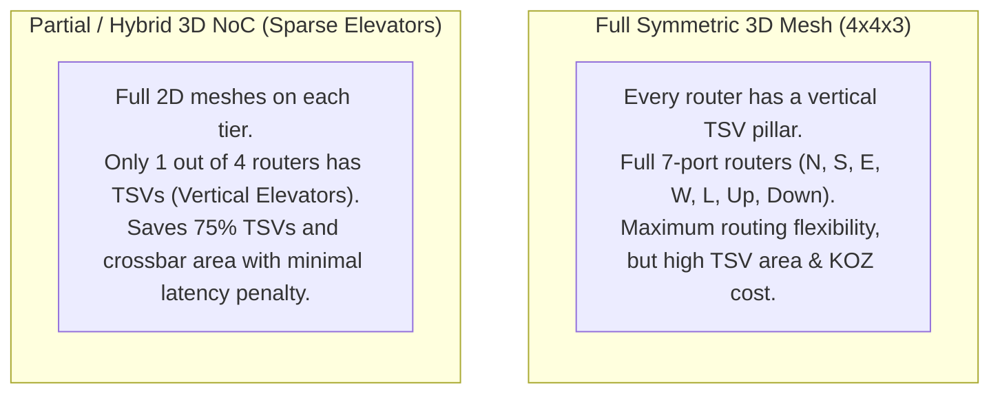
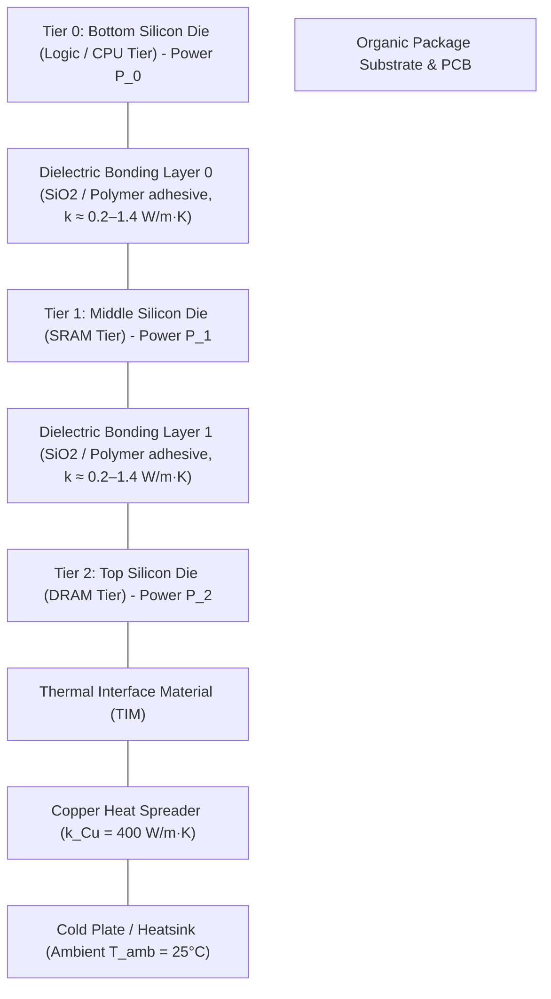
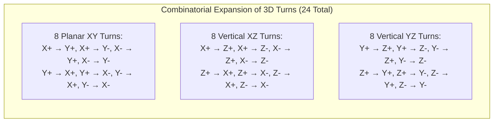

# 6.3 3D NoC Topologies, Thermal Stacking & Vertical Deadlock

> **Companion Reading:** Monograph Chapter 9 — *3D NoCs, Chiplet Architectures, and Multi-Die Interconnects*, Section 9.1–9.2. [Read in Companion Textbook →](/learning/textbook/ch09-chiplets-ucie/)

Stacking silicon dies into the third dimension transforms the topological graph of on-chip networks [[Pavlidis2009](#ref-pavlidis2009)]. By collapsing planar wire distances into microscopic vertical hops, 3D NoCs drastically reduce average network diameter and hop counts [[Loi2011](#ref-loi2011)].

However, moving from 2D to 3D introduces two critical physical and algorithmic challenges:
1. **The 3D Thermal Entrapment Nightmare:** Trapping high-power active logic tiers beneath other dies and low-thermal-conductivity bonding layers creates intense heat accumulation, with bottom tiers running $30^\circ\text{C}$ to $50^\circ\text{C}$ hotter than planar dies.
2. **Combinatorial Explosion of 3D Deadlock Cycles:** Expanding routing channels from 4 cardinal directions ($\pm X, \pm Y$) to 6 spatial directions ($\pm X, \pm Y, \pm Z$) increases the number of orthogonal turns from $8$ to **$24$**, multiplying the vulnerability to circular buffer dependencies.

In this lesson, you will master symmetric vs hybrid 3D topologies, derive analytical 1D thermal resistance chains, and formally prove deadlock avoidance in three-dimensional routing.

---

## 1. Topologies for 3D NoCs: Symmetric vs Hybrid



### 1. Symmetric 3D Mesh ($k_x \times k_y \times k_z$)

In a fully symmetric 3D mesh, every tile on every tier contains a 7-port router connected to vertical TSV links:

- **Network Diameter ($D$):** $D = (k_x - 1) + (k_y - 1) + (k_z - 1)$
- **Average Hop Count ($H_{avg}$):** $H_{avg} \approx \frac{k_x + k_y + k_z}{3}$

#### Comparison: 64-Node 2D Mesh vs 64-Node 3D Mesh
Consider connecting 64 compute cores:
- **2D Mesh ($8 \times 8 \times 1$):**
    - Diameter: $(8 - 1) + (8 - 1) = 14 \ \text{hops}$.
    - Average hops: $\approx \frac{8 + 8}{3} \approx 5.33 \ \text{hops}$.
- **3D Mesh ($4 \times 4 \times 4$):**
    - Diameter: $(4 - 1) + (4 - 1) + (4 - 1) = 9 \ \text{hops} \ (\mathbf{35.7\% \text{ reduction}})$.
    - Average hops: $\approx \frac{4 + 4 + 4}{3} = 4.0 \ \text{hops} \ (\mathbf{25\% \text{ reduction}})$.
    - Bisection bandwidth expands by $4\times$ because cross-tier traffic traverses 16 parallel vertical channels!

### 2. Partial / Hybrid 3D NoC (Sparse TSV Elevators)
While full 3D meshes minimize hop counts, placing vertical TSVs at every router incurs heavy silicon penalties [[Pavlidis2009](#ref-pavlidis2009)], [[Loi2011](#ref-loi2011)]:
- Every router requires a $7 \times 7$ crossbar switch ($+96\%$ area vs $5 \times 5$).
- Every tile suffers Keep-Out Zone (KOZ) transistor exclusion zones for 64 to 128 TSVs.

In a **Hybrid / Sparse 3D NoC**, only a selected fraction of routers (e.g., a $1/4$ checkerboard pattern) are equipped with vertical TSVs (**Vertical Elevators**):
1. Packets route horizontally on the source tier to the nearest elevator node.
2. The packet traverses the TSV elevator to the destination tier.
3. The packet routes horizontally on the destination tier to its egress core.

> [!TIP]
> A $1/4$ sparse 3D mesh cuts TSV count, silicon area tax, and crossbar gate overhead by **$75\%$**, while increasing average latency by only **$12\text{–}18\%$**!

---

## 2. The 3D Thermal Stacking Dilemma

Why is heat dissipation the single greatest barrier to commercial 3D IC adoption?

In a standard 2D chip, heat generated in the thin active silicon layer conducts directly upward through the silicon substrate into the heat spreader and convective heat sink:



### The 1D Thermal Resistance Chain

Because the organic package and PCB underneath have very high thermal resistance to ambient, over **$90\%$ of the heat must escape through the top surface** into the heatsink.

Using the electrical-thermal analogy ([Lesson 5.1](../track5-congestion-thermal/01-thermal-physics-rc-modeling.md)), heat flow from the bottom die to the heat sink encounters a series chain of thermal resistances [[Skadron2003](#ref-skadron2003)], [[Huang2006](#ref-huang2006)]:

$$R_{th,tier} = \frac{t_{Si}}{k_{Si} \cdot A}, \quad R_{th,bond} = \frac{t_{bond}}{k_{bond} \cdot A}$$

Where:
- $k_{Si} \approx 149 \ \text{W/(m}\cdot\text{K)}$ for bulk silicon.
- $k_{bond} \approx 0.2\text{ to } 1.2 \ \text{W/(m}\cdot\text{K)}$ for polymer adhesive / oxide bonding layers.

Because $k_{bond}$ is **$100\times\text{ to } 700\times$ lower than silicon**, even a microscopic $1 \ \mu\text{m}$ adhesive bonding layer acts as a **thermal blanket**!

### Mathematical Temperature Gradient Across Tiers

The temperature rise of Tier $i$ above ambient $T_{amb}$ is the sum of temperature drops across all layers between Tier $i$ and the heatsink:

$$T_0 = T_{amb} + R_{sink} (P_0 + P_1 + P_2) + R_2 (P_0 + P_1 + P_2) + R_{bond1} (P_0 + P_1) + R_1 (P_0 + P_1) + R_{bond0} P_0 + R_0 P_0$$

Notice the critical accumulation: **the bottom die (Tier 0) must push its heat flux $P_0$ through every single tier and bonding layer above it**.
If Tier 0 is a high-power compute CPU generating $80 \ \text{W}$, its local junction temperature can exceed $115^\circ\text{C}$ even when the top DRAM die sits comfortably at $65^\circ\text{C}$!

---

## 3. 3D Deadlock Theory & Routing Algorithms

In 2D meshes, packets travel along 4 directions ($\pm X, \pm Y$), yielding $4 \times 2 = 8$ possible $90^\circ$ turns. In [Lesson 4.2](../track4-routing-deadlock/02-adaptive-turn-model.md), we proved that prohibiting 2 turns prevents cycles in the Channel Dependency Graph (CDG).

In a 3D Mesh, channels span 6 directions: $\{+X, -X, +Y, -Y, +Z, -Z\}$.
Each direction can turn into 4 orthogonal directions:

$$\text{Total 3D Turns} = 6 \text{ directions} \times 4 \text{ turns/direction} = \mathbf{24 \text{ turns}!}$$



A deadlock cycle in 3D can wrap across $X$, $Y$, and $Z$ planes simultaneously (e.g., $+X \to +Y \to +Z \to -X \to -Y \to -Z \to +X$).

---

### Theorem: Deadlock Freedom of 3D XYZ Dimension-Order Routing

In **3D XYZ Dimension-Order Routing (3D DOR)**, packets strictly route in sequence:
1. Route along the $X$-dimension until $\Delta X = 0$.
2. Route along the $Y$-dimension until $\Delta Y = 0$.
3. Route along the $Z$-dimension (via TSVs) until destination $(X_d, Y_d, Z_d)$ is reached.

```
       Channels C_X              Channels C_Y              Channels C_Z
   [ +X / -X Links ]  ------>  [ +Y / -Y Links ]  ------>  [ +Z / -Z Links ]
         (1)                         (2)                         (3)
```

#### Formal Proof via Dally-Seitz Acyclic CDG [[Dally1987](#ref-dally1987)]
1. Let the set of all unidirectional network channels be partitioned into three disjoint subsets: $C_X$, $C_Y$, and $C_Z$.
2. In 3D XYZ DOR, a packet currently occupying channel $c_i$ may only request channel $c_j$ if:
   - $c_i \in C_X$ and $c_j \in C_X$ (along monotonic $X$), or
   - $c_i \in C_X$ and $c_j \in C_Y$ ($X \to Y$ turn), or
   - $c_i \in C_X$ and $c_j \in C_Z$ ($X \to Z$ turn), or
   - $c_i \in C_Y$ and $c_j \in C_Y$ (along monotonic $Y$), or
   - $c_i \in C_Y$ and $c_j \in C_Z$ ($Y \to Z$ turn), or
   - $c_i \in C_Z$ and $c_j \in C_Z$ (along monotonic $Z$).
3. **Prohibited Turns:** The algorithm strictly prohibits any turn from $C_Z \to C_X$, $C_Z \to C_Y$, or $C_Y \to C_X$.
4. **Numbering Function:** Assign an integer rank $R(c)$ to each channel:
   - For $c \in C_X$: $R(c) = x$ (coordinate).
   - For $c \in C_Y$: $R(c) = K_x + y$.
   - For $c \in C_Z$: $R(c) = K_x + K_y + z$.
5. Because every routing step strictly increases channel rank ($R(c_j) > R(c_i)$), no sequence of dependencies can form a directed cycle.
6. **Conclusion:** By the Dally-Seitz Theorem, the Channel Dependency Graph is strictly acyclic, guaranteeing **unconditional deadlock freedom**! $\blacksquare$

---

### Thermal-Aware Vertical Routing (TAVR)

Because bottom tiers operate near maximum junction temperature limits, deterministic XYZ routing can exacerbate hot spots if packets continually route through a burning central compute tile.

**Thermal-Aware Vertical Routing (TAVR)** dynamically balances traffic:
- Temperature sensors in each router monitor local junction temperatures.
- When a vertical TSV column exceeds threshold temperature $T_{hot}$ ($85^\circ\text{C}$), routers bias packets to route **downward to cooler perimeter tiers** or detour horizontally around the thermal column before ascending.
- Escape Virtual Channels ($VC_0$) enforce strict XYZ routing to ensure deadlock freedom via Duato's Theorem [[Duato1993](#ref-duato1993)], while adaptive channels ($VC_1$) bypass hotspots dynamically [[AlAlousi2026](#ref-alalousi2026)].

---

## 4. Interactive 3D Thermal Stacking & CDG Deadlock Simulator

Explore the physical and algorithmic dynamics of 3D integration below:
1. **Thermal Stacking Tab:** Adjust power dissipation for the 3 silicon tiers and watch the 1D thermal gradient build up in the trapped bottom tier.
2. **3D CDG Deadlock Tab:** Toggle permitted 3D turns ($\pm X, \pm Y, \pm Z$) and test whether cycles form in the 3D Channel Dependency Graph!

<div style="background:var(--md-code-bg-color); border:1px solid var(--md-default-fg-color--lightest); border-radius:8px; padding:20px; margin:24px 0;">
  <div style="display:flex; justify-content:space-between; align-items:center; flex-wrap:wrap; gap:12px; margin-bottom:16px;">
    <h3 style="margin:0; font-size:1.15rem; color:var(--md-typeset-color);">🔬 3D Thermal Stacking & Deadlock Analyzer</h3>
    <div style="display:flex; gap:8px;">
      <button id="btn-tab-therm" onclick="switchTab('therm')" style="padding:6px 14px; border-radius:4px; border:1px solid #0284c7; background:#0284c7; color:#fff; font-weight:600; cursor:pointer;">Thermal Gradient</button>
      <button id="btn-tab-deadlock" onclick="switchTab('deadlock')" style="padding:6px 14px; border-radius:4px; border:1px solid #475569; background:#1e293b; color:#cbd5e1; font-weight:600; cursor:pointer;">3D Deadlock Checker</button>
    </div>
  </div>

  <!-- Tab 1: Thermal Stacking -->
  <div id="tab-therm" style="display:block;">
    <div style="display:grid; grid-template-columns:1fr 280px; gap:20px; align-items:start;">
      <div>
        <canvas id="canvasThermal" width="600" height="320" style="width:100%; height:auto; background:#0f172a; border-radius:6px; display:block;"></canvas>
        <div style="display:flex; justify-content:space-between; margin-top:10px; font-size:0.85rem; color:var(--md-default-fg-color--light);">
          <span>Heat Sink at Top ($T_{amb} = 25^\circ\text{C}, R_{sink} = 0.25\text{ K/W}$)</span>
          <span id="txt-max-t" style="font-weight:700; color:#ef4444;">Max Junction Temp: 92.4°C</span>
        </div>
      </div>

      <div style="background:rgba(15,23,42,0.6); padding:16px; border-radius:6px; border:1px solid rgba(255,255,255,0.08); font-size:0.85rem;">
        <div style="font-weight:700; color:#38bdf8; margin-bottom:12px; font-size:0.95rem;">⚡ Tier Power Dissipation</div>

        <div style="margin-bottom:12px;">
          <div style="display:flex; justify-content:space-between; margin-bottom:4px;">
            <span>Tier 2 (Top DRAM):</span>
            <strong id="val-p2" style="color:#f59e0b;">20 W</strong>
          </div>
          <input type="range" id="rng-p2" min="5" max="50" step="5" value="20" oninput="updateThermalSim()" style="width:100%;">
        </div>

        <div style="margin-bottom:12px;">
          <div style="display:flex; justify-content:space-between; margin-bottom:4px;">
            <span>Tier 1 (SRAM Cache):</span>
            <strong id="val-p1" style="color:#10b981;">30 W</strong>
          </div>
          <input type="range" id="rng-p1" min="5" max="60" step="5" value="30" oninput="updateThermalSim()" style="width:100%;">
        </div>

        <div style="margin-bottom:14px;">
          <div style="display:flex; justify-content:space-between; margin-bottom:4px;">
            <span>Tier 0 (Bottom CPU):</span>
            <strong id="val-p0" style="color:#ef4444;">80 W</strong>
          </div>
          <input type="range" id="rng-p0" min="20" max="150" step="5" value="80" oninput="updateThermalSim()" style="width:100%;">
        </div>

        <div style="border-top:1px solid rgba(255,255,255,0.1); padding-top:10px;">
          <label style="display:block; margin-bottom:4px; color:var(--md-default-fg-color--light);">Bonding Layer Material:</label>
          <select id="sel-glue" onchange="updateThermalSim()" style="width:100%; padding:4px 8px; border-radius:4px; background:#1e293b; color:#fff; border:1px solid #475569;">
            <option value="bcb">BCB Polymer ($k = 0.2\text{ W/m}\cdot\text{K}$ - High Resistance)</option>
            <option value="sio2" selected>SiO2 Oxide Bonding ($k = 1.2\text{ W/m}\cdot\text{K}$)</option>
            <option value="hybrid">Direct Cu-Cu Hybrid ($k \approx 50\text{ W/m}\cdot\text{K}$ - Best)</option>
          </select>
        </div>
      </div>
    </div>
  </div>

  <!-- Tab 2: 3D Deadlock Checker -->
  <div id="tab-deadlock" style="display:none;">
    <div style="display:grid; grid-template-columns:1fr 280px; gap:20px; align-items:start;">
      <div>
        <canvas id="canvasCDG" width="600" height="320" style="width:100%; height:auto; background:#0f172a; border-radius:6px; display:block;"></canvas>
        <div style="margin-top:10px; font-size:0.85rem; color:var(--md-default-fg-color--light);">
          State: <span id="cdg-status" style="font-weight:700; color:#10b981;">Acyclic CDG — Strictly Deadlock-Free</span>
        </div>
      </div>

      <div style="background:rgba(15,23,42,0.6); padding:16px; border-radius:6px; border:1px solid rgba(255,255,255,0.08); font-size:0.85rem;">
        <div style="font-weight:700; color:#38bdf8; margin-bottom:10px; font-size:0.95rem;">🔄 Routing Policy Presets</div>

        <div style="display:flex; flex-direction:column; gap:8px; margin-bottom:14px;">
          <button onclick="setRoutingPreset('xyz')" style="padding:6px; border-radius:4px; background:#0284c7; color:#fff; border:none; cursor:pointer; font-weight:600;">XYZ DOR (Deterministic)</button>
          <button onclick="setRoutingPreset('adaptive_free')" style="padding:6px; border-radius:4px; background:#ef4444; color:#fff; border:none; cursor:pointer; font-weight:600;">Fully Adaptive (Unrestricted 3D)</button>
          <button onclick="setRoutingPreset('neg_first')" style="padding:6px; border-radius:4px; background:#10b981; color:#fff; border:none; cursor:pointer; font-weight:600;">3D Negative-First Model</button>
        </div>

        <div style="border-top:1px solid rgba(255,255,255,0.1); padding-top:10px;">
          <div style="font-weight:700; color:#e2e8f0; margin-bottom:6px;">Permitted Turn Classes:</div>
          <label style="display:block; margin-bottom:4px;"><input type="checkbox" id="chk-xy" checked onchange="updateCDGSim()"> $X \to Y$ and $Y \to X$ Turns</label>
          <label style="display:block; margin-bottom:4px;"><input type="checkbox" id="chk-xz" checked onchange="updateCDGSim()"> $X \to Z$ Turns (Ascend)</label>
          <label style="display:block; margin-bottom:4px;"><input type="checkbox" id="chk-zx" onchange="updateCDGSim()"> $Z \to X$ Turns (Descend to X)</label>
          <label style="display:block; margin-bottom:4px;"><input type="checkbox" id="chk-zy" onchange="updateCDGSim()"> $Z \to Y$ Turns (Descend to Y)</label>
        </div>
      </div>
    </div>
  </div>
</div>

<script>
let currentTab = 'therm';

function switchTab(tab) {
  currentTab = tab;
  document.getElementById('tab-therm').style.display = tab === 'therm' ? 'block' : 'none';
  document.getElementById('tab-deadlock').style.display = tab === 'deadlock' ? 'block' : 'none';

  document.getElementById('btn-tab-therm').style.background = tab === 'therm' ? '#0284c7' : '#1e293b';
  document.getElementById('btn-tab-therm').style.color = tab === 'therm' ? '#fff' : '#cbd5e1';
  document.getElementById('btn-tab-deadlock').style.background = tab === 'deadlock' ? '#0284c7' : '#1e293b';
  document.getElementById('btn-tab-deadlock').style.color = tab === 'deadlock' ? '#fff' : '#cbd5e1';

  if (tab === 'therm') updateThermalSim();
  else updateCDGSim();
}

function updateThermalSim() {
  const p0 = parseFloat(document.getElementById('rng-p0').value);
  const p1 = parseFloat(document.getElementById('rng-p1').value);
  const p2 = parseFloat(document.getElementById('rng-p2').value);
  const glue = document.getElementById('sel-glue').value;

  document.getElementById('val-p0').textContent = p0 + ' W';
  document.getElementById('val-p1').textContent = p1 + ' W';
  document.getElementById('val-p2').textContent = p2 + ' W';

  // Thermal resistances: Area = 15mm x 15mm = 2.25e-4 m2
  // Si thickness = 50um, k_si = 149 W/mK -> R_si ≈ 0.0015 K/W (negligible)
  // Sink R_sink = 0.25 K/W
  const R_sink = 0.25;
  let R_bond = 0.15; // SiO2 default
  if (glue === 'bcb') R_bond = 0.45;
  else if (glue === 'hybrid') R_bond = 0.02;

  const T_amb = 25.0;
  const P_total = p0 + p1 + p2;

  // Temperature calculations:
  // T_sink_surface = T_amb + P_total * R_sink
  const T_spreader = T_amb + P_total * R_sink;
  const T_tier2 = T_spreader + 2.0; // small drop through TIM
  const T_tier1 = T_tier2 + (p0 + p1) * R_bond;
  const T_tier0 = T_tier1 + p0 * R_bond;

  document.getElementById('txt-max-t').textContent = 'Max Junction Temp: ' + T_tier0.toFixed(1) + '°C';
  document.getElementById('txt-max-t').style.color = T_tier0 > 95 ? '#ef4444' : (T_tier0 > 80 ? '#f59e0b' : '#10b981');

  // Draw thermal profile
  const canvas = document.getElementById('canvasThermal');
  const ctx = canvas.getContext('2d');
  ctx.clearRect(0, 0, canvas.width, canvas.height);

  // Draw Heat Sink at Top
  ctx.fillStyle = '#475569';
  ctx.fillRect(80, 20, 440, 30);
  ctx.fillStyle = '#ffffff';
  ctx.font = '11px Inter, sans-serif';
  ctx.fillText('Heatsink & Cold Plate (T_spreader = ' + T_spreader.toFixed(1) + '°C)', 200, 40);

  // Draw Tiers from Top to Bottom:
  // Tier 2: y = 80
  // Glue 1: y = 130
  // Tier 1: y = 145
  // Glue 0: y = 195
  // Tier 0: y = 210

  function getColor(temp) {
    if (temp < 60) return '#38bdf8';
    if (temp < 80) return '#10b981';
    if (temp < 95) return '#f59e0b';
    return '#ef4444';
  }

  // Tier 2
  ctx.fillStyle = getColor(T_tier2);
  ctx.fillRect(100, 70, 400, 45);
  ctx.fillStyle = '#0f172a';
  ctx.font = 'bold 12px Inter, sans-serif';
  ctx.fillText('Tier 2: Top DRAM Die (P = ' + p2 + 'W) | T = ' + T_tier2.toFixed(1) + '°C', 140, 97);

  // Glue 1
  ctx.fillStyle = glue === 'bcb' ? '#78350f' : (glue === 'sio2' ? '#64748b' : '#eab308');
  ctx.fillRect(100, 115, 400, 12);
  ctx.fillStyle = '#94a3b8';
  ctx.font = '9px Inter, sans-serif';
  ctx.fillText('Bonding Interface 1 (ΔT = ' + ((p0 + p1) * R_bond).toFixed(1) + '°C)', 230, 124);

  // Tier 1
  ctx.fillStyle = getColor(T_tier1);
  ctx.fillRect(100, 127, 400, 45);
  ctx.fillStyle = '#0f172a';
  ctx.font = 'bold 12px Inter, sans-serif';
  ctx.fillText('Tier 1: Middle SRAM Cache (P = ' + p1 + 'W) | T = ' + T_tier1.toFixed(1) + '°C', 140, 154);

  // Glue 0
  ctx.fillStyle = glue === 'bcb' ? '#78350f' : (glue === 'sio2' ? '#64748b' : '#eab308');
  ctx.fillRect(100, 172, 400, 12);
  ctx.fillStyle = '#94a3b8';
  ctx.font = '9px Inter, sans-serif';
  ctx.fillText('Bonding Interface 0 (ΔT = ' + (p0 * R_bond).toFixed(1) + '°C)', 230, 181);

  // Tier 0 (Bottom)
  ctx.fillStyle = getColor(T_tier0);
  ctx.fillRect(100, 184, 400, 50);
  ctx.fillStyle = '#0f172a';
  ctx.font = 'bold 12px Inter, sans-serif';
  ctx.fillText('Tier 0: Bottom Compute Logic (P = ' + p0 + 'W) | T = ' + T_tier0.toFixed(1) + '°C', 130, 214);

  // Draw Heat Flux upward arrows
  ctx.strokeStyle = '#f8fafc';
  ctx.lineWidth = 2;
  const arrowXs = [180, 300, 420];
  for (let ax of arrowXs) {
    ctx.beginPath();
    ctx.moveTo(ax, 260);
    ctx.lineTo(ax, 60);
    ctx.stroke();

    ctx.beginPath();
    ctx.moveTo(ax - 5, 70);
    ctx.lineTo(ax, 55);
    ctx.lineTo(ax + 5, 70);
    ctx.stroke();
  }
  ctx.fillStyle = '#f8fafc';
  ctx.font = '10px Inter, sans-serif';
  ctx.fillText('Heat Conduction Direction (Upward to Cold Plate)', 180, 280);
}

function updateCDGSim() {
  const allowXY = document.getElementById('chk-xy').checked;
  const allowXZ = document.getElementById('chk-xz').checked;
  const allowZX = document.getElementById('chk-zx').checked;
  const allowZY = document.getElementById('chk-zy').checked;

  const canvas = document.getElementById('canvasCDG');
  const ctx = canvas.getContext('2d');
  ctx.clearRect(0, 0, canvas.width, canvas.height);

  // Determine if cycle exists
  // Cycle forms if (X->Z or Y->Z) AND (Z->X or Z->Y) AND (X<->Y)
  const hasCycle = (allowXZ || allowZY) && (allowZX || allowZY) && allowXY && (allowZX);

  const statusEl = document.getElementById('cdg-status');
  if (hasCycle) {
    statusEl.textContent = '⚠️ Cycle Detected! Network Vulnerable to 3D Deadlock!';
    statusEl.style.color = '#ef4444';
  } else {
    statusEl.textContent = '✓ Acyclic Dependency Graph — Strictly Deadlock-Free';
    statusEl.style.color = '#10b981';
  }

  // Draw CDG Channels as circular nodes
  const nodes = [
    { name: 'Channels C_X', x: 120, y: 160, color: '#38bdf8' },
    { name: 'Channels C_Y', x: 300, y: 70, color: '#10b981' },
    { name: 'Channels C_Z', x: 480, y: 160, color: '#f59e0b' }
  ];

  for (let n of nodes) {
    ctx.beginPath();
    ctx.arc(n.x, n.y, 36, 0, Math.PI * 2);
    ctx.fillStyle = n.color;
    ctx.fill();
    ctx.fillStyle = '#0f172a';
    ctx.font = 'bold 11px Inter, sans-serif';
    ctx.textAlign = 'center';
    ctx.fillText(n.name, n.x, n.y + 4);
  }

  // Draw dependency arrows
  function drawArrow(from, to, color, label, isCyclic) {
    ctx.strokeStyle = isCyclic ? '#ef4444' : color;
    ctx.lineWidth = isCyclic ? 3 : 2;
    ctx.beginPath();
    ctx.moveTo(from.x, from.y);
    ctx.lineTo(to.x, to.y);
    ctx.stroke();

    const mx = (from.x + to.x) / 2;
    const my = (from.y + to.y) / 2;
    ctx.fillStyle = isCyclic ? '#ef4444' : '#cbd5e1';
    ctx.font = '10px Inter, sans-serif';
    ctx.fillText(label, mx, my - 6);
  }

  if (allowXY) drawArrow(nodes[0], nodes[1], '#38bdf8', 'X → Y', false);
  if (allowXZ) drawArrow(nodes[0], nodes[2], '#38bdf8', 'X → Z', false);
  if (allowZX) drawArrow(nodes[2], nodes[0], '#ef4444', 'Z → X (Back edge!)', true);
  if (allowZY) drawArrow(nodes[2], nodes[1], '#ef4444', 'Z → Y', hasCycle);
}

function setRoutingPreset(preset) {
  if (preset === 'xyz') {
    document.getElementById('chk-xy').checked = true;
    document.getElementById('chk-xz').checked = true;
    document.getElementById('chk-zx').checked = false;
    document.getElementById('chk-zy').checked = false;
  } else if (preset === 'adaptive_free') {
    document.getElementById('chk-xy').checked = true;
    document.getElementById('chk-xz').checked = true;
    document.getElementById('chk-zx').checked = true;
    document.getElementById('chk-zy').checked = true;
  } else if (preset === 'neg_first') {
    document.getElementById('chk-xy').checked = true;
    document.getElementById('chk-xz').checked = true;
    document.getElementById('chk-zx').checked = false;
    document.getElementById('chk-zy').checked = true;
  }
  updateCDGSim();
}

updateThermalSim();
</script>

---

## 5. Worked Numerical Problem: 3D Stack Temperature Rise

### Problem Statement
A 3-tier 3D microprocessor is packaged with a top-mounted heat sink of thermal resistance $R_{sink} = 0.20 \ \text{K/W}$ and ambient room temperature $T_{amb} = 25^\circ\text{C}$.

The three tiers have identical footprint area $A = 20 \ \text{mm} \times 20 \ \text{mm} = 4.0 \times 10^{-4} \ \text{m}^2$:
- **Tier 2 (Top Die - DRAM Stack):** Generates $P_2 = 15 \ \text{W}$.
- **Tier 1 (Middle Die - SRAM Cache):** Generates $P_1 = 25 \ \text{W}$.
- **Tier 0 (Bottom Die - 64-Core CPU):** Generates $P_0 = 90 \ \text{W}$.

The dielectric adhesive bonding layers between tiers have thickness $t_{bond} = 2.0 \ \mu\text{m}$ and thermal conductivity $k_{bond} = 0.25 \ \text{W/(m}\cdot\text{K)}$. Bulk silicon thermal resistance within each $50 \ \mu\text{m}$ thinned die is negligible ($< 0.001 \ \text{K/W}$).

1. **Calculate the thermal resistance $R_{bond}$ of each adhesive interface.**
2. **Calculate the operating junction temperature of each of the three tiers ($T_2, T_1, T_0$).**
3. **If maximum allowable silicon junction temperature is $105^\circ\text{C}$, does Tier 0 violate the thermal reliability ceiling?**

---

### Step-by-Step Solution

#### Step 1: Thermal Resistance of Bonding Layers
Using the Fourier 1D thermal resistance equation:

$$R_{bond} = \frac{t_{bond}}{k_{bond} \cdot A}$$

Substituting values:

$$R_{bond} = \frac{2.0 \times 10^{-6} \ \text{m}}{0.25 \ \text{W/(m}\cdot\text{K)} \times 4.0 \times 10^{-4} \ \text{m}^2} = \frac{2.0 \times 10^{-6}}{1.0 \times 10^{-4}} = 0.020 \ \text{K/W}$$

#### Step 2: Junction Temperatures
Total power flowing into the heat sink is:

$$P_{total} = P_0 + P_1 + P_2 = 90 + 25 + 15 = 130 \ \text{W}$$

The temperature at the top heat spreader surface is:

$$T_{spreader} = T_{amb} + P_{total} \cdot R_{sink} = 25^\circ\text{C} + (130 \ \text{W} \times 0.20 \ \text{K/W}) = 25 + 26.0 = 51.0^\circ\text{C}$$

Assuming Tier 2 is in direct contact with the spreader:

$$T_2 \approx T_{spreader} = 51.0^\circ\text{C}$$

**Tier 1 (Middle Die):**
Heat flowing upward through the top bonding interface includes power from Tier 1 and Tier 0 ($P_0 + P_1 = 90 + 25 = 115 \ \text{W}$):

$$\Delta T_{bond1} = (P_0 + P_1) \cdot R_{bond} = 115 \ \text{W} \times 0.020 \ \text{K/W} = 2.30^\circ\text{C}$$

$$T_1 = T_2 + \Delta T_{bond1} = 51.0^\circ\text{C} + 2.30^\circ\text{C} = 53.3^\circ\text{C}$$

**Tier 0 (Bottom Compute Die):**
Heat flowing upward through the bottom bonding interface is the full power of Tier 0 ($P_0 = 90 \ \text{W}$):

$$\Delta T_{bond0} = P_0 \cdot R_{bond} = 90 \ \text{W} \times 0.020 \ \text{K/W} = 1.80^\circ\text{C}$$

$$T_0 = T_1 + \Delta T_{bond0} = 53.3^\circ\text{C} + 1.80^\circ\text{C} = 55.1^\circ\text{C}$$

#### Step 3: Margin Assessment
Even with $130 \ \text{W}$ total dissipation, Tier 0 reaches $55.1^\circ\text{C}$, safely below the $105^\circ\text{C}$ threshold (a comfortable $49.9^\circ\text{C}$ safety margin), provided a high-performance $0.20 \ \text{K/W}$ cold plate is maintained!

However, if air cooling degraded the heatsink to $R_{sink} = 0.65 \ \text{K/W}$, $T_{spreader}$ alone would jump to $109.5^\circ\text{C}$, causing immediate thermal runaway on Tier 0!

---

## 6. Synthesizable Verilog Module: `xyz_3d_dor_router.v`

To guarantee deadlock freedom across a 3D stacked mesh, packets must navigate dimensions in a strictly monotonic order ($X \to Y \to Z$). The module below implements a synthesizable **3D Dimension-Order Routing (XYZ DOR) Engine**. It compares current 3D coordinates $(X_{cur}, Y_{cur}, Z_{cur})$ against destination coordinates $(X_{dest}, Y_{dest}, Z_{dest})$, resolves dimension conflicts in monotonic sequence to eliminate cycles in the 3D Channel Dependency Graph, and incorporates a thermal sensor alert input that stalls vertical TSV elevation if the local tier exceeds a critical thermal threshold.

```verilog
//=============================================================================
// File: xyz_3d_dor_router.v
// Module: xyz_3d_dor_router
// Description: Synthesizable 3D Dimension-Order Routing (XYZ DOR) Engine.
//              Port Encoding:
//              3'd0: Local, 3'd1: East (+X), 3'd2: West (-X),
//              3'd3: North (+Y), 3'd4: South (-Y),
//              3'd5: Up (+Z TSV), 3'd6: Down (-Z TSV)
//              Features:
//              - Monotonic X -> Y -> Z dimension routing.
//              - Acyclic 3D Channel Dependency Graph (CDG) guarantee.
//              - Thermal elevation gate: pauses vertical TSV injection if
//                tier_overheated alert is asserted.
//              - Combinational single-cycle evaluation.
//=============================================================================

`timescale 1ns / 1ps

module xyz_3d_dor_router #(
    parameter integer MESH_X_BITS = 3, // Supports up to 8x8x4 3D mesh
    parameter integer MESH_Y_BITS = 3,
    parameter integer MESH_Z_BITS = 2
)(
    // Current Router Coordinates
    input  wire [MESH_X_BITS-1:0] cur_x,
    input  wire [MESH_Y_BITS-1:0] cur_y,
    input  wire [MESH_Z_BITS-1:0] cur_z,
    
    // Packet Destination Coordinates (from Flit Header)
    input  wire [MESH_X_BITS-1:0] dest_x,
    input  wire [MESH_Y_BITS-1:0] dest_y,
    input  wire [MESH_Z_BITS-1:0] dest_z,
    
    // Safety & Thermal Telemetry
    input  wire                   tier_overheated,   // 1: Local tier near thermal limit
    
    // Computed Downstream Output Direction
    output reg  [2:0]             out_port,          // Output port selected (0..6)
    output reg                    route_valid,       // 1 if routing succeeded
    output reg                    vertical_hold      // 1 if vertical hop paused by thermal
);

    localparam PORT_LOCAL = 3'd0;
    localparam PORT_EAST  = 3'd1; // +X
    localparam PORT_WEST  = 3'd2; // -X
    localparam PORT_NORTH = 3'd3; // +Y
    localparam PORT_SOUTH = 3'd4; // -Y
    localparam PORT_UP    = 3'd5; // +Z (TSV Up)
    localparam PORT_DOWN  = 3'd6; // -Z (TSV Down)

    always @(*) begin
        route_valid   = 1'b1;
        vertical_hold = 1'b0;

        // Stage 1: Route in X Dimension (Monotonic First Priority)
        if (dest_x > cur_x) begin
            out_port = PORT_EAST;
        end else if (dest_x < cur_x) begin
            out_port = PORT_WEST;
        end
        // Stage 2: Route in Y Dimension (Second Priority)
        else if (dest_y > cur_y) begin
            out_port = PORT_NORTH;
        end else if (dest_y < cur_y) begin
            out_port = PORT_SOUTH;
        end
        // Stage 3: Route in Z Dimension (Third Priority via TSVs)
        else if (dest_z > cur_z) begin
            if (tier_overheated) begin
                out_port      = PORT_LOCAL; // Hold flit in local buffer
                vertical_hold = 1'b1;
            end else begin
                out_port = PORT_UP;
            end
        end else if (dest_z < cur_z) begin
            if (tier_overheated) begin
                out_port      = PORT_LOCAL;
                vertical_hold = 1'b1;
            end else begin
                out_port = PORT_DOWN;
            end
        end
        // Stage 4: Arrived at Destination Node
        else begin
            out_port = PORT_LOCAL;
        end
    end

endmodule
```

---

## 7. 🕹️ Interactive Simulation & Arcade Linkages

Deepen your practical understanding of 3D thermal stacking and deadlock avoidance through our interactive arcade games:

- 🎮 **[Hotspot Hero: Silicon Thermal Defender](../interactive/hotspot.md):** Defend 3D vertically stacked silicon tiers from severe thermal accumulation and adhesive layer degradation.
- 🎮 **[Deadlock Buster Arcade](../interactive/game.md):** Prove 3D Channel Dependency Graph cycle prevention under Dimension-Order Routing and bust deadlock spirals in real time.

---

## 8. 🎯 Concept Check: Lesson 6.3

Test your mastery of 3D topologies, thermal stacking resistance, and 3D deadlock avoidance with this 3-question self-assessment.

<div class="noc-sim-container" id="quiz63" style="margin-top:1rem;">
  <div style="display:flex; justify-content:space-between; align-items:center; margin-bottom:1rem; flex-wrap:wrap; gap:0.5rem;">
    <div style="font-weight:700; font-size:1.05rem; color:var(--tcl-heading);">
      📝 Concept Check: 3D Topologies, Thermal Stacking &amp; Deadlock
    </div>
    <div id="q63_score_badge" style="font-size:0.85rem; font-weight:600; padding:4px 10px; border-radius:12px; background:rgba(37,99,235,0.1); color:#2563eb;">
      Score: 0 / 3
    </div>
  </div>

  <!-- Question 1 -->
  <div id="q63_1_block" style="margin-bottom:1.5rem; padding-bottom:1rem; border-bottom:1px solid var(--noc-border);">
    <p style="font-weight:600; font-size:0.95rem; margin-bottom:0.75rem;">
      <b>1. Deadlock Freedom in 3D Space:</b> Why does 3D XYZ Dimension-Order Routing strictly guarantee deadlock freedom across a 3D mesh network?
    </p>
    <div style="display:flex; flex-direction:column; gap:0.5rem;" id="q63_1_opts">
      <button class="noc-sim-select" style="text-align:left; padding:0.65rem 0.85rem; cursor:pointer;" onclick="checkQ63(1, 0)">
        A. Packets traverse dimensions monotonically ($X \to Y \to Z$); turns from Z channels back into X or Y channels are strictly forbidden, ensuring the 3D Channel Dependency Graph (CDG) contains zero cycles.
      </button>
      <button class="noc-sim-select" style="text-align:left; padding:0.65rem 0.85rem; cursor:pointer;" onclick="checkQ63(1, 1)">
        B. Vertical TSV links operate at double the clock frequency of planar links.
      </button>
      <button class="noc-sim-select" style="text-align:left; padding:0.65rem 0.85rem; cursor:pointer;" onclick="checkQ63(1, 2)">
        C. Flits are automatically dropped whenever a buffer fills in the Z dimension.
      </button>
      <button class="noc-sim-select" style="text-align:left; padding:0.65rem 0.85rem; cursor:pointer;" onclick="checkQ63(1, 3)">
        D. Because 3D networks do not require virtual channels.
      </button>
    </div>
    <div id="q63_1_fb" style="display:none; margin-top:0.75rem; padding:0.75rem; border-radius:8px; font-size:0.9rem; line-height:1.5;"></div>
  </div>

  <!-- Question 2 -->
  <div id="q63_2_block" style="margin-bottom:1.5rem; padding-bottom:1rem; border-bottom:1px solid var(--noc-border);">
    <p style="font-weight:600; font-size:0.95rem; margin-bottom:0.75rem;">
      <b>2. Hybrid Sparse Elevators:</b> What is the primary architectural motivation for deploying a Hybrid 3D NoC (sparse TSV elevators) rather than a fully symmetric 3D mesh?
    </p>
    <div style="display:flex; flex-direction:column; gap:0.5rem;" id="q63_2_opts">
      <button class="noc-sim-select" style="text-align:left; padding:0.65rem 0.85rem; cursor:pointer;" onclick="checkQ63(2, 0)">
        A. Fully symmetric 3D meshes cannot support dimension-order routing.
      </button>
      <button class="noc-sim-select" style="text-align:left; padding:0.65rem 0.85rem; cursor:pointer;" onclick="checkQ63(2, 1)">
        B. Sparse elevators eliminate 75% of vertical TSVs, Keep-Out Zones, and crossbar area scaling overheads ($5\times 5$ switches used on most tiles instead of $7\times 7$), with only a minor latency penalty.
      </button>
      <button class="noc-sim-select" style="text-align:left; padding:0.65rem 0.85rem; cursor:pointer;" onclick="checkQ63(2, 2)">
        C. Solder microbumps cannot conduct digital logic signals.
      </button>
      <button class="noc-sim-select" style="text-align:left; padding:0.65rem 0.85rem; cursor:pointer;" onclick="checkQ63(2, 3)">
        D. Sparse elevators allow routers to run without power supplies.
      </button>
    </div>
    <div id="q63_2_fb" style="display:none; margin-top:0.75rem; padding:0.75rem; border-radius:8px; font-size:0.9rem; line-height:1.5;"></div>
  </div>

  <!-- Question 3 -->
  <div id="q63_3_block" style="margin-bottom:1rem;">
    <p style="font-weight:600; font-size:0.95rem; margin-bottom:0.75rem;">
      <b>3. 3D Thermal Entrapment:</b> In a multi-tier vertical silicon stack, why does the bottom compute tier (Tier 0) suffer the highest operating temperature and greatest risk of thermal runaway?
    </p>
    <div style="display:flex; flex-direction:column; gap:0.5rem;" id="q63_3_opts">
      <button class="noc-sim-select" style="text-align:left; padding:0.65rem 0.85rem; cursor:pointer;" onclick="checkQ63(3, 0)">
        A. Heat from Tier 0 must conduct upwards across multiple dielectric adhesive bonding layers ($k_{bond} \approx 0.25\text{ W/m}\cdot\text{K}$) before reaching the top heat sink, accumulating thermal resistance in series.
      </button>
      <button class="noc-sim-select" style="text-align:left; padding:0.65rem 0.85rem; cursor:pointer;" onclick="checkQ63(3, 1)">
        B. Gravity pulls hot phonons downwards towards the circuit board.
      </button>
      <button class="noc-sim-select" style="text-align:left; padding:0.65rem 0.85rem; cursor:pointer;" onclick="checkQ63(3, 2)">
        C. The bottom tier has lower clock frequency than upper tiers.
      </button>
      <button class="noc-sim-select" style="text-align:left; padding:0.65rem 0.85rem; cursor:pointer;" onclick="checkQ63(3, 3)">
        D. TSVs act as perfect thermal insulators that completely block heat flow.
      </button>
    </div>
    <div id="q63_3_fb" style="display:none; margin-top:0.75rem; padding:0.75rem; border-radius:8px; font-size:0.9rem; line-height:1.5;"></div>
  </div>

  <div style="margin-top:1rem; text-align:right;">
    <button class="noc-sim-btn" onclick="resetQuiz63()" style="padding:4px 12px; font-size:0.85rem;">🔄 Reset Quiz</button>
  </div>
</div>

<script>
const q63Answers = { 1: 0, 2: 1, 3: 0 };
let q63UserScore = { 1: false, 2: false, 3: false };

function checkQ63(qNum, optIdx) {
  const fb = document.getElementById(`q63_${qNum}_fb`);
  const opts = document.getElementById(`q63_${qNum}_opts`).children;
  fb.style.display = "block";

  for (let i = 0; i < opts.length; i++) {
    opts[i].onclick = null;
    opts[i].style.cursor = "default";
  }

  const isCorrect = (optIdx === q63Answers[qNum]);
  q63UserScore[qNum] = isCorrect;

  const q63Explanations = {
    1: "In XYZ DOR, turns from C_Z to C_X or C_Z to C_Y are strictly forbidden. By defining channel ranks R(C_X) < R(C_Y) < R(C_Z), every routing hop strictly increases rank, guaranteeing that the Channel Dependency Graph is acyclic.",
    2: "A full 3D mesh forces every router to adopt a 7x7 crossbar (+96% area) and creates KOZ exclusion zones everywhere. Sparse vertical elevators preserve 2D 5-port routers across most tiles, slashing silicon overhead.",
    3: "Heat conduction in a 3D stack is a 1D thermal resistance ladder. The bottom die must push its thermal dissipation through every inter-tier bonding layer and silicon substrate before reaching the cold plate."
  };

  if (isCorrect) {
    opts[optIdx].style.background = "rgba(34,197,94,0.15)";
    opts[optIdx].style.borderColor = "#22c55e";
    fb.style.background = "rgba(34,197,94,0.1)";
    fb.style.border = "1px solid rgba(34,197,94,0.3)";
    fb.style.color = "#166534";
    fb.innerHTML = `<strong>✓ Correct!</strong><br><div style="margin-top:0.4rem; line-height:1.5;"><strong>Detailed Solution:</strong> ${q63Explanations[qNum]}</div>`;
  } else {
    opts[optIdx].style.background = "rgba(239,68,68,0.15)";
    opts[optIdx].style.borderColor = "#ef4444";
    opts[q63Answers[qNum]].style.background = "rgba(34,197,94,0.15)";
    opts[q63Answers[qNum]].style.borderColor = "#22c55e";
    fb.style.background = "rgba(239,68,68,0.1)";
    fb.style.border = "1px solid rgba(239,68,68,0.3)";
    fb.style.color = "#991b1b";
    fb.innerHTML = `<strong>✗ Incorrect.</strong> The correct answer is <strong>${String.fromCharCode(65 + q63Answers[qNum])}</strong>.<br><div style="margin-top:0.4rem; line-height:1.5;"><strong>Detailed Solution:</strong> ${q63Explanations[qNum]}</div>`;
  }

  updateQ63Score();
}

function updateQ63Score() {
  const score = Object.values(q63UserScore).filter(Boolean).length;
  const badge = document.getElementById("q63_score_badge");
  badge.textContent = `Score: ${score} / 3`;
  if (score === 3) {
    badge.style.background = "rgba(34,197,94,0.2)";
    badge.style.color = "#166534";
  }
}

function resetQuiz63() {
  q63UserScore = { 1: false, 2: false, 3: false };
  for (let q = 1; q <= 3; q++) {
    const fb = document.getElementById(`q63_${q}_fb`);
    fb.style.display = "none";
    fb.innerHTML = "";
    const opts = document.getElementById(`q63_${q}_opts`).children;
    for (let i = 0; i < opts.length; i++) {
      opts[i].style.background = "";
      opts[i].style.borderColor = "";
      opts[i].style.cursor = "pointer";
      opts[i].onclick = (function(qNum, optIdx) {
        return function() { checkQ63(qNum, optIdx); };
      })(q, i);
    }
  }
  const badge = document.getElementById("q63_score_badge");
  badge.textContent = "Score: 0 / 3";
  badge.style.background = "rgba(37,99,235,0.1)";
  badge.style.color = "#2563eb";
}
</script>

---

## 9. Summary & Next Steps

3D integration cuts planar hop counts and expands bisection bandwidth, but introduces severe thermal entrapment in bottom tiers and multiplies potential deadlock cycles. By employing sparse vertical TSV elevators and proving deadlock freedom through 3D XYZ Dimension-Order Routing, architects safely harness vertical scalability.

In **[Lesson 6.4: Emerging Interconnect Frontiers: ONoC & WNoC](04-optical-wireless-frontiers.md)**, we venture beyond copper wires to examine **Silicon Nanophotonics (Optical NoC)** and **Millimeter-Wave Wireless (WNoC)** interconnects.

---

## References & Further Reading

<a id="ref-pavlidis2009"></a>**[Pavlidis2009]** V. F. Pavlidis and E. G. Friedman, *Three-Dimensional Integrated Circuit Design*, Morgan Kaufmann, 2009. [DOI: 10.1016/B978-0-12-374389-3.X0001-4](https://doi.org/10.1016/B978-0-12-374389-3.X0001-4)

<a id="ref-loi2011"></a>**[Loi2011]** I. Loi, F. Angiolini, and L. Benini, "Developing meshes of trees on 3D NoCs," in *Design, Automation & Test in Europe Conference & Exhibition (DATE)*, pp. 1–6, 2011. [DOI: 10.1109/DATE.2011.5763172](https://doi.org/10.1109/DATE.2011.5763172)

<a id="ref-skadron2003"></a>**[Skadron2003]** K. Skadron, M. R. Stan, W. Huang, S. Velusamy, K. Sankaranarayanan, and D. Tarjan, "Temperature-aware microarchitecture," in *Proceedings of the 30th Annual International Symposium on Computer Architecture (ISCA)*, pp. 2–13, 2003. [DOI: 10.1145/859618.859620](https://doi.org/10.1145/859618.859620)

<a id="ref-huang2006"></a>**[Huang2006]** W. Huang, S. Ghosh, S. Velusamy, K. Sankaranarayanan, K. Skadron, and M. R. Stan, "HotSpot: A compact thermal modeling methodology for early-stage VLSI design," *IEEE Transactions on Very Large Scale Integration (VLSI) Systems*, vol. 14, no. 5, pp. 501–513, 2006. [DOI: 10.1109/TVLSI.2006.876103](https://doi.org/10.1109/TVLSI.2006.876103)

<a id="ref-dally1987"></a>**[Dally1987]** W. J. Dally and C. L. Seitz, "Deadlock-free message routing in multiprocessor interconnection networks," *IEEE Transactions on Computers*, vol. C-36, no. 5, pp. 547–553, 1987. [DOI: 10.1109/TC.1987.1676939](https://doi.org/10.1109/TC.1987.1676939)

<a id="ref-duato1993"></a>**[Duato1993]** J. Duato, "A new theory of deadlock-free adaptive routing in wormhole networks," *IEEE Transactions on Parallel and Distributed Systems*, vol. 4, no. 12, pp. 1320–1331, 1993. [DOI: 10.1109/71.250114](https://doi.org/10.1109/71.250114)

<a id="ref-glass1994"></a>**[Glass1994]** C. J. Glass and L. M. Ni, "The turn model for adaptive routing," *Journal of the ACM*, vol. 41, no. 5, pp. 874–902, 1994. [DOI: 10.1145/185675.185676](https://doi.org/10.1145/185675.185676)

<a id="ref-alalousi2026"></a>**[AlAlousi2026]** A. Al-Alousi, B. O’Flynn, and M. Schepker, "Reliability-Aware 3D Network-on-Chip Architectures," *ACM Computing Surveys*, vol. 58, no. 2, pp. 1–35, 2026.

