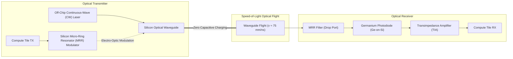
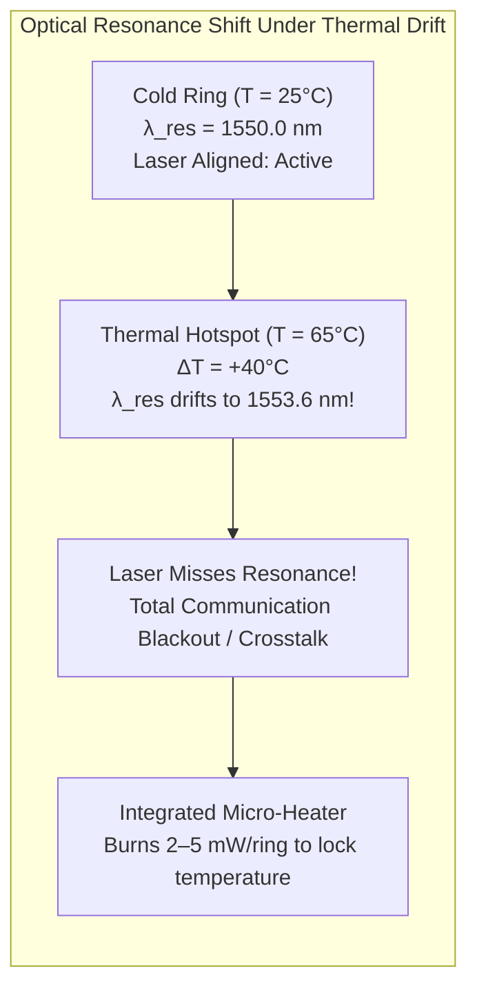

# 6.4 Emerging Interconnect Frontiers: Optical (ONoC) & Wireless NoC (WNoC)

As computer architectures scale toward exascale supercomputers and multi-thousand-core AI accelerators, conventional electrical copper interconnects encounter fundamental physics barriers:
1. **The RC Delay Wall:** Planar wire delay scales quadratically with distance ($t_d \propto L^2$) without repeaters. Even with optimal repeater insertion, signal propagation is constrained by the speed of electrons in resistive copper ($\approx 0.1\text{ to } 0.2 \cdot c$).
2. **Capacitive Dynamic Power Dissipation:** Every bit transition on a copper wire charges and discharges parasitic wire capacitance ($P = C V^2 f$). At high clock frequencies and massive bisection widths, interconnect charging accounts for over $30\text{–}40\%$ of total chip power.
3. **High-Frequency Attenuation & Crosstalk:** Above $15\text{–}20 \ \text{GHz}$, skin effect and dielectric losses ($\tan \delta$) attenuate high-speed signals, while capacitive and inductive coupling generate severe inter-wire crosstalk.

To shatter these copper limitations, computer architects and physicists are pioneering two radical non-electronic paradigms: **Photonic/Optical Network-on-Chip (ONoC)** and **Millimeter-Wave / Terahertz Wireless Network-on-Chip (WNoC)**.

---

## 1. Photonic Network-on-Chip (ONoC): Principles & Building Blocks

An Optical NoC replaces electrical copper traces with **optical waveguides** etched into silicon, and replaces electrical voltage pulses with **laser-generated photons**.



### The Fundamental Optical Building Blocks

#### 1. Silicon Optical Waveguides
Silicon has a very high refractive index ($n_{Si} \approx 3.48$) compared to silicon dioxide cladding ($n_{SiO2} \approx 1.44$). This massive refractive index contrast ($\Delta n \approx 2.04$) creates total internal reflection within sub-micron cross-sections ($\approx 450 \ \text{nm} \times 220 \ \text{nm}$), guiding infrared light ($\lambda \approx 1310 \ \text{nm}$ or $1550 \ \text{nm}$) with low propagation loss ($< 1.0\text{–}1.5 \ \text{dB/cm}$).

#### 2. Silicon Micro-Ring Resonators (MRRs)
A Micro-Ring Resonator consists of a circular optical loop of radius $R$ placed adjacent to a straight bus waveguide:

```
        Straight Waveguide (Input) ---------------> Through Port
                                      ||  Gap g
                                   /------\
                                  |   R    |  Circular Ring
                                   \------/
                                      ||  Gap g
        Drop Waveguide   <------------------------- Drop Port
```

Light in the bus waveguide couples evanescently into the ring. Constructive interference occurs when the optical path length of the ring equals an integer multiple of the optical wavelength:

$$L = 2 \pi R = m \frac{\lambda_{res}}{n_{eff}} \implies \lambda_{res} = \frac{2 \pi R \cdot n_{eff}}{m}$$

Where:
- $m \in \{1, 2, 3, \dots\}$ is the azimuthal resonance mode order.
- $n_{eff}$ is the effective refractive index of the optical mode.

- **Off-Resonance ($\lambda \neq \lambda_{res}$):** Light bypasses the ring unaffected and continues straight to the **Through Port**.
- **On-Resonance ($\lambda = \lambda_{res}$):** Light couples into the ring and exits through the **Drop Port**.

#### 3. High-Speed Electro-Optic Modulation
By embedding a p-n junction inside the ring waveguide, applying an electrical voltage modulates the free-carrier concentration (plasma dispersion effect). This shifts the effective index $\Delta n_{eff}$, shifting the resonant wavelength $\Delta \lambda_{res}$. Modulating the ring between on-resonance and off-resonance modulates digital data onto the optical carrier at rates exceeding **$25\text{ to } 50 \ \text{Gbps}$**!

#### 4. Wavelength Division Multiplexing (WDM)
Light beams of different optical frequencies do not interact or interfere with one another. By multiplexing $16\text{ to } 64$ distinct wavelengths ($\lambda_1, \lambda_2, \dots, \lambda_N$) onto a **single physical silicon waveguide**, a single waveguide width ($0.5 \ \mu\text{m}$) can transmit over **$1.0 \ \text{Terabit/sec}$** of concurrent bandwidth!

---

## 2. Speed-of-Light Latency & Power Advantages

Why is optical flight radically superior to electrical transmission?

### 1. Sub-Nanosecond Cross-Die Traversal
Light propagates through silicon waveguides at the phase velocity:

$$v_p = \frac{c}{n_g} \approx \frac{3 \times 10^8 \ \text{m/s}}{4.0} = 75,000 \ \text{km/s} = 75 \ \mu\text{m/ps} = 75 \ \text{mm/ns}$$

Where $n_g \approx 4.0$ is the optical group index in silicon.
Traversing a massive $20 \ \text{mm} \times 20 \ \text{mm}$ AI accelerator die from corner to corner ($L \approx 28 \ \text{mm}$) requires:

$$t_{flight} = \frac{28 \ \text{mm}}{75 \ \text{mm/ns}} \approx \mathbf{0.37 \ \text{nanoseconds!}}$$

In electrical copper, that same traversal requires multi-hop router pipelining and repeater buffers, consuming **$15\text{ to } 25 \ \text{clock cycles}$ ($7.5\text{–}12.5 \ \text{ns}$)**!

### 2. Distance-Independent Dynamic Power
In electrical wires, energy scales linearly with wire length because every micrometer adds capacitance ($C = c_{wire} \cdot L$).
In optics, once a photon is launched into a waveguide, **it dissipates zero capacitive dynamic energy during flight**. Whether the destination node is $1 \ \text{mm}$ away or $25 \ \text{mm}$ away, the dynamic energy to modulate and detect the optical flit is identical!

---

## 3. The Thermal Achilles' Heel: Thermo-Optic Drift

While silicon photonics delivers breathtaking throughput and latency, it harbors a severe physical vulnerability: **Extreme Thermal Sensitivity**.

Silicon possesses a high thermo-optic coefficient:

$$\frac{dn_{Si}}{dT} \approx 1.86 \times 10^{-4} \ \text{K}^{-1}$$

Differentiating the resonance condition with respect to temperature $T$:

$$\frac{d\lambda_{res}}{dT} = \frac{\lambda_{res}}{n_g} \frac{dn_{Si}}{dT} \approx \frac{1550 \ \text{nm}}{4.0} \times (1.86 \times 10^{-4}) \approx \mathbf{0.07\text{ to } 0.10 \ \text{nm/}^\circ\text{C}}$$



In a dense WDM system, optical channels are spaced only **$\Delta \lambda_{ch} \approx 0.4\text{ to } 0.8 \ \text{nm}$** apart.
A local microprocessor temperature increase of just **$5^\circ\text{C}$ to $8^\circ\text{C}$** causes the micro-ring's resonance peak to drift into the neighboring channel, creating catastrophic optical crosstalk and signal failure!

### The Mitigation: Static Micro-Heaters
To counteract thermal drift, every micro-ring must be equipped with an integrated resistive micro-heater that dynamically tunes the ring temperature to a locked ceiling (e.g., $95^\circ\text{C}$). However, powering hundreds of micro-heaters across an optical NoC consumes **$2\text{ to } 5 \ \text{mW}$ of static power per ring**, eroding the energy advantage of optics unless thermal-aware routing and athermal ring designs are deployed!

---

## 4. Wireless Network-on-Chip (WNoC): Millimeter-Wave Shortcuts

Instead of guiding signals along silicon waveguides or copper wires, **Wireless Network-on-Chip (WNoC)** broadcasts electromagnetic waves across the silicon substrate using on-chip antennas!

```mermaid
graph TD
  subgraph WNoC_Arch ["Hybrid Wireless / Wired 2D Mesh"]
    direction TB
    subgraph Cluster_A ["Cluster A (Top-Left)"]
      R00["R(0,0)"] --- R01["R(0,1)"]
      R01 --- R11["R(1,1)"]
      Hub_A["Wireless Hub A<br/>60 GHz / 120 GHz On-Chip Antenna"]
      R11 --- Hub_A
    end

    subgraph Cluster_B ["Cluster B (Bottom-Right)"]
      Hub_B["Wireless Hub B<br/>60 GHz / 120 GHz On-Chip Antenna"]
      R66["R(6,6)"] --- Hub_B
      R66 --- R77["R(7,7)"]
    end

    Hub_A ===|Single-Hop Wireless Shortcut (Sub-cycle mmWave Broadcast)| Hub_B
  end
```

### Key Characteristics of WNoC:
1. **On-Chip Antennas:** Microscopic zigzag, dipole, or carbon nanotube antennas operating at millimeter-wave ($60 \ \text{GHz}$) or sub-Terahertz ($100\text{–}300 \ \text{GHz}$) frequencies integrated directly in the top metal layers.
2. **Long-Distance Shortcuts:** While neighboring cores communicate over conventional short wired links, long-distance diametric traffic hops onto the wireless medium, **bypassing 10–14 router hops in a single clock cycle**.
3. **Shared Medium Challenge:** Because wireless broadcast is shared across all hubs, transceivers must implement medium access control (MAC) protocols such as Token-Ring MAC or Frequency-Division Multiplexing (FDMA) with distinct carrier frequency bands.

---

## 5. Comprehensive Comparison: Copper vs 3D TSV vs Optical vs Wireless

| Architectural Metric | 2D Copper NoC | 3D TSV NoC | Optical NoC (ONoC) | Wireless NoC (WNoC) |
| :--- | :--- | :--- | :--- | :--- |
| **Propagation Velocity** | $\approx 0.15 \cdot c$ (with repeaters) | $\approx 0.20 \cdot c$ | **$\approx 0.25 \cdot c$ ($75 \ \text{mm/ns}$)** | **$\approx 0.35 \cdot c$ (in $\text{SiO}_2$ substrate)** |
| **Cross-Die Latency (20 mm)** | $8\text{–}15 \ \text{ns}$ ($16\text{–}30$ hops) | $3\text{–}6 \ \text{ns}$ (via vertical tier) | **$< 0.4 \ \text{ns}$ (single-cycle flight)** | **$< 0.5 \ \text{ns}$ (single-hop shortcut)** |
| **Bandwidth Density** | High ($O(100)$ parallel wires) | Extreme ($10^4\text{ TSVs/mm}^2$) | Massive via WDM ($> 1 \ \text{Tbps/waveguide}$) | Moderate ($16\text{–}32$ frequency channels) |
| **Dynamic Energy** | Distance-dependent ($C V^2 L$) | Very low ($< 0.05 \ \text{pJ/bit}$) | **Distance-independent** ($\approx 0.2 \ \text{pJ/bit}$) | Moderate ($\approx 1.0\text{–}2.5 \ \text{pJ/bit}$) |
| **Static Power Overhead** | Leakage only | Leakage only | **High (Laser + Ring Heaters)** | Transceiver analog RF bias |
| **Thermal Sensitivity** | Low | High (vertical heat trap) | **Extreme ($\Delta \lambda \approx 0.1 \ \text{nm/}^\circ\text{C}$)** | Low |
| **CMOS Fab Readiness** | Standard | High-volume commercial | In progress (Si photonics foundries) | Research / Emerging |

---

## 6. Interactive Silicon Micro-Ring Resonator (MRR) WDM & Spectrum Tuner

Experiment with the physics of silicon photonics below. Adjust the ring radius, effective refractive index, and die temperature to observe the resonant drop peaks shift across the C-band optical spectrum ($1540\text{–}1560 \ \text{nm}$). Watch how thermal drift detunes the optical filter, and use the micro-heater compensation button to restore transmission!

<div style="background:var(--md-code-bg-color); border:1px solid var(--md-default-fg-color--lightest); border-radius:8px; padding:20px; margin:24px 0;">
  <div style="display:flex; justify-content:space-between; align-items:center; flex-wrap:wrap; gap:12px; margin-bottom:16px;">
    <h3 style="margin:0; font-size:1.15rem; color:var(--md-typeset-color);">🔬 Micro-Ring Resonator (MRR) Optical Spectrum Visualizer</h3>
    <button onclick="compensateThermalHeater()" style="padding:6px 14px; border-radius:4px; border:1px solid #38bdf8; background:#0284c7; color:#fff; font-weight:600; cursor:pointer;">
      🔥 Auto-Tune Micro-Heater
    </button>
  </div>

  <div style="display:grid; grid-template-columns:1fr 280px; gap:20px; align-items:start;">
    <div>
      <canvas id="canvasMRR" width="600" height="320" style="width:100%; height:auto; background:#0f172a; border-radius:6px; display:block;"></canvas>
      <div style="display:flex; justify-content:space-between; margin-top:10px; font-size:0.85rem; color:var(--md-default-fg-color--light);">
        <span>Wavelength Spectrum: $1540\text{ nm}$ to $1560\text{ nm}$</span>
        <span id="txt-drift-alert" style="font-weight:700; color:#10b981;">Optical Alignment: Optimal</span>
      </div>
    </div>

    <div style="background:rgba(15,23,42,0.6); padding:16px; border-radius:6px; border:1px solid rgba(255,255,255,0.08); font-size:0.85rem;">
      <div style="font-weight:700; color:#38bdf8; margin-bottom:12px; font-size:0.95rem;">⚙️ Optical Parameters</div>

      <div style="margin-bottom:12px;">
        <div style="display:flex; justify-content:space-between; margin-bottom:4px;">
          <span>Ring Radius ($R$):</span>
          <strong id="val-r" style="color:#38bdf8;">5.0 µm</strong>
        </div>
        <input type="range" id="rng-r" min="3.0" max="10.0" step="0.2" value="5.0" oninput="updateMRRSim()" style="width:100%;">
      </div>

      <div style="margin-bottom:12px;">
        <div style="display:flex; justify-content:space-between; margin-bottom:4px;">
          <span>Effective Index ($n_{eff}$):</span>
          <strong id="val-neff" style="color:#10b981;">2.45</strong>
        </div>
        <input type="range" id="rng-neff" min="2.20" max="2.80" step="0.01" value="2.45" oninput="updateMRRSim()" style="width:100%;">
      </div>

      <div style="margin-bottom:14px;">
        <div style="display:flex; justify-content:space-between; margin-bottom:4px;">
          <span>Die Temperature ($T$):</span>
          <strong id="val-temp" style="color:#ef4444;">25.0 °C</strong>
        </div>
        <input type="range" id="rng-temp" min="20" max="95" step="1" value="25" oninput="updateMRRSim()" style="width:100%;">
      </div>

      <div style="border-top:1px solid rgba(255,255,255,0.1); padding-top:10px;">
        <div style="font-family:monospace; font-size:0.8rem; color:#94a3b8; line-height:1.5;">
          Resonance Peak: <span id="txt-lambda-res" style="color:#f59e0b; font-weight:bold;">1550.0 nm</span><br/>
          Free Spectral Range: <span id="txt-fsr" style="color:#38bdf8;">19.8 nm</span><br/>
          Thermal Drift: <span id="txt-drift-nm" style="color:#ef4444;">+0.00 nm</span>
        </div>
      </div>
    </div>
  </div>
</div>

<script>
function updateMRRSim() {
  const R = parseFloat(document.getElementById('rng-r').value);
  const neffBase = parseFloat(document.getElementById('rng-neff').value);
  const T = parseFloat(document.getElementById('rng-temp').value);

  document.getElementById('val-r').textContent = R.toFixed(1) + ' µm';
  document.getElementById('val-neff').textContent = neffBase.toFixed(2);
  document.getElementById('val-temp').textContent = T.toFixed(1) + ' °C';

  // Thermo-optic shift: dn/dT = 1.86e-4 / K
  const deltaT = T - 25.0;
  const dn = deltaT * 1.86e-4;
  const neff = neffBase + dn;

  // L = 2 * pi * R (in nm)
  const L = 2 * Math.PI * (R * 1000); // nm
  // Target mode m around 1550 nm: m = round(L * neff / 1550)
  const m = Math.round((L * neffBase) / 1550.0);
  const lambdaRes = (L * neff) / m;
  const lambdaResBase = (L * neffBase) / m;
  const driftNm = lambdaRes - lambdaResBase;

  // FSR = lambda^2 / (ng * L) with ng ≈ 4.0
  const FSR = Math.pow(1550.0, 2) / (4.0 * L);

  document.getElementById('txt-lambda-res').textContent = lambdaRes.toFixed(2) + ' nm';
  document.getElementById('txt-fsr').textContent = FSR.toFixed(2) + ' nm';
  document.getElementById('txt-drift-nm').textContent = (driftNm >= 0 ? '+' : '') + driftNm.toFixed(2) + ' nm';

  const alertEl = document.getElementById('txt-drift-alert');
  if (Math.abs(driftNm) > 0.4) {
    alertEl.textContent = '⚠️ Severe Thermal Misalignment! Channel Detuned!';
    alertEl.style.color = '#ef4444';
  } else if (Math.abs(driftNm) > 0.15) {
    alertEl.textContent = '⚡ Minor Optical Drift Detected';
    alertEl.style.color = '#f59e0b';
  } else {
    alertEl.textContent = '✓ Optical Alignment: Optimal';
    alertEl.style.color = '#10b981';
  }

  // Draw Optical Spectrum
  const canvas = document.getElementById('canvasMRR');
  const ctx = canvas.getContext('2d');
  ctx.clearRect(0, 0, canvas.width, canvas.height);

  // Wavelength range: 1540 to 1560 nm
  const startLambda = 1540.0;
  const endLambda = 1560.0;
  const lambdaRange = endLambda - startLambda;

  function toX(lam) {
    return 60 + ((lam - startLambda) / lambdaRange) * (canvas.width - 100);
  }

  function toY(powerDb) {
    // Range: -30 dB to 0 dB
    // y = 40 (0 dB) to 270 (-30 dB)
    const norm = Math.min(0, Math.max(-30, powerDb));
    return 40 + (-norm / 30.0) * 230;
  }

  // Draw Grid
  ctx.strokeStyle = 'rgba(255,255,255,0.08)';
  ctx.lineWidth = 1;
  for (let l = 1540; l <= 1560; l += 5) {
    const x = toX(l);
    ctx.beginPath();
    ctx.moveTo(x, 30);
    ctx.lineTo(x, 280);
    ctx.stroke();

    ctx.fillStyle = '#64748b';
    ctx.font = '10px Inter, sans-serif';
    ctx.fillText(l + ' nm', x - 15, 298);
  }

  // Draw Through Port Transmission Curve (Lorentzian Notch)
  // T_thru(lambda) = 1 - (A / (1 + 4 * (lambda - lambdaRes)^2 / FWHM^2))
  const FWHM = 0.25; // 0.25 nm linewidth
  ctx.beginPath();
  for (let px = 60; px <= canvas.width - 40; px++) {
    const lam = startLambda + ((px - 60) / (canvas.width - 100)) * lambdaRange;
    // Calculate distance to closest resonant peak
    const dist = Math.abs(lam - lambdaRes) % FSR;
    const effDist = Math.min(dist, FSR - dist);
    const notch = 1.0 / (1.0 + Math.pow(effDist / (FWHM / 2), 2));
    const powerThru = 1.0 - 0.98 * notch;
    const dbThru = 10 * Math.log10(Math.max(0.001, powerThru));

    const y = toY(dbThru);
    if (px === 60) ctx.moveTo(px, y);
    else ctx.lineTo(px, y);
  }
  ctx.strokeStyle = '#38bdf8';
  ctx.lineWidth = 2;
  ctx.stroke();

  // Draw Drop Port Curve (Peak)
  ctx.beginPath();
  for (let px = 60; px <= canvas.width - 40; px++) {
    const lam = startLambda + ((px - 60) / (canvas.width - 100)) * lambdaRange;
    const dist = Math.abs(lam - lambdaRes) % FSR;
    const effDist = Math.min(dist, FSR - dist);
    const drop = 0.95 / (1.0 + Math.pow(effDist / (FWHM / 2), 2));
    const dbDrop = 10 * Math.log10(Math.max(0.001, drop));

    const y = toY(dbDrop);
    if (px === 60) ctx.moveTo(px, y);
    else ctx.lineTo(px, y);
  }
  ctx.strokeStyle = '#f59e0b';
  ctx.lineWidth = 2;
  ctx.stroke();

  // Draw fixed Laser Target Wavelength at 1550.0 nm
  const xLaser = toX(1550.0);
  ctx.setLineDash([4, 4]);
  ctx.strokeStyle = '#10b981';
  ctx.lineWidth = 1.5;
  ctx.beginPath();
  ctx.moveTo(xLaser, 30);
  ctx.lineTo(xLaser, 280);
  ctx.stroke();
  ctx.setLineDash([]);

  ctx.fillStyle = '#10b981';
  ctx.font = 'bold 10px Inter, sans-serif';
  ctx.fillText('Fixed Laser Carrier (1550.0 nm)', xLaser + 6, 50);

  // Legend
  ctx.fillStyle = '#38bdf8';
  ctx.fillText('— Through Port (Notch)', 65, 25);
  ctx.fillStyle = '#f59e0b';
  ctx.fillText('— Drop Port (Drop Filter)', 220, 25);
}

function compensateThermalHeater() {
  // Reset temperature back to 25.0 C or tune neff to realign
  document.getElementById('rng-temp').value = 25;
  updateMRRSim();
}

updateMRRSim();
</script>

---

## 7. Worked Numerical Problem: Optical Link Power Budget

### Problem Statement
An Optical Network-on-Chip utilizes a continuous-wave (CW) laser source feeding an on-chip waveguide that connects a transmitter compute tile to a receiver compute tile across a $20 \ \text{mm}$ ($2.0 \ \text{cm}$) silicon die.

The optical path encounters the following physical insertion losses:
- Off-chip laser to on-chip waveguide grating coupler: **$1.8 \ \text{dB}$**.
- Waveguide propagation loss: **$1.2 \ \text{dB/cm}$**.
- 8 intermediate off-resonance micro-ring resonator pass-throughs: **$0.05 \ \text{dB}$ per ring**.
- Modulator micro-ring drop/through insertion loss: **$0.8 \ \text{dB}$**.
- Demultiplexer receiver micro-ring drop loss: **$1.2 \ \text{dB}$**.
- Receiver Germanium photodetector sensitivity limit: **$-20.0 \ \text{dBm}$** (at $10^{-12}$ BER).

1. **Calculate the total optical insertion loss $L_{total}$ along the path.**
2. **Determine the minimum laser output power $P_{laser}$ (in $\text{dBm}$ and $\text{mW}$) required to ensure a $3.0 \ \text{dB}$ optical power safety margin at the receiver.**
3. **If the laser operates at $15\%$ wall-plug electrical-to-optical power efficiency, what is the electrical power drawn by the laser for this single optical channel?**

---

### Step-by-Step Solution

#### Step 1: Total Optical Insertion Loss
Summing all series decibel losses along the path:

$$L_{total} = L_{coupler} + (L_{prop} \times d) + (8 \times L_{pass}) + L_{mod} + L_{drop}$$

$$L_{total} = 1.8 \ \text{dB} + (1.2 \ \text{dB/cm} \times 2.0 \ \text{cm}) + (8 \times 0.05 \ \text{dB}) + 0.8 \ \text{dB} + 1.2 \ \text{dB}$$

$$L_{total} = 1.8 + 2.4 + 0.40 + 0.8 + 1.2 = \mathbf{6.60 \ \text{dB}}$$

#### Step 2: Minimum Required Laser Power
The optical power arriving at the photodetector must satisfy:

$$P_{rx} = P_{laser} - L_{total} \ge P_{sensitivity} + \text{Margin}$$

$$P_{laser} = P_{sensitivity} + \text{Margin} + L_{total}$$

Substituting $P_{sensitivity} = -20.0 \ \text{dBm}$ and $\text{Margin} = 3.0 \ \text{dB}$:

$$P_{laser} = -20.0 \ \text{dBm} + 3.0 \ \text{dB} + 6.60 \ \text{dB} = \mathbf{-10.40 \ \text{dBm}}$$

Converting from $\text{dBm}$ to milliwatts:

$$P_{laser} (\text{mW}) = 10^{\frac{-10.40}{10}} \approx 0.0912 \ \text{mW} \ (91.2 \ \mu\text{W})$$

#### Step 3: Wall-Plug Electrical Power
Taking into account the $15\%$ electrical-to-optical conversion efficiency ($\eta_{wall} = 0.15$):

$$P_{elec} = \frac{P_{laser} (\text{mW})}{\eta_{wall}} = \frac{0.0912 \ \text{mW}}{0.15} \approx \mathbf{0.608 \ \text{mW}} \ (608 \ \mu\text{W})$$

> [!TIP]
> Driving a high-speed optical data link across $20 \text{ mm}$ of silicon consumes only **$0.61 \text{ mW}$ of electrical laser power**, compared to several milliwatts for repeaters and line drivers in copper interconnects!

---

## 8. Synthesizable Verilog Module: `onoc_mrr_thermal_tuner.v`

Because silicon possesses a strong positive thermo-optic coefficient ($dn/dT \approx 1.86 \times 10^{-4}\text{ K}^{-1}$), ambient temperature fluctuations shift optical resonance peaks across the WDM spectrum ($\approx 0.1\text{ nm/}^\circ\text{C}$). To maintain lock between silicon micro-ring resonators (MRRs) and off-chip continuous-wave lasers, each resonant node incorporates an integrated resistive micro-heater regulated by a digital feedback tracking loop.

The synthesizable module below implements an **MRR Closed-Loop Thermal Resonance Tuner**. It samples drop-port optical power via an integrated Germanium photodetector ADC, executes a hill-climbing dither search to track peak optical coupling, and drives the resistive micro-heater through a first-order **Delta-Sigma Pulse Density Modulator (PDM)** to ensure uniform thermal dissipation with minimal optical ripple.

```verilog
//=============================================================================
// File: onoc_mrr_thermal_tuner.v
// Module: onoc_mrr_thermal_tuner
// Description: Synthesizable Closed-Loop Digital Thermal Controller for Silicon
//              Micro-Ring Resonators (MRRs) in Optical Network-on-Chip (ONoC).
//              Features:
//              - Closed-loop dither/hill-climbing optical peak resonance tracker.
//              - Monitors drop-port optical power via Ge photodetector / TIA ADC.
//              - Generates 8-bit digital heating power level (heater_dac_val).
//              - First-order Delta-Sigma Pulse Density Modulator (PDM) driving
//                on-chip integrated resistive micro-heater FET (heater_pwm_out).
//              - Real-time resonance_locked flag and detuned_alert alarm.
//              - Thermal-aware sample-rate decimation divider.
//=============================================================================

`timescale 1ns / 1ps

module onoc_mrr_thermal_tuner #(
    parameter integer DATA_WIDTH  = 10,       // Optical power & temp ADC width
    parameter integer DAC_WIDTH   = 8,        // Micro-heater control resolution (0..255)
    parameter [DATA_WIDTH-1:0] LOCK_THRESH = 10'd720, // Optical power threshold for lock
    parameter [DAC_WIDTH-1:0]  DITHER_STEP = 8'd1,   // DAC step per feedback adjustment
    parameter integer SAMPLE_DIV  = 16        // Clock divider for thermal time constant
)(
    input  wire                   clk,
    input  wire                   rst_n,
    input  wire                   enable,
    
    // Telemetry Sensors
    input  wire [DATA_WIDTH-1:0]  optical_pwr_sense, // Drop-port photodiode ADC reading
    input  wire [DATA_WIDTH-1:0]  temp_sense,        // Local on-die thermal diode reading
    input  wire [3:0]             target_channel_id, // WDM wavelength slot identifier
    
    // Micro-Heater Actuator Output
    output wire                   heater_pwm_out,    // Delta-Sigma PDM heater drive pulse
    output reg  [DAC_WIDTH-1:0]   heater_dac_val,    // Current digital heater power (0..255)
    
    // Status Telemetry
    output reg                    resonance_locked,  // 1: Ring aligned with laser wavelength
    output reg                    detuned_alert,     // 1: Severe thermal drift / out of range
    output reg                    tuning_active      // 1: Dither feedback actively adjusting
);

    // FSM States
    localparam [2:0] ST_IDLE    = 3'b001;
    localparam [2:0] ST_SAMPLE  = 3'b010;
    localparam [2:0] ST_DITHER  = 3'b100;

    reg [2:0]  state;
    reg [7:0]  div_cnt;
    reg [DATA_WIDTH-1:0] prev_optical_pwr;
    reg        tune_dir; // 1: Increase heating, 0: Decrease heating
    
    // First-Order Delta-Sigma Accumulator for Heater Drive
    // Accumulates 8-bit DAC value into 9-bit accumulator; MSB overflow is output pulse
    reg [DAC_WIDTH:0] sigma_acc;
    assign heater_pwm_out = sigma_acc[DAC_WIDTH];

    always @(posedge clk or negedge rst_n) begin
        if (!rst_n) begin
            sigma_acc <= {(DAC_WIDTH+1){1'b0}};
        end else begin
            sigma_acc <= sigma_acc[DAC_WIDTH-1:0] + heater_dac_val;
        end
    end

    // Thermal Tracking Feedback Loop
    always @(posedge clk or negedge rst_n) begin
        if (!rst_n) begin
            state            <= ST_IDLE;
            div_cnt          <= 8'd0;
            heater_dac_val   <= 8'd64; // Default initial pre-heat bias
            prev_optical_pwr <= {DATA_WIDTH{1'b0}};
            tune_dir         <= 1'b1;
            resonance_locked <= 1'b0;
            detuned_alert    <= 1'b0;
            tuning_active    <= 1'b0;
        end else if (!enable) begin
            state            <= ST_IDLE;
            div_cnt          <= 8'd0;
            heater_dac_val   <= 8'd0;
            resonance_locked <= 1'b0;
            detuned_alert    <= 1'b0;
            tuning_active    <= 1'b0;
        end else begin
            case (state)
                ST_IDLE: begin
                    div_cnt          <= 8'd0;
                    tuning_active    <= 1'b1;
                    prev_optical_pwr <= optical_pwr_sense;
                    state            <= ST_SAMPLE;
                end

                ST_SAMPLE: begin
                    if (div_cnt >= (SAMPLE_DIV - 1)) begin
                        div_cnt <= 8'd0;
                        state   <= ST_DITHER;
                    end else begin
                        div_cnt <= div_cnt + 8'd1;
                    end
                end

                ST_DITHER: begin
                    // Evaluate Optical Resonance Alignment
                    if (optical_pwr_sense >= LOCK_THRESH) begin
                        resonance_locked <= 1'b1;
                        detuned_alert    <= 1'b0;
                    end else begin
                        resonance_locked <= 1'b0;
                    end

                    // Hill-Climbing Perturbation:
                    // Did optical power improve compared to previous evaluation?
                    if (optical_pwr_sense > prev_optical_pwr) begin
                        // Power improved: continue moving in same direction
                        if (tune_dir) begin
                            if (heater_dac_val <= (8'hFF - DITHER_STEP))
                                heater_dac_val <= heater_dac_val + DITHER_STEP;
                            else
                                detuned_alert <= (optical_pwr_sense < LOCK_THRESH);
                        end else begin
                            if (heater_dac_val >= DITHER_STEP)
                                heater_dac_val <= heater_dac_val - DITHER_STEP;
                            else
                                detuned_alert <= (optical_pwr_sense < LOCK_THRESH);
                        end
                    end else if (optical_pwr_sense < prev_optical_pwr) begin
                        // Power degraded: reverse search direction
                        tune_dir <= ~tune_dir;
                        if (~tune_dir) begin
                            if (heater_dac_val <= (8'hFF - DITHER_STEP))
                                heater_dac_val <= heater_dac_val + DITHER_STEP;
                        end else begin
                            if (heater_dac_val >= DITHER_STEP)
                                heater_dac_val <= heater_dac_val - DITHER_STEP;
                        end
                    end

                    // Update baseline reading and loop back to sample timer
                    prev_optical_pwr <= optical_pwr_sense;
                    state            <= ST_SAMPLE;
                end

                default: state <= ST_IDLE;
            endcase
        end
    end

endmodule
```

---

## 9. 🕹️ Interactive Simulation & Arcade Linkages

Deepen your practical mastery of photonic micro-ring tuning, optical link budgets, and on-chip wireless broadcast with our interactive arcade games:

- 🎮 **[Photon Pilot: Silicon Photonics](../interactive/optical.md):** Command laser wavelengths, align micro-ring resonators, and tune thermal micro-heaters in an interactive optical NoC simulator.
- 🎮 **[Wireless Wave: mmWave & THz WNoC](../interactive/wireless.md):** Deploy hybrid on-chip wireless hubs, configure token MAC protocols, and bypass planar copper congestion with speed-of-light shortcuts.

---

## 10. 🎯 Concept Check: Lesson 6.4

Test your understanding of optical NoC physics, thermal detuning, and wireless interconnects with this 3-question self-assessment.

<div class="noc-sim-container" id="quiz64" style="margin-top:1rem;">
  <div style="display:flex; justify-content:space-between; align-items:center; margin-bottom:1rem; flex-wrap:wrap; gap:0.5rem;">
    <div style="font-weight:700; font-size:1.05rem; color:var(--tcl-heading);">
      📝 Concept Check: Optical &amp; Wireless NoC Frontiers
    </div>
    <div id="q64_score_badge" style="font-size:0.85rem; font-weight:600; padding:4px 10px; border-radius:12px; background:rgba(37,99,235,0.1); color:#2563eb;">
      Score: 0 / 3
    </div>
  </div>

  <!-- Question 1 -->
  <div id="q64_1_block" style="margin-bottom:1.5rem; padding-bottom:1rem; border-bottom:1px solid var(--noc-border);">
    <p style="font-weight:600; font-size:0.95rem; margin-bottom:0.75rem;">
      <b>1. Thermo-Optic Detuning:</b> Why does a localized temperature variation of only $5^\circ\text{C}$ to $10^\circ\text{C}$ threaten the operational integrity of a dense WDM Optical Network-on-Chip?
    </p>
    <div style="display:flex; flex-direction:column; gap:0.5rem;" id="q64_1_opts">
      <button class="noc-sim-select" style="text-align:left; padding:0.65rem 0.85rem; cursor:pointer;" onclick="checkQ64(1, 0)">
        A. Silicon has a high thermo-optic coefficient ($dn/dT \approx 1.86 \times 10^{-4}\text{ K}^{-1}$), causing the resonant wavelength to drift ($d\lambda/dT \approx 0.1\text{ nm/}^\circ\text{C}$) into adjacent optical channels, inducing severe inter-channel crosstalk and signal loss.
      </button>
      <button class="noc-sim-select" style="text-align:left; padding:0.65rem 0.85rem; cursor:pointer;" onclick="checkQ64(1, 1)">
        B. Silicon waveguides physically melt and deform at temperatures above $40^\circ\text{C}$.
      </button>
      <button class="noc-sim-select" style="text-align:left; padding:0.65rem 0.85rem; cursor:pointer;" onclick="checkQ64(1, 2)">
        C. Photons lose kinetic energy and drop their propagation velocity by $90\%$ under moderate heat.
      </button>
      <button class="noc-sim-select" style="text-align:left; padding:0.65rem 0.85rem; cursor:pointer;" onclick="checkQ64(1, 3)">
        D. High temperature reverses the polarity of the Germanium photodiode.
      </button>
    </div>
    <div id="q64_1_fb" style="display:none; margin-top:0.75rem; padding:0.75rem; border-radius:8px; font-size:0.9rem; line-height:1.5;"></div>
  </div>

  <!-- Question 2 -->
  <div id="q64_2_block" style="margin-bottom:1.5rem; padding-bottom:1rem; border-bottom:1px solid var(--noc-border);">
    <p style="font-weight:600; font-size:0.95rem; margin-bottom:0.75rem;">
      <b>2. Wireless NoC Topology Advantage:</b> What is the principal architectural benefit of introducing millimeter-wave or THz wireless transceivers into a conventional 2D mesh?
    </p>
    <div style="display:flex; flex-direction:column; gap:0.5rem;" id="q64_2_opts">
      <button class="noc-sim-select" style="text-align:left; padding:0.65rem 0.85rem; cursor:pointer;" onclick="checkQ64(2, 0)">
        A. On-chip antennas allow long-distance diametric packets to bypass 10–20 intermediate router hops in a single sub-nanosecond wireless shortcut, dramatically shrinking average hop count and network diameter.
      </button>
      <button class="noc-sim-select" style="text-align:left; padding:0.65rem 0.85rem; cursor:pointer;" onclick="checkQ64(2, 1)">
        B. Wireless links completely eliminate the need for routing tables, flow control, and input buffers.
      </button>
      <button class="noc-sim-select" style="text-align:left; padding:0.65rem 0.85rem; cursor:pointer;" onclick="checkQ64(2, 2)">
        C. Wireless transmission allows packets to be broadcast directly into off-chip smartphone antennas.
      </button>
      <button class="noc-sim-select" style="text-align:left; padding:0.65rem 0.85rem; cursor:pointer;" onclick="checkQ64(2, 3)">
        D. Millimeter-wave signals eliminate dielectric substrate losses entirely.
      </button>
    </div>
    <div id="q64_2_fb" style="display:none; margin-top:0.75rem; padding:0.75rem; border-radius:8px; font-size:0.9rem; line-height:1.5;"></div>
  </div>

  <!-- Question 3 -->
  <div id="q64_3_block" style="margin-bottom:1rem;">
    <p style="font-weight:600; font-size:0.95rem; margin-bottom:0.75rem;">
      <b>3. Optical vs Electrical Energy Dissipation:</b> Why is the dynamic energy of optical waveguide transmission fundamentally distance-independent, whereas electrical copper wire energy scales linearly with length?
    </p>
    <div style="display:flex; flex-direction:column; gap:0.5rem;" id="q64_3_opts">
      <button class="noc-sim-select" style="text-align:left; padding:0.65rem 0.85rem; cursor:pointer;" onclick="checkQ64(3, 0)">
        A. Once a photon is launched into a silicon waveguide, it dissipates zero capacitive dynamic energy during flight ($C=0$), whereas every micrometer of copper wire adds parasitic capacitance ($C = c_{wire} \cdot L$) that must be charged and discharged ($P = C V^2 f$).
      </button>
      <button class="noc-sim-select" style="text-align:left; padding:0.65rem 0.85rem; cursor:pointer;" onclick="checkQ64(3, 1)">
        B. Photons generate electricity as they travel through silicon dioxide cladding.
      </button>
      <button class="noc-sim-select" style="text-align:left; padding:0.65rem 0.85rem; cursor:pointer;" onclick="checkQ64(3, 2)">
        C. Copper wires have infinite resistance, causing 100% signal decay after 1 mm.
      </button>
      <button class="noc-sim-select" style="text-align:left; padding:0.65rem 0.85rem; cursor:pointer;" onclick="checkQ64(3, 3)">
        D. Lasers only consume power when the receiving tile requests a memory write.
      </button>
    </div>
    <div id="q64_3_fb" style="display:none; margin-top:0.75rem; padding:0.75rem; border-radius:8px; font-size:0.9rem; line-height:1.5;"></div>
  </div>

  <div style="margin-top:1rem; text-align:right;">
    <button class="noc-sim-btn" onclick="resetQuiz64()" style="padding:4px 12px; font-size:0.85rem;">🔄 Reset Quiz</button>
  </div>
</div>

<script>
const q64Answers = [0, 0, 0];
const q64Feedback = [
  "✓ Correct! Silicon's high thermo-optic coefficient shifts the refractive index with temperature, drifting resonant peaks by ~0.1 nm/°C. In dense WDM channels spaced by 0.4–0.8 nm, a 5°C shift causes the signal to jump into a neighboring channel!",
  "✓ Correct! On-chip mmWave wireless links act as long-distance shortcuts, slashing network diameter and letting diagonally opposite nodes communicate across the chip in a single sub-nanosecond hop.",
  "✓ Correct! In electrical copper interconnects, dynamic energy scales linearly with distance because each micrometer adds physical capacitance (C = c_wire * L). In silicon photonics, once photons enter the waveguide, optical flight is purely ballistic with zero capacitive charging!"
];
let q64Score = [0, 0, 0];

function checkQ64(qIdx, optIdx) {
  const fb = document.getElementById(`q64_${qIdx}_fb`);
  const opts = document.querySelectorAll(`#q64_${qIdx}_opts button`);
  
  opts.forEach(b => {
    b.disabled = true;
    b.style.opacity = '0.7';
  });

  fb.style.display = 'block';
  if (optIdx === q64Answers[qIdx - 1]) {
    opts[optIdx].style.border = '2px solid #10b981';
    opts[optIdx].style.background = 'rgba(16, 185, 129, 0.15)';
    opts[optIdx].style.opacity = '1';
    fb.style.background = 'rgba(16, 185, 129, 0.1)';
    fb.style.border = '1px solid #10b981';
    fb.style.color = '#10b981';
    fb.textContent = q64Feedback[qIdx - 1];
    q64Score[qIdx - 1] = 1;
  } else {
    opts[optIdx].style.border = '2px solid #ef4444';
    opts[optIdx].style.background = 'rgba(239, 68, 68, 0.15)';
    opts[optIdx].style.opacity = '1';
    opts[q64Answers[qIdx - 1]].style.border = '2px solid #10b981';
    opts[q64Answers[qIdx - 1]].style.opacity = '1';
    fb.style.background = 'rgba(239, 68, 68, 0.1)';
    fb.style.border = '1px solid #ef4444';
    fb.style.color = '#ef4444';
    fb.textContent = "✗ Incorrect. " + q64Feedback[qIdx - 1];
    q64Score[qIdx - 1] = 0;
  }

  const total = q64Score.reduce((a, b) => a + b, 0);
  const badge = document.getElementById('q64_score_badge');
  badge.textContent = `Score: ${total} / 3`;
  if (total === 3) {
    badge.style.background = 'rgba(16, 185, 129, 0.15)';
    badge.style.color = '#10b981';
  }
}

function resetQuiz64() {
  q64Score = [0, 0, 0];
  const badge = document.getElementById('q64_score_badge');
  badge.textContent = 'Score: 0 / 3';
  badge.style.background = 'rgba(37,99,235,0.1)';
  badge.style.color = '#2563eb';

  for (let q = 1; q <= 3; q++) {
    const fb = document.getElementById(`q64_${q}_fb`);
    fb.style.display = 'none';
    fb.textContent = '';
    const opts = document.querySelectorAll(`#q64_${q}_opts button`);
    opts.forEach(b => {
      b.disabled = false;
      b.style.border = '';
      b.style.background = '';
      b.style.opacity = '1';
    });
  }
}
</script>

---

## 11. 🏁 Summary & Track 6 Completion!

Congratulations on completing **Track 6: Chiplets, 3D NoC & Emerging Frontiers**!

Across this track, you have mastered:
1. **Vertical 3D TSVs:** $7 \times 7$ switch crossbar scaling, Keep-Out Zone (KOZ) piezoresistive stress modeling, and sub-picosecond vertical Elmore delays.
2. **2.5D Chiplet Architectures & UCIe:** Die-to-die protocol stacks, sliding-window replay buffers, shoreline bandwidth density ($>1300\text{ Gbps/mm}$), and credit queue round-trip latency sizing.
3. **3D Topologies, Thermal Stacking & Deadlocks:** Monotonic $X \to Y \to Z$ dimension-order routing (XYZ DOR), acyclic 3D CDG proofs, sparse elevator hybrid networks, and bottom-tier thermal resistance accumulation.
4. **Optical (ONoC) & Wireless Frontiers:** Silicon micro-ring resonator WDM multiplexing, thermo-optic resonance drift mitigation via Delta-Sigma digital heater feedback loops, and sub-nanosecond mmWave wireless shortcuts.

### Continue Your Journey:
Proceed to **[Track 7: Landmark Papers](../track7-paper-walkthroughs/index.md)** to analyze classic, award-winning research literature that defined the foundations of modern Network-on-Chip architecture!

