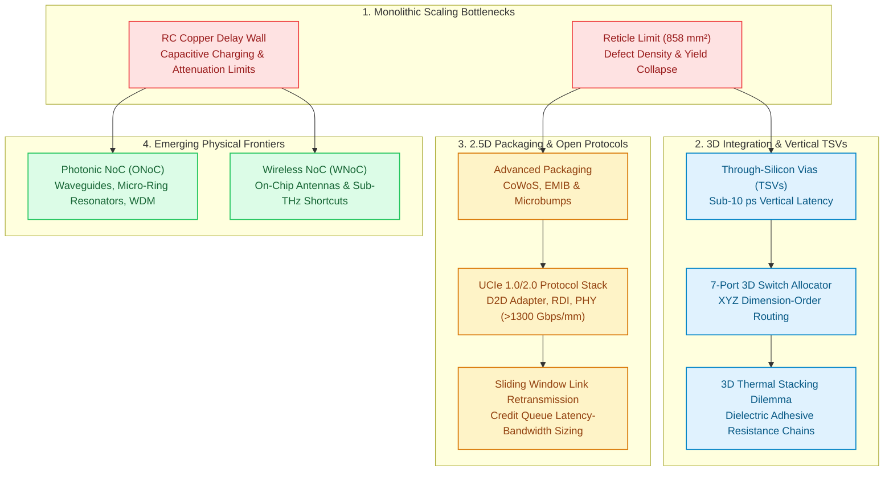

# Track 6: Chiplets, 3D NoC & Emerging Frontiers

  
Network Architecture • Module 06

  <h1>Chiplets, 3D Integration &amp; Emerging Physical Frontiers</h1>
  

    Master the microarchitecture and physics of spatial interconnects beyond monolithic 2D copper. From Through-Silicon Vias (TSVs) and Keep-Out Zone (KOZ) piezoresistive stress modeling to 2.5D Multi-Die packaging, the Universal Chiplet Interconnect Express (UCIe) protocol stack, 3D thermal stacking &amp; deadlock-free XYZ dimension-order routing, to nanophotonic silicon waveguides and millimeter-wave wireless shortcuts.
  

  

    ⏱️ 4 In-Depth Lessons
    🔬 4 Interactive Simulators &amp; Tools
    💻 4 Synthesizable Verilog RTL Modules
    📦 UCIe 1.0/2.0 &amp; TSV Standards

  

    

      📚 Aligned with Official Textbook Chapters 8, 9 &amp; 10
    

    

      Read <strong>Chapter 8 (3D-NoC &amp; TSVs)</strong> for vertical parasitics, 7-port crossbars, and thermal trapping. Read <strong>Chapter 9 (Chiplets &amp; UCIe)</strong> for Murphy yield economics, 2.5D interposers, and In/Outbound swap deadlock recovery. Read <strong>Chapter 10 (Optical &amp; Wireless NoC)</strong> for silicon photonics, MRRs, and 60 GHz wireless transceivers.
    

  

  

    <a href="../textbook/ch08-3d-noc-tsvs/" style="display: inline-flex; align-items: center; gap: 6px; background: #2563eb; color: #ffffff; padding: 8px 14px; border-radius: 6px; font-weight: 600; font-size: 0.85rem; text-decoration: none;">
      Read Chapter 8 →
    </a>
    <a href="../textbook/ch09-chiplets-ucie/" style="display: inline-flex; align-items: center; gap: 6px; background: #0284c7; color: #ffffff; padding: 8px 14px; border-radius: 6px; font-weight: 600; font-size: 0.85rem; text-decoration: none;">
      Read Chapter 9 →
    </a>
    <a href="../textbook/ch10-optical-wireless/" style="display: inline-flex; align-items: center; gap: 6px; background: #ec4899; color: #ffffff; padding: 8px 14px; border-radius: 6px; font-weight: 600; font-size: 0.85rem; text-decoration: none;">
      Read Chapter 10 →
    </a>
  

---

## 🗺️ 3D & Chiplet Architecture Roadmap

The roadmap below visualizes how physical scaling limits in monolithic silicon drive 3D vertical integration, 2.5D modular chiplet standards, and emerging optical and wireless transmission media:

---

## 📚 Syllabus & Chapters in Track 6

  

    

      Lesson 6.1
      
3D TSV Interconnects &amp; Microarchitecture

      

        Cylindrical TSV parasitics ($R_{tsv}, C_{tsv}$), keep-out zones (KOZ) from thermo-mechanical stress ($\sigma_{vm} \propto \Delta \alpha \cdot \Delta T$), 7-port 3D router crossbars ($7\times 7$, $+96\%$ area overhead), and sub-micron copper-copper hybrid bonding.
      

      

        ⚡ <strong>Features:</strong> Interactive 3D TSV Mesh &amp; 7-Port Router Architecture Visualizer, Synthesizable Verilog RTL (`router_3d_7port_allocator.v`), 3-Question Self-Check Quiz, Arcade Linkages (Topology Titans &amp; Arbiter Arena).
      

    

    <a href="01-3d-tsv-interconnects/" class="noc-track-link">Launch Lesson 6.1 →</a>
  

  

    

      Lesson 6.2
      
Multi-Chiplet Interconnects &amp; UCIe Standard

      

        Reticle economics, negative binomial yield models, packaging technologies (Organic vs CoWoS vs EMIB), the Universal Chiplet Interconnect Express (UCIe) 3-layer stack, sliding-window replay buffers, shoreline bandwidth scaling ($>1300\text{ Gbps/mm}$), and credit queue round-trip latency sizing.
      

      

        ⚡ <strong>Features:</strong> Interactive Multi-Chiplet D2D Packaging &amp; UCIe Explorer, Synthesizable Verilog RTL (`ucie_d2d_link_adapter.v`), 3-Question Self-Check Quiz, Arcade Linkages (Chiplet Tycoon &amp; Credit Commander).
      

    

    <a href="02-chiplets-ucie-interconnects/" class="noc-track-link">Launch Lesson 6.2 →</a>
  

  

    

      Lesson 6.3
      
3D Topologies, Thermal Stacking &amp; Deadlock

      

        Symmetric vs asymmetric/sparse 3D NoC topologies, 1D thermal resistance chains ($\Delta T_{stack} = \sum P_i R_i$), 3D Channel Dependency Graphs (CDGs), and formal proof of deadlock freedom under XYZ Dimension-Order Routing.
      

      

        ⚡ <strong>Features:</strong> Interactive 3D Thermal Stacking &amp; CDG Deadlock Simulator, Synthesizable Verilog RTL (`xyz_3d_dor_router.v`), 3-Question Self-Check Quiz, Arcade Linkages (Hotspot Hero &amp; Deadlock Buster).
      

    

    <a href="03-3d-topologies-thermal-deadlock/" class="noc-track-link">Launch Lesson 6.3 →</a>
  

  

    

      Lesson 6.4
      
Emerging Interconnect Frontiers: ONoC &amp; WNoC

      

        RC copper delay walls, Optical NoC (silicon waveguides, micro-ring resonators, WDM, thermo-optic wavelength drift), delta-sigma digital micro-heater feedback control, on-chip mm-Wave Wireless NoC antennas, and comparative physical trade-offs.
      

      

        ⚡ <strong>Features:</strong> Interactive Silicon Micro-Ring Resonator (MRR) WDM &amp; Spectrum Tuner, Synthesizable Verilog RTL (`onoc_mrr_thermal_tuner.v`), 3-Question Self-Check Quiz, Arcade Linkages (Photon Pilot &amp; Wireless Wave).
      

    

    <a href="04-optical-wireless-frontiers/" class="noc-track-link">Launch Lesson 6.4 →</a>
  

---

## 🎯 Track Learning Objectives

Upon completing Track 6, you will be able to:

1. **Calculate Electrical Parasitics of TSVs:** Compute lumped resistance, capacitance, and Elmore delay for vertical silicon vias, and quantify the silicon area tax imposed by piezo-resistive Keep-Out Zones (KOZ).
2. **Model Multi-Chiplet Yield & Packaging Economics:** Apply the negative binomial yield model to prove why multi-chiplet partitioning slashes manufacturing costs by $40\text{–}60\%$ on bleeding-edge nodes despite packaging overheads.
3. **Analyze the UCIe Standard:** Trace packets from high-level NoC protocols (AXI, CHI) through the UCIe D2D Adapter (CRC, parity, retry buffers) down to the Physical Layer (AFE, forwarded clock, lane reversal).
4. **Solve 3D Deadlock & Heat Dissipation Challenges:** Prove the acyclic nature of 3D Channel Dependency Graphs under XYZ DOR and calculate inter-tier thermal gradients across stacked logic and memory tiers.
5. **Evaluate Next-Generation Optical & Wireless Frontiers:** Analyze optical power budgets, insertion losses, and thermal tuning requirements for Silicon Micro-Ring Resonators, and evaluate wireless sub-THz shortcuts.
