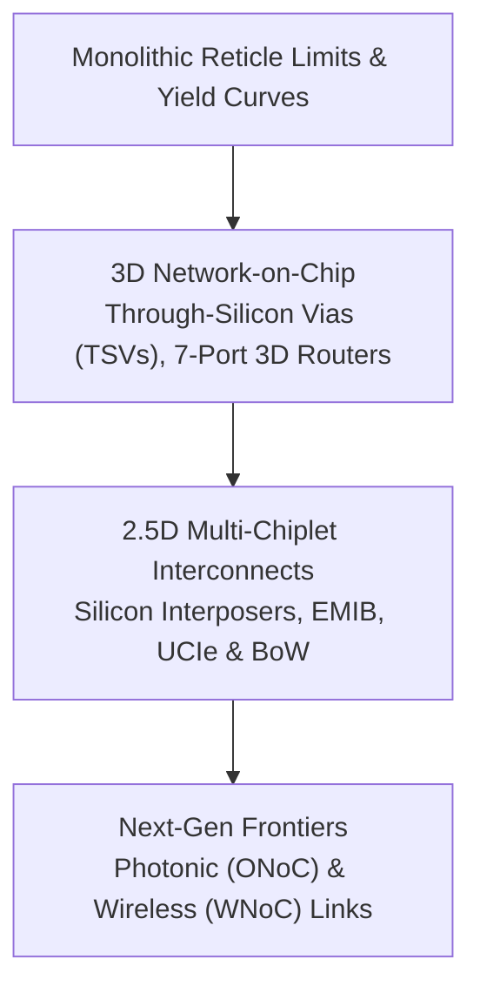

# Track 6: Chiplets, 3D NoC & Emerging Frontiers

As conventional 2D monolithic silicon hits physical reticle size limits ($\approx 858 \text{ mm}^2$) and manufacturing yields plummet, the semiconductor industry is aggressively shifting to **3D Stacking** and **Multi-Die Chiplets**.

In this track, you will learn how Network-on-Chip architectures scale vertically into the third dimension and bridge across multiple chiplets using industry standards like UCIe.

---

## 🗺️ Track Roadmap

---

## 📖 Lessons in this Track

1. **[6.1 3D TSV Interconnects](01-3d-tsv-interconnects.md)**  
   True 3D IC stacking. Through-Silicon Vias (TSVs), 7-port 3D router architectures (adding Up and Down ports), vertical hop latency reduction, and thermal challenges of 3D heat dissipation.
2. **[6.2 Multi-Chiplet & UCIe Interconnects](02-chiplets-ucie-interconnects.md)**  
   2.5D packaging, passive/active silicon interposers, Intel EMIB, TSMC CoWoS. The Universal Chiplet Interconnect Express (UCIe) standard, Bunch of Wires (BoW), and modular chiplet interconnect protocol stacks.
