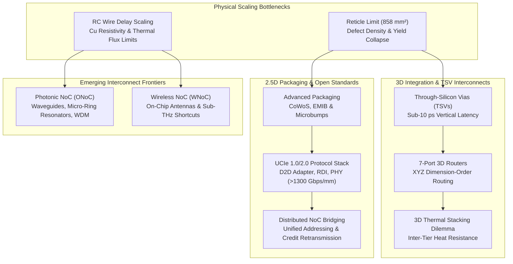

# Track 6: Chiplets, 3D NoC & Emerging Frontiers

As conventional monolithic silicon dies encounter the physical lithography reticle limit ($\approx 858 \text{ mm}^2$) and manufacturing yields plummet on cutting-edge process nodes (3nm / 2nm), the semiconductor industry is executing a historic architectural transition: **scaling vertically into the third dimension with 3D IC stacking** and **partitioning massive SoCs into modular 2.5D Multi-Die Chiplets**.

In this track, you will journey from the microscopic physics of copper Through-Silicon Vias (TSVs) to global chiplet interconnect standards (UCIe, BoW), 3D thermal stacking dynamics, and emerging physical frontiers including Nanophotonic (ONoC) and Millimeter-Wave Wireless (WNoC) interconnects.

---

## 🗺️ Track Roadmap

---

## 📖 Curriculum Outline

| Lesson | Focus & Theoretical Core | Interactive Simulator / Engineering Tool |
| :--- | :--- | :--- |
| **[6.1 3D TSV Interconnects & Microarchitecture](01-3d-tsv-interconnects.md)** | Cylindrical TSV parasitics ($R_{tsv}, C_{tsv}$), keep-out zones (KOZ) from thermo-mechanical stress ($\sigma_{vm} \propto \Delta \alpha \cdot \Delta T$), 7-port 3D router crossbars ($7\times 7$), and sub-micron hybrid bonding. | **3D TSV Mesh & 7-Port Router Architecture Visualizer:** Interactive 3-tier 3D mesh canvas with rotatable perspective, vertical elevator packet stepping, and real-time crossbar port allocation. |
| **[6.2 Multi-Chiplet Interconnects & UCIe Standard](02-chiplets-ucie-interconnects.md)** | Reticle economics, negative binomial yield models, packaging technologies (Organic vs CoWoS vs EMIB), the Universal Chiplet Interconnect Express (UCIe) 3-layer stack, and shoreline bandwidth scaling ($>1300\text{ Gbps/mm}$). | **Multi-Chiplet D2D Packaging & UCIe Explorer:** Interactive yield, cost-per-good-die, shoreline bandwidth, and energy-per-bit ($\text{pJ/bit}$) calculator comparing monolithic vs chiplet partitions. |
| **[6.3 3D Topologies, Thermal Stacking & Deadlock](03-3d-topologies-thermal-deadlock.md)** | Symmetric vs asymmetric/sparse 3D NoC topologies, 1D thermal resistance chains ($\Delta T_{stack} = \sum P_i R_i$), 3D Channel Dependency Graphs (CDGs), and formal proof of deadlock freedom under XYZ Dimension-Order Routing. | **3D Thermal Stacking & CDG Deadlock Simulator:** Interactive 3-tier thermal gradient visualizer with heat flux sliders and an interactive 3D turn model cycle checker. |
| **[6.4 Emerging Interconnect Frontiers: ONoC & WNoC](04-optical-wireless-frontiers.md)** | RC copper delay walls, Optical NoC (waveguides, silicon micro-ring resonators, WDM, thermo-optic wavelength drift), on-chip mm-Wave Wireless NoC antennas, and comparative physical trade-offs. | **Silicon Micro-Ring Resonator (MRR) WDM & Spectrum Tuner:** Real-time optical spectrum visualizer with ring radius, refractive index, and thermal drift sliders demonstrating channel crosstalk and heater tuning. |

---

## 🎯 Learning Objectives

By completing this track, you will be able to:

1. **Calculate Electrical Parasitics of TSVs:** Compute lumped resistance, capacitance, and Elmore delay for vertical silicon vias, and quantify the silicon area tax imposed by piezo-resistive Keep-Out Zones (KOZ).
2. **Model Multi-Chiplet Yield & Packaging Economics:** Apply the negative binomial yield model to prove why multi-chiplet partitioning slashes manufacturing costs by $40\text{–}60\%$ on bleeding-edge nodes despite packaging overheads.
3. **Analyze the UCIe Standard:** Trace packets from high-level NoC protocols (AXI, CHI) through the UCIe D2D Adapter (CRC, parity, retry buffers) down to the Physical Layer (AFE, forwarded clock, lane reversal).
4. **Solve 3D Deadlock & Heat Dissipation Challenges:** Prove the acyclic nature of 3D Channel Dependency Graphs under XYZ DOR and calculate inter-tier thermal gradients across stacked logic and memory tiers.
5. **Evaluate Next-Generation Optical & Wireless Frontiers:** Analyze optical power budgets, insertion losses, and thermal tuning requirements for Silicon Micro-Ring Resonators, and evaluate wireless sub-THz shortcuts.
