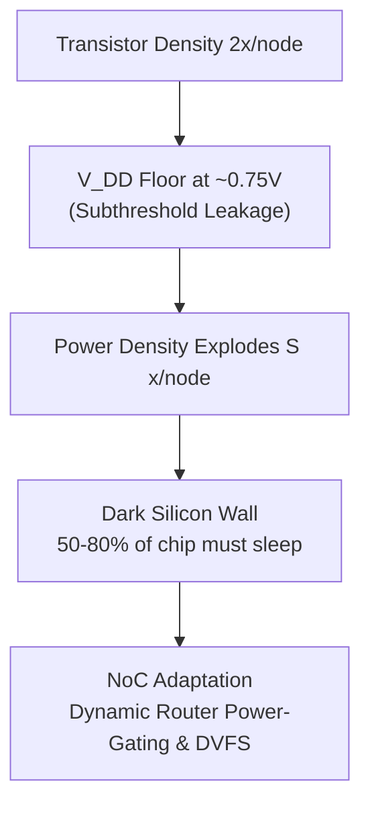

# Lesson 6.1: Dark Silicon Physics & The Utilization Wall

  
Track 06 • Lesson 01

  <h1>Dennard Scaling Collapse &amp; The Dark Silicon Wall</h1>
  

    Explore why constant supply voltages in sub-22nm nodes created the dark silicon crisis, and derive how on-chip networks must dynamically adapt to unpowered silicon cores.
  

---

## 1. The Breakdown of Dennard Scaling

From 1974 until approximately 2005, Dennard scaling allowed transistor density to double every generation while power density remained constant, because threshold voltage $V_{th}$ and supply voltage $V_{DD}$ scaled proportionally ($V_{DD} \to V_{DD}/S$).

However, quantum sub-threshold leakage ($I_{\text{sub}} \propto \exp(-qV_{th}/kT)$) set a fundamental lower bound on supply voltage ($pprox 0.7\text{ V}$). When $V_{DD}$ ceased scaling while transistor counts continued doubling:

$$
\text{Power Density} \propto \frac{N \cdot C V^2 f}{A} \propto S
$$

Power density escalates by $\sim 1.4\times$ per node. Consequently, modern chips hit a **Thermal Design Power (TDP) Ceiling**: up to **$50\%\text{--}80\%$ of silicon transistors must remain unpowered ("dark")** at any given moment to prevent thermal runaway.

---

## 2. Interactive Power Management Laboratory

Experience dynamic power allocation live in our web arcade:

👉 **[Launch Volt Vortex: Dark Silicon Power Defense](../../interactive/power/)** — Balance energy consumption across dark silicon islands under bursty workloads.

---

## 3. Self-Check Assessment

**Question 1:** What physical phenomenon halted the scaling of supply voltage $V_{DD}$ in modern CMOS nodes?  
*Answer:* Sub-threshold leakage current, which increases exponentially if threshold voltage $V_{th}$ is scaled down.

**Question 2:** What is meant by "Dark Silicon"?  
*Answer:* The fraction of silicon real estate that must be kept powered off or throttled at any moment to stay within the chip's thermal cooling budget.

**Question 3:** How does dark silicon affect on-chip network routing?  
*Answer:* Unpowered cores and sleep-mode routers create irregular physical topologies that require dynamic fault-tolerant routing or router bypassing.

---

👉 **Next: [Lesson 6.2: Dynamic Voltage & Frequency Scaling (DVFS) Islands](02-dvfs-voltage-islands.md)**
