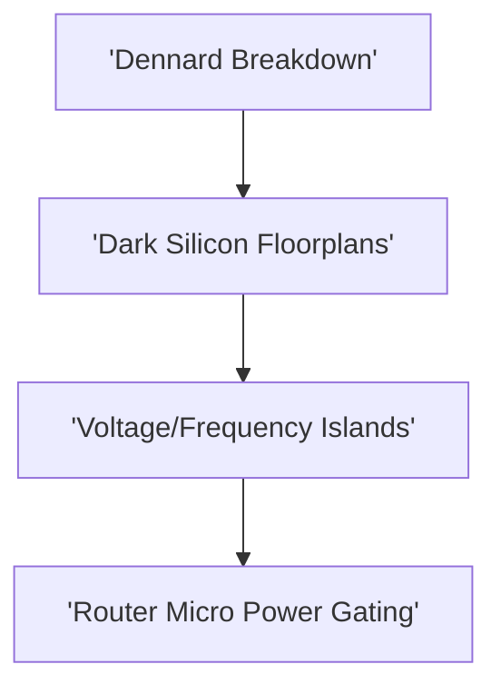

# Track 6: Low-Power Architectures & Dark Silicon

  
Network Architecture • Module 06

  <h1>Low-Power Architectures & Dark Silicon</h1>
  
Dark silicon physics, Thermal Design Power (TDP) budgets, Voltage/Frequency Islands (VFIs), fine-grained power gating, and L*di/dt emergencies.

  

    ⏱️ 4 In-Depth Lessons
    🔬 Interactive Simulators &amp; Tools
    💻 Synthesizable Verilog RTL
    📜 Grounded in Official Monograph
  

  

    

      📚 Aligned with Chapter 6 of Official 12-Chapter Textbook
    

    

      Explore complete theoretical derivations, physical scaling parameters, and microarchitectural proofs in <strong>Chapter 6</strong>.
    

  

  <a href="../textbook/ch06-low-power-dark-silicon/" style="display: inline-flex; align-items: center; gap: 6px; background: #2563eb; color: #ffffff; padding: 8px 16px; border-radius: 6px; font-weight: 600; font-size: 0.85rem; text-decoration: none;">
    Read Chapter 6 in Textbook →
  </a>

---

## 🗺️ Architectural Learning Roadmap

The diagram below outlines how the core concepts in Track 6 connect across the physical and protocol layers:

---

## 📚 Syllabus & Lessons in Track 6

  

    

      Lesson 6.1
      
Dark Silicon Physics & TDP Scaling Limits

      
Why Dennard scaling death leaves up to 80% of silicon unpowered at 3nm.

      

        ⚡ <strong>Features:</strong> Dark Silicon Floorplan Calculator
      

    

    <a href="01-dark-silicon-physics/" class="noc-track-link">Launch Lesson 6.1 →</a>
  

  

    

      Lesson 6.2
      
Voltage & Frequency Islands (VFIs) and DVFS

      
Multi-domain voltage scaling, asynchronous FIFO clock-domain crossings, and energy-delay product.

      

        ⚡ <strong>Features:</strong> Volt Vortex Interactive Lab
      

    

    <a href="02-dvfs-voltage-islands/" class="noc-track-link">Launch Lesson 6.2 →</a>
  

  

    

      Lesson 6.3
      
Router Microarchitectural Power Gating

      
Sleep transistors, wake-up latency penalties, lookahead credit power wakeup, and zero-leakage state.

      

        ⚡ <strong>Features:</strong> Synthesizable Power Gating FSM RTL
      

    

    <a href="03-power-gating-router/" class="noc-track-link">Launch Lesson 6.3 →</a>
  

  

    

      Lesson 6.4
      
Voltage Emergencies & Energy-Efficient Encoding

      
Inductive L*di/dt resonance, decap allocation, bus-invert coding, and energy-delay optimization.

      

        ⚡ <strong>Features:</strong> L-di/dt Noise Analyzer
      

    

    <a href="04-voltage-emergencies-energy/" class="noc-track-link">Launch Lesson 6.4 →</a>
  

---

## 💻 Web EDA Unix Workbench Quick Launch

Simulate, verify, and inspect the synthesizable SystemVerilog implementations for Track 6 using our integrated in-browser terminal:

  guest@noc-lab:~$ run-sim --topo mesh4x4 --algo xy --inj 0.05 
  [SIM-EXEC] Progress: [========================================] 100% (Zero-load latency: 4.85 cyc)

👉 **[Launch Interactive Web EDA Unix Terminal &amp; Visualizer](../interactive/terminal/)**
