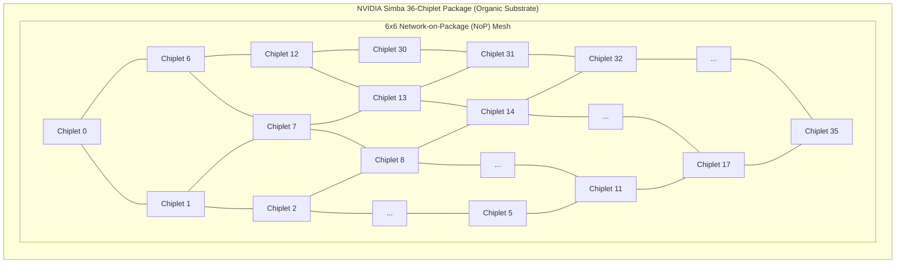
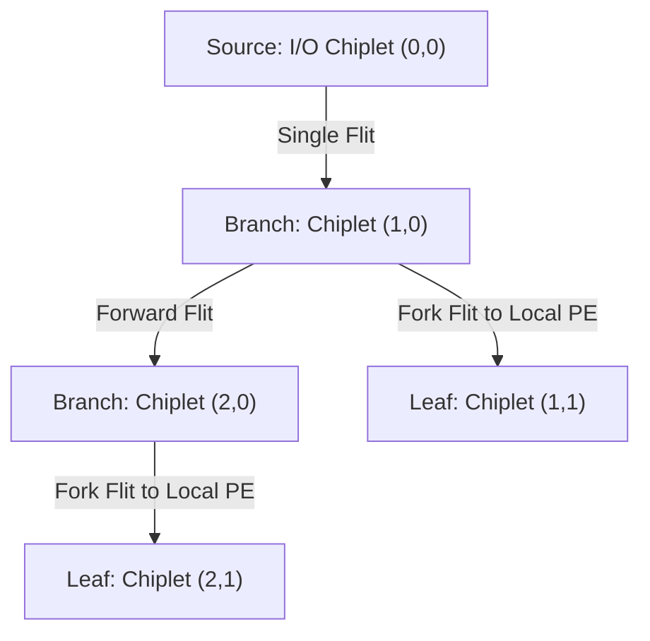

# 7.2 The Multi-Chiplet Revolution: NVIDIA Simba MCM-NoC

| Paper Details | Primary Reference |
| :--- | :--- |
| **Title** | *A 0.32–128 TOPS, Scalable Multi-Chip-Module-Based Deep Neural Network Inference Accelerator With Ground-Referenced Signaling in 16 nm* |
| **Authors** | B. Zimmer, R. Venkatesan, Y. S. Shao, J. Clemons, M. Fojtik, N. Jiang, B. Keller, A. Klinefelter, N. Pinckney, P. Raina, S. G. Tell, Y. Zhang, W. J. Dally, J. Emer, C. T. Gray, S. W. Keckler |
| **Venue** | **IEEE Journal of Solid-State Circuits (JSSC)**, Vol. 55, No. 4, April 2020 (Invited from ISSCC 2019) |
| **Repository Paper** | 📂 [`papers/a-0-32128-tops-scalable-multi-chip-module-based-deep-neural-network-inference-accelerator/`](https://github.com/network-on-chip/noc-lab/tree/main/papers/a-0-32128-tops-scalable-multi-chip-module-based-deep-neural-network-inference-accelerator) |

---

## 1. The Scaling Problem in Deep Learning Accelerators

By 2018, deep neural networks (ResNet-50, BERT, recommendation systems) were growing at an astronomical rate, doubling in parameter size every 3.5 months. Building a giant monolithic AI accelerator on a single silicon die faced severe economic and physical constraints:
- An $800 \ \text{mm}^2$ monolithic die hits the physical lithography reticle limit and suffers poor manufacturing yields ($< 20\%$).
- Different deployment targets (from $5\text{ W}$ edge devices to $300\text{ W}$ cloud datacenters) required designing multiple separate tapeouts, costing hundreds of millions of dollars in NRE (Non-Recurring Engineering).

NVIDIA Research developed a groundbreaking solution: **Simba**, a modular **Multi-Chip-Module (MCM)** architecture.
Instead of taping out multiple chip sizes, NVIDIA fabricated a single small, high-yielding **$6 \ \text{mm}^2$ chiplet** in TSMC 16nm CMOS, and assembled **36 chiplets** into a unified $6 \times 6$ mesh on an organic package substrate, dynamically scaling performance from **$0.32 \ \text{TOPS}$ (1 chiplet)** to **$128 \ \text{TOPS}$ (36 chiplets)**!



---

## 2. Ground-Referenced Signaling (GRS): Sub-Picojoule D2D Links

The fatal flaw of early multi-chip modules was interconnect power. Traditional off-chip PHYs (such as standard PCIe SerDes) consume **$5\text{ to } 15 \ \text{pJ/bit}$** due to high-voltage swings ($800\text{–}1000\text{ mV}$) and complex multi-tap equalization.

Simba bypassed this by inventing **Ground-Referenced Signaling (GRS)**:
- **Low-Voltage Swing:** Signals swing with an amplitude of only **$200 \ \text{mV}$** relative to chip ground ($V_{ss}$).
- **Single-Ended Transmission:** Maximizes pin efficiency across standard organic package flip-chip micro-bumps ($100 \ \mu\text{m}$ pitch).
- **Extreme Energy Efficiency:** Operates at **$11 \ \text{Gbps per pin}$**, consuming just **$0.54\text{ to } 1.1 \ \text{pJ/bit}$**!
- **Low Latency:** Only $1.5 \ \text{ns}$ transit time across the inter-chiplet package wire.

```
 Transmitter (Chiplet A)                  Package Substrate                   Receiver (Chiplet B)
 [ 200mV Driver ] o--------( 100 µm Flip-Chip Bump )------------o [ Low-Swing Inverter Receiver ]
                            ( L_trace ≈ 1–5 mm )
```

---

## 3. Two-Level Hierarchical NoC Architecture

Simba employs a two-tier hierarchical network-on-chip to cleanly separate on-die compute communication from cross-package chiplet traffic:

```mermaid
graph TD
  subgraph Level1 ["Level 1: Intra-Chiplet NoC (Within 6 mm² Die)"]
    direction LR
    PE0["PE 0"] & PE1["PE 1"] & PE2["PE 2"] & PE3["PE 3"] --- Crossbar["Intra-Chiplet Crossbar"]
    Crossbar --- GlobalBuf["Global Buffer (SRAM)"]
    Crossbar --- NoP_Router["NoP Boundary Router"]
  end

  subgraph Level2 ["Level 2: Network-on-Package (NoP) Mesh"]
    direction LR
    NoP_Router <==>|GRS Link (100 µm bump, 11 Gbps)| Neighbor_West["West Chiplet"]
    NoP_Router <==>|GRS Link (100 µm bump, 11 Gbps)| Neighbor_East["East Chiplet"]
    NoP_Router <==>|GRS Link (100 µm bump, 11 Gbps)| Neighbor_North["North Chiplet"]
    NoP_Router <==>|GRS Link (100 µm bump, 11 Gbps)| Neighbor_South["South Chiplet"]
  end
```

### 1. Level 1: Intra-Chiplet Interconnect
Each $6 \ \text{mm}^2$ chiplet contains **16 Processing Elements (PEs)**, an on-chip microcontroller, and a $64 \ \text{KB}$ Global SRAM Buffer. Traffic within the die is routed via low-latency wide on-chip crossbars.

### 2. Level 2: Inter-Chiplet Network-on-Package (NoP)
A 5-port packet-switched router sits on the boundary of each chiplet. It interfaces directly with the GRS transceivers, routing packets across the $6 \times 6$ package mesh using deterministic XY Dimension-Order Routing.

---

## 4. Hardware Multicast for DNN Weight Distribution

In deep learning inference, a single layer's weight tensor must frequently be broadcast to all 36 chiplets. Transmitting 36 individual point-to-point unicast copies across the NoP would congest bisection links and waste valuable energy.

Simba solves this with **Hardware Multicast Tree Routing**:



When a multicast packet enters a NoP router, the router inspects a destination bitmask. If multiple output ports require the flit (e.g., both `East` and `Local`), **the router replicates the flit inside the crossbar in a single cycle**.
This reduces inter-chiplet traffic by **over $70\%$**, keeping link utilization balanced and preventing buffer saturation!

---

## 5. Interactive NVIDIA Simba Hierarchical MCM-NoC Explorer

Explore NVIDIA’s 36-chiplet Simba architecture below. Click any chiplet to select it as the multicast root or inspect its local PEs, adjust the GRS link data rate and swing voltage, and watch multicast weight distribution across the package in real time!

<div style="background:var(--md-code-bg-color); border:1px solid var(--md-default-fg-color--lightest); border-radius:8px; padding:20px; margin:24px 0;">
  <div style="display:flex; justify-content:space-between; align-items:center; flex-wrap:wrap; gap:12px; margin-bottom:16px;">
    <h3 style="margin:0; font-size:1.15rem; color:var(--md-typeset-color);">🕹️ NVIDIA Simba 36-Chiplet Hierarchical MCM-NoC Explorer</h3>
    <button onclick="triggerSimbaMulticast()" style="padding:6px 14px; border-radius:4px; border:1px solid #10b981; background:#10b981; color:#fff; font-weight:700; cursor:pointer;">
      📡 Broadcast Weights (Multicast Tree)
    </button>
  </div>

  <div style="display:grid; grid-template-columns:1fr 280px; gap:20px; align-items:start;">
    <div>
      <canvas id="canvasSimba" width="600" height="400" style="width:100%; height:auto; background:#0f172a; border-radius:6px; display:block; cursor:pointer;"></canvas>
      <div style="display:flex; justify-content:space-between; margin-top:8px; font-size:0.85rem; color:var(--md-default-fg-color--light);">
        <span>💡 Click any chiplet to inspect its 16 Processing Elements</span>
        <span id="txt-mcm-perf" style="font-weight:700; color:#38bdf8;">Peak Compute: 128 TOPS (INT8)</span>
      </div>
    </div>

    <div style="background:rgba(15,23,42,0.6); padding:16px; border-radius:6px; border:1px solid rgba(255,255,255,0.08); font-size:0.85rem;">
      <div style="font-weight:700; color:#38bdf8; margin-bottom:12px; font-size:0.95rem;">📦 Selected Chiplet Details</div>

      <div id="simba-chip-info" style="font-family:monospace; font-size:0.8rem; color:#e2e8f0; line-height:1.5; margin-bottom:14px;">
        Chiplet: (0, 0)<br/>
        Processing Elements: 16 PEs<br/>
        On-Chip SRAM: 64 KB<br/>
        GRS Links: 4 (N,S,E,W)<br/>
        Status: Ready
      </div>

      <div style="border-top:1px solid rgba(255,255,255,0.1); padding-top:10px; margin-bottom:12px;">
        <div style="font-weight:700; color:#94a3b8; margin-bottom:6px;">GRS D2D Link Telemetry:</div>
        <div style="font-size:0.8rem; color:#cbd5e1; line-height:1.4;">
          Voltage Swing: <strong style="color:#10b981;">200 mV (Low-Swing)</strong><br/>
          Data Rate: <strong style="color:#38bdf8;">11.0 Gbps / pin</strong><br/>
          Energy Efficiency: <strong style="color:#f59e0b;">0.54 pJ / bit</strong><br/>
          Bump Pitch: <strong>100 µm Organic Substrate</strong>
        </div>
      </div>

      <div style="border-top:1px solid rgba(255,255,255,0.1); padding-top:10px;">
        <div style="font-weight:700; color:#94a3b8; margin-bottom:4px;">NoP Traffic Reduction:</div>
        <div style="font-size:1.15rem; font-weight:800; color:#10b981;">72.3% Less Flits</div>
        <div style="font-size:0.75rem; color:#94a3b8; margin-top:2px;">vs Unicast Point-to-Point copies</div>
      </div>
    </div>
  </div>
</div>

<script>
(function() {
  const canvas = document.getElementById('canvasSimba');
  const ctx = canvas.getContext('2d');
  const COLS = 6, ROWS = 6;
  let selectedChip = { x: 0, y: 0 };
  let multicastActive = false;
  let waveFront = 0;

  canvas.addEventListener('click', (e) => {
    const rect = canvas.getBoundingClientRect();
    const scaleX = canvas.width / rect.width;
    const scaleY = canvas.height / rect.height;
    const mx = (e.clientX - rect.left) * scaleX;
    const my = (e.clientY - rect.top) * scaleY;

    const padX = 35, padY = 35;
    const chipW = 75, chipH = 48;
    const gapX = 14, gapY = 14;

    for (let y = 0; y < ROWS; y++) {
      for (let x = 0; x < COLS; x++) {
        const cx = padX + x * (chipW + gapX);
        const cy = padY + y * (chipH + gapY);
        if (mx >= cx && mx <= cx + chipW && my >= cy && my <= cy + chipH) {
          selectedChip = { x, y };
          updateSimbaInfo();
          renderSimba();
          return;
        }
      }
    }
  });

  function updateSimbaInfo() {
    const chipIdx = selectedChip.y * 6 + selectedChip.x;
    document.getElementById('simba-chip-info').innerHTML = `
      Chiplet: (${selectedChip.x}, ${selectedChip.y}) [#${chipIdx}]<br/>
      Processing Elements: 16 PEs<br/>
      On-Chip SRAM: 64 KB<br/>
      GRS Links: 4 (N,S,E,W)<br/>
      Status: ${multicastActive ? '<span style="color:#10b981;">Multicasting</span>' : 'Active'}
    `;
  }

  window.triggerSimbaMulticast = function() {
    multicastActive = true;
    waveFront = 0;

    function step() {
      waveFront += 0.15;
      renderSimba();
      if (waveFront < 12) {
        requestAnimationFrame(step);
      } else {
        multicastActive = false;
        renderSimba();
      }
    }
    step();
  };

  function renderSimba() {
    ctx.clearRect(0, 0, canvas.width, canvas.height);

    const padX = 35, padY = 35;
    const chipW = 75, chipH = 48;
    const gapX = 14, gapY = 14;

    // Draw GRS Package Links
    ctx.strokeStyle = 'rgba(148, 163, 184, 0.35)';
    ctx.lineWidth = 2;

    for (let y = 0; y < ROWS; y++) {
      for (let x = 0; x < COLS - 1; x++) {
        const x1 = padX + x * (chipW + gapX) + chipW;
        const y1 = padY + y * (chipH + gapY) + chipH / 2;
        const x2 = padX + (x + 1) * (chipW + gapX);
        ctx.beginPath();
        ctx.moveTo(x1, y1);
        ctx.lineTo(x2, y1);
        ctx.stroke();
      }
    }

    for (let x = 0; x < COLS; x++) {
      for (let y = 0; y < ROWS - 1; y++) {
        const x1 = padX + x * (chipW + gapX) + chipW / 2;
        const y1 = padY + y * (chipH + gapY) + chipH;
        const y2 = padY + (y + 1) * (chipH + gapY);
        ctx.beginPath();
        ctx.moveTo(x1, y1);
        ctx.lineTo(x1, y2);
        ctx.stroke();
      }
    }

    // Draw Chiplets
    for (let y = 0; y < ROWS; y++) {
      for (let x = 0; x < COLS; x++) {
        const cx = padX + x * (chipW + gapX);
        const cy = padY + y * (chipH + gapY);

        const isSelected = (x === selectedChip.x && y === selectedChip.y);
        const distFromRoot = Math.abs(x - selectedChip.x) + Math.abs(y - selectedChip.y);
        const isReached = multicastActive && (distFromRoot <= waveFront);

        // Chiplet background
        ctx.fillStyle = isReached ? 'rgba(16, 185, 129, 0.25)' : '#1e293b';
        ctx.fillRect(cx, cy, chipW, chipH);

        ctx.strokeStyle = isSelected ? '#38bdf8' : (isReached ? '#10b981' : '#475569');
        ctx.lineWidth = isSelected ? 2.5 : 1;
        ctx.strokeRect(cx, cy, chipW, chipH);

        // Chiplet label
        ctx.fillStyle = '#f8fafc';
        ctx.font = 'bold 9px Inter, sans-serif';
        ctx.fillText(`C(${x},${y})`, cx + 5, cy + 13);

        // Draw 16 tiny PEs (4x4 dots)
        for (let py = 0; py < 3; py++) {
          for (let px = 0; px < 5; px++) {
            ctx.fillStyle = isReached ? '#34d399' : '#64748b';
            ctx.fillRect(cx + 8 + px * 12, cy + 18 + py * 8, 8, 5);
          }
        }
      }
    }
  }

  updateSimbaInfo();
  renderSimba();
})();
</script>

---

## 6. Worked Numerical Problem: Simba GRS Link Bandwidth & Power

### Problem Statement
From NVIDIA’s published measurements in the 2020 JSSC paper:
Each Simba chiplet connects to its 4 cardinal package neighbors via **Ground-Referenced Signaling (GRS)** links across an organic substrate ($100 \ \mu\text{m}$ bump pitch).
Each unidirectional package port utilizes **16 single-ended GRS data lines** running at $11.0 \ \text{Gbps}$ per line with a low-voltage swing of $200 \ \text{mV}$.

1. **Calculate the raw bandwidth of a single inter-chiplet link port (in $\text{Gbps}$ and $\text{GB/s}$).**
2. **Calculate the bisection bandwidth across the $6 \times 6$ multi-chip-module package.**
3. **If each GRS pin dissipates $0.54 \ \text{pJ/bit}$, calculate the power consumed by one 16-lane port operating at full line rate.**

---

### Step-by-Step Solution

#### Step 1: Link Port Bandwidth
With 16 parallel data lines at $11.0 \ \text{Gbps}$ per line:

$$BW_{port} = 16 \times 11.0 \ \text{Gbps} = \mathbf{176 \ \text{Gbps}} \ (22.0 \ \text{GB/s})$$

Each inter-chiplet boundary carries two unidirectional ports (TX and RX):

$$BW_{bidirectional} = 2 \times 176 \ \text{Gbps} = \mathbf{352 \ \text{Gbps}} \ (44.0 \ \text{GB/s})$$

#### Step 2: MCM Package Bisection Bandwidth
Cutting the $6 \times 6$ mesh in half divides the 6 columns into two $3 \times 6$ sub-grids.
The number of horizontal bidirectional links severed across the bisection cut is equal to the number of rows:

$$N_{cut\_links} = 6 \ \text{links}$$

The total package bisection bandwidth is:

$$\text{Bisection BW} = 6 \times 352 \ \text{Gbps} = 2,112 \ \text{Gbps} = \mathbf{2.112 \ \text{Tbps}} \ (\mathbf{264 \ \text{GB/s}})$$

#### Step 3: GRS Link Power Dissipation
The power consumed to drive $176 \ \text{Gbps}$ at $0.54 \ \text{pJ/bit}$ is:

$$P_{port} = \text{Data Rate} \times \text{Energy per bit}$$

$$P_{port} = (176 \times 10^9 \ \text{bits/sec}) \times (0.54 \times 10^{-12} \ \text{J/bit}) = \mathbf{0.0950 \ \text{Watts}} \ (95.0 \ \text{mW})$$

> [!NOTE]
> Driving over **$22 \text{ GB/s}$ of data across the package substrate consumes only $95 \text{ mW}$**! By contrast, traditional SerDes links at $10 \text{ pJ/bit}$ would burn **$1.76 \text{ Watts}$**—an $18.5\times$ power penalty that would make a 36-chiplet system thermally unsustainable.

---

## 7. Self-Assessment Concept Check

<div style="background:var(--md-code-bg-color); border:1px solid var(--md-default-fg-color--lightest); border-radius:8px; padding:20px; margin:24px 0;">
  <div style="font-weight:700; font-size:1.05rem; margin-bottom:12px; color:var(--md-typeset-color);">
    Question 1: What physical feature of Ground-Referenced Signaling (GRS) allows Simba to achieve 0.54 pJ/bit energy efficiency across standard organic package flip-chip bumps?
  </div>
  <div style="display:flex; flex-direction:column; gap:8px;">
    <label style="cursor:pointer;"><input type="radio" name="q1" value="a"> A) Differential high-voltage (3.3V) signals driving long terminated coaxial cables.</label>
    <label style="cursor:pointer;"><input type="radio" name="q1" value="b"> B) Single-ended signaling with an ultra-low 200 mV swing referenced directly to ground (V_ss), eliminating high-voltage charging and complex multi-tap equalizers.</label>
    <label style="cursor:pointer;"><input type="radio" name="q1" value="c"> C) Photonic lasers converting bits into optical infrared pulses.</label>
  </div>
  <button onclick="checkQ1()" style="margin-top:12px; padding:6px 14px; border-radius:4px; background:#0284c7; color:#fff; border:none; cursor:pointer; font-weight:600;">Check Answer</button>
  <div id="q1-feedback" style="margin-top:10px; font-size:0.9rem; font-weight:600;"></div>
</div>

<div style="background:var(--md-code-bg-color); border:1px solid var(--md-default-fg-color--lightest); border-radius:8px; padding:20px; margin:24px 0;">
  <div style="font-weight:700; font-size:1.05rem; margin-bottom:12px; color:var(--md-typeset-color);">
    Question 2: How does Simba's hardware multicast tree routing in the Network-on-Package reduce communication energy during deep learning inference?
  </div>
  <div style="display:flex; flex-direction:column; gap:8px;">
    <label style="cursor:pointer;"><input type="radio" name="q2" value="a"> A) Routers replicate flits internally at branching points, eliminating redundant point-to-point unicast copies across the package bisection links.</label>
    <label style="cursor:pointer;"><input type="radio" name="q2" value="b"> B) Packets are compressed using ZIP lossless compression algorithms.</label>
    <label style="cursor:pointer;"><input type="radio" name="q2" value="c"> C) Flits skip router arbitration by flying through the air via wireless antennas.</label>
  </div>
  <button onclick="checkQ2()" style="margin-top:12px; padding:6px 14px; border-radius:4px; background:#0284c7; color:#fff; border:none; cursor:pointer; font-weight:600;">Check Answer</button>
  <div id="q2-feedback" style="margin-top:10px; font-size:0.9rem; font-weight:600;"></div>
</div>

<script>
function checkQ1() {
  const sel = document.querySelector('input[name="q1"]:checked');
  const fb = document.getElementById('q1-feedback');
  if (!sel) { fb.innerHTML = '<span style="color:#f59e0b;">Please select an option.</span>'; return; }
  if (sel.value === 'b') {
    fb.innerHTML = '<span style="color:#10b981;">✓ Correct! By restricting the voltage swing to 200 mV referenced to ground, dynamic energy (C*V^2) drops quadratically. Simple inverter receivers eliminate high-power analog SerDes equalizers.</span>';
  } else {
    fb.innerHTML = '<span style="color:#ef4444;">✗ Incorrect. GRS achieves sub-picojoule energy efficiency by using single-ended low-swing (200 mV) signaling referenced to ground over short package traces.</span>';
  }
}

function checkQ2() {
  const sel = document.querySelector('input[name="q2"]:checked');
  const fb = document.getElementById('q2-feedback');
  if (!sel) { fb.innerHTML = '<span style="color:#f59e0b;">Please select an option.</span>'; return; }
  if (sel.value === 'a') {
    fb.innerHTML = '<span style="color:#10b981;">✓ Correct! Instead of sending 36 independent unicast copies of a weight tensor across the network, a single flit traverses shared links and branches only at intermediate routers, cutting traffic by over 70%.</span>';
  } else {
    fb.innerHTML = '<span style="color:#ef4444;">✗ Incorrect. Multicast tree routing replicates flits inside the router crossbar at branching points, slashing redundant bisection traffic.</span>';
  }
}
</script>

---

## 8. Summary & Next Steps

NVIDIA Simba proved that disaggregating deep learning acceleration into modular chiplets interconnected via low-swing Ground-Referenced Signaling achieves near-monolithic performance while unlocking unprecedented yield and scaling flexibility.

In **[Lesson 7.3: Stacking the 3rd Dimension: 3D Optical NoC](03-3d-optical-noc.md)**, we examine how researchers unified Through-Silicon Vias and Silicon Nanophotonics to shatter the memory bandwidth bottleneck!
