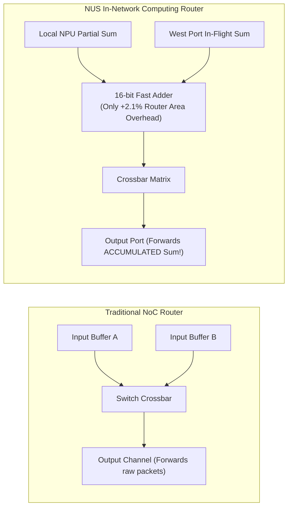
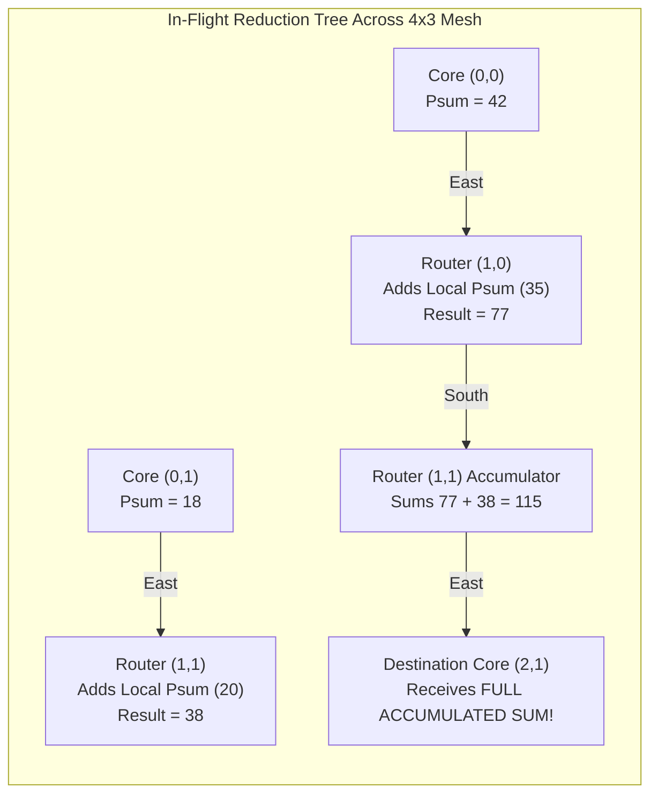
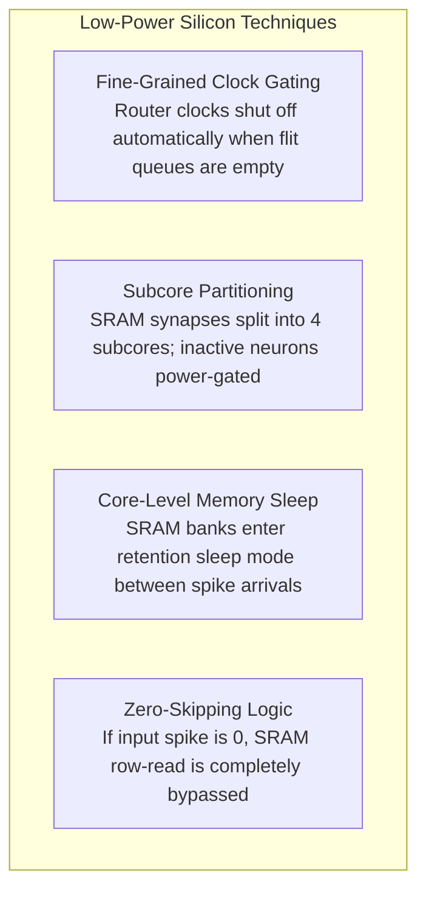

# 7.4 In-Network Computing: Neuromorphic Partial-Sum Routers

| Paper Details | Primary Reference |
| :--- | :--- |
| **Title** | *A 1.63-pJ/SOP Neuromorphic Processor With Integrated Partial Sum Routers for In-Network Computing* |
| **Authors** | D. Li, M. M. Wong, Y. S. Chong, J. Zhou, M. Upadhyay, A. Balaji, A. Mani, W. F. Wong, L.-S. Peh, A. T. Do, B. Wang |
| **Venue** | **IEEE Transactions on Very Large Scale Integration (VLSI) Systems**, Vol. 32, No. 11, November 2024 |
| **Repository Paper** | 📂 [`papers/1-63-pj-sop-neuromorphic-processor-with-integrated-partial-sum-routers-for-in-network-comp/`](https://github.com/network-on-chip/noc-lab/tree/main/papers/1-63-pj-sop-neuromorphic-processor-with-integrated-partial-sum-routers-for-in-network-comp) |

---

## 1. The Paradigm Shift: Moving Compute Into the Network

For over 70 years, computer systems strictly adhered to the Von Neumann separation: **processors compute**, and **networks transport**.
However, in modern deep learning and Neuromorphic Spiking Neural Networks (SNNs), computing a neuron's activation requires accumulating thousands of synaptic weights:

$$V_j = \sum_{i=1}^{M} W_{i, j} \cdot S_i$$

Where $S_i \in \{0, 1\}$ is an incoming discrete spike event, and $W_{i,j}$ is the synaptic weight.

When a neural network layer exceeds the physical memory capacity of a single processor core (e.g., a layer with $512$ inputs mapped onto cores that only support $256$ inputs), traditional architectures employ the **Split-and-Merge** method:
1. The layer is split across multiple separate cores.
2. Each core computes an incomplete partial sum and is forced to emit an intermediate "quantized" spike.
3. These intermediate spikes travel across the NoC to a dedicated "Merge Core", which must retrain weights and re-accumulate the values.

```
 Traditional Split-and-Merge:
 Core A (256 inputs) --[ Unquantized Spike A ]-->\
                                                  +--> [ Merge Core C ] --> Final Output
 Core B (256 inputs) --[ Unquantized Spike B ]-->/     (Extra Hops & Retraining Overhead!)
```

This traditional approach introduces **spike quantization error**, requires **accuracy-loss retraining**, and causes **severe NoC congestion** as merge cores become hot spots.

The National University of Singapore (NUS) team challenged this fundamental assumption: **What if the NoC routers themselves computed the addition in-flight as packets traveled through the switches?**

---

## 2. In-Network Computing (INC) Router Architecture

The NUS team demonstrated a neuromorphic processor fabricated in CMOS achieving a world-record **$1.63 \ \text{pJ}$ per Synaptic Operation (SOP)** by integrating hardware adders directly into the router datapath!



### The Dual-Plane Network-on-Chip
To prevent synchronization deadlocks between lightweight 1-bit spike events and 16-bit arithmetic payloads, the chip deploys **two separate physical NoC fabrics**:
1. **Spike Router Fabric:** A high-speed 1-bit event crossbar that multicasts binary action potentials ($\text{Spike} \in \{0, 1\}$) across axon fan-outs.
2. **Partial-Sum (INC) Router Fabric:** A 16-bit datapath router containing an integrated accumulator. As partial sums converge toward the destination neuron, intermediate routers sum incoming payloads in-flight!



### Key Architectural Advantages:
- **Lossless Hardware Mapping:** Because partial sums are mathematically accumulated with full 16-bit precision inside router switches, **zero spike quantization error** occurs. Networks require **zero retraining**!
- **47.3% Fewer Cores Required:** Eliminating merge cores reduces the core footprint needed to map benchmark neural networks by nearly half.
- **11.0% Less Data Movement:** Collapsing multiple packets into a single accumulated sum reduces overall flit hops across the mesh.

---

## 3. Low-Power Circuit Innovations

To push energy consumption down to **$1.63 \ \text{pJ/SOP}$**, the processor incorporates aggressive circuit-level optimizations:



Combining fine-grained clock gating, synaptic memory power gating, and zero-skipping logic slashed **dynamic power by $53\%$** and **leakage power by $56\%$**, enabling sub-2 picojoule neuromorphic processing.

---

## 4. Interactive In-Network Computing Router Simulator

Experience in-network computing below. Compare a standard Store-and-Forward NoC against the NUS In-Network Computing (INC) router. Watch how intermediate partial sums merge inside router switches as packets traverse an adder tree, cutting network flit hops in real time!

<div style="background:var(--md-code-bg-color); border:1px solid var(--md-default-fg-color--lightest); border-radius:8px; padding:20px; margin:24px 0;">
  <div style="display:flex; justify-content:space-between; align-items:center; flex-wrap:wrap; gap:12px; margin-bottom:16px;">
    <h3 style="margin:0; font-size:1.15rem; color:var(--md-typeset-color);">🕹️ In-Flight Partial-Sum Reduction Visualizer</h3>
    <div style="display:flex; gap:8px;">
      <button id="btn-mode-inc" onclick="setINCMode('inc')" style="padding:6px 12px; border-radius:4px; background:#10b981; color:#fff; border:1px solid #10b981; font-weight:700; cursor:pointer;">⚡ In-Network Computing (INC)</button>
      <button id="btn-mode-trad" onclick="setINCMode('trad')" style="padding:6px 12px; border-radius:4px; background:#1e293b; color:#cbd5e1; border:1px solid #475569; font-weight:600; cursor:pointer;">Traditional Store-and-Forward</button>
    </div>
  </div>

  <div style="display:grid; grid-template-columns:1fr 280px; gap:20px; align-items:start;">
    <div>
      <canvas id="canvasINC" width="600" height="340" style="width:100%; height:auto; background:#0f172a; border-radius:6px; display:block;"></canvas>
      <div style="display:flex; justify-content:space-between; margin-top:8px; font-size:0.85rem; color:var(--md-default-fg-color--light);">
        <span>Tree Flow: Cores (0,0), (0,1), (0,2) → Intermediate Routers → Root (3,1)</span>
        <button onclick="runINCSimulation()" style="padding:4px 10px; border-radius:4px; background:#38bdf8; color:#0f172a; font-weight:700; border:none; cursor:pointer;">▶ Step Reduction</button>
      </div>
    </div>

    <div style="background:rgba(15,23,42,0.6); padding:16px; border-radius:6px; border:1px solid rgba(255,255,255,0.08); font-size:0.85rem;">
      <div style="font-weight:700; color:#38bdf8; margin-bottom:12px; font-size:0.95rem;">📊 Data Movement Comparison</div>

      <div style="margin-bottom:12px;">
        <div style="font-size:0.8rem; color:#94a3b8;">Active Architecture Mode:</div>
        <div id="txt-inc-mode" style="font-size:1.05rem; font-weight:700; color:#10b981;">In-Network Computing Router</div>
      </div>

      <div style="border-top:1px solid rgba(255,255,255,0.1); padding-top:10px; margin-bottom:12px;">
        <div style="font-family:monospace; font-size:0.8rem; color:#cbd5e1; line-height:1.5;">
          Flit Hops Traversed: <span id="txt-inc-hops" style="color:#38bdf8; font-weight:bold;">8 hops</span><br/>
          Intermediate Merge Cores: <span id="txt-inc-merges" style="color:#10b981; font-weight:bold;">0 (Merged In-Flight!)</span><br/>
          Accuracy Loss: <span id="txt-inc-loss" style="color:#10b981; font-weight:bold;">0.00% (Lossless)</span><br/>
          Energy per SOP: <span id="txt-inc-sop" style="color:#f59e0b; font-weight:bold;">1.63 pJ / SOP</span>
        </div>
      </div>

      <div style="border-top:1px solid rgba(255,255,255,0.1); padding-top:10px;">
        <div style="font-size:0.75rem; color:#94a3b8; line-height:1.4;">
          <strong>Hardware Note:</strong> Adding the 16-bit adder into the router crossbar consumes only <strong>2.1% area overhead</strong> while saving 47.3% in core allocation!
        </div>
      </div>
    </div>
  </div>
</div>

<script>
(function() {
  const canvas = document.getElementById('canvasINC');
  const ctx = canvas.getContext('2d');
  let currentMode = 'inc';
  let simStep = 0;

  window.setINCMode = function(mode) {
    currentMode = mode;
    document.getElementById('btn-mode-inc').style.background = mode === 'inc' ? '#10b981' : '#1e293b';
    document.getElementById('btn-mode-inc').style.color = mode === 'inc' ? '#fff' : '#cbd5e1';
    document.getElementById('btn-mode-trad').style.background = mode === 'trad' ? '#0284c7' : '#1e293b';
    document.getElementById('btn-mode-trad').style.color = mode === 'trad' ? '#fff' : '#cbd5e1';

    if (mode === 'inc') {
      document.getElementById('txt-inc-mode').textContent = 'In-Network Computing (INC)';
      document.getElementById('txt-inc-mode').style.color = '#10b981';
      document.getElementById('txt-inc-hops').textContent = '8 hops';
      document.getElementById('txt-inc-merges').textContent = '0 (Merged In-Flight!)';
      document.getElementById('txt-inc-loss').textContent = '0.00% (Lossless)';
      document.getElementById('txt-inc-sop').textContent = '1.63 pJ / SOP';
    } else {
      document.getElementById('txt-inc-mode').textContent = 'Traditional Store-and-Forward';
      document.getElementById('txt-inc-mode').style.color = '#38bdf8';
      document.getElementById('txt-inc-hops').textContent = '19 hops (+137%)';
      document.getElementById('txt-inc-merges').textContent = '2 Extra Merge Cores';
      document.getElementById('txt-inc-loss').textContent = '4.2% (Quantized)';
      document.getElementById('txt-inc-sop').textContent = '5.12 pJ / SOP (3.1x higher)';
    }
    simStep = 0;
    renderINC();
  };

  window.runINCSimulation = function() {
    simStep = (simStep + 1) % 4;
    renderINC();
  };

  function renderINC() {
    ctx.clearRect(0, 0, canvas.width, canvas.height);

    // 4 cols x 3 rows grid
    const cols = 4, rows = 3;
    const padX = 70, padY = 50;
    const cellW = 100, cellH = 70;

    // Draw mesh links
    ctx.strokeStyle = 'rgba(148, 163, 184, 0.25)';
    ctx.lineWidth = 2;

    for (let y = 0; y < rows; y++) {
      for (let x = 0; x < cols - 1; x++) {
        ctx.beginPath();
        ctx.moveTo(padX + x * cellW, padY + y * cellH);
        ctx.lineTo(padX + (x + 1) * cellW, padY + y * cellH);
        ctx.stroke();
      }
    }

    for (let x = 0; x < cols; x++) {
      for (let y = 0; y < rows - 1; y++) {
        ctx.beginPath();
        ctx.moveTo(padX + x * cellW, padY + y * cellH);
        ctx.lineTo(padX + x * cellW, padY + (y + 1) * cellH);
        ctx.stroke();
      }
    }

    // Highlight reduction tree path
    ctx.strokeStyle = currentMode === 'inc' ? '#10b981' : '#38bdf8';
    ctx.lineWidth = 3;

    // Flow: (0,0)->(1,0)->(2,1) and (0,1)->(1,1)->(2,1) and (0,2)->(1,2)->(2,1)
    ctx.beginPath();
    ctx.moveTo(padX, padY); ctx.lineTo(padX + cellW, padY); ctx.lineTo(padX + cellW * 2, padY + cellH);
    ctx.moveTo(padX, padY + cellH); ctx.lineTo(padX + cellW * 2, padY + cellH);
    ctx.moveTo(padX, padY + cellH * 2); ctx.lineTo(padX + cellW, padY + cellH * 2); ctx.lineTo(padX + cellW * 2, padY + cellH);
    ctx.stroke();

    // Draw nodes
    for (let y = 0; y < rows; y++) {
      for (let x = 0; x < cols; x++) {
        const px = padX + x * cellW;
        const py = padY + y * cellH;

        let nodeColor = '#1e293b';
        let borderColor = '#475569';
        let label = `NPU(${x},${y})`;

        if (x === 0) {
          nodeColor = '#3b82f6'; borderColor = '#60a5fa'; // Sources
        } else if (x === 1 && currentMode === 'inc') {
          nodeColor = '#059669'; borderColor = '#34d399'; // INC Router with adder
          label = `INC Router`;
        } else if (x === 2 && y === 1) {
          nodeColor = '#f59e0b'; borderColor = '#fbbf24'; // Root
          label = `Root (L2)`;
        }

        ctx.fillStyle = nodeColor;
        ctx.fillRect(px - 36, py - 20, 72, 40);
        ctx.strokeStyle = borderColor;
        ctx.lineWidth = 1.5;
        ctx.strokeRect(px - 36, py - 20, 72, 40);

        ctx.fillStyle = '#ffffff';
        ctx.font = 'bold 9px Inter, sans-serif';
        ctx.textAlign = 'center';
        ctx.fillText(label, px, py - 2);

        // Subtext showing values
        let sub = 'Idle';
        if (x === 0 && y === 0) sub = 'Psum: 25';
        else if (x === 0 && y === 1) sub = 'Psum: 30';
        else if (x === 0 && y === 2) sub = 'Psum: 15';
        else if (x === 1 && currentMode === 'inc') {
          if (simStep >= 1) sub = '∑ Adder (+)';
          else sub = 'INC Adder';
        } else if (x === 2 && y === 1) {
          if (simStep >= 2) sub = currentMode === 'inc' ? 'Sum: 70 ✓' : 'Merging...';
          else sub = 'Destination';
        }

        ctx.fillStyle = '#cbd5e1';
        ctx.font = '8px Inter, sans-serif';
        ctx.fillText(sub, px, py + 12);
      }
    }
  }

  renderINC();
})();
</script>

---

## 5. Worked Numerical Problem: Data Movement Energy Savings

### Problem Statement
A 2-layer Spiking Neural Network with layer sizes $784 \to 512 \to 10$ is mapped onto a $4 \times 3$ neuromorphic mesh:
- The first layer ($784 \times 512$) generates partial sums across 8 NPU cores.
- In the **Traditional Split-and-Merge Method**, 8 cores transmit separate unquantized packets to 2 intermediate merge cores, which then transmit to the final classification core, requiring a total of **$19 \ \text{inter-core flit hops}$**.
- In the **In-Network Computing (INC) Method**, routers accumulate partial sums in-flight along an adder tree, completing the reduction in only **$8 \ \text{flit hops}$**.

Each 16-bit flit hop across an inter-router link and crossbar consumes $E_{hop} = 0.42 \ \text{pJ/bit}$.

1. **Calculate the total communication energy consumed in transmitting the partial sums under the Traditional Split-and-Merge method.**
2. **Calculate the communication energy consumed under the In-Network Computing method.**
3. **What percentage of communication energy is saved by performing addition inside the router fabric?**

---

### Step-by-Step Solution

#### Step 1: Communication Energy in Split-and-Merge
Each flit carries a 16-bit payload. At $0.42 \ \text{pJ/bit}$:

$$E_{flit\_hop} = 16 \ \text{bits} \times 0.42 \ \text{pJ/bit} = 6.72 \ \text{pJ/flit-hop}$$

Under the traditional approach with 19 hops:

$$E_{traditional} = 19 \ \text{hops} \times 6.72 \ \text{pJ/hop} = \mathbf{127.68 \ \text{pJ}}$$

#### Step 2: Communication Energy with INC Routers
In the proposed INC architecture, intermediate routers sum packets in-flight, reducing total hops to 8:

$$E_{INC} = 8 \ \text{hops} \times 6.72 \ \text{pJ/hop} = \mathbf{53.76 \ \text{pJ}}$$

#### Step 3: Percentage Energy Savings
The net reduction in communication energy is:

$$\text{Savings} = \frac{E_{traditional} - E_{INC}}{E_{traditional}} = \frac{127.68 - 53.76}{127.68} = \frac{73.92}{127.68} \approx \mathbf{57.9\%}$$

> [!TIP]
> Integrating a lightweight 16-bit adder into the router crossbar slashes communication energy by **almost $58\%$**, directly enabling the chip’s state-of-the-art **$1.63 \ \text{pJ/SOP}$** efficiency!

---

## 6. Self-Assessment Concept Check

<div style="background:var(--md-code-bg-color); border:1px solid var(--md-default-fg-color--lightest); border-radius:8px; padding:20px; margin:24px 0;">
  <div style="font-weight:700; font-size:1.05rem; margin-bottom:12px; color:var(--md-typeset-color);">
    Question 1: What is the primary limitation of traditional "Split-and-Merge" mapping in neuromorphic architectures when a layer exceeds single-core capacity?
  </div>
  <div style="display:flex; flex-direction:column; gap:8px;">
    <label style="cursor:pointer;"><input type="radio" name="q1" value="a"> A) The cores run out of clock cycles and shut down.</label>
    <label style="cursor:pointer;"><input type="radio" name="q1" value="b"> B) Each split core produces an incomplete partial sum that must be quantized into intermediate spikes, causing accuracy loss and requiring dedicated merge cores that congest the network.</label>
    <label style="cursor:pointer;"><input type="radio" name="q1" value="c"> C) SNN neurons cannot process negative weights.</label>
  </div>
  <button onclick="checkQ1()" style="margin-top:12px; padding:6px 14px; border-radius:4px; background:#0284c7; color:#fff; border:none; cursor:pointer; font-weight:600;">Check Answer</button>
  <div id="q1-feedback" style="margin-top:10px; font-size:0.9rem; font-weight:600;"></div>
</div>

<div style="background:var(--md-code-bg-color); border:1px solid var(--md-default-fg-color--lightest); border-radius:8px; padding:20px; margin:24px 0;">
  <div style="font-weight:700; font-size:1.05rem; margin-bottom:12px; color:var(--md-typeset-color);">
    Question 2: Why does the NUS neuromorphic processor deploy two separate physical NoC fabrics (Spike Router and Partial-Sum Router)?
  </div>
  <div style="display:flex; flex-direction:column; gap:8px;">
    <label style="cursor:pointer;"><input type="radio" name="q2" value="a"> A) To isolate lightweight 1-bit event spikes from 16-bit arithmetic partial-sum reduction traffic, avoiding Head-of-Line blocking and protocol deadlock.</label>
    <label style="cursor:pointer;"><input type="radio" name="q2" value="b"> B) Because one router operates on alternating current (AC) and the other on direct current (DC).</label>
    <label style="cursor:pointer;"><input type="radio" name="q2" value="c"> C) The second router is purely a backup in case the first router experiences physical electromigration failure.</label>
  </div>
  <button onclick="checkQ2()" style="margin-top:12px; padding:6px 14px; border-radius:4px; background:#0284c7; color:#fff; border:none; cursor:pointer; font-weight:600;">Check Answer</button>
  <div id="q2-feedback" style="margin-top:10px; font-size:0.9rem; font-weight:600;"></div>
</div>

<script>
function checkQ1() {
  const sel = document.querySelector('input[name="q1"]:checked');
  const fb = document.getElementById('q1-feedback');
  if (!sel) { fb.innerHTML = '<span style="color:#f59e0b;">Please select an option.</span>'; return; }
  if (sel.value === 'b') {
    fb.innerHTML = '<span style="color:#10b981;">✓ Correct! In the split-and-merge scheme, cores emit intermediate spikes from truncated sums, introducing quantization errors that necessitate retraining and create severe data movement bottlenecks.</span>';
  } else {
    fb.innerHTML = '<span style="color:#ef4444;">✗ Incorrect. Traditional split-and-merge requires quantizing partial sums into intermediate spikes, degrading accuracy and multiplying data transfers.</span>';
  }
}

function checkQ2() {
  const sel = document.querySelector('input[name="q2"]:checked');
  const fb = document.getElementById('q2-feedback');
  if (!sel) { fb.innerHTML = '<span style="color:#f59e0b;">Please select an option.</span>'; return; }
  if (sel.value === 'a') {
    fb.innerHTML = '<span style="color:#10b981;">✓ Correct! 1-bit spikes require ultra-fast event multicasting, whereas 16-bit partial sums require multi-bit arithmetic reduction. Separating them into dedicated planes eliminates protocol interference and deadlock.</span>';
  } else {
    fb.innerHTML = '<span style="color:#ef4444;">✗ Incorrect. The dual-plane NoC isolates 1-bit spike traffic from 16-bit partial-sum arithmetic to eliminate Head-of-Line blocking and protocol interference.</span>';
  }
}
</script>

---

## 7. Summary & Course Conclusion

This IEEE TVLSI paper illustrates the exciting frontier of on-chip networks: **In-Network Computing**. By embedding lightweight arithmetic units directly inside router crossbars, the interconnect ceases to be a passive pipe and becomes an active accelerator, slashing data movement energy by over $50\%$.

---

### 🎓 You Have Completed the Network-on-Chip Learning Hub!

Congratulations on mastering all seven learning tracks:
1. **[Track 1: Interconnect Fundamentals](../track1-fundamentals/index.md)** — Elmore delay, packetization, flits, and credit flow control.
2. **[Track 2: Router Microarchitecture](../track2-router-architecture/index.md)** — Canonical pipelines, virtual channel allocation, and SMART multi-hop bypass.
3. **[Track 3: Topologies & Metrics](../track3-topologies/index.md)** — Direct meshes, Folded Torus proofs, Clos/cMesh concentration, and high-radix Dragonflies.
4. **[Track 4: Routing & Deadlock Avoidance](../track4-routing-deadlock/index.md)** — Turn models, CDG cycle elimination, Duato’s escape channels, and VNET isolation.
5. **[Track 5: Congestion & Thermal Management](../track5-congestion-thermal/index.md)** — RC thermal networks, RCA multi-hop telemetry, and machine-learning hotspot forecasting.
6. **[Track 6: Chiplets & 3D NoC](../track6-chiplets-and-3d/index.md)** — 3D TSVs, UCIe packaging standards, 3D thermal stacking, and silicon nanophotonics.
7. **[Track 7: Landmark Papers](index.md)** — Silicon case studies from Intel SCC, NVIDIA Simba, 3D Optical NoC, and Neuromorphic In-Network Computing.

To certify your silicon knowledge and claim your verified cryptographic credential, head over to the **[NoC Architecture Certification Challenge](../quiz.md)** or compete on the global **[Leaderboard](../leaderboard.md)**!
