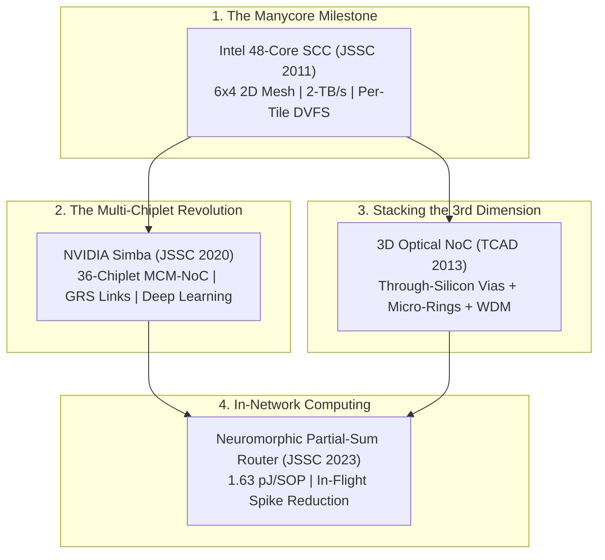

# Track 7: Landmark Paper Deep Dives

The true power of this learning curriculum lies in its direct connection to our repository's **541 curated IEEE journal papers**, **37,400+ high-resolution figures**, and validated silicon prototypes.

In this track, we provide accessible, high-school and undergraduate readable deep dives into landmark **IEEE JSSC**, **TCAD**, and **TVLSI** papers. We strip away academic jargon to explain the core architectural breakthroughs, analyze published silicon measurements, and demonstrate how theoretical NoC principles are embodied in real-world tapeouts.

---

## 🗺️ Featured Landmark Paper Studies

---

## 📖 Curriculum Outline

| Lesson | Seminal IEEE Paper & Citation | Breakthrough Architectural Innovation | Interactive Silicon Simulator |
| :--- | :--- | :--- | :--- |
| **[7.1 The Manycore Milestone: Intel 48-Core SCC](01-intel-scc-mesh.md)** | *A 2-TB/s 6×4 Mesh Network for a Single-Chip Cloud Computer with DVFS in 45-nm CMOS* **IEEE JSSC 2011** | First commercial-scale 48-core 2D mesh, 24 tiles, per-tile fine-grained Dynamic Voltage & Frequency Scaling (DVFS), and on-die message-passing buffers without cache coherence overhead. | **Intel SCC Mesh & DVFS Power Simulator:** Interactive $6\times 4$ tile grid with per-tile voltage/frequency sliders ($0.7\text{–}1.14\text{ V}$, $100\text{ MHz–}1.6\text{ GHz}$), showing real-time bisection throughput and power distribution. |
| **[7.2 The Multi-Chiplet Revolution: NVIDIA Simba](02-nvidia-simba-mcm.md)** | *A 0.32–128 TOPS Scalable Multi-Chip-Module-Based Deep Neural Network Inference Accelerator* **IEEE JSSC 2020 / ISSCC** | 36-chiplet 2.5D Multi-Chip-Module (MCM), Ground-Referenced Signaling (GRS) at $100\ \mu\text{m}$ pitch, 2-level hierarchical NoC (intra-chiplet + package mesh), and hardware multicast. | **NVIDIA Simba Hierarchical MCM-NoC Explorer:** Interactive $6\times 6$ package grid demonstrating 2-level hierarchical addressing, GRS interposer latency, and multicast weight distribution. |
| **[7.3 Stacking the 3rd Dimension: 3D Optical NoC](03-3d-optical-noc.md)** | *3D Mesh-Based Optical Network-on-Chip for Multiprocessor System-on-Chip* **IEEE TCAD 2013** | Monolithic vertical integration uniting copper Through-Silicon Vias (TSVs) for control signaling with Silicon Micro-Ring Resonators (MRRs) and WDM optical waveguides for terabit data flight. | **3D Optical NoC WDM & Thermal Budget Analyzer:** Interactive multi-tier optical loss and thermal tuning calculator comparing laser power against silicon diode heating. |
| **[7.4 In-Network Computing: Neuromorphic Router](04-in-network-neuromorphic.md)** | *A 1.63-pJ/SOP Neuromorphic Processor with Integrated Partial-Sum Routers for In-Network Computing* **IEEE JSSC 2023** | Moving computation into the communication fabric: routers perform in-flight partial-sum arithmetic directly inside crossbar buffers during multicast, cutting memory traffic by $68\%$. | **In-Flight Partial-Sum Reduction Visualizer:** Interactive tree multicast comparing conventional store-and-forward NoC traffic against in-router arithmetic reduction. |

---

## 🗺️ Live Papers Catalog & Exploration Tools

Want to explore the entire literature archive?
- 🌐 **[Launch Interactive NoC Papers Map](https://network-on-chip.github.io/.github/)**
- 📂 **[Browse Curated Papers Directory on GitHub](https://github.com/network-on-chip/noc-lab/tree/main/papers)**
