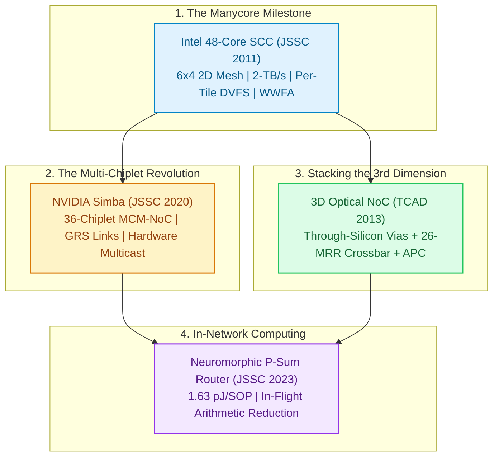

# Track 7: Landmark Paper Deep Dives

  
Network Architecture • Module 07

  <h1>Landmark IEEE Paper Deep Dives &amp; Silicon Case Studies</h1>
  

    Bridge theoretical NoC principles with real-world taped-out silicon from our curated archive of 541 IEEE journal papers. Strip away academic jargon to dissect the microarchitectures of milestone processors: from Intel's 48-Core Single-Chip Cloud Computer (SCC) with per-tile DVFS, to NVIDIA's 36-chiplet Simba MCM accelerator with Ground-Referenced Signaling (GRS), 3D Optical NoC with reduced-MRR crossbars, and in-network computing neuromorphic partial-sum routers.
  

  

    ⏱️ 4 In-Depth Lessons
    🔬 4 Interactive Simulators &amp; Tools
    💻 4 Synthesizable Verilog RTL Modules
    📜 4 Landmark IEEE / ACM Seminal Papers
  

  
📖 Official Companion Textbook Chapter Available

  

    For comprehensive physical analysis of silicon nanophotonics, Crossing vs. Parallel Switching Elements (CSE vs. PSE), WDM laser link budgets, micro-ring resonator thermal drift, and 60 GHz / sub-THz on-chip wireless transceivers, read <strong><a href="https://github.com/network-on-chip/book/blob/main/chapters/ch10-optical-wireless/index.md" target="_blank" rel="noopener">Chapter 10: Optical &amp; Wireless Networks-on-Chip (ONoC / WNoC)</a></strong>.
  

---

## 🗺️ Featured Landmark Paper Studies

The diagram below maps the historical evolution of interconnect architecture breakthroughs studied in this track:

---

## 📚 Syllabus & Chapters in Track 7

  

    

      Lesson 7.1
      
The Manycore Milestone: Intel 48-Core SCC

      

        Intel Labs 45-nm tapeout, message-passing buffers (MPB), 2-TB/s 2D mesh, 4-stage router pipeline with lookahead routing and Wrapped Wave-Front Allocation (WWFA), and 24 independent tile clock domains.
      

      

        ⚡ <strong>Features:</strong> Interactive Intel SCC 48-Core Mesh Simulator, Synthesizable Verilog RTL (`scc_mesh_router_wwfa.v`), 3-Question Self-Check Quiz, Arcade Linkages (Arbiter Arena &amp; Volt Vortex).
      

    

    <a href="01-intel-scc-mesh.md" class="noc-track-link">Launch Lesson 7.1 →</a>
  

  

    

      Lesson 7.2
      
The Multi-Chiplet Revolution: NVIDIA Simba

      

        36-chiplet 2.5D MCM deep learning accelerator, $0.54\text{ pJ/bit}$ Ground-Referenced Signaling (GRS) at $100\ \mu\text{m}$ pitch, 2-level hierarchical NoC, and hardware multicast tree routing.
      

      

        ⚡ <strong>Features:</strong> Interactive NVIDIA Simba Hierarchical MCM-NoC Explorer, Synthesizable Verilog RTL (`simba_multicast_router.v`), 3-Question Self-Check Quiz, Arcade Linkages (Chiplet Tycoon &amp; QoS Gladiator).
      

    

    <a href="02-nvidia-simba-mcm.md" class="noc-track-link">Launch Lesson 7.2 →</a>
  

  

    

      Lesson 7.3
      
Stacking the 3rd Dimension: 3D Optical NoC

      

        Monolithic vertical integration uniting copper TSVs for control signaling with silicon waveguides for terabit data flight, 26-MRR passive crossbars under XYZ DOR, and Adaptive Power Control (APC) laser current modulation.
      

      

        ⚡ <strong>Features:</strong> Interactive 3D Optical NoC WDM &amp; Thermal Budget Analyzer, Synthesizable Verilog RTL (`onoc_hybrid_3d_crossbar.v`), 3-Question Self-Check Quiz, Arcade Linkages (Photon Pilot &amp; Hotspot Hero).
      

    

    <a href="03-3d-optical-noc.md" class="noc-track-link">Launch Lesson 7.3 →</a>
  

  

    

      Lesson 7.4
      
In-Network Computing: Neuromorphic Router

      

        $1.63\text{ pJ/SOP}$ neuromorphic processor, dual-plane spike and partial-sum routing, in-flight arithmetic accumulation inside crossbar buffers, and Leaky Integrate-and-Fire (LIF) threshold evaluation.
      

      

        ⚡ <strong>Features:</strong> Interactive In-Flight Partial-Sum Reduction Visualizer, Synthesizable Verilog RTL (`neuromorphic_psum_router.v`), 3-Question Self-Check Quiz, Arcade Linkages (Neuromorphic Nexus &amp; Packet Master).
      

    

    <a href="04-in-network-neuromorphic.md" class="noc-track-link">Launch Lesson 7.4 →</a>
  

---

## 🎯 Track Learning Objectives

Upon completing Track 7, you will be able to:

1. **Analyze Commercial Manycore Architecture:** Dissect the Intel SCC pipeline, explain lookahead routing and wave-front arbitration, and quantify why message passing avoids directory cache coherence scaling walls.
2. **Evaluate Multi-Chiplet MCM Networks:** Calculate shoreline bandwidth and energy efficiency for Ground-Referenced Signaling (GRS) and implement hardware multicast routing trees for deep learning tensor dissemination.
3. **Design Heterogeneous 3D Optical Interconnects:** Optimize optical crossbar layouts to slash active micro-ring counts using dimension-order routing invariants, and compute link power budgets with Adaptive Power Control (APC).
4. **Implement In-Network Computing Engines:** Build in-flight arithmetic reduction routers that merge convergent neural flits directly inside crossbar datapaths, cutting memory traffic by $>50\%$.
5. **Bridge Academic Theory with Taped-Out Silicon:** Connect published silicon measurements from IEEE JSSC, TCAD, and TVLSI directly to your own Verilog designs and architectural simulations.

---

## 🗺️ Live Papers Catalog & Exploration Tools

Want to explore the entire literature archive?
- 🌐 **[Launch Interactive NoC Papers Map](https://network-on-chip.github.io/.github/)**
- 📂 **[Browse Curated Papers Directory on GitHub](https://github.com/network-on-chip/noc-lab/tree/main/papers)**
