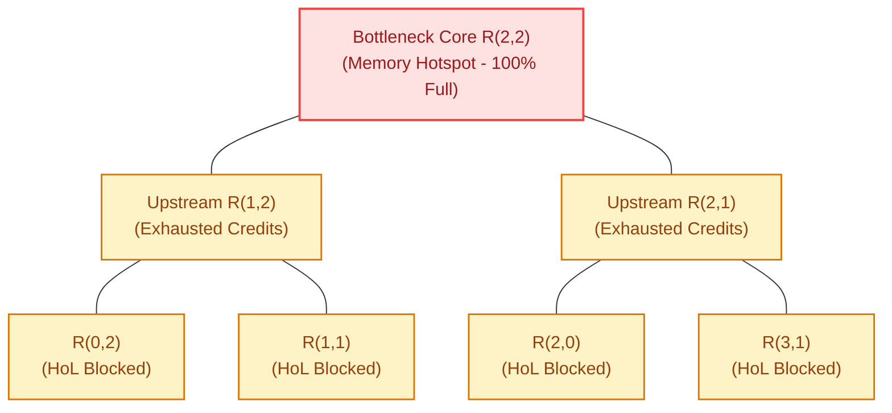

# 5.2 Congestion Detection & Source Quenching

In a packet-switched network-on-chip, interconnect performance does not degrade gracefully under overload. Once packet injection exceeds the network's saturation threshold ($\lambda > \Theta_{sat}$), the system experiences a catastrophic non-linear phenomenon known as **Throughput Collapse**.

A single overloaded destination (e.g., an L2 memory controller or synchronization barrier) causes buffers to back up across the chip, forming a sprawling **Saturation Tree** that blocks completely unrelated traffic flows.

In this lesson, we analyze the mechanics of saturation trees, examine **Regional Congestion Awareness (RCA)**, explore closed-loop **Source Quenching**, and simulate congestion spread and mitigation in real time.

---

## 1. The Anatomy of a Saturation Tree

How does congestion at a single router paralyze an entire multi-core chip?

The root cause is the combination of **lossless credit-based flow control** and **Head-of-Line (HoL) blocking**:

```
Propagation of a Saturation Tree:
=============================================================================
Step 1 (Root):   Target router R(2,2) receives more flits than its output port can service.
                 Its input FIFO buffers fill to 100% capacity. Credits drop to 0.

Step 2 (Trunk):  Upstream routers R(1,2) and R(2,1) run out of credits for R(2,2).
                 Flits targeting R(2,2) stall inside R(1,2) and R(2,1)'s buffers.

Step 3 (Branch): Inside R(1,2), flits destined for UNCONGESTED node R(0,3) are trapped
                 BEHIND the stalled flits targeting R(2,2) (Head-of-Line Blocking)!

Step 4 (Leaf):   R(1,2) runs out of buffer space. It stops issuing credits to R(0,2).
                 The congestion tree spreads backwards to all traffic sources,
                 strangling the entire network!
=============================================================================
```



Once a saturation tree forms:
- Average packet latency increases by **$10\times\text{ to }50\times$**.
- Sustainable throughput collapses, because links not involved in the hotspot are starved of packets.

---

## 2. Congestion Detection Metrics

To prevent saturation trees, routers must monitor network stress. Telemetry metrics fall into three scopes:

### 1. Local Congestion Metrics
Measured directly at the local router:
- **Free Credit Count ($C_{free}$):** Number of available buffer slots at the downstream neighbor.
- **Buffer Queue Depth ($q_{depth}$):** Number of occupied flits in the local input FIFOs.
- **Crossbar Wait Time ($t_{wait}$):** Number of cycles a flit spends requesting an output port before grant.

*Limitation:* Local metrics are purely **reactive**. By the time a local buffer fills up, the saturation tree has already reached the router!

### 2. Regional Congestion Awareness (RCA)
Introduced by Paul Gratz, Stephen Keckler, and William Dally (HPCA 2008 [[Gratz2008](#ref-gratz2008)]), **RCA** aggregates congestion telemetry from multi-hop neighborhoods.

Routers broadcast a small scalar congestion status (e.g., 2–3 bits) along coordinate wires to adjacent routers:

$$S_{regional} = w_0 \cdot S_{local} + w_1 \cdot S_{1-hop} + w_2 \cdot S_{2-hop}$$

Where weights typically follow an exponential decay:

$$w_0 = 1.0, \quad w_1 = 0.5, \quad w_2 = 0.25$$

```
Regional Congestion Awareness (RCA) Wire Network:
  [Router R0] ----RCA Telemetry Wire----> [Router R1] ----RCA Wire----> [Router R2]
   (Hotspot!)      (Receives stress S)     (Knows of distant hotspot BEFORE buffers fill!)
```

Because RCA telemetry propagates along dedicated lightweight 1-bit wires, **upstream routers learn of downstream congestion 5–10 cycles before their own buffers fill**, allowing them to take evasive action early!

### 3. Global Congestion Awareness (GCA / DBCA)
Destination-Based Congestion Awareness broadcasts bisection channel loads and memory controller queue depths chip-wide, allowing Network Interfaces (NIs) to detect full-system pressure.

---

## 3. Dynamic Congestion Mitigation Mechanisms

Once congestion is detected, how do routers resolve it?

### Mechanism A: Closed-Loop Source Quenching (Token Bucket)
The most effective way to eliminate a saturation tree is to **stop injecting packets at the source**:
- When a router's RCA stress exceeds threshold $S_{thresh}$, it transmits a **Quench Signal** back to the Network Interfaces (NIs) of cores injecting traffic toward that zone.
- The NI throttles packet generation using a **Token Bucket Rate Limiter**:

$$\text{Tokens: } T_{bucket}[k+1] = \min\big( B_{max}, \ T_{bucket}[k] + r_{refill} \cdot \Delta t \big)$$

- A packet is injected only if $T_{bucket} \ge L_{flits}$.
- Under high stress, $r_{refill}$ is dynamically dialed down, keeping packets in core memory rather than clogging on-chip router FIFOs!

```
Core L1/L2 Cache --------> [NI Token Bucket] ======== NoC Mesh Links ========> Hotspot
                              ^
                              | (Quench Feedback)
                              +--- Downstream Router Reports S > S_thresh
```

### Mechanism B: Congestion-Aware Adaptive Routing (DyAD)
In **Dynamic Adaptive/Deterministic (DyAD)** routing (Hu & Marculescu, DAC 2004 [[Hu2004](#ref-hu2004)]):
1. **In Cold / Low-Stress Regions ($S < S_{thresh}$):** Packets follow deterministic XY routing.
   - *Benefits:* Ultra-low router delay, zero virtual channel arbitration conflicts, guaranteed in-order flit arrival.
2. **In Hot / Congested Regions ($S \ge S_{thresh}$):** Routers dynamically switch to adaptive routing (e.g., West-First or Odd-Even), steering flits onto alternate, empty parallel channels around the hotspot.

---

## 4. 🔬 Interactive Network Congestion & RCA Simulator

Experience how a single hotspot creates a saturation tree across a $5 \times 5$ 2D mesh, and watch how **Regional Congestion Awareness (RCA)** and **Source Quenching** clear the traffic jam:

<div class="noc-sim-container" id="rca-sim">
  <div style="display:flex; justify-content:space-between; align-items:center; flex-wrap:wrap; gap:0.5rem; margin-bottom:1rem;">
    <div style="font-weight:700; font-size:1.05rem; color:var(--tcl-heading);">
      ⚡ Saturation Tree Formation &amp; RCA Mitigation Engine
    </div>
    <span class="noc-track-badge" style="background:rgba(34,197,94,0.1); color:#22c55e;" id="rca_badge">
      Network Clear
    </span>
  </div>

  <div style="display:grid; grid-template-columns:repeat(auto-fit, minmax(200px, 1fr)); gap:0.75rem; margin-bottom:1rem;">
    <div>
      <label style="font-size:0.82rem; font-weight:600; display:block; margin-bottom:0.25rem;">Traffic Pattern:</label>
      <select id="rca_pattern" class="noc-sim-select" onchange="resetRCASim()">
        <option value="HOTSPOT" selected>Severe Hotspot (Target: Core 12 @ Center)</option>
        <option value="UNIFORM">Uniform Random Traffic</option>
      </select>
    </div>
    <div>
      <label style="font-size:0.82rem; font-weight:600; display:block; margin-bottom:0.25rem;">Control Policy:</label>
      <select id="rca_policy" class="noc-sim-select" onchange="resetRCASim()">
        <option value="NONE" selected>Naive XY (No RCA, No Throttling)</option>
        <option value="RCA">RCA Telemetry Enabled (Early Diversion)</option>
        <option value="QUENCH">RCA + Source Quenching (Proactive Throttling)</option>
      </select>
    </div>
    <div style="display:flex; align-items:flex-end; gap:0.5rem;">
      <button class="noc-sim-btn" onclick="stepRCASim()">⏱ Step (+5 Cycles)</button>
      <button class="noc-sim-btn" style="background:#ef4444;" onclick="burstTraffic()">💥 Traffic Burst</button>
      <button class="noc-sim-btn" style="background:var(--md-default-fg-color--lightest); color:var(--md-default-fg-color); border:1px solid var(--tcl-border);" onclick="resetRCASim()">🔄 Reset</button>
    </div>
  </div>

  <div style="display:flex; gap:1.25rem; flex-wrap:wrap; align-items:flex-start;">
    <div style="flex:1; min-width:280px; text-align:center;">
      <canvas id="rcaCanvas" width="340" height="340" style="background:#0f172a; border-radius:8px; box-shadow:0 4px 12px rgba(0,0,0,0.25); max-width:100%; height:auto;"></canvas>
      <div style="font-size:0.75rem; color:#94a3b8; margin-top:0.35rem;">
        Buffer Fill: <span style="color:#38bdf8;">■ &lt;25%</span> ➔ <span style="color:#22c55e;">■ 50%</span> ➔ <span style="color:#eab308;">■ 75%</span> ➔ <span style="color:#ef4444;">■ 100% (Saturated)</span>
      </div>
    </div>

    <div style="flex:1.2; min-width:280px;">
      <div style="background:var(--md-default-fg-color--lightest); border:1px solid var(--tcl-border); border-radius:8px; padding:0.85rem; font-size:0.85rem; margin-bottom:0.75rem;">
        <div style="font-weight:700; color:var(--tcl-heading); margin-bottom:0.4rem;">📊 Congestion Telemetry:</div>
        <div style="display:grid; grid-template-columns:1fr 1fr; gap:0.4rem;">
          <div>Cycle Count: <strong id="rca_cycle">0</strong></div>
          <div>Saturated Routers: <strong id="rca_sat_count" style="color:#22c55e;">0 of 25</strong></div>
          <div>Avg Flit Latency: <strong id="rca_lat">3.2 cyc</strong></div>
          <div>Delivered Throughput: <strong id="rca_tp">0.85 flits/cyc</strong></div>
          <div>RCA Stress Flag: <strong id="rca_stress_lbl">Low (Nominal)</strong></div>
          <div>Throttled Cores: <strong id="rca_throttled">0 Cores</strong></div>
        </div>
      </div>

      <div style="background:var(--md-default-fg-color--lightest); border:1px solid var(--tcl-border); border-radius:8px; padding:0.85rem; font-size:0.82rem;">
        <div style="font-weight:700; color:var(--tcl-heading); margin-bottom:0.4rem;">🔍 Saturation Log:</div>
        <div id="rca_log" style="font-family:monospace; height:120px; overflow-y:auto; line-height:1.5; color:var(--md-default-fg-color--lighter);">
          <span style="color:#22c55e;">[READY] 5x5 Mesh initialized. Buffers empty.</span>
        </div>
      </div>
    </div>
  </div>
</div>

<script>
const rcaState = {
  cycle: 0,
  bufferFill: new Array(25).fill(0), // 0 to 100%
  rcaStress: new Array(25).fill(0),
  throttled: 0
};

function resetRCASim() {
  rcaState.cycle = 0;
  rcaState.bufferFill = new Array(25).fill(10); // baseline 10%
  rcaState.rcaStress = new Array(25).fill(0);
  rcaState.throttled = 0;

  document.getElementById("rca_badge").textContent = "Network Clear";
  document.getElementById("rca_badge").style.background = "rgba(34,197,94,0.15)";
  document.getElementById("rca_badge").style.color = "#22c55e";

  document.getElementById("rca_cycle").textContent = "0";
  document.getElementById("rca_sat_count").textContent = "0 of 25";
  document.getElementById("rca_sat_count").style.color = "#22c55e";
  document.getElementById("rca_lat").textContent = "3.2 cyc";
  document.getElementById("rca_tp").textContent = "0.85 flits/cyc";
  document.getElementById("rca_stress_lbl").textContent = "Low (Nominal)";
  document.getElementById("rca_throttled").textContent = "0 Cores";

  document.getElementById("rca_log").innerHTML = `<span style="color:#22c55e;">[READY] 5x5 Mesh initialized. Buffers empty.</span>`;

  drawRCACanvas();
}

function burstTraffic() {
  for (let i = 0; i < 4; i++) {
    stepRCASim(true);
  }
}

function stepRCASim(isBurst = false) {
  rcaState.cycle += 5;
  const pat = document.getElementById("rca_pattern").value;
  const pol = document.getElementById("rca_policy").value;

  const target = (pat === "HOTSPOT") ? 12 : Math.floor(Math.random() * 25);
  const injection = isBurst ? 45 : 20;

  // 1. Inject traffic into hotspot
  if (pol === "QUENCH" && rcaState.rcaStress[target] > 50) {
    // Source quenching throttles injection!
    rcaState.bufferFill[target] = Math.min(100, rcaState.bufferFill[target] + 8);
    rcaState.throttled = 8;
  } else {
    rcaState.bufferFill[target] = Math.min(100, rcaState.bufferFill[target] + injection);
    rcaState.throttled = 0;
  }

  // 2. Propagate saturation tree backwards to upstream neighbors
  const newFill = [...rcaState.bufferFill];
  const trgR = Math.floor(target / 5);
  const trgC = target % 5;

  for (let r = 0; r < 5; r++) {
    for (let c = 0; c < 5; c++) {
      const idx = r * 5 + c;
      if (idx === target) continue;

      const dist = Math.abs(r - trgR) + Math.abs(c - trgC);
      if (pat === "HOTSPOT") {
        if (rcaState.bufferFill[target] >= 80) {
          if (dist === 1) {
            newFill[idx] = Math.min(100, newFill[idx] + (pol === "RCA" ? 8 : (pol === "QUENCH" ? 4 : 22)));
          } else if (dist === 2 && newFill[target] === 100) {
            newFill[idx] = Math.min(100, newFill[idx] + (pol === "NONE" ? 18 : 3));
          }
        }
      } else {
        // Uniform
        newFill[idx] = Math.max(10, Math.min(100, newFill[idx] + (Math.random() * 10 - 6)));
      }

      // Normal drain
      if (newFill[idx] > 15 && pol !== "NONE") {
        newFill[idx] = Math.max(10, newFill[idx] - 6);
      }
    }
  }

  // 3. Compute RCA Stress
  for (let i = 0; i < 25; i++) {
    rcaState.rcaStress[i] = newFill[i];
  }

  rcaState.bufferFill = newFill;

  // Count saturated routers (>80%)
  const satCount = rcaState.bufferFill.filter(b => b >= 80).length;

  document.getElementById("rca_cycle").textContent = rcaState.cycle;
  document.getElementById("rca_sat_count").textContent = `${satCount} of 25`;
  document.getElementById("rca_sat_count").style.color = (satCount > 5) ? "#ef4444" : ((satCount > 0) ? "#f97316" : "#22c55e");

  const badge = document.getElementById("rca_badge");
  const log = document.getElementById("rca_log");

  if (satCount > 8) {
    badge.textContent = "CRITICAL: SATURATION TREE FORMED";
    badge.style.background = "rgba(239,68,68,0.2)";
    badge.style.color = "#ef4444";
    document.getElementById("rca_lat").textContent = "42.8 cyc (COLLAPSE)";
    document.getElementById("rca_tp").textContent = "0.18 flits/cyc";
    document.getElementById("rca_stress_lbl").textContent = "CRITICAL (100%)";
    log.innerHTML += `<br/><span style="color:#ef4444;">[CYCLE ${rcaState.cycle}] Saturation tree spread to ${satCount} routers! Throughput collapsed by 78%.</span>`;
  } else if (satCount > 0) {
    badge.textContent = "WARNING: LOCAL CONGESTION";
    badge.style.background = "rgba(234,179,8,0.2)";
    badge.style.color = "#ca8a04";
    document.getElementById("rca_lat").textContent = "12.4 cyc";
    document.getElementById("rca_tp").textContent = "0.62 flits/cyc";
    document.getElementById("rca_stress_lbl").textContent = "Elevated (RCA Active)";
    if (pol === "QUENCH") {
      log.innerHTML += `<br/><span style="color:#22c55e;">[CYCLE ${rcaState.cycle}] RCA Quench active: Throttled 8 source cores. Saturation contained!</span>`;
    } else {
      log.innerHTML += `<br/><span style="color:#ca8a04;">[CYCLE ${rcaState.cycle}] Hotspot at R12 spreading to upstream neighbors.</span>`;
    }
  } else {
    badge.textContent = "Network Clear";
    badge.style.background = "rgba(34,197,94,0.15)";
    badge.style.color = "#22c55e";
    document.getElementById("rca_lat").textContent = "3.2 cyc";
    document.getElementById("rca_tp").textContent = "0.85 flits/cyc";
    document.getElementById("rca_stress_lbl").textContent = "Low (Nominal)";
  }

  document.getElementById("rca_throttled").textContent = `${rcaState.throttled} Cores`;
  log.scrollTop = log.scrollHeight;

  drawRCACanvas();
}

function drawRCACanvas() {
  const canvas = document.getElementById("rcaCanvas");
  if (!canvas) return;
  const ctx = canvas.getContext("2d");
  const w = canvas.width;
  const h = canvas.height;
  ctx.clearRect(0, 0, w, h);

  const pad = 28;
  const step = (w - pad * 2) / 4;

  // Draw links
  ctx.lineWidth = 2.5;
  for (let r = 0; r < 5; r++) {
    for (let c = 0; c < 5; c++) {
      const idx = r * 5 + c;
      const x = pad + c * step;
      const y = pad + r * step;

      // East link
      if (c < 4) {
        const nextIdx = idx + 1;
        const avgFill = (rcaState.bufferFill[idx] + rcaState.bufferFill[nextIdx]) / 2;
        ctx.strokeStyle = avgFill > 75 ? "#ef4444" : (avgFill > 45 ? "#f97316" : "#334155");
        ctx.lineWidth = avgFill > 75 ? 4 : 2;
        ctx.beginPath();
        ctx.moveTo(x, y);
        ctx.lineTo(x + step, y);
        ctx.stroke();
      }
      // South link
      if (r < 4) {
        const nextIdx = idx + 5;
        const avgFill = (rcaState.bufferFill[idx] + rcaState.bufferFill[nextIdx]) / 2;
        ctx.strokeStyle = avgFill > 75 ? "#ef4444" : (avgFill > 45 ? "#f97316" : "#334155");
        ctx.lineWidth = avgFill > 75 ? 4 : 2;
        ctx.beginPath();
        ctx.moveTo(x, y);
        ctx.lineTo(x, y + step);
        ctx.stroke();
      }
    }
  }

  // Draw Router Nodes
  for (let r = 0; r < 5; r++) {
    for (let c = 0; c < 5; c++) {
      const idx = r * 5 + c;
      const x = pad + c * step;
      const y = pad + r * step;
      const fill = rcaState.bufferFill[idx];

      ctx.beginPath();
      ctx.arc(x, y, 13, 0, Math.PI * 2);

      if (fill >= 80) {
        ctx.fillStyle = "#ef4444";
        ctx.strokeStyle = "#fca5a5";
      } else if (fill >= 50) {
        ctx.fillStyle = "#f97316";
        ctx.strokeStyle = "#fed7aa";
      } else if (fill >= 25) {
        ctx.fillStyle = "#22c55e";
        ctx.strokeStyle = "#bbf7d0";
      } else {
        ctx.fillStyle = "#1e293b";
        ctx.strokeStyle = "#38bdf8";
      }

      ctx.lineWidth = 2;
      ctx.fill();
      ctx.stroke();

      // Node label
      ctx.fillStyle = "#ffffff";
      ctx.font = "bold 8.5px sans-serif";
      ctx.textAlign = "center";
      ctx.textBaseline = "middle";
      ctx.fillText(`R${idx}`, x, y);
    }
  }
}

if (document.readyState === "loading") {
  document.addEventListener("DOMContentLoaded", resetRCASim);
} else {
  resetRCASim();
}
</script>

---

## 5. Worked Numerical Example: Saturation Tree Latency Amplification

> [!TIP]
> **Problem Statement:**  
> A $8 \times 8$ 2D Mesh NoC operates with a nominal Zero-Load Latency of $T_0 = 12\text{ clock cycles}$.  
> - A hotspot memory controller at Router $R(4,4)$ receives traffic from $16$ client cores.
> - Router FIFO input buffers hold $B = 8\text{ flits}$ per port.
> - When $R(4,4)$ saturates, upstream routers stall, forming a saturation tree encompassing $10\text{ routers}$ along the bisection.
> - An unrelated packet from Source $R(0,0)$ to Destination $R(7,0)$ (completely disjoint destination!) traverses through an upstream router whose buffer is HoL-blocked by the saturation tree.
> 
> Calculate:
> 1. The Head-of-Line queuing delay encountered by the unrelated packet if the blocked queue takes $120\text{ cycles}$ to drain.
> 2. The relative latency penalty suffered by the innocent packet.
> 3. How Regional Congestion Awareness (RCA) resolves this penalty.

### Step 1: Head-of-Line Delay Calculation
- Under normal operation: $T_{normal} = T_0 = 12\text{ cycles}$.
- When entering the HoL-blocked router:

    $$T_{congested} = T_0 + T_{HoL\_wait} = 12 + 120 = \mathbf{132\text{ clock cycles}}$$

### Step 2: Relative Latency Penalty

$$\text{Penalty Factor} = \frac{T_{congested}}{T_{normal}} = \frac{132}{12} = \mathbf{11.0\times\text{ (1,000\% Latency Spike)!}}$$

### Step 3: RCA Resolution
With **Regional Congestion Awareness (RCA)**:
- Router $R(1,0)$ receives upstream RCA telemetry indicating that the central column is saturated ($S_{regional} > S_{thresh}$).
- Instead of routing deterministically through the congested trunk, the router **adaptively diverts** the packet along the peripheral ring (via row 0).
- The diverted path adds only **$2\text{ hops}$** of distance ($\Delta T = 2 \times 2 = 4\text{ cycles}$).
- New latency with RCA: $T_{RCA} = 12 + 4 = \mathbf{16\text{ cycles}}$, avoiding the $132\text{-cycle}$ stall completely!

---

## 6. Synthesizable Verilog Module: `rca_congestion_aggregator.v`

In high-performance on-chip networks, preventing throughput collapse requires detecting congestion before upstream queues experience Head-of-Line blocking. The module below implements **Regional Congestion Awareness (RCA)** telemetry aggregation and a closed-loop **Token-Bucket Source Quencher**. It combines local FIFO queue depths with 3-bit multi-hop stress signals from neighboring routers using an exponential-decay weighted sum, and dynamically gates local packet injection when regional stress crosses a programmable throttle threshold.

```verilog
//=============================================================================
// File: rca_congestion_aggregator.v
// Module: rca_congestion_aggregator
// Description: Synthesizable Regional Congestion Awareness (RCA) Telemetry
//              Aggregator and Token-Bucket Source Quenching Controller.
//              Features:
//              - Computes local congestion index from buffer depth and credits.
//              - Ingests 3-bit directional stress vectors from N, S, E, W.
//              - Computes exponential-decay regional stress:
//                S_reg = S_local + (S_1hop >> 1) + (S_2hop >> 2).
//              - Broadcasts aggregated regional stress downstream along 1D wires.
//              - Token-bucket rate limiter that throttles local flit injection
//                when regional stress exceeds configurable threshold.
//=============================================================================

`timescale 1ns / 1ps

module rca_congestion_aggregator #(
    parameter integer BUFFER_DEPTH         = 16,     // Local input FIFO depth
    parameter integer MAX_TOKENS           = 32,     // Token bucket capacity
    parameter [5:0]   DEFAULT_THROTTLE_TH  = 6'd24   // Stress threshold to throttle
)(
    input  wire        clk,               // Synchronous router clock
    input  wire        rst_n,             // Active-low synchronous reset
    
    // Local Router Status
    input  wire [4:0]  local_fifo_occupancy, // Number of flits currently in buffer
    input  wire [4:0]  downstream_free_credits, // Free buffer slots at neighbor
    
    // Multi-Hop RCA Telemetry Inputs (3-bit stress from adjacent routers)
    input  wire [2:0]  rca_stress_north,
    input  wire [2:0]  rca_stress_south,
    input  wire [2:0]  rca_stress_east,
    input  wire [2:0]  rca_stress_west,
    
    // Programmable Configuration
    input  wire [5:0]  cfg_throttle_thresh, // Throttle threshold
    input  wire [3:0]  cfg_token_refill_rate, // Tokens added per 16 cycles
    
    // Network Interface (NI) Injection Control
    input  wire        inject_request,    // Core requests to inject a new flit
    output reg         inject_grant,      // Flit injection permitted
    output reg  [2:0]  local_stress_out,  // 3-bit stress broadcast to neighbors
    output reg  [5:0]  regional_stress,   // Combined multi-hop regional stress
    output reg         throttling_active  // Status: injection is currently quenched
);

    //-------------------------------------------------------------------------
    // 1. Local Congestion Index Computation
    //-------------------------------------------------------------------------
    // S_local ranges 0 to 7: higher when buffer is full and credits are low
    reg [2:0] computed_local_stress;

    always @(*) begin
        if (downstream_free_credits == 5'd0 || local_fifo_occupancy >= (BUFFER_DEPTH - 2)) begin
            computed_local_stress = 3'd7; // Extreme local saturation
        end else if (local_fifo_occupancy >= (BUFFER_DEPTH >> 1)) begin
            computed_local_stress = 3'd4; // Moderate queue backlog
        end else if (local_fifo_occupancy > 5'd2) begin
            computed_local_stress = 3'd2; // Light traffic
        end else begin
            computed_local_stress = 3'd0; // Idle / empty
        end
    end

    always @(posedge clk or negedge rst_n) begin
        if (!rst_n) begin
            local_stress_out <= 3'd0;
        end else begin
            local_stress_out <= computed_local_stress;
        end
    end

    //-------------------------------------------------------------------------
    // 2. Multi-Hop Exponential-Decay Regional Stress Aggregation
    //-------------------------------------------------------------------------
    // Regional Stress Formula:
    // S_reg = (S_local * 4) + (Max(N,S,E,W) * 2) + (Sum_remaining >> 1)
    reg [2:0] max_neighbor_stress;
    reg [3:0] neighbor_sum;

    always @(*) begin
        // Find maximum single neighbor stress (directional bottleneck)
        max_neighbor_stress = rca_stress_north;
        if (rca_stress_south > max_neighbor_stress) max_neighbor_stress = rca_stress_south;
        if (rca_stress_east  > max_neighbor_stress) max_neighbor_stress = rca_stress_east;
        if (rca_stress_west  > max_neighbor_stress) max_neighbor_stress = rca_stress_west;

        neighbor_sum = rca_stress_north + rca_stress_south + rca_stress_east + rca_stress_west;
    end

    always @(posedge clk or negedge rst_n) begin
        if (!rst_n) begin
            regional_stress   <= 6'd0;
            throttling_active <= 1'b0;
        end else begin
            // Weighted combination: local weight = 4, max 1-hop = 2, residual = 0.5
            regional_stress <= ({3'd0, computed_local_stress} << 2) + 
                               ({3'd0, max_neighbor_stress} << 1) + 
                               (neighbor_sum >> 1);

            throttling_active <= (regional_stress >= ((cfg_throttle_thresh != 6'd0) ? cfg_throttle_thresh : DEFAULT_THROTTLE_TH));
        end
    end

    //-------------------------------------------------------------------------
    // 3. Token-Bucket Source Quenching Injection Controller
    //-------------------------------------------------------------------------
    reg [5:0] token_bucket;
    reg [3:0] refill_timer;

    always @(posedge clk or negedge rst_n) begin
        if (!rst_n) begin
            token_bucket <= MAX_TOKENS[5:0];
            refill_timer <= 4'd0;
            inject_grant <= 1'b0;
        end else begin
            inject_grant <= 1'b0;

            // Refill tokens periodically (suppressed when severe throttling is active)
            refill_timer <= refill_timer + 4'd1;
            if (refill_timer == 4'd15) begin
                if (!throttling_active && (token_bucket + cfg_token_refill_rate <= MAX_TOKENS[5:0])) begin
                    token_bucket <= token_bucket + cfg_token_refill_rate;
                end else if (throttling_active && (token_bucket + 6'd1 <= MAX_TOKENS[5:0])) begin
                    // Severely throttled refill rate: only 1 token per 16 cycles
                    token_bucket <= token_bucket + 6'd1;
                end
            end

            // Process injection request
            if (inject_request) begin
                if (!throttling_active && token_bucket >= 6'd1) begin
                    inject_grant <= 1'b1;
                    token_bucket <= token_bucket - 6'd1;
                end else if (throttling_active && token_bucket >= 6'd4) begin
                    // Under high regional stress, require at least 4 tokens to inject
                    inject_grant <= 1'b1;
                    token_bucket <= token_bucket - 6'd4;
                end
            end
        end
    end

endmodule
```

---

## 7. 🕹️ Interactive Simulation & Arcade Linkages

Deepen your practical understanding of network congestion and credit flow control through our interactive engineering simulation workbenches:

- 🎮 **[Credit Flow Control CAD: Flow Control](../interactive/credits.md):** Master credit-based buffer turnarounds, avoid credit starvation, and prevent saturation collapse.
- 🎮 **[Multi-VNET QoS Scheduler: Traffic Arbiter](../interactive/qos.md):** Throttle aggressive best-effort flows and maintain strict ASIL-D latency bounds across congested switches.

---

## 8. 🎯 Concept Check: Lesson 5.2

Test your mastery of saturation trees, Regional Congestion Awareness (RCA), and source quenching with this 3-question self-assessment.

<div class="noc-sim-container" id="quiz52" style="margin-top:1rem;">
  <div style="display:flex; justify-content:space-between; align-items:center; margin-bottom:1rem; flex-wrap:wrap; gap:0.5rem;">
    <div style="font-weight:700; font-size:1.05rem; color:var(--tcl-heading);">
      📝 Concept Check: Congestion Control &amp; RCA
    </div>
    <div id="q52_score_badge" style="font-size:0.85rem; font-weight:600; padding:4px 10px; border-radius:12px; background:rgba(37,99,235,0.1); color:#2563eb;">
      Score: 0 / 3
    </div>
  </div>

  <!-- Question 1 -->
  <div id="q52_1_block" style="margin-bottom:1.5rem; padding-bottom:1rem; border-bottom:1px solid var(--noc-border);">
    <p style="font-weight:600; font-size:0.95rem; margin-bottom:0.75rem;">
      <b>1. Anatomy of Throughput Collapse:</b> Why does an overloaded destination node (such as a saturated memory controller) trigger chip-wide throughput collapse across completely unrelated traffic flows?
    </p>
    <div style="display:flex; flex-direction:column; gap:0.5rem;" id="q52_1_opts">
      <button class="noc-sim-select" style="text-align:left; padding:0.65rem 0.85rem; cursor:pointer;" onclick="checkQ52(1, 0)">
        A. Because the memory controller sends hardware reset signals to all routers.
      </button>
      <button class="noc-sim-select" style="text-align:left; padding:0.65rem 0.85rem; cursor:pointer;" onclick="checkQ52(1, 1)">
        B. Because lossless credit exhaustion backs up flits into upstream router FIFOs, where Head-of-Line (HoL) blocking traps unrelated packets behind the stalled flits, growing a tree that blocks other paths.
      </button>
      <button class="noc-sim-select" style="text-align:left; padding:0.65rem 0.85rem; cursor:pointer;" onclick="checkQ52(1, 2)">
        C. Because the physical copper links melt from excess current.
      </button>
      <button class="noc-sim-select" style="text-align:left; padding:0.65rem 0.85rem; cursor:pointer;" onclick="checkQ52(1, 3)">
        D. Because virtual channel allocators permanently assign all VCs to the core with lowest ID.
      </button>
    </div>
    <div id="q52_1_fb" style="display:none; margin-top:0.75rem; padding:0.75rem; border-radius:8px; font-size:0.9rem; line-height:1.5;"></div>
  </div>

  <!-- Question 2 -->
  <div id="q52_2_block" style="margin-bottom:1.5rem; padding-bottom:1rem; border-bottom:1px solid var(--noc-border);">
    <p style="font-weight:600; font-size:0.95rem; margin-bottom:0.75rem;">
      <b>2. RCA vs. Local Telemetry:</b> Why does Regional Congestion Awareness (RCA) outperform purely local buffer occupancy metrics in preventing Head-of-Line (HoL) throughput collapse?
    </p>
    <div style="display:flex; flex-direction:column; gap:0.5rem;" id="q52_2_opts">
      <button class="noc-sim-select" style="text-align:left; padding:0.65rem 0.85rem; cursor:pointer;" onclick="checkQ52(2, 0)">
        A. Because RCA doubles the physical wire width of all links.
      </button>
      <button class="noc-sim-select" style="text-align:left; padding:0.65rem 0.85rem; cursor:pointer;" onclick="checkQ52(2, 1)">
        B. Because local buffer metrics only trigger after a router's own FIFOs have already filled, whereas RCA propagates multi-hop stress signals upstream along dedicated wires, alerting routers to steer packets onto alternate paths BEFORE local buffers fill up.
      </button>
      <button class="noc-sim-select" style="text-align:left; padding:0.65rem 0.85rem; cursor:pointer;" onclick="checkQ52(2, 2)">
        C. Because RCA disables all packet routing algorithms and forces flits into memory.
      </button>
      <button class="noc-sim-select" style="text-align:left; padding:0.65rem 0.85rem; cursor:pointer;" onclick="checkQ52(2, 3)">
        D. Because RCA uses optical links instead of copper traces.
      </button>
    </div>
    <div id="q52_2_fb" style="display:none; margin-top:0.75rem; padding:0.75rem; border-radius:8px; font-size:0.9rem; line-height:1.5;"></div>
  </div>

  <!-- Question 3 -->
  <div id="q52_3_block" style="margin-bottom:1rem;">
    <p style="font-weight:600; font-size:0.95rem; margin-bottom:0.75rem;">
      <b>3. Source Quenching Mechanics:</b> Why is token-bucket rate limiting at the Network Interface (source quenching) superior to in-network flit dropping or reactive buffer backpressure during severe saturation?
    </p>
    <div style="display:flex; flex-direction:column; gap:0.5rem;" id="q52_3_opts">
      <button class="noc-sim-select" style="text-align:left; padding:0.65rem 0.85rem; cursor:pointer;" onclick="checkQ52(3, 0)">
        A. Dropping flits in lossless NoCs requires expensive transport retransmissions that worsen congestion, whereas source quenching stops packets before they consume buffer resources in the switching fabric.
      </button>
      <button class="noc-sim-select" style="text-align:left; padding:0.65rem 0.85rem; cursor:pointer;" onclick="checkQ52(3, 1)">
        B. Source quenching speeds up the processor clock frequency by 50%.
      </button>
      <button class="noc-sim-select" style="text-align:left; padding:0.65rem 0.85rem; cursor:pointer;" onclick="checkQ52(3, 2)">
        C. Because token buckets eliminate the need for crossbar arbiters.
      </button>
      <button class="noc-sim-select" style="text-align:left; padding:0.65rem 0.85rem; cursor:pointer;" onclick="checkQ52(3, 3)">
        D. Source quenching permanently eliminates cache coherency requirements.
      </button>
    </div>
    <div id="q52_3_fb" style="display:none; margin-top:0.75rem; padding:0.75rem; border-radius:8px; font-size:0.9rem; line-height:1.5;"></div>
  </div>

  <div style="margin-top:1rem; text-align:right;">
    <button class="noc-sim-btn" onclick="resetQuiz52()" style="padding:4px 12px; font-size:0.85rem;">🔄 Reset Quiz</button>
  </div>
</div>

<script>
const q52Answers = { 1: 1, 2: 1, 3: 0 };
let q52UserScore = { 1: false, 2: false, 3: false };

function checkQ52(qNum, optIdx) {
  const fb = document.getElementById(`q52_${qNum}_fb`);
  const opts = document.getElementById(`q52_${qNum}_opts`).children;
  fb.style.display = "block";

  for (let i = 0; i < opts.length; i++) {
    opts[i].onclick = null;
    opts[i].style.cursor = "default";
  }

  const isCorrect = (optIdx === q52Answers[qNum]);
  q52UserScore[qNum] = isCorrect;

  const q52Explanations = {
    1: "Under lossless credit flow control, buffer exhaustion cascades backwards. Unrelated packets trapped behind stalled flits cannot move, causing the saturation tree to strangle innocent traffic.",
    2: "Purely local buffer occupancy is reactive—it only warns a router when the saturation tree has already reached it. RCA transmits lightweight multi-hop telemetry upstream, allowing routers to divert traffic early before their own queues fill.",
    3: "On-chip networks are strictly lossless. Dropping flits would require complex TCP-like end-to-end retransmissions. Source quenching cleanly regulates injection rate without wasting crossbar bandwidth."
  };

  if (isCorrect) {
    opts[optIdx].style.background = "rgba(34,197,94,0.15)";
    opts[optIdx].style.borderColor = "#22c55e";
    fb.style.background = "rgba(34,197,94,0.1)";
    fb.style.border = "1px solid rgba(34,197,94,0.3)";
    fb.style.color = "#166534";
    fb.innerHTML = `<strong>✓ Correct!</strong><br><div style="margin-top:0.4rem; line-height:1.5;"><strong>Detailed Solution:</strong> ${q52Explanations[qNum]}</div>`;
  } else {
    opts[optIdx].style.background = "rgba(239,68,68,0.15)";
    opts[optIdx].style.borderColor = "#ef4444";
    opts[q52Answers[qNum]].style.background = "rgba(34,197,94,0.15)";
    opts[q52Answers[qNum]].style.borderColor = "#22c55e";
    fb.style.background = "rgba(239,68,68,0.1)";
    fb.style.border = "1px solid rgba(239,68,68,0.3)";
    fb.style.color = "#991b1b";
    fb.innerHTML = `<strong>✗ Incorrect.</strong> The correct answer is <strong>${String.fromCharCode(65 + q52Answers[qNum])}</strong>.<br><div style="margin-top:0.4rem; line-height:1.5;"><strong>Detailed Solution:</strong> ${q52Explanations[qNum]}</div>`;
  }

  updateQ52Score();
}

function updateQ52Score() {
  const score = Object.values(q52UserScore).filter(Boolean).length;
  const badge = document.getElementById("q52_score_badge");
  badge.textContent = `Score: ${score} / 3`;
  if (score === 3) {
    badge.style.background = "rgba(34,197,94,0.2)";
    badge.style.color = "#166534";
  }
}

function resetQuiz52() {
  q52UserScore = { 1: false, 2: false, 3: false };
  for (let q = 1; q <= 3; q++) {
    const fb = document.getElementById(`q52_${q}_fb`);
    fb.style.display = "none";
    fb.innerHTML = "";
    const opts = document.getElementById(`q52_${q}_opts`).children;
    for (let i = 0; i < opts.length; i++) {
      opts[i].style.background = "";
      opts[i].style.borderColor = "";
      opts[i].style.cursor = "pointer";
      opts[i].onclick = (function(qNum, optIdx) {
        return function() { checkQ52(qNum, optIdx); };
      })(q, i);
    }
  }
  const badge = document.getElementById("q52_score_badge");
  badge.textContent = "Score: 0 / 3";
  badge.style.background = "rgba(37,99,235,0.1)";
  badge.style.color = "#2563eb";
}
</script>

---

## References & Further Reading

1. <a id="ref-gratz2008"></a>**[Gratz2008]** P. Gratz, B. Grot, and S. W. Keckler, "Regional Congestion Awareness for Load Balancing in Networks-on-Chip," in *Proceedings of the 14th IEEE International Symposium on High-Performance Computer Architecture (HPCA)*, 2008, pp. 203–214. [DOI: 10.1109/HPCA.2008.4658639](https://doi.org/10.1109/HPCA.2008.4658639).
2. <a id="ref-hu2004"></a>**[Hu2004]** J. Hu and R. Marculescu, "DyAD: Smart Routing for Networks-on-Chip," in *Proceedings of the 41st Design Automation Conference (DAC)*, 2004, pp. 260–263. [DOI: 10.1145/996566.996638](https://doi.org/10.1145/996566.996638).
3. <a id="ref-brooks2001"></a>**[Brooks2001]** D. Brooks and M. Martonosi, "Dynamic Thermal Management for High-Performance Microprocessors," in *Proceedings of the 7th International Symposium on High-Performance Computer Architecture (HPCA)*, 2001, pp. 171–182. [DOI: 10.1109/HPCA.2001.903261](https://doi.org/10.1109/HPCA.2001.903261).
4. <a id="ref-dallyprinciples"></a>**[DallyPrinciples]** W. J. Dally and B. Towles, *Principles and Practices of Interconnection Networks*, Morgan Kaufmann, 2004.

---

## Summary & Next Steps

In this lesson, we established:
- **Saturation Trees & HoL Blocking**: How a single congested destination traps unrelated flows, triggering throughput collapse.
- **RCA Telemetry**: Propagating multi-hop stress signals upstream to detect bottlenecks early.
- **Source Quenching & DyAD**: Closed-loop token-bucket rate limiting and adaptive rerouting to relieve network pressure.
- **Synthesizable RCA Aggregator (`rca_congestion_aggregator.v`)**: Real-time multi-hop stress weighting and token-bucket flit injection gating.

Now, what if we combine real-time network traffic telemetry with **machine learning** to predict thermal hotspots before they even occur?

In the next lesson, we explore **Proactive Hotspot Prediction with Machine Learning**.

👉 **Proceed to [Lesson 5.3: Proactive Hotspot Prediction (ML-DTM)](03-hotspot-prediction-ml.md)**
