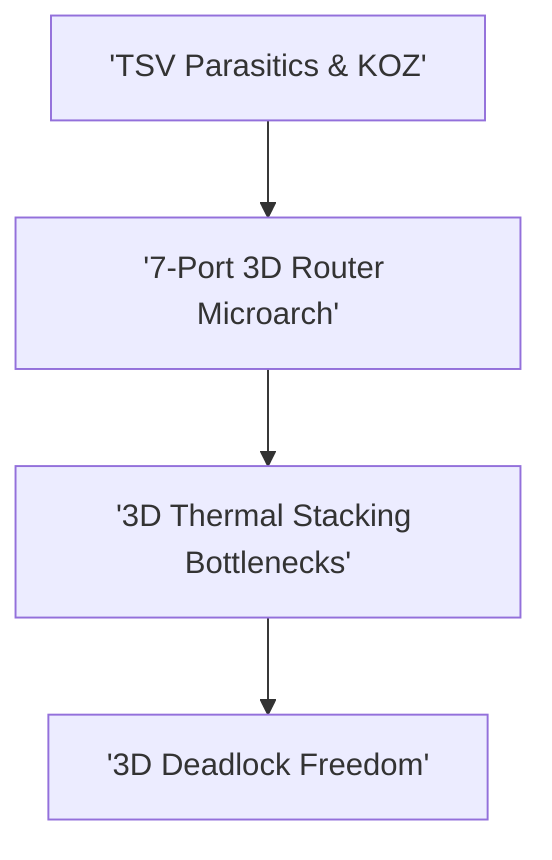

# Track 8: Three-Dimensional NoC (3D-NoC) & TSVs

  
Network Architecture • Module 08

  <h1>Three-Dimensional NoC (3D-NoC) & TSVs</h1>
  
Through-Silicon Vias (TSVs), Keep-Out Zones (KOZ), thermo-mechanical stress, 7-port 3D crossbars, vertical serialization, and 3D thermal stacking.

  

    ⏱️ 4 In-Depth Lessons
    🔬 Interactive Simulators &amp; Tools
    💻 Synthesizable Verilog RTL
    📜 Grounded in Official Monograph
  

  

    

      📚 Aligned with Chapter 8 of Official 12-Chapter Textbook
    

    

      Explore complete theoretical derivations, physical scaling parameters, and microarchitectural proofs in <strong>Chapter 8</strong>.
    

  

  <a href="../textbook/ch08-3d-noc-tsvs/" style="display: inline-flex; align-items: center; gap: 6px; background: #2563eb; color: #ffffff; padding: 8px 16px; border-radius: 6px; font-weight: 600; font-size: 0.85rem; text-decoration: none;">
    Read Chapter 8 in Textbook →
  </a>

---

## 🗺️ Architectural Learning Roadmap

The diagram below outlines how the core concepts in Track 8 connect across the physical and protocol layers:

---

## 📚 Syllabus & Lessons in Track 8

  

    

      Lesson 8.1
      
3D Integration & Through-Silicon Via (TSV) Physics

      
TSV aspect ratios, capacitive parasitics, microbump arrays, and vertical link scaling.

      

        ⚡ <strong>Features:</strong> TSV Parasitic & Delay Explorer
      

    

    <a href="01-3d-tsv-interconnects/" class="noc-track-link">Launch Lesson 8.1 →</a>
  

  

    

      Lesson 8.2
      
TSV Keep-Out Zones (KOZ) & Stress Fields

      
Thermo-mechanical mismatch (Cu vs Si), piezoresistive mobility shifts, and KOZ floorplanning.

      

        ⚡ <strong>Features:</strong> KOZ Stress Field Visualizer
      

    

    <a href="02-tsv-parasitics-koz/" class="noc-track-link">Launch Lesson 8.2 →</a>
  

  

    

      Lesson 8.3
      
3D Router Microarchitecture & 7-Port Crossbars

      
Up/Down vertical port allocation, asymmetric vertical serialization, and 3D arbiters.

      

        ⚡ <strong>Features:</strong> 7-Port 3D Router SystemVerilog RTL
      

    

    <a href="03-3d-router-microarchitecture/" class="noc-track-link">Launch Lesson 8.3 →</a>
  

  

    

      Lesson 8.4
      
3D Topologies, Thermal Stacking & Routing Deadlock

      
Vertical heat dissipation bottlenecks, true 3D deadlock models, and dimension-order extensions.

      

        ⚡ <strong>Features:</strong> TSV Titan 3D Architecture Lab
      

    

    <a href="04-3d-topologies-thermal-deadlock/" class="noc-track-link">Launch Lesson 8.4 →</a>
  

---

## 💻 Web EDA Unix Workbench Quick Launch

Simulate, verify, and inspect the synthesizable SystemVerilog implementations for Track 8 using our integrated in-browser terminal:

  guest@noc-lab:~$ run-sim --topo mesh4x4 --algo xy --inj 0.05 
  [SIM-EXEC] Progress: [========================================] 100% (Zero-load latency: 4.85 cyc)

👉 **[Launch Interactive Web EDA Unix Terminal &amp; Visualizer](../interactive/terminal/)**
