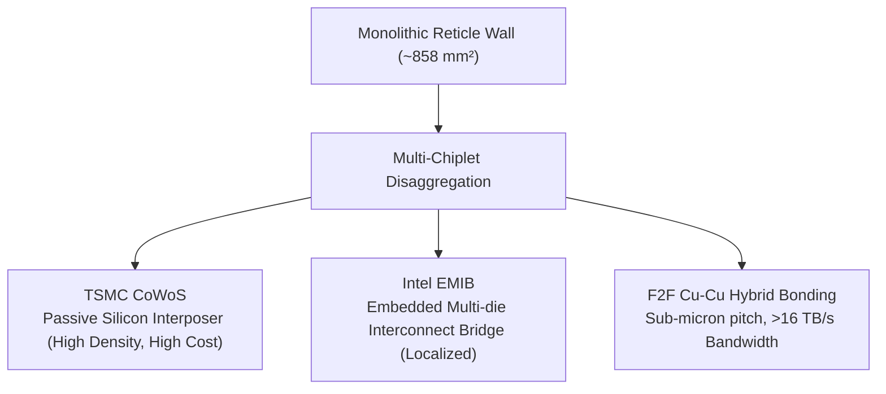

# Lesson 9.1: 2.5D Packaging Economics & Reticle Limits

  
Track 09 • Lesson 01

  <h1>Die Disaggregation, Negative Binomial Yield &amp; Packaging Technologies</h1>
  

    Understand the economic forces driving monolithic SoCs into multi-die chiplets, calculate silicon yield curves, and compare silicon interposers (CoWoS) with embedded organic bridges (EMIB).
  

---

## 1. The Reticle Limit & Yield Economics

Monolithic silicon dies are physically constrained by photolithography reticle limits ($pprox 858\text{ mm}^2$). Furthermore, random defect densities make large monolithic dies economically ruinous under the **Negative Binomial Yield Model**:

$$
Y = \left( 1 + \frac{D_0 A}{\alpha} \right)^{-\alpha}
$$

where $D_0$ is defect density, $A$ is die area, and $\alpha$ is the defect clustering parameter ($lpha \approx 1.5\text{--}2.0$). 

Disaggregating an $800\text{ mm}^2$ monolithic GPU into four $200\text{ mm}^2$ chiplets increases silicon die yield from $<30\%$ to $>85\%$, yielding substantial net manufacturing cost savings even after accounting for 2.5D packaging overhead.

---

## 2. Advanced Packaging Taxonomy

---

👉 **Next: [Lesson 9.2: UCIe Protocol Stack & D2D Physical Layer](02-chiplets-ucie-interconnects.md)**
