# 📚 Network-on-Chip Curriculum: 13 Comprehensive Tracks

  
✨ Official Comprehensive Syllabus • 13 Modules • 53 Lessons

  <h1>Network-on-Chip & Advanced Interconnects Curriculum</h1>
  

    A rigorous, university-grade curriculum mapping 1:1 to the 12 definitive textbook chapters of the official monograph, culminating in a full-scale Capstone System Synthesis challenge. Designed for undergraduate students, graduate researchers, and silicon computer architects.
  

  

    📖 12 Textbook Chapters
    🏆 13 Structured Tracks
    ⚡ 53 In-Depth Lessons
    💻 Synthesizable SystemVerilog RTL
  

  

    

      📘 Complete 1:1 Book &amp; Hardware Alignment
    

    

      Every track corresponds directly to an official textbook chapter. Each lesson provides theoretical derivations, synthesizable SystemVerilog cores verified against Nangate45 open-cell libraries, and interactive browser-based simulation workbenches.
    

  

  <a href="../textbook/" style="display: inline-flex; align-items: center; gap: 6px; background: #2563eb; color: #ffffff; padding: 10px 18px; border-radius: 8px; font-weight: 600; font-size: 0.85rem; text-decoration: none;">
    Explore Textbook (12 Chaps) →
  </a>

---

## 🗺️ Master Curriculum Architecture Roadmap

The 13 tracks form an end-to-end stack spanning nanoscale silicon physics to exascale collective accelerators:

```mermaid
graph TD
  subgraph Tier1["Tier 1: Physical & Data-Link Fundamentals"]
    T1["Track 1: Interconnect Crisis & Wire Physics<br/>(Elmore RC, Repeater Spacing)"]
    T2["Track 2: Switching, Flow Control & Buffers<br/>(Wormhole, Credit Loops, AXI)"]
    T1 --> T2
  end

  subgraph Tier2["Tier 2: Router Microarchitecture & Topologies"]
    T3["Track 3: Router Microarchitecture & Arbitration<br/>(5-Stage Pipeline, SMART Bypass)"]
    T4["Track 4: Direct, Indirect & High-Radix Topologies<br/>(Mesh, Torus, Dragonfly, Clos)"]
    T2 --> T3
    T3 --> T4
  end

  subgraph Tier3["Tier 3: Deadlock Theory & Physical Constraints"]
    T5["Track 5: Deadlock Theory & Adaptive Routing<br/>(Turn Models, CDG, Duato Escapes)"]
    T6["Track 6: Low-Power Architectures & Dark Silicon<br/>(VFIs, Power-Gating, L*di/dt)"]
    T7["Track 7: Thermal Modeling & Fault Tolerance<br/>(RC HotSpot, RCA, ML Hotspots)"]
    T4 --> T5
    T5 --> T6
    T6 --> T7
  end

  subgraph Tier4["Tier 4: Advanced Packaging & 3D Integration"]
    T8["Track 8: 3D-NoC & Through-Silicon Vias<br/>(TSV Parasitics, KOZ, 7-Port Crossbars)"]
    T9["Track 9: Multi-Chiplet Interconnects & UCIe<br/>(2.5D Yield, UCIe D2D, In/Outbound Swap)"]
    T7 --> T8
    T8 --> T9
  end

  subgraph Tier5["Tier 5: Emerging Frontiers & Capstone Synthesis"]
    T10["Track 10: Optical & Wireless Networks-on-Chip<br/>(MRRs, WRONoC, APC Loops, mmWave)"]
    T11["Track 11: Hardware Security & Trust in NoCs<br/>(Covert Channels, HeatSense EWMA, Quarantine)"]
    T12["Track 12: Domain-Specific NoCs for AI & LLMs<br/>(All-Reduce Reduction, Ruche, SNNs)"]
    T13["Track 13: Capstone System Synthesis<br/>(Intel SCC, Simba, 3D Optical, Zero-Trust MoE)"]
    T9 --> T10
    T10 --> T11
    T11 --> T12
    T12 --> T13
  end
```

---

## 📚 All 13 Curriculum Tracks

  

    

      Track 1 • Aligned with Chapter 1
      
Interconnect Crisis &amp; Wire Physics

      

        Why shared buses failed. Dennard scaling breakdown, wire aspect ratios, Elmore distributed RC delay modeling, Fuchs-Sondheimer scattering, and optimal repeater insertion.
      

      

        ⚡ 4 Lessons • Synthesizable Elmore Verilog • Interactive Wire Simulator
      

    

    <a href="../track1-interconnect-crisis/" class="noc-track-link">Explore Track 1 →</a>
  

  

    

      Track 2 • Aligned with Chapter 2
      
Switching, Flow Control &amp; Buffers

      

        Packets, flits, and phits. Store-and-Forward vs Virtual Cut-Through vs Wormhole switching, credit turnaround latency loops, Virtual Channel FIFO buffers, and AXI4/TileLink NI packetization.
      

      

        ⚡ 4 Lessons • Credit Counter RTL • Credit Commander Simulator
      

    

    <a href="../track2-switching-flow-control/" class="noc-track-link">Explore Track 2 →</a>
  

  

    

      Track 3 • Aligned with Chapter 3
      
Router Microarchitecture &amp; Arbitration

      

        Canonical 5-stage router pipelines (BW-RC-VA-SA-ST), Virtual Channel allocation, sub-200ps LRU matrix arbiters, wavefront scheduling, and SMART single-cycle multi-hop bypass routers.
      

      

        ⚡ 4 Lessons • 5-Stage SystemVerilog Router • Arbiter Arena Lab
      

    

    <a href="../track3-router-microarchitecture/" class="noc-track-link">Explore Track 3 →</a>
  

  

    

      Track 4 • Aligned with Chapter 4
      
Direct, Indirect &amp; High-Radix Topologies

      

        Direct (Mesh, Torus, Folded Torus), Indirect (Clos, Fat-Tree, cMesh), and High-Radix (Dragonfly, Flattened Butterfly). Mathematical derivations of $T_0$, $\Theta_{sat}$, and UGAL routing.
      

      

        ⚡ 4 Lessons • Topology Graph Metrics RTL • Interactive Topology Architect
      

    

    <a href="../track4-topologies-and-metrics/" class="noc-track-link">Explore Track 4 →</a>
  

  

    

      Track 5 • Aligned with Chapter 5
      
Deadlock Theory, Turn Models &amp; Routing

      

        Deterministic Dimension-Order Routing (DOR), Glass &amp; Ni's Turn Model, Chiu's Odd-Even algorithm, Duato's Escape Channels, CDG acyclic proofs, and Cache Coherence VNET isolation.
      

      

        ⚡ 4 Lessons • SMT CDG Verifier • Deadlock Buster Arcade Game
      

    

    <a href="../track5-routing-deadlock/" class="noc-track-link">Explore Track 5 →</a>
  

  

    

      Track 6 • Aligned with Chapter 6
      
Low-Power Architectures &amp; Dark Silicon

      

        Dark silicon physics, Thermal Design Power (TDP), multiple voltage/frequency domains (V/F islands), microarchitectural power gating, sleep state wakeups, and inductive $L\cdot di/dt$ emergencies.
      

      

        ⚡ 4 Lessons • Power Gating FSM RTL • Volt Vortex Simulator
      

    

    <a href="../track6-low-power-dark-silicon/" class="noc-track-link">Explore Track 6 →</a>
  

  

    

      Track 7 • Aligned with Chapter 7
      
Thermal Modeling &amp; Fault Tolerance

      

        Fourier heat diffusion, compact RC ladder models, Regional Congestion Awareness (RCA), source quenching, proactive ML hotspot forecasting, and sparse sensor reconstruction.
      

      

        ⚡ 4 Lessons • Thermal Deflection RTL • Hotspot Hero &amp; Fault Defender
      

    

    <a href="../track7-thermal-fault-tolerance/" class="noc-track-link">Explore Track 7 →</a>
  

  

    

      Track 8 • Aligned with Chapter 8
      
3D Networks-on-Chip (3D-NoC) &amp; TSVs

      

        Through-Silicon Vias (TSVs), Keep-Out Zones (KOZ), thermo-mechanical stress, 7-port 3D crossbars, vertical serialization, and 3D thermal stacking mitigation.
      

      

        ⚡ 4 Lessons • 7-Port 3D Crossbar RTL • TSV Titan Simulator
      

    

    <a href="../track8-3d-noc-tsvs/" class="noc-track-link">Explore Track 8 →</a>
  

  

    

      Track 9 • Aligned with Chapter 9
      
Multi-Chiplet Interconnects &amp; UCIe

      

        2.5D packaging economics, negative binomial yield, UCIe standard physical &amp; D2D adapter stacks, In/Outbound Swap deadlock recovery, and multi-chiplet bypassing.
      

      

        ⚡ 4 Lessons • In/Outbound Swap RTL • Chiplet Tycoon Lab
      

    

    <a href="../track9-chiplets-ucie/" class="noc-track-link">Explore Track 9 →</a>
  

  

    

      Track 10 • Aligned with Chapter 10
      
Optical &amp; Wireless Networks-on-Chip

      

        Silicon nanophotonic microring resonators (MRRs), wavelength-routed ONoCs (WRONoCs), laser power gating with APC loops, and on-chip mmWave/THz fabrics.
      

      

        ⚡ 4 Lessons • Photonic MRR Switch RTL • Photon Pilot &amp; Wireless Wave
      

    

    <a href="../track10-optical-wireless/" class="noc-track-link">Explore Track 10 →</a>
  

  

    

      Track 11 • Aligned with Chapter 11
      
Hardware Security &amp; Trust in NoCs

      

        On-chip threat models: eavesdropping, spoofing, and DoS. Timing, buffer, and thermal covert channels. HeatSense zero-multiplier EWMA thermal Trojan detection and silicon quarantine.
      

      

        ⚡ 4 Lessons • HeatSense EWMA Verilog • Silicon Sentinel Arcade
      

    

    <a href="../track11-security/" class="noc-track-link">Explore Track 11 →</a>
  

  

    

      Track 12 • Aligned with Chapter 12
      
Domain-Specific NoCs for AI &amp; LLMs

      

        Large Language Models &amp; Collective Communication (AllReduce, AllGather). In-Network Reduction Routers, ultra-dense wafer-scale Ruche fabrics, and SNN multicasting.
      

      

        ⚡ 4 Lessons • In-Network Reduction SystemVerilog • Transformer Titan Lab
      

    

    <a href="../track12-ai-llm-snn/" class="noc-track-link">Explore Track 12 →</a>
  

  

    

      Track 13 • Capstone Synthesis
      
Capstone: Landmark Systems &amp; MoE Synthesis

      

        Walkthroughs of seminal chips (Intel SCC 48-Core, NVIDIA Simba 36-Chiplet, 3D Optical NoC, In-Network TVLSI) culminating in the Grand Capstone: Zero-Trust Multi-Chiplet MoE Accelerator.
      

      

        ⚡ 5 Lessons • Full SystemVerilog SoC RTL • Web EDA Auto-Grader Verification
      

    

    <a href="../track13-capstone/" class="noc-track-link">Explore Capstone Track 13 →</a>
  

---

## 💻 Interactive Web EDA Unix Terminal

All 13 tracks are preloaded with SystemVerilog RTL modules and executable CLI simulation tools directly in your browser:

👉 **[Launch Interactive Web EDA Unix Terminal &amp; Visualizer](../interactive/terminal/)**
