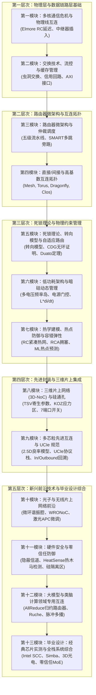

# 📚 系统化课程模块：全 13 大教学模块

  
✨ 官方完整课程大纲 • 全 13 大模块 • 53 节深度课时

  <h1>片上网络与先进互连系统全栈课程体系</h1>
  

    1:1 严格对齐官方专著全 12 大核心章节，并以全栈“毕业设计：零信任多芯粒 MoE 混合专家加速器综合”为终极实战。专为计算机体系结构方向本科生、硕博研究生及芯片研发工程师打造。
  

  

    📖 12 大核心教材章节
    🏆 13 大进阶学习模块
    ⚡ 53 节理论与实训课时
    💻 可综合 SystemVerilog RTL
  

  

    

      📘 理论与芯片物理实现 1:1 严格对齐
    

    

      每一个课程模块均直接映射至教材中的对应章节。每节课均包含严格的数学推导、Nangate45 验证的可综合 SystemVerilog 硬件内核，以及基于浏览器的免安装零服务器 EDA 仿真验证环境。
    

  

  <a href="../textbook/" style="display: inline-flex; align-items: center; gap: 6px; background: #2563eb; color: #ffffff; padding: 10px 18px; border-radius: 8px; font-weight: 600; font-size: 0.85rem; text-decoration: none;">
    阅读全十二章官方开源教材 →
  </a>

---

## 🗺️ 全课程体系结构全景图

全 13 大模块构筑了从底层微米/纳米导线物理到晶圆级大模型集合通信加速器的完整知识链条：

---

## 📚 全 13 大教学模块清单

  

    

      第一模块 • 对齐教材第一章
      
多核通信危机与物理线互连

      

        共享总线退役背后的物理根源。导线缩放效应、Elmore RC 延迟建模、最优中继器（Repeater）插入算法及片上能耗-延迟极限推导。
      

      

        ⚡ 4 节深度课时 • 可综合 Elmore Verilog • 导线物理仿真器
      

    

    <a href="../track1-interconnect-crisis/" class="noc-track-link">进入第一模块 →</a>
  

  

    

      第二模块 • 对齐教材第二章
      
交换技术、流控与缓存管理

      

        数据包（Packet）、微元（Flit）与物理单元（Phit）。存储转发、虚拟直通与虫洞交换（Wormhole）对比，信用（Credit）回路与 AXI 网络接口。
      

      

        ⚡ 4 节深度课时 • 信用计数器 RTL • 信用指挥官仿真器
      

    

    <a href="../track2-switching-flow-control/" class="noc-track-link">进入第二模块 →</a>
  

  

    

      第三模块 • 对齐教材第三章
      
路由器微架构与仲裁调度

      

        经典五级流水线路由器（BW-RC-VA-SA-ST）、虚通道（Virtual Channel）组织、亚 200ps 矩阵仲裁器与 SMART 单周期多跳旁路路由。
      

      

        ⚡ 4 节深度课时 • 五级流水线 SystemVerilog • 仲裁竞技场
      

    

    <a href="../track3-router-microarchitecture/" class="noc-track-link">进入第三模块 →</a>
  

  

    

      第四模块 • 对齐教材第四章
      
直接/间接与高基数互连拓扑

      

        直接拓扑（Mesh, Torus）、间接集中拓扑（Clos, Fat-Tree, cMesh）与高基数超算互连（Dragonfly, 扁平蝶式）。深入推导 $T_0$、$\Theta_{sat}$ 与 UGAL 路由。
      

      

        ⚡ 4 节深度课时 • 拓扑图指标 RTL • 交互式拓扑架构师
      

    

    <a href="../track4-topologies-and-metrics/" class="noc-track-link">进入第四模块 →</a>
  

  

    

      第五模块 • 对齐教材第五章
      
死锁理论、转向模型与自适应路由

      

        确定性 XY 路由、转向模型（西向优先、北向最后、奇偶路由）、杜阿托（Duato）逃逸信道定理、信道依赖图（CDG）证明与缓存一致性 VNET 隔离。
      

      

        ⚡ 4 节深度课时 • SMT CDG 形式化验证器 • 死锁大作战街机
      

    

    <a href="../track5-routing-deadlock/" class="noc-track-link">进入第五模块 →</a>
  

  

    

      第六模块 • 对齐教材第六章
      
低功耗架构与暗硅动态管理

      

        暗硅物理极限、热设计功耗（TDP）、多电压频率岛（V/F 岛）、路由器微架构电源门控、唤醒状态机与电感性 $L\cdot di/dt$ 电压突降防护。
      

      

        ⚡ 4 节深度课时 • 电源门控 FSM RTL • 电压旋涡仿真器
      

    

    <a href="../track6-low-power-dark-silicon/" class="noc-track-link">进入第六模块 →</a>
  

  

    

      第七模块 • 对齐教材第七章
      
热学建模、热点防御与容错弹性

      

        傅里叶热扩散定律、RC 紧凑热网、区域拥塞感知（RCA）、源端限流压制、机器学习热点预测与非高斯噪声下稀疏传感器重构。
      

      

        ⚡ 4 节深度课时 • 热偏斜 Verilog RTL • 硅温保卫战与故障防御
      

    

    <a href="../track7-thermal-fault-tolerance/" class="noc-track-link">进入第七模块 →</a>
  

  

    

      第八模块 • 对齐教材第八章
      
三维片上网络 (3D-NoC) 与硅通孔

      

        三维硅通孔（TSV）寄生参数、热机械应力禁放区（KOZ）、七端口 3D 交叉开关、垂直串行化传输与 3D 纵向热沉陷抑制技术。
      

      

        ⚡ 4 节深度课时 • 7端口三维交叉开关 RTL • TSV 泰坦仿真器
      

    

    <a href="../track8-3d-noc-tsvs/" class="noc-track-link">进入第八模块 →</a>
  

  

    

      第九模块 • 对齐教材第九章
      
多芯粒先进互连与 UCIe 规范

      

        2.5D 先进封装（CoWoS/EMIB）、负二项良率经济学、UCIe 标准物理与 D2D 适配层、跨芯粒 In/Outbound Swap 死锁回溯恢复与多芯粒旁路机制。
      

      

        ⚡ 4 节深度课时 • In/Outbound Swap RTL • 芯粒大亨实验室
      

    

    <a href="../track9-chiplets-ucie/" class="noc-track-link">进入第九模块 →</a>
  

  

    

      第十模块 • 对齐教材第十章
      
光子与无线片上网络前沿

      

        硅基纳米光子微环谐振腔（MRR）、波长路由光互连（WRONoC）、激光器电源门控与闭环 APC 热微调控、毫米波/太赫兹片上无线互连。
      

      

        ⚡ 4 节深度课时 • 光子微环开关 RTL • 光子领航员与无线电波
      

    

    <a href="../track10-optical-wireless/" class="noc-track-link">进入第十模块 →</a>
  

  

    

      第十一模块 • 对齐教材第十一章
      
硬件安全与零信任防御

      

        片上威胁模型：窃听、欺骗与拒绝服务（DoS）。时间、缓存与物理热隐蔽信道。HeatSense 无乘法器 EWMA 热木马实时检测与硬件隔离区技术。
      

      

        ⚡ 4 节深度课时 • HeatSense EWMA Verilog • 硅基哨兵街机
      

    

    <a href="../track11-security/" class="noc-track-link">进入第十一模块 →</a>
  

  

    

      第十二模块 • 对齐教材第十二章
      
大模型与类脑计算领域专用互连

      

        大语言模型集合通信（AllReduce, AllGather）通信模式。网内归约路由器、超密晶圆级（Wafer-Scale）Ruche 织网与类脑脉冲（SNN）多播网络。
      

      

        ⚡ 4 节深度课时 • 网内归约 SystemVerilog • 变形泰坦加速实验室
      

    

    <a href="../track12-ai-llm-snn/" class="noc-track-link">进入第十二模块 →</a>
  

  

    

      第十三模块 • 毕业设计
      
毕业设计：经典芯片实测与全栈系统综合

      

        精读经典芯片（英特尔 SCC 48核、英伟达 Simba 36芯粒、三维光互连、网内计算TVLSI），挑战终极毕业设计：零信任多芯粒 MoE 混合专家加速器全栈综合。
      

      

        ⚡ 5 节深度课时 • 完整 SystemVerilog SoC RTL • 网页 EDA 终端自动评分
      

    

    <a href="../track13-capstone/" class="noc-track-link">进入第十三模块毕业设计 →</a>
  

---

## 💻 网页端 EDA 仿真验证终端

全 13 大教学模块中配套的 SystemVerilog 硬件代码与测试激励，均可直接在网页内置的 Unix EDA 终端中一键编译与仿真验证：

👉 **[启动网页 EDA Unix 终端与交互式仿真器](../interactive/terminal/)**
